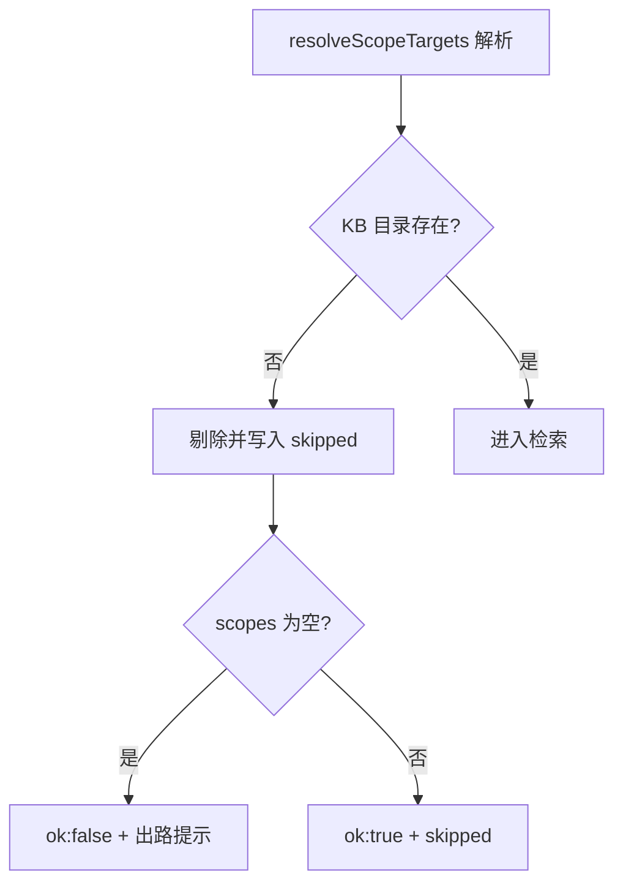

检索链路（CLI / MCP / Web / 对话 / recall / 事件参考文档）对不存在的库名曾静默返回 ok:true + 空数组，2026-11-27 修复（事件 #111）。
- 根因：resolveScopeTargets 单段只做字符集校验，default 模式任意名字都解析成功，使 executeSearchLocal 的 scopes.length===0 fail-loud 分支永不触发；下层 fullTextSearch 对不存在的库返回空数组
- 头号坑：hybrid 降级为全文时按 reason 前缀「无向量 Collection」整批清理 skipped，新增的跳过原因若撞该前缀会被自己删掉，修复即失效
- 修法：在 executeSearchLocal 入口按 scopeDirExists 过滤，**不放进 resolveScopeTargets**（那是 9 处复用的零 IO 纯函数）；单库剔除后落既有 ok:false 分支并附「ki view list」出路，多库只剔除 + skipped
- 判据用目录存在而非 listAllScopes：后者要求有 KB 关系数据，会误拒「已建库未导入」
- 位置：src/search.ts、src/lib/store.ts(scopeDirExists)
- 同族未修：ki doc list（src/doc.ts）、ki tag list（src/lib/tag-list-view.ts）仍静默

结论：判定点只有一个（检索入口），但单库与多库走不同出口——单库落到既有的 ok:false 分支即可，不必新写 fail-loud 逻辑。