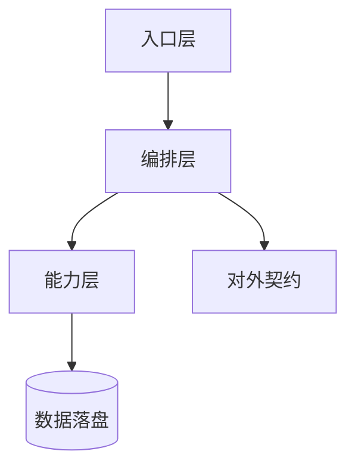

# 01-架构：AI 对话与追问专家

**本文引用的文件**
- [src/lib/chat/chat-routes.ts](file://src/lib/chat/chat-routes.ts)
- [src/lib/chat/chat-store.ts](file://src/lib/chat/chat-store.ts)
- [src/lib/chat/prompt-config.ts](file://src/lib/chat/prompt-config.ts)
- [src/lib/chat/ask/ask-runner.ts](file://src/lib/chat/ask/ask-runner.ts)
- [src/lib/chat/ask/ask-contract.ts](file://src/lib/chat/ask/ask-contract.ts)
- [src/lib/chat/retrieval/tool-loop.ts](file://src/lib/chat/retrieval/tool-loop.ts)
- [src/lib/chat/mcp-tool-registry.ts](file://src/lib/chat/mcp-tool-registry.ts)
- [src/lib/mcp-tools/ask.ts](file://src/lib/mcp-tools/ask.ts)

## 目录
1. [简介](#简介)
2. [架构分层](#架构分层)
3. [依赖关系](#依赖关系)
4. [分层示意](#分层示意)
5. [契约层与实现层索引](#契约层与实现层索引)
6. [关键发现 / 主要风险](#关键发现 / 主要风险)
7. [术语表](#术语表)

## 简介

提供 Web 端 SSE 流式对话、ki_ask 单库问答与追问的停止/接续，以及提示词配置与工具循环编排。。模块根：`src/lib/chat/ + src/lib/mcp-tools/ask.ts + test/chat/`。

章节来源：[src/lib/chat/chat-routes.ts](file://src/lib/chat/chat-routes.ts)（关键符号：`handleChatRoutes` / `writeSseStream` / `runAsk`）

## 架构分层

| 层 | 职责 | 主要文件 |
|---|---|---|
| 入口 | /api/chat/* 与 ki_ask | chat-routes.ts / mcp-tools/ask.ts |
| 编排 | 工具循环与追问执行器 | retrieval/tool-loop.ts / ask/ask-runner.ts |
| 能力 | 工具注册、提示词配置、图片解析 | mcp-tool-registry.ts / prompt-config.ts |
| 数据 | 会话目录与提示词配置 | chat-store.ts / prompt-config.ts |

章节来源：[src/lib/chat/chat-routes.ts](file://src/lib/chat/chat-routes.ts)（关键符号：`handleChatRoutes` / `writeSseStream` / `runAsk`）

## 依赖关系

- 强依赖「存储与配置基础专家」：loadConfig / scope 列表
- 强依赖「MCP 服务专家」：mcp-http-api.ts 挂载 handleChatRoutes，mcp-token 提供 Token 列表
- 与「回想内核专家」：ask 工具循环复用只读工具集与 llm-client 类型
- 与「可视化前端专家」划界：web/src/chat/ 不归本专家

章节来源：[src/lib/chat/chat-routes.ts](file://src/lib/chat/chat-routes.ts)（关键符号：`handleChatRoutes` / `writeSseStream` / `runAsk`）

## 分层示意

图表来源：src/lib/chat/chat-routes.ts（关键符号：handleChatRoutes, writeSseStream）

### 子专家划分

| 子专家 | 职责 | 边界 |
|---|---|---|
| 会话与追问子专家 | 会话 CRUD、SSE 流、归档压缩与追问停止/接续。 | src/lib/chat/chat-*.ts + src/lib/chat/ask/ + src/lib/chat/compaction.ts |
| 工具循环与技能子专家 | 对话侧工具集注册、工具循环、内置 skill 与响应投影。 | src/lib/chat/retrieval/ + src/lib/chat/mcp-tool-registry.ts + src/lib/chat/prompt-config.ts |

章节来源：[src/lib/chat/chat-routes.ts](file://src/lib/chat/chat-routes.ts)（关键符号：`handleChatRoutes` / `writeSseStream` / `runAsk`）

## 契约层与实现层索引

- 契约层：C0-使用总览
- 契约层：C1-能力契约
- 契约层：C2-使用流程
- 契约层：C4-数据流向与消费
- 契约层：C5-关键决策
- 实现层：01-架构
- 实现层：02-实现
- 实现层：03-数据流转
- 实现层：04-模型
- 实现层：05-接口
- 实现层：06-测试
- 实现层：07-运维

章节来源：[src/lib/chat/chat-routes.ts](file://src/lib/chat/chat-routes.ts)（关键符号：`handleChatRoutes` / `writeSseStream` / `runAsk`）

## 关键发现 / 主要风险

- SSE 一旦 writeHead 就不能改状态，异常必须转 error 帧
- 生效超时是 min(find.timeoutMs, recall.hardTimeoutMs)，只改一侧无效
- chatDir 必须由 chatRootDir() 推导，不得硬编码 ~/.ki

章节来源：[src/lib/chat/chat-routes.ts](file://src/lib/chat/chat-routes.ts)（关键符号：`handleChatRoutes` / `writeSseStream` / `runAsk`）

## 术语表

| 术语 | 含义 |
|---|---|
| rounds | 内层工具调用次数 |
| ASK_BUSY | 同一库已有问答在跑 |
| ka-*.json | ki_ask 短会话文件前缀 |
| context_id | 追问所依附的上下文 id |

章节来源：[src/lib/chat/chat-routes.ts](file://src/lib/chat/chat-routes.ts)（关键符号：`handleChatRoutes` / `writeSseStream` / `runAsk`）

---
出处行：更新日期 2026-11-25，资产基线 `0f1426b`（工作区另含 20 个未提交改动）。
