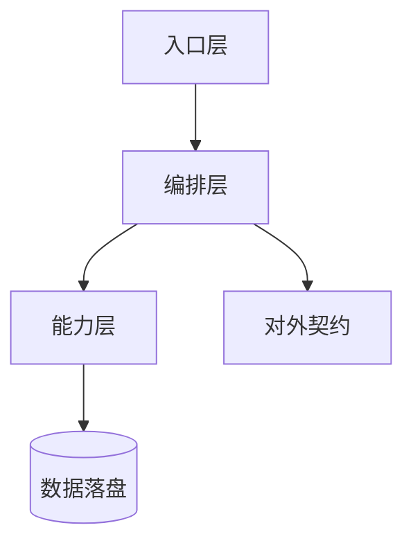

# 01-架构：会话与追问子专家

**本文引用的文件**
- [src/lib/chat/chat-routes.ts](file://src/lib/chat/chat-routes.ts)
- [src/lib/chat/chat-store.ts](file://src/lib/chat/chat-store.ts)
- [src/lib/chat/chat-contract.ts](file://src/lib/chat/chat-contract.ts)
- [src/lib/chat/ask/ask-runner.ts](file://src/lib/chat/ask/ask-runner.ts)
- [src/lib/chat/ask/ask-store.ts](file://src/lib/chat/ask/ask-store.ts)
- [src/lib/chat/compaction.ts](file://src/lib/chat/compaction.ts)

## 目录
1. [简介](#简介)
2. [架构分层](#架构分层)
3. [依赖关系](#依赖关系)
4. [分层示意](#分层示意)
5. [契约层与实现层索引](#契约层与实现层索引)
6. [关键发现 / 主要风险](#关键发现 / 主要风险)
7. [术语表](#术语表)

## 简介

会话 CRUD、SSE 流、归档压缩与追问停止/接续。。模块根：`src/lib/chat/chat-*.ts + src/lib/chat/ask/ + src/lib/chat/compaction.ts`。

章节来源：[src/lib/chat/chat-routes.ts](file://src/lib/chat/chat-routes.ts)（关键符号：`handleChatRoutes` / `createConversation` / `runAsk`）

## 架构分层

| 层 | 职责 | 主要文件 |
|---|---|---|
| 入口 | /api/chat/* | chat-routes.ts |
| 编排 | 问答执行器 | ask/ask-runner.ts |
| 数据 | 会话目录 | chat-store.ts |

章节来源：[src/lib/chat/chat-routes.ts](file://src/lib/chat/chat-routes.ts)（关键符号：`handleChatRoutes` / `createConversation` / `runAsk`）

## 依赖关系

- 依赖「存储与配置基础专家」的 loadConfig
- 依赖「MCP 服务专家」的路由挂载

章节来源：[src/lib/chat/chat-routes.ts](file://src/lib/chat/chat-routes.ts)（关键符号：`handleChatRoutes` / `createConversation` / `runAsk`）

## 分层示意

图表来源：src/lib/chat/chat-routes.ts（关键符号：handleChatRoutes, createConversation）

章节来源：[src/lib/chat/chat-routes.ts](file://src/lib/chat/chat-routes.ts)（关键符号：`handleChatRoutes` / `createConversation` / `runAsk`）

## 契约层与实现层索引

- 契约层：C0-使用总览
- 契约层：C1-能力契约
- 契约层：C4-数据流向与消费
- 实现层：01-架构
- 实现层：02-实现
- 实现层：06-测试

章节来源：[src/lib/chat/chat-routes.ts](file://src/lib/chat/chat-routes.ts)（关键符号：`handleChatRoutes` / `createConversation` / `runAsk`）

## 关键发现 / 主要风险

- SSE writeHead 后不可再改状态

章节来源：[src/lib/chat/chat-routes.ts](file://src/lib/chat/chat-routes.ts)（关键符号：`handleChatRoutes` / `createConversation` / `runAsk`）

## 术语表

| 术语 | 含义 |
|---|---|
| SSE | data: {...} 帧 |
| context_id | 追问上下文 id |

章节来源：[src/lib/chat/chat-routes.ts](file://src/lib/chat/chat-routes.ts)（关键符号：`handleChatRoutes` / `createConversation` / `runAsk`）

---
出处行：更新日期 2026-11-25，资产基线 `0f1426b`（工作区另含 20 个未提交改动）。
