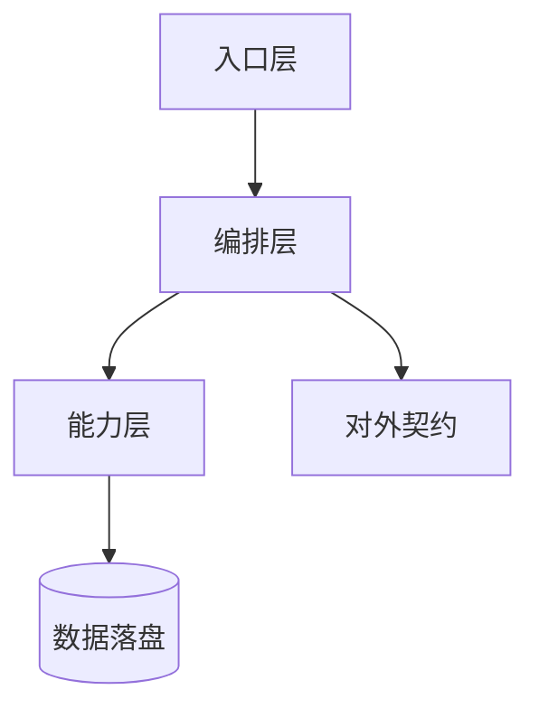

# 01-架构：工具循环与技能子专家

**本文引用的文件**
- [src/lib/chat/retrieval/tool-loop.ts](file://src/lib/chat/retrieval/tool-loop.ts)
- [src/lib/chat/retrieval/tool-response.ts](file://src/lib/chat/retrieval/tool-response.ts)
- [src/lib/chat/retrieval/replay.ts](file://src/lib/chat/retrieval/replay.ts)
- [src/lib/chat/mcp-tool-registry.ts](file://src/lib/chat/mcp-tool-registry.ts)
- [src/lib/chat/prompt-config.ts](file://src/lib/chat/prompt-config.ts)

## 目录
1. [简介](#简介)
2. [架构分层](#架构分层)
3. [依赖关系](#依赖关系)
4. [分层示意](#分层示意)
5. [契约层与实现层索引](#契约层与实现层索引)
6. [关键发现 / 主要风险](#关键发现 / 主要风险)
7. [术语表](#术语表)

## 简介

对话侧工具集注册、工具循环、内置 skill 与响应投影。。模块根：`src/lib/chat/retrieval/ + src/lib/chat/mcp-tool-registry.ts + src/lib/chat/prompt-config.ts`。

章节来源：[src/lib/chat/retrieval/tool-loop.ts](file://src/lib/chat/retrieval/tool-loop.ts)（关键符号：`runToolLoop` / `getChatTool` / `enabledChatToolEntries`）

## 架构分层

| 层 | 职责 | 主要文件 |
|---|---|---|
| 入口 | SSE 消息 | chat-routes.ts |
| 编排 | 工具循环 | retrieval/tool-loop.ts |
| 能力 | 工具注册表与技能 | mcp-tool-registry.ts / retrieval/*-skill.ts |

章节来源：[src/lib/chat/retrieval/tool-loop.ts](file://src/lib/chat/retrieval/tool-loop.ts)（关键符号：`runToolLoop` / `getChatTool` / `enabledChatToolEntries`）

## 依赖关系

- 依赖「检索与向量客户端专家」的只读工具
- 依赖「MCP 服务专家」的工具注册

章节来源：[src/lib/chat/retrieval/tool-loop.ts](file://src/lib/chat/retrieval/tool-loop.ts)（关键符号：`runToolLoop` / `getChatTool` / `enabledChatToolEntries`）

## 分层示意

图表来源：src/lib/chat/retrieval/tool-loop.ts（关键符号：runToolLoop, getChatTool）

章节来源：[src/lib/chat/retrieval/tool-loop.ts](file://src/lib/chat/retrieval/tool-loop.ts)（关键符号：`runToolLoop` / `getChatTool` / `enabledChatToolEntries`）

## 契约层与实现层索引

- 契约层：C0-使用总览
- 契约层：C1-能力契约
- 契约层：C4-数据流向与消费
- 实现层：01-架构
- 实现层：02-实现
- 实现层：06-测试

章节来源：[src/lib/chat/retrieval/tool-loop.ts](file://src/lib/chat/retrieval/tool-loop.ts)（关键符号：`runToolLoop` / `getChatTool` / `enabledChatToolEntries`）

## 关键发现 / 主要风险

- 内置 skill 移除后老配置要静默过滤

章节来源：[src/lib/chat/retrieval/tool-loop.ts](file://src/lib/chat/retrieval/tool-loop.ts)（关键符号：`runToolLoop` / `getChatTool` / `enabledChatToolEntries`）

## 术语表

| 术语 | 含义 |
|---|---|
| maxToolCalls | AI 查找工具调用次数 |
| skill | 内置在提示词里的操作手册 |

章节来源：[src/lib/chat/retrieval/tool-loop.ts](file://src/lib/chat/retrieval/tool-loop.ts)（关键符号：`runToolLoop` / `getChatTool` / `enabledChatToolEntries`）

---
出处行：更新日期 2026-11-25，资产基线 `0f1426b`（工作区另含 20 个未提交改动）。
