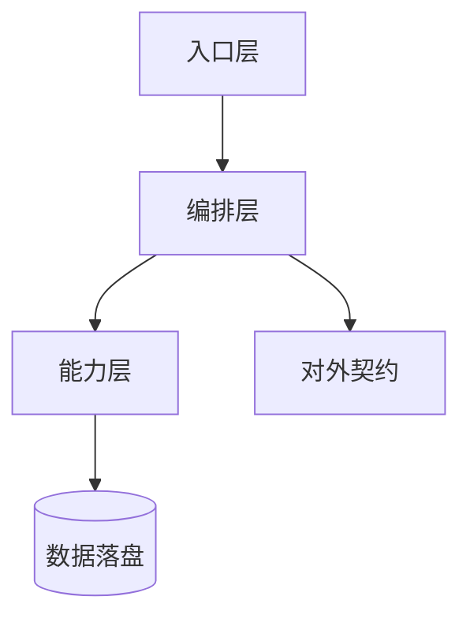

# 01-架构：事件治理专家

**本文引用的文件**
- [src/lib/governance-http.ts](file://src/lib/governance-http.ts)
- [src/lib/governance-errors.ts](file://src/lib/governance-errors.ts)
- [src/lib/governance-store.ts](file://src/lib/governance-store.ts)
- [src/lib/events/event-service.ts](file://src/lib/events/event-service.ts)
- [src/lib/events/event-detail.ts](file://src/lib/events/event-detail.ts)
- [src/lib/events/refs-service.ts](file://src/lib/events/refs-service.ts)
- [src/lib/events/refs-store.ts](file://src/lib/events/refs-store.ts)
- [src/lib/events/analysis-runner.ts](file://src/lib/events/analysis-runner.ts)
- [src/lib/events/stage-log.ts](file://src/lib/events/stage-log.ts)
- [src/lib/events/store.ts](file://src/lib/events/store.ts)
- [src/lib/mcp-tools/event-edit.ts](file://src/lib/mcp-tools/event-edit.ts)
- [src/event-types.ts](file://src/event-types.ts)

## 目录
1. [简介](#简介)
2. [架构分层](#架构分层)
3. [依赖关系](#依赖关系)
4. [分层示意](#分层示意)
5. [契约层与实现层索引](#契约层与实现层索引)
6. [关键发现 / 主要风险](#关键发现 / 主要风险)
7. [术语表](#术语表)

## 简介

管理事件的创建、阶段流转、AI 分析与追问、参考文档与回收站，并把这些能力同时暴露给 HTTP 治理路由与 MCP 事件工具。。模块根：`src/lib/governance-*.ts + src/lib/events/ + src/event-types.ts + src/lib/mcp-tools/event-*.ts`。

章节来源：[src/lib/governance-http.ts](file://src/lib/governance-http.ts)（关键符号：`handleGovernanceRoutes` / `createEvent` / `transitionEvent`）

## 架构分层

| 层 | 职责 | 主要文件 |
|---|---|---|
| 入口层 | /api/governance/* 与 6 个 MCP 事件工具 | src/lib/governance-http.ts / src/lib/mcp-tools/event-*.ts |
| 编排层 | 事件服务、分析执行器、追问执行器 | src/lib/events/event-service.ts / analysis-runner.ts / analysis-ask-runner.ts |
| 能力层 | 参考文档、阶段日志、候选查找、结论链 | src/lib/events/refs-service.ts / stage-log.ts / find-*.ts |
| 数据层 | 按 scope 隔离的 .events/ 与 governance.json | src/lib/events/store.ts / src/lib/governance-store.ts |

章节来源：[src/lib/governance-http.ts](file://src/lib/governance-http.ts)（关键符号：`handleGovernanceRoutes` / `createEvent` / `transitionEvent`）

## 依赖关系

- 强依赖「存储与配置基础专家」：readJson / writeJson / getKbDir / withScopeWriteLock
- 强依赖「知识索引导入专家」：ASSET_EXTENSIONS / validateUploadFile / deriveGroupPath
- 强依赖「MCP 服务专家」：mcp-http-api.ts 挂载治理路由，McpServer 注册事件工具
- 与「可视化前端专家」划界：web/src/pages/EventsPage.tsx 与 components/governance/ 不归本专家
- 与「关系与索引管理专家」：event-service.ts 引用 scoring.ts 的 Relation 类型

章节来源：[src/lib/governance-http.ts](file://src/lib/governance-http.ts)（关键符号：`handleGovernanceRoutes` / `createEvent` / `transitionEvent`）

## 分层示意

图表来源：src/lib/governance-http.ts（关键符号：handleGovernanceRoutes, createEvent）

### 子专家划分

| 子专家 | 职责 | 边界 |
|---|---|---|
| 事件与阶段子专家 | 事件主体 CRUD、阶段流转、详情聚合与事件类型。 | src/lib/events/{event-service,event-detail,event-view,store,stage-log,type-service,members}.ts + src/event-types.ts |
| AI 分析链路子专家 | 事件 AI 分析的启动、取消、工具循环、结论链与数据链路产物。 | src/lib/events/analysis-*.ts + find-*.ts + deep-find-core.ts + conclusion-chain.ts + analysis-fs-tools.ts |
| 参考文档与结论子专家 | 事件参考文档的增删查、AI 候选定位与追问结论补丁。 | src/lib/events/refs-*.ts + find-targets.ts + analysis-ask-*.ts + conclusion-chain.ts |

章节来源：[src/lib/governance-http.ts](file://src/lib/governance-http.ts)（关键符号：`handleGovernanceRoutes` / `createEvent` / `transitionEvent`）

## 契约层与实现层索引

- 契约层：C0-使用总览
- 契约层：C1-能力契约
- 契约层：C2-使用流程
- 契约层：C4-数据流向与消费
- 契约层：C5-关键决策
- 实现层：01-架构
- 实现层：02-实现
- 实现层：03-数据流转
- 实现层：04-模型
- 实现层：05-接口
- 实现层：06-测试
- 实现层：07-运维

章节来源：[src/lib/governance-http.ts](file://src/lib/governance-http.ts)（关键符号：`handleGovernanceRoutes` / `createEvent` / `transitionEvent`）

## 关键发现 / 主要风险

- 新增错误码必须同时落在 GOVERNANCE_CODE_NUMBERS 与 HTTP_STATUS，否则契约与状态漂移
- test/events 不在 npm run test:all 默认扫描范围，回归时容易漏跑
- 分析、追问、参考文档各写独立文件，跨文件一致性靠 withScopeWriteLock 与删除前复核保证
- SSE 分支任何非 GovernanceError 异常都可能触发 ERR_HTTP_HEADERS_SENT

章节来源：[src/lib/governance-http.ts](file://src/lib/governance-http.ts)（关键符号：`handleGovernanceRoutes` / `createEvent` / `transitionEvent`）

## 术语表

| 术语 | 含义 |
|---|---|
| shortId | 事件短编号，删除后不复用 |
| terminalAction | 终态动作 keep 或 trash，决定关联文档去向 |
| lastFind | 最近一次 AI 查找结论，存在 refs 文件里 |
| partial | 超时或停止但已有正文的分析状态 |

章节来源：[src/lib/governance-http.ts](file://src/lib/governance-http.ts)（关键符号：`handleGovernanceRoutes` / `createEvent` / `transitionEvent`）

---
出处行：更新日期 2026-11-25，资产基线 `0f1426b`（工作区另含 20 个未提交改动）。
