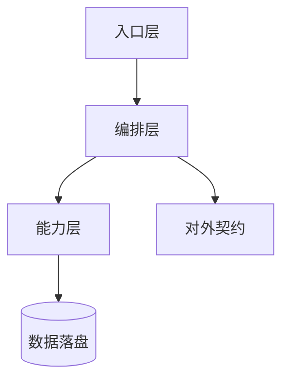

# 01-架构：AI 分析链路子专家

**本文引用的文件**
- [src/lib/events/analysis-runner.ts](file://src/lib/events/analysis-runner.ts)
- [src/lib/events/analysis-store.ts](file://src/lib/events/analysis-store.ts)
- [src/lib/events/deep-find-core.ts](file://src/lib/events/deep-find-core.ts)
- [src/lib/events/find-targets.ts](file://src/lib/events/find-targets.ts)
- [src/lib/events/conclusion-chain.ts](file://src/lib/events/conclusion-chain.ts)
- [src/lib/events/analysis-fs-tools.ts](file://src/lib/events/analysis-fs-tools.ts)

## 目录
1. [简介](#简介)
2. [架构分层](#架构分层)
3. [依赖关系](#依赖关系)
4. [分层示意](#分层示意)
5. [契约层与实现层索引](#契约层与实现层索引)
6. [关键发现 / 主要风险](#关键发现 / 主要风险)
7. [术语表](#术语表)

## 简介

事件 AI 分析的启动、取消、工具循环、结论链与数据链路产物。。模块根：`src/lib/events/analysis-*.ts + find-*.ts + deep-find-core.ts + conclusion-chain.ts + analysis-fs-tools.ts`。

章节来源：[src/lib/events/analysis-runner.ts](file://src/lib/events/analysis-runner.ts)（关键符号：`startEventAnalysis` / `isAnalysisActive` / `cancelEventAnalysis`）

## 架构分层

| 层 | 职责 | 主要文件 |
|---|---|---|
| 入口 | 治理路由 /analysis/* | governance-http.ts |
| 编排 | 分析执行器 | analysis-runner.ts |
| 能力 | AI 查找与结论链 | deep-find-core.ts / conclusion-chain.ts |
| 数据 | 独立分析文件 | analysis-store.ts |

章节来源：[src/lib/events/analysis-runner.ts](file://src/lib/events/analysis-runner.ts)（关键符号：`startEventAnalysis` / `isAnalysisActive` / `cancelEventAnalysis`）

## 依赖关系

- 依赖「回想内核专家」的多轮工具循环能力
- 依赖「MCP 服务专家」注入 authScopes

章节来源：[src/lib/events/analysis-runner.ts](file://src/lib/events/analysis-runner.ts)（关键符号：`startEventAnalysis` / `isAnalysisActive` / `cancelEventAnalysis`）

## 分层示意

图表来源：src/lib/events/analysis-runner.ts（关键符号：startEventAnalysis, isAnalysisActive）

章节来源：[src/lib/events/analysis-runner.ts](file://src/lib/events/analysis-runner.ts)（关键符号：`startEventAnalysis` / `isAnalysisActive` / `cancelEventAnalysis`）

## 契约层与实现层索引

- 契约层：C0-使用总览
- 契约层：C1-能力契约
- 契约层：C4-数据流向与消费
- 实现层：01-架构
- 实现层：02-实现
- 实现层：06-测试

章节来源：[src/lib/events/analysis-runner.ts](file://src/lib/events/analysis-runner.ts)（关键符号：`startEventAnalysis` / `isAnalysisActive` / `cancelEventAnalysis`）

## 关键发现 / 主要风险

- activeRuns 是进程内状态，服务重启后不落盘

章节来源：[src/lib/events/analysis-runner.ts](file://src/lib/events/analysis-runner.ts)（关键符号：`startEventAnalysis` / `isAnalysisActive` / `cancelEventAnalysis`）

## 术语表

| 术语 | 含义 |
|---|---|
| partial | 超时或停止但已有正文 |
| authScopes | 由 analyze / ask 注入的可用库集合 |

章节来源：[src/lib/events/analysis-runner.ts](file://src/lib/events/analysis-runner.ts)（关键符号：`startEventAnalysis` / `isAnalysisActive` / `cancelEventAnalysis`）

---
出处行：更新日期 2026-11-25，资产基线 `0f1426b`（工作区另含 20 个未提交改动）。
