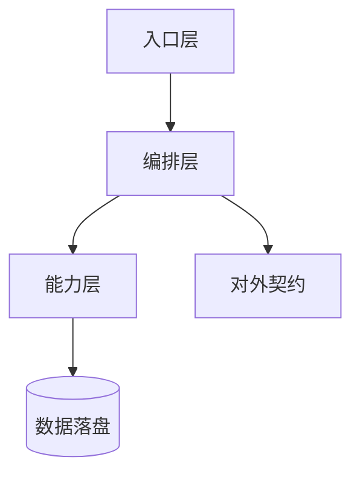

# 01-架构：事件与阶段子专家

**本文引用的文件**
- [src/lib/events/event-service.ts](file://src/lib/events/event-service.ts)
- [src/lib/events/event-detail.ts](file://src/lib/events/event-detail.ts)
- [src/lib/events/event-view.ts](file://src/lib/events/event-view.ts)
- [src/lib/events/store.ts](file://src/lib/events/store.ts)
- [src/lib/events/stage-log.ts](file://src/lib/events/stage-log.ts)
- [src/event-types.ts](file://src/event-types.ts)

## 目录
1. [简介](#简介)
2. [架构分层](#架构分层)
3. [依赖关系](#依赖关系)
4. [分层示意](#分层示意)
5. [契约层与实现层索引](#契约层与实现层索引)
6. [关键发现 / 主要风险](#关键发现 / 主要风险)
7. [术语表](#术语表)

## 简介

事件主体 CRUD、阶段流转、详情聚合与事件类型。。模块根：`src/lib/events/{event-service,event-detail,event-view,store,stage-log,type-service,members}.ts + src/event-types.ts`。

章节来源：[src/lib/events/event-service.ts](file://src/lib/events/event-service.ts)（关键符号：`createEvent` / `transitionEvent` / `getEventDetail`）

## 架构分层

| 层 | 职责 | 主要文件 |
|---|---|---|
| 入口 | MCP / HTTP 工具 | mcp-tools/event-edit.ts |
| 编排 | 事件服务 | event-service.ts |
| 数据 | 事件与阶段日志 | store.ts / stage-log.ts |

章节来源：[src/lib/events/event-service.ts](file://src/lib/events/event-service.ts)（关键符号：`createEvent` / `transitionEvent` / `getEventDetail`）

## 依赖关系

- 依赖「存储与配置基础专家」的 readJson / writeJson / withScopeWriteLock

章节来源：[src/lib/events/event-service.ts](file://src/lib/events/event-service.ts)（关键符号：`createEvent` / `transitionEvent` / `getEventDetail`）

## 分层示意

图表来源：src/lib/events/event-service.ts（关键符号：createEvent, transitionEvent）

章节来源：[src/lib/events/event-service.ts](file://src/lib/events/event-service.ts)（关键符号：`createEvent` / `transitionEvent` / `getEventDetail`）

## 契约层与实现层索引

- 契约层：C0-使用总览
- 契约层：C1-能力契约
- 契约层：C4-数据流向与消费
- 实现层：01-架构
- 实现层：02-实现
- 实现层：06-测试

章节来源：[src/lib/events/event-service.ts](file://src/lib/events/event-service.ts)（关键符号：`createEvent` / `transitionEvent` / `getEventDetail`）

## 关键发现 / 主要风险

- shortId 不复用是可追溯性约束，不能为了紧凑回收编号

章节来源：[src/lib/events/event-service.ts](file://src/lib/events/event-service.ts)（关键符号：`createEvent` / `transitionEvent` / `getEventDetail`）

## 术语表

| 术语 | 含义 |
|---|---|
| shortId | 事件短编号 |
| revision | 并发写修订号 |

章节来源：[src/lib/events/event-service.ts](file://src/lib/events/event-service.ts)（关键符号：`createEvent` / `transitionEvent` / `getEventDetail`）

---
出处行：更新日期 2026-11-25，资产基线 `0f1426b`（工作区另含 20 个未提交改动）。
