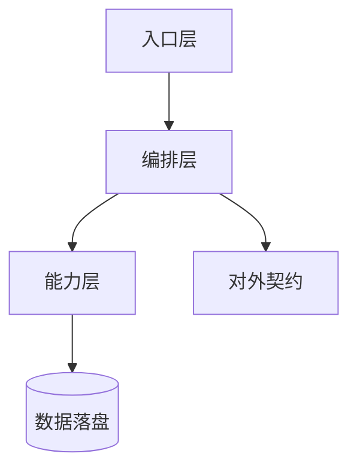

# 01-架构：参考文档与结论子专家

**本文引用的文件**
- [src/lib/events/refs-service.ts](file://src/lib/events/refs-service.ts)
- [src/lib/events/refs-store.ts](file://src/lib/events/refs-store.ts)
- [src/lib/events/refs-search.ts](file://src/lib/events/refs-search.ts)
- [src/lib/events/find-targets.ts](file://src/lib/events/find-targets.ts)
- [src/lib/events/analysis-ask-store.ts](file://src/lib/events/analysis-ask-store.ts)
- [src/lib/events/conclusion-chain.ts](file://src/lib/events/conclusion-chain.ts)

## 目录
1. [简介](#简介)
2. [架构分层](#架构分层)
3. [依赖关系](#依赖关系)
4. [分层示意](#分层示意)
5. [契约层与实现层索引](#契约层与实现层索引)
6. [关键发现 / 主要风险](#关键发现 / 主要风险)
7. [术语表](#术语表)

## 简介

事件参考文档的增删查、AI 候选定位与追问结论补丁。。模块根：`src/lib/events/refs-*.ts + find-targets.ts + analysis-ask-*.ts + conclusion-chain.ts`。

章节来源：[src/lib/events/refs-service.ts](file://src/lib/events/refs-service.ts)（关键符号：`listRefs` / `addRefs` / `searchRefCandidates`）

## 架构分层

| 层 | 职责 | 主要文件 |
|---|---|---|
| 入口 | MCP ki_event_edit action=references | mcp-tools/event-edit.ts |
| 编排 | 引用服务 | refs-service.ts |
| 数据 | 独立 refs 文件 | refs-store.ts |

章节来源：[src/lib/events/refs-service.ts](file://src/lib/events/refs-service.ts)（关键符号：`listRefs` / `addRefs` / `searchRefCandidates`）

## 依赖关系

- 依赖「知识索引导入专家」的附件校验策略
- 依赖「检索与向量客户端专家」的候选检索

章节来源：[src/lib/events/refs-service.ts](file://src/lib/events/refs-service.ts)（关键符号：`listRefs` / `addRefs` / `searchRefCandidates`）

## 分层示意

图表来源：src/lib/events/refs-service.ts（关键符号：listRefs, addRefs）

章节来源：[src/lib/events/refs-service.ts](file://src/lib/events/refs-service.ts)（关键符号：`listRefs` / `addRefs` / `searchRefCandidates`）

## 契约层与实现层索引

- 契约层：C0-使用总览
- 契约层：C1-能力契约
- 契约层：C4-数据流向与消费
- 实现层：01-架构
- 实现层：02-实现
- 实现层：06-测试

章节来源：[src/lib/events/refs-service.ts](file://src/lib/events/refs-service.ts)（关键符号：`listRefs` / `addRefs` / `searchRefCandidates`）

## 关键发现 / 主要风险

- REF_LIMIT=50 是硬上限，超限事件不创建

章节来源：[src/lib/events/refs-service.ts](file://src/lib/events/refs-service.ts)（关键符号：`listRefs` / `addRefs` / `searchRefCandidates`）

## 术语表

| 术语 | 含义 |
|---|---|
| sourceScope | 引用所属库，缺省按事件库归一 |
| lastFind | 最近一次 AI 查找结论 |

章节来源：[src/lib/events/refs-service.ts](file://src/lib/events/refs-service.ts)（关键符号：`listRefs` / `addRefs` / `searchRefCandidates`）

---
出处行：更新日期 2026-11-25，资产基线 `0f1426b`（工作区另含 20 个未提交改动）。
