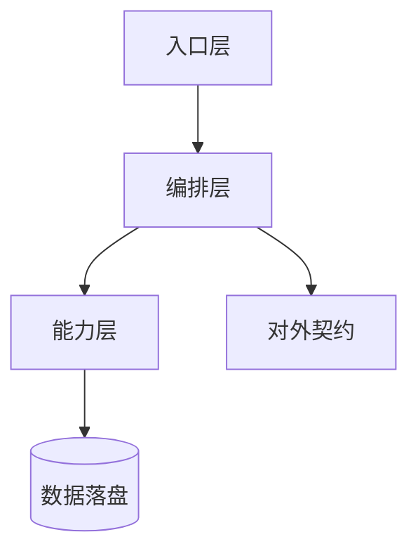

# 01-架构：回想内核专家

**本文引用的文件**
- [src/lib/recall/run-recall.ts](file://src/lib/recall/run-recall.ts)
- [src/lib/recall/fast-recall.ts](file://src/lib/recall/fast-recall.ts)
- [src/lib/recall/targets.ts](file://src/lib/recall/targets.ts)
- [src/lib/recall/limits.ts](file://src/lib/recall/limits.ts)
- [src/lib/recall/tool-runner.ts](file://src/lib/recall/tool-runner.ts)
- [src/lib/recall/assemble.ts](file://src/lib/recall/assemble.ts)
- [src/lib/recall/codes.ts](file://src/lib/recall/codes.ts)
- [src/lib/recall/log.ts](file://src/lib/recall/log.ts)
- [src/lib/recall/recall-prompt.ts](file://src/lib/recall/recall-prompt.ts)
- [src/lib/mcp-tools/recall.ts](file://src/lib/mcp-tools/recall.ts)

## 目录
1. [简介](#简介)
2. [架构分层](#架构分层)
3. [依赖关系](#依赖关系)
4. [分层示意](#分层示意)
5. [契约层与实现层索引](#契约层与实现层索引)
6. [关键发现 / 主要风险](#关键发现 / 主要风险)
7. [术语表](#术语表)

## 简介

ki_recall 的多轮带证据回想内核：范围解析与鉴权、快路径、工具循环预算、候选组装与审计。。模块根：`src/lib/recall/ + src/lib/mcp-tools/recall.ts + src/lib/mcp-tools/recall-kernel 相关测试`。

章节来源：[src/lib/recall/run-recall.ts](file://src/lib/recall/run-recall.ts)（关键符号：`runGroundedRecall` / `runFastRecall` / `resolveRecallTargets`）

## 架构分层

| 层 | 职责 | 主要文件 |
|---|---|---|
| 入口 | ki_recall 工具与 5 个只读工具进程内直调 | mcp-tools/recall.ts / tool-runner.ts |
| 编排 | 多轮内核与快路径 | run-recall.ts / fast-recall.ts |
| 能力 | 范围、预算、组装、错误码 | targets.ts / limits.ts / assemble.ts / codes.ts |
| 审计 | stderr 单行 JSON | log.ts |

章节来源：[src/lib/recall/run-recall.ts](file://src/lib/recall/run-recall.ts)（关键符号：`runGroundedRecall` / `runFastRecall` / `resolveRecallTargets`）

## 依赖关系

- 强依赖「检索与向量客户端专家」：只读工具调 ki_search / doc 工具
- 强依赖「MCP 服务专家」：authScopes 由 governance-http（analyze/ask）注入
- 与「AI 对话与追问专家」：共用 llm-client 类型与 find 域预算
- 与「可视化前端专家」划界：过程面板归前端

章节来源：[src/lib/recall/run-recall.ts](file://src/lib/recall/run-recall.ts)（关键符号：`runGroundedRecall` / `runFastRecall` / `resolveRecallTargets`）

## 分层示意

图表来源：src/lib/recall/run-recall.ts（关键符号：runGroundedRecall, runFastRecall）

章节来源：[src/lib/recall/run-recall.ts](file://src/lib/recall/run-recall.ts)（关键符号：`runGroundedRecall` / `runFastRecall` / `resolveRecallTargets`）

## 契约层与实现层索引

- 契约层：C0-使用总览
- 契约层：C1-能力契约
- 契约层：C2-使用流程
- 契约层：C4-数据流向与消费
- 契约层：C5-关键决策
- 实现层：01-架构
- 实现层：02-实现
- 实现层：03-数据流转
- 实现层：04-模型
- 实现层：05-接口
- 实现层：06-测试
- 实现层：07-运维

章节来源：[src/lib/recall/run-recall.ts](file://src/lib/recall/run-recall.ts)（关键符号：`runGroundedRecall` / `runFastRecall` / `resolveRecallTargets`）

## 关键发现 / 主要风险

- threshold 单库 0.02~0.03、视图 0.6~0.8，混用会全灭或全留
- 模型自选 scope 逐次鉴权失败必须报错，不回落到默认库
- 候选未真读正文就进结论会破坏可追溯性

章节来源：[src/lib/recall/run-recall.ts](file://src/lib/recall/run-recall.ts)（关键符号：`runGroundedRecall` / `runFastRecall` / `resolveRecallTargets`）

## 术语表

| 术语 | 含义 |
|---|---|
| targets | 用户可读的逻辑范围 |
| physicalTargets | 视图展开后的物理库 |
| rounds | 工具调用次数 |
| grounded | 带读正文证据的回想 |

章节来源：[src/lib/recall/run-recall.ts](file://src/lib/recall/run-recall.ts)（关键符号：`runGroundedRecall` / `runFastRecall` / `resolveRecallTargets`）

---
出处行：更新日期 2026-11-25，资产基线 `0f1426b`（工作区另含 20 个未提交改动）。
