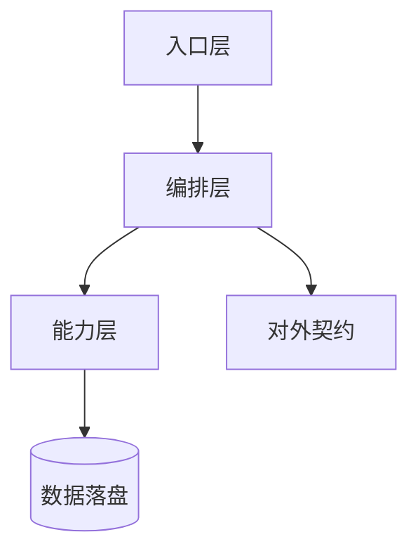

# 01-架构：开放接口与鉴权专家

**本文引用的文件**
- [src/lib/open-api/index.ts](file://src/lib/open-api/index.ts)
- [src/lib/open-api/auth.ts](file://src/lib/open-api/auth.ts)
- [src/lib/open-api/constants.ts](file://src/lib/open-api/constants.ts)
- [src/lib/open-api/upload-stream.ts](file://src/lib/open-api/upload-stream.ts)
- [src/lib/open-api/routes/ping.ts](file://src/lib/open-api/routes/ping.ts)
- [src/lib/auth/capabilities.ts](file://src/lib/auth/capabilities.ts)
- [src/lib/auth/route-permissions.ts](file://src/lib/auth/route-permissions.ts)
- [src/lib/auth/tool-permissions.ts](file://src/lib/auth/tool-permissions.ts)
- [src/lib/web-auth.ts](file://src/lib/web-auth.ts)
- [src/user.ts](file://src/user.ts)

## 目录
1. [简介](#简介)
2. [架构分层](#架构分层)
3. [依赖关系](#依赖关系)
4. [分层示意](#分层示意)
5. [契约层与实现层索引](#契约层与实现层索引)
6. [关键发现 / 主要风险](#关键发现 / 主要风险)
7. [术语表](#术语表)

## 简介

对外 /open/v1/* 通道：能力位协商、Bearer 鉴权、只读取件、上传暂存与图集包部署，并管理用户/角色与路由权限。。模块根：`src/lib/open-api/ + src/lib/auth/ + src/lib/web-*.ts + src/user.ts`。

章节来源：[src/lib/open-api/index.ts](file://src/lib/open-api/index.ts)（关键符号：`handleOpenApiRequest` / `resolveOpenApiPrincipal` / `createUploadSession`）

## 架构分层

| 层 | 职责 | 主要文件 |
|---|---|---|
| 入口 | /open/v1/* 与能力位开关 | open-api/index.ts / constants.ts |
| 鉴权 | Bearer 主体与路由/工具权限 | open-api/auth.ts / auth/*.ts |
| 路由 | ping / doc / asset / events / import upload / atlas | open-api/routes/ |
| 数据 | 上传暂存目录 | upload-stream.ts |

章节来源：[src/lib/open-api/index.ts](file://src/lib/open-api/index.ts)（关键符号：`handleOpenApiRequest` / `resolveOpenApiPrincipal` / `createUploadSession`）

## 依赖关系

- 强依赖「MCP 服务专家」：TokenAuth 由 mcp-http.ts 注入，mcp-token.ts 提供 resolveTokenAuth
- 强依赖「知识索引导入专家」：上传暂存后交 handleDirectImport
- 与「知识资产治理专家」：atlas package 端点调用 installPackage
- 与「远端客户端专家」：HTTP 契约耦合，无代码 import

章节来源：[src/lib/open-api/index.ts](file://src/lib/open-api/index.ts)（关键符号：`handleOpenApiRequest` / `resolveOpenApiPrincipal` / `createUploadSession`）

## 分层示意

图表来源：src/lib/open-api/index.ts（关键符号：handleOpenApiRequest, resolveOpenApiPrincipal）

章节来源：[src/lib/open-api/index.ts](file://src/lib/open-api/index.ts)（关键符号：`handleOpenApiRequest` / `resolveOpenApiPrincipal` / `createUploadSession`）

## 契约层与实现层索引

- 契约层：C0-使用总览
- 契约层：C1-能力契约
- 契约层：C2-使用流程
- 契约层：C4-数据流向与消费
- 契约层：C5-关键决策
- 实现层：01-架构
- 实现层：02-实现
- 实现层：03-数据流转
- 实现层：04-模型
- 实现层：05-接口
- 实现层：06-测试
- 实现层：07-运维

章节来源：[src/lib/open-api/index.ts](file://src/lib/open-api/index.ts)（关键符号：`handleOpenApiRequest` / `resolveOpenApiPrincipal` / `createUploadSession`）

## 关键发现 / 主要风险

- 能力位字段缺失时客户端必须视为 0，不能按 undefined 继续尝试
- downloadApi=false 时 doc/asset 端点 404，Web 侧不受影响
- ATLAS 上传包上限同时受服务端 20MB 与客户端分批影响

章节来源：[src/lib/open-api/index.ts](file://src/lib/open-api/index.ts)（关键符号：`handleOpenApiRequest` / `resolveOpenApiPrincipal` / `createUploadSession`）

## 术语表

| 术语 | 含义 |
|---|---|
| contractVersion | 对外契约版本 |
| capabilities | 服务端能力位集合 |
| uploadApi/downloadApi | 上传/取件开关位 |
| DAEMON_DRIFT | daemon 与当前代码版本不一致 |

章节来源：[src/lib/open-api/index.ts](file://src/lib/open-api/index.ts)（关键符号：`handleOpenApiRequest` / `resolveOpenApiPrincipal` / `createUploadSession`）

---
出处行：更新日期 2026-11-25，资产基线 `0f1426b`（工作区另含 20 个未提交改动）。
