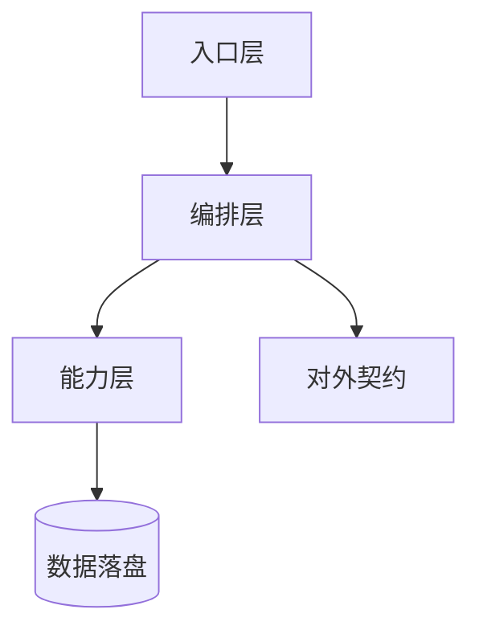

# 01-架构：数据源同步专家

**本文引用的文件**
- [src/lib/datasource.ts](file://src/lib/datasource.ts)
- [src/lib/datasource-scheduler.ts](file://src/lib/datasource-scheduler.ts)
- [src/lib/datasource-scheduled-run.ts](file://src/lib/datasource-scheduled-run.ts)
- [src/lib/datasource-git.ts](file://src/lib/datasource-git.ts)
- [src/lib/datasource-clone.ts](file://src/lib/datasource-clone.ts)
- [src/lib/datasource-sync-merge.ts](file://src/lib/datasource-sync-merge.ts)
- [src/lib/datasource-prune.ts](file://src/lib/datasource-prune.ts)
- [src/lib/datasource-mappings.ts](file://src/lib/datasource-mappings.ts)
- [src/datasource.ts](file://src/datasource.ts)

## 目录
1. [简介](#简介)
2. [架构分层](#架构分层)
3. [依赖关系](#依赖关系)
4. [分层示意](#分层示意)
5. [契约层与实现层索引](#契约层与实现层索引)
6. [关键发现 / 主要风险](#关键发现 / 主要风险)
7. [术语表](#术语表)

## 简介

登记本地目录 / Git 远端数据源，维护托管 clone，按计划同步并经既有导入链路落库，同时算出裁剪候选而不直接删除。。模块根：`src/lib/datasource*.ts + src/datasource.ts`。

章节来源：[src/lib/datasource.ts](file://src/lib/datasource.ts)（关键符号：`addDataSource` / `syncDataSource` / `startDataSourceScheduler`）

## 架构分层

| 层 | 职责 | 主要文件 |
|---|---|---|
| 入口 | CLI ki datasource / HTTP /api/datasource/* | src/datasource.ts / mcp-http-api.ts |
| 编排 | 数据源服务与调度器 | datasource.ts / datasource-scheduler.ts |
| 能力 | Git、克隆、映射、同步合并与裁剪 | datasource-git.ts / -clone.ts / -mappings.ts / -sync-merge.ts / -prune.ts |
| 数据 | datasource.json 与托管 clone 目录 | datasource-clone.ts |

章节来源：[src/lib/datasource.ts](file://src/lib/datasource.ts)（关键符号：`addDataSource` / `syncDataSource` / `startDataSourceScheduler`）

## 依赖关系

- 强依赖「知识索引导入专家」：复用 importAndPersist 与 import-prune 的 computePruneToken
- 强依赖「MCP 服务专家」：callDaemon / cancelDaemonJob / createTaskReporter / HTTP 路由挂载
- 强依赖「存储与配置基础专家」：config / scope / vector-client 的 closeEngine
- 与「可视化前端专家」划界：DataSourcePage.tsx 与 Datasource* 组件不归本专家

章节来源：[src/lib/datasource.ts](file://src/lib/datasource.ts)（关键符号：`addDataSource` / `syncDataSource` / `startDataSourceScheduler`）

## 分层示意

图表来源：src/lib/datasource.ts（关键符号：addDataSource, syncDataSource）

章节来源：[src/lib/datasource.ts](file://src/lib/datasource.ts)（关键符号：`addDataSource` / `syncDataSource` / `startDataSourceScheduler`）

## 契约层与实现层索引

- 契约层：C0-使用总览
- 契约层：C1-能力契约
- 契约层：C2-使用流程
- 契约层：C4-数据流向与消费
- 契约层：C5-关键决策
- 实现层：01-架构
- 实现层：02-实现
- 实现层：03-数据流转
- 实现层：04-模型
- 实现层：05-接口
- 实现层：06-测试
- 实现层：07-运维

章节来源：[src/lib/datasource.ts](file://src/lib/datasource.ts)（关键符号：`addDataSource` / `syncDataSource` / `startDataSourceScheduler`）

## 关键发现 / 主要风险

- 调度器只在 daemon 的 HTTP 分支末尾启动，stdio 模式没有定时同步
- Web 端删除动作若绕过候选确认会造成知识丢失
- clone 根目录受 KI_DATASOURCE_CLONE_ROOT 影响，换环境要复核路径

章节来源：[src/lib/datasource.ts](file://src/lib/datasource.ts)（关键符号：`addDataSource` / `syncDataSource` / `startDataSourceScheduler`）

## 术语表

| 术语 | 含义 |
|---|---|
| 待删候选 | 同步算出的可删条目，需人工确认 |
| staleWarning | fetch 失败后本地副本可能过期的提示 |
| managedScopeDir | 按 scope 隔离的托管克隆目录 |

章节来源：[src/lib/datasource.ts](file://src/lib/datasource.ts)（关键符号：`addDataSource` / `syncDataSource` / `startDataSourceScheduler`）

---
出处行：更新日期 2026-11-25，资产基线 `0f1426b`（工作区另含 20 个未提交改动）。
