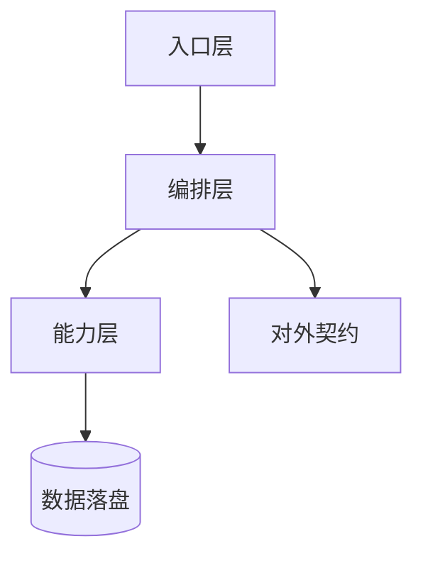

# 01-架构：知识资产治理专家

**本文引用的文件**
- [src/lib/trash-service.ts](file://src/lib/trash-service.ts)
- [src/lib/trash-store.ts](file://src/lib/trash-store.ts)
- [src/lib/scope-view.ts](file://src/lib/scope-view.ts)
- [src/lib/views-api.ts](file://src/lib/views-api.ts)
- [src/lib/view-dimension-state.ts](file://src/lib/view-dimension-state.ts)
- [src/lib/view-member-meta.ts](file://src/lib/view-member-meta.ts)
- [src/lib/atlas/package.ts](file://src/lib/atlas/package.ts)
- [src/lib/atlas/paths.ts](file://src/lib/atlas/paths.ts)
- [src/lib/atlas/errors.ts](file://src/lib/atlas/errors.ts)
- [src/atlas.ts](file://src/atlas.ts)
- [src/view.ts](file://src/view.ts)

## 目录
1. [简介](#简介)
2. [架构分层](#架构分层)
3. [依赖关系](#依赖关系)
4. [分层示意](#分层示意)
5. [契约层与实现层索引](#契约层与实现层索引)
6. [关键发现 / 主要风险](#关键发现 / 主要风险)
7. [术语表](#术语表)

## 简介

回收站、知识视图（多库聚合）与图集包（整包上传 + 只读页）三块知识资产治理能力。。模块根：`src/lib/trash-*.ts + src/lib/*view*.ts + src/lib/atlas/ + src/{view,atlas}.ts`。

章节来源：[src/lib/trash-service.ts](file://src/lib/trash-service.ts)（关键符号：`moveToTrash` / `restoreFromTrash` / `purgeExpired`）

## 架构分层

| 层 | 职责 | 主要文件 |
|---|---|---|
| 入口 | /api/governance/trash、/api/views*、/api/atlas/*、CLI | trash-service.ts / views-api.ts / src/atlas.ts / src/view.ts |
| 编排 | 视图、回收站、图集包各自服务层 | scope-view.ts / trash-store.ts / atlas/package.ts |
| 数据 | 点号前缀目录与 views.json | atlas/paths.ts / trash-store.ts / scope-view.ts |

章节来源：[src/lib/trash-service.ts](file://src/lib/trash-service.ts)（关键符号：`moveToTrash` / `restoreFromTrash` / `purgeExpired`）

## 依赖关系

- 强依赖「存储与配置基础专家」：readJson / writeJson / scope 路径
- 强依赖「MCP 服务专家」：views-api.ts 读 listTokens、mcp-http-api.ts 挂路由
- 与「开放接口与鉴权专家」：/open/v1/atlas/* 复用 installPackage
- 与「检索与向量客户端专家」：views-api.ts 调 vectorListScopes

章节来源：[src/lib/trash-service.ts](file://src/lib/trash-service.ts)（关键符号：`moveToTrash` / `restoreFromTrash` / `purgeExpired`）

## 分层示意

图表来源：src/lib/trash-service.ts（关键符号：moveToTrash, restoreFromTrash）

章节来源：[src/lib/trash-service.ts](file://src/lib/trash-service.ts)（关键符号：`moveToTrash` / `restoreFromTrash` / `purgeExpired`）

## 契约层与实现层索引

- 契约层：C0-使用总览
- 契约层：C1-能力契约
- 契约层：C2-使用流程
- 契约层：C4-数据流向与消费
- 契约层：C5-关键决策
- 实现层：01-架构
- 实现层：02-实现
- 实现层：03-数据流转
- 实现层：04-模型
- 实现层：05-接口
- 实现层：06-测试
- 实现层：07-运维

章节来源：[src/lib/trash-service.ts](file://src/lib/trash-service.ts)（关键符号：`moveToTrash` / `restoreFromTrash` / `purgeExpired`）

## 关键发现 / 主要风险

- ATLAS_CODES 1401–1407 与治理 S-05 参考文档段数值重叠，靠 ATLAS_ 前缀与 extra.atlasCode 区分
- 图集包必须 baked:true 且无外链，否则产品 /atlas 页拒装
- 回收站空正文恢复 fail-closed，不能靠 sizeBytes 判断有无内容

章节来源：[src/lib/trash-service.ts](file://src/lib/trash-service.ts)（关键符号：`moveToTrash` / `restoreFromTrash` / `purgeExpired`）

## 术语表

| 术语 | 含义 |
|---|---|
| hasContent | 按 content.md 头部判断回收站条目是否有正文 |
| baked | 单文件分发版标记，运行时不读外部配置 |
| views.json | 知识视图定义文件 |

章节来源：[src/lib/trash-service.ts](file://src/lib/trash-service.ts)（关键符号：`moveToTrash` / `restoreFromTrash` / `purgeExpired`）

---
出处行：更新日期 2026-11-25，资产基线 `0f1426b`（工作区另含 20 个未提交改动）。
