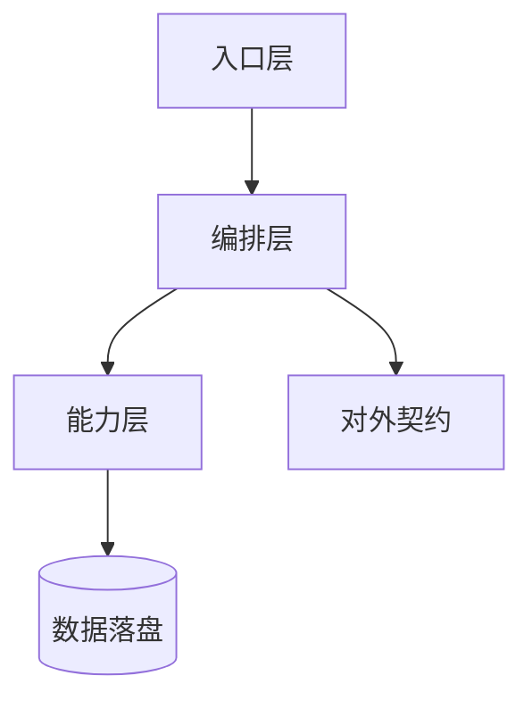

# 01-架构：远端客户端专家

**本文引用的文件**
- [ki-client/src/cli.ts](file://ki-client/src/cli.ts)
- [ki-client/src/args.ts](file://ki-client/src/args.ts)
- [ki-client/src/config.ts](file://ki-client/src/config.ts)
- [ki-client/src/remote.ts](file://ki-client/src/remote.ts)
- [ki-client/src/http.ts](file://ki-client/src/http.ts)
- [ki-client/src/errors.ts](file://ki-client/src/errors.ts)
- [ki-client/src/commands/upload.ts](file://ki-client/src/commands/upload.ts)
- [ki-client/src/commands/atlas.ts](file://ki-client/src/commands/atlas.ts)
- [ki-client/src/lib/tar.ts](file://ki-client/src/lib/tar.ts)
- [ki-client/src/lib/state.ts](file://ki-client/src/lib/state.ts)
- [ki-client/package.json](file://ki-client/package.json)

## 目录
1. [简介](#简介)
2. [架构分层](#架构分层)
3. [依赖关系](#依赖关系)
4. [分层示意](#分层示意)
5. [契约层与实现层索引](#契约层与实现层索引)
6. [关键发现 / 主要风险](#关键发现 / 主要风险)
7. [术语表](#术语表)

## 简介

独立子包 ki-client：远端登记、能力协商、只读取件、分片/整包上传与文件级增量状态。。模块根：`ki-client/src/ + ki-client/test/ + ki-client/package.json`。

章节来源：[ki-client/src/cli.ts](file://ki-client/src/cli.ts)（关键符号：`parseArgs` / `resolveRemote` / `postMultipart`）

## 架构分层

| 层 | 职责 | 主要文件 |
|---|---|---|
| 入口 | CLI 命令族 | cli.ts / args.ts |
| 配置与远端 | config / remote / errors | config.ts / remote.ts / errors.ts |
| 协议 | HTTP 与能力协商 | http.ts |
| 命令 | doc / asset / upload / atlas / ping / status | commands/ |
| 工具 | tar 打包与增量状态 | lib/tar.ts / lib/state.ts |

章节来源：[ki-client/src/cli.ts](file://ki-client/src/cli.ts)（关键符号：`parseArgs` / `resolveRemote` / `postMultipart`）

## 依赖关系

- 与「开放接口与鉴权专家」是 HTTP 契约耦合（/open/v1/*），无任何代码 import
- 与「MCP 服务专家」间接耦合：端点由 mcp-http.ts 挂载
- 不依赖主仓 src/：cli.ts 只 import 自有模块与 node:fs

章节来源：[ki-client/src/cli.ts](file://ki-client/src/cli.ts)（关键符号：`parseArgs` / `resolveRemote` / `postMultipart`）

## 分层示意

图表来源：ki-client/src/cli.ts（关键符号：parseArgs, resolveRemote）

章节来源：[ki-client/src/cli.ts](file://ki-client/src/cli.ts)（关键符号：`parseArgs` / `resolveRemote` / `postMultipart`）

## 契约层与实现层索引

- 契约层：C0-使用总览
- 契约层：C1-能力契约
- 契约层：C2-使用流程
- 契约层：C4-数据流向与消费
- 契约层：C5-关键决策
- 实现层：01-架构
- 实现层：02-实现
- 实现层：03-数据流转
- 实现层：04-模型
- 实现层：05-接口
- 实现层：06-测试
- 实现层：07-运维

章节来源：[ki-client/src/cli.ts](file://ki-client/src/cli.ts)（关键符号：`parseArgs` / `resolveRemote` / `postMultipart`）

## 关键发现 / 主要风险

- 主仓 TS 7.x 与本包 TS 5.6 不同，勿用主仓 tsconfig 编译本包
- 服务端 downloadApi=false 时 doc/asset 端点 404
- 失败批不落状态是幂等保证，不能为了让状态好看而提前写

章节来源：[ki-client/src/cli.ts](file://ki-client/src/cli.ts)（关键符号：`parseArgs` / `resolveRemote` / `postMultipart`）

## 术语表

| 术语 | 含义 |
|---|---|
| contractVersion | 服务端契约版本 |
| capabilities | 决定命令可用性的能力位 |
| 文件级增量 | 按 sha256 跳过未变更文件 |

章节来源：[ki-client/src/cli.ts](file://ki-client/src/cli.ts)（关键符号：`parseArgs` / `resolveRemote` / `postMultipart`）

---
出处行：更新日期 2026-11-25，资产基线 `0f1426b`（工作区另含 20 个未提交改动）。
