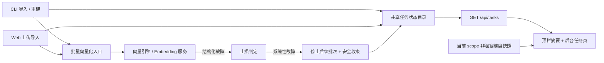

# 简版实现方案：向量化止损、全局告警与后台任务

> 本文是方向级设计，供先看懂整体做法；接口字段、失败阈值和迁移细节在实施前细化。输入为上一级 `requirement.md` R1–R10 与本目录 `ui-design.md`。默认本机单用户/低并发，CLI、daemon 和 Web 服务使用同一份配置与数据目录；跨机器任务聚合不在本期范围。

## 1. 总体做法



核心是两条线并行：**批量写入链识别系统性向量故障并停止**；**纳入本需求的长任务写入同一个可发现的状态源**。页面顶部只呈现摘要与当前 scope 的维度告警，详细任务进度放在“后台任务”页。

## 2. 向量故障如何停止

1. 错误类别须贯通 `embedding/provider → batch-scheduler → src/zvec-engine/engine.ts → src/lib/vector-client.ts → 调用方`。现在 provider 的 HTTP 状态/重试属性在引擎层被压成 `EMBEDDING_FAILED`，`vectorBulkStore` 又只返回错误字符串，无法可靠判定系统故障。新结果至少区分：维度/配置/鉴权错误、重试耗尽的 provider 不可用、集合不可写、单条内容错误、用户取消；不能只匹配错误文案。
2. 止损判定首先作用于 `src/zvec-engine/embedding/batch-scheduler.ts` 的内部待提交队列：确定性错误立即停，临时网络/限流用现有有限重试，重试耗尽且确认为基础设施故障时不再发送后续 embedding 请求；在途请求和持久化回调安全收束。`src/lib/batch-vectorize.ts` 与 `src/lib/rebuild-vector.ts` 的外层 200 条批次也停止。未尝试项新增独立的 `notProcessed` 计数，不能算成“已失败”或用户主动“已取消”（当前调度器会把未启动项放进 cancelled，需要调整）；单条内容错误只计该条。
3. `src/lib/import.ts`、`src/lib/rebuild-vector.ts`、`src/bulk-store.ts`、`src/sync-relation.ts` 及标签/路径向量化消费同一结构化停止原因。系统故障最终一律 `failed`，即使已有部分提交，也用 `partialCommitted` 与数量说明；普通单条失败才是 `partial`。CLI 系统故障退出非零，Web 任务置 `failed`。停止信号不能直接跳过导入的回滚/收尾逻辑。
4. 全文模式 `--no-vector` 不调用 embedding，也不因 dense 向量不可用而失败。

**安全提交边界**：同维度全量重建现会先删除旧集合（`src/lib/rebuild-vector.ts`）；应把现有仅跨维度使用的暂存、完整性校验、切换标记和回滚扩展为“有旧集合的全量重建”共用流程，而非只改一个条件。暂存结果必须在零失败、零取消、元数据完整且输入 KB 未被并发改写后才能切换；全程与其他同 scope 写入互斥，包含 CLI 直连进程。切换前失败保留旧集合和 cache；切换后异常须准确报告已提交状态及恢复路径。启动前检查暂存所需磁盘空间。

导入已对失败文件执行新向量回滚和旧 KB 恢复（`src/lib/import.ts`）。早停应复用并扩展这段收尾：扫描阶段预写的 local KB、尚未处理文件、标签/路径向量、以及回滚前异常都要有归宿；必要时增加恢复标记，核对孤儿向量，不能在得到停止原因后直接抛错跳过现有回滚。局部重建仍可能保留已成功部分，但任务须显示实际提交数量与重试指引。

## 3. CLI 与 Web 如何出现在同一任务页

目前 `src/lib/daemon-rpc.ts` 和 `src/lib/mcp-http-api.ts` 各有内存任务表，均只支持按已知 jobId 查询；`ki import` / `ki restore --rebuild-vector` 直连执行时不进入 daemon。因此不能靠前端轮询现有状态接口完成自动发现。

建议新增 `src/lib/task-registry.ts`，使用本机**共享任务状态目录**（例如配置数据目录下的 `.tasks/`）：CLI 直连、daemon 执行和 Web job 均以同一结构写入自己的任务摘要文件，单任务原子替换；只存操作、来源、scope、状态、进度、时间和安全的错误摘要，不存源文件内容、密钥或完整配置。进度写入节流，但 owner 心跳须独立于进度回调，覆盖排队和长时间等待 provider 的阶段；结束时立即写终态。CLI 的可控 SIGINT/取消需在退出前同步写入 `cancelled`，SIGKILL 等突然退出才由心跳超时标为 `unknown`。初始任务登记是启动前置条件：登记失败则不开始批量写入并明确报错，否则 Web 无法保证自动发现；运行中状态写入失败则持续重试并向发起端告警，Web 在心跳超时后显示 `unknown`。过期记录按保留策略清理，读取时限制文件名、大小并拒绝符号链接。现有 `src/lib/daemon-rpc.ts` 与 `src/lib/mcp-http-api.ts` 的取消/结果接口先保留，任务目录仅负责“发现与展示”，避免第一期重写执行器。

任务状态统一为 `queued → running → succeeded / partial / failed / cancelled`；长时间没有 owner 心跳的非终态任务显示 `unknown`，不能推断成功。新任务列表从**结果本身**派生终态：现有 Web `done` 可能带逐项错误，应映射为 `partial`；系统性故障即使部分写入也映射为 `failed`。旧 `/api/import/status`、`/api/restore/status` 保持兼容，但其生成端也要避免把系统故障标成完成。默认保留最近一小时结束的记录；跨进程重启仍能看到文件，但运行态需通过心跳校正。Web 服务与 CLI 使用不同配置目录、文件系统或机器时，不承诺自动同步。

新增只读接口：

| 接口 | 用途 | 关键约束 |
|---|---|---|
| `GET /api/tasks?limit=50` | 返回有权访问的进行中及最近任务，供顶栏和任务页轮询 | 服务端先按 scope 授权过滤，再排序、计数、分页；限制条数与读取大小；状态目录不可读时返回明确的 503，不伪装为空列表 |
| `GET /api/tasks/:jobId` | 展示单任务详情 | 不存在、过期、无权访问统一不可区分响应，避免 jobId 存在性泄露 |

示意响应（字段名待接口设计确认）：

```json
{
  "ok": true,
  "tasks": [{
    "id": "job-82a1", "source": "cli", "operation": "rebuild-vector",
    "scope": "kafka", "state": "running", "phase": "vectorize",
    "progress": { "done": 182, "total": 438, "failed": 0 },
    "startedAt": "2026-09-29T06:32:00Z", "updatedAt": "2026-09-29T06:33:10Z"
  }]
}
```

## 4. 顶部提示与任务页

- `web/src/layouts/AppShell.tsx` 统一拉取任务摘要，不再只依赖 `ImportPage` 向壳层上报的单个任务。左侧加“后台任务”导航，顶栏运行时显示醒目的蓝色状态块和 spinner；有失败无运行时显示失败摘要。点击进入任务页。`web/src/styles/ki.css` 增加状态样式与 `prefers-reduced-motion` 处理。
- 新增 `web/src/pages/TasksPage.tsx` 和 `web/src/api/tasksApi.ts`，列出 CLI / 网页来源、scope、状态、阶段、进度、时间、失败摘要与恢复指引。任务列表有进行中、失败、最近结束筛选；原有 Web 上传页的文件级详情仍留在原页。
- `web/src/router/routes.tsx` 增加 `/tasks` 路由；`src/lib/mcp-http-api.ts` 增加只读列表与详情分支，复用现有鉴权和 scope 过滤。
- 全局维度告警不直接依赖 `GET /api/import/config?scope=...` 的实时响应：该接口进入同 scope 操作队列，长任务期间可能一直等待。建议建立按 scope 保存的“最后确认维度快照”（含检查时间），新增鉴权的轻量只读 `GET /api/vector/status?scope=...` 供 `AppShell` 使用；任务前置检查及任务结束后刷新快照，空闲时才安全触发实际集合探测。快照缺失/过期时显示“暂无法确认”，不能冒充实时正常；切 scope 立即切换对应快照。`/api/health` 当前不检查集合维度，不用其绿色徽标推断维度正常。
- 顶栏只轮询任务列表摘要（建议运行中约 3 秒、空闲时更低频）；详细进度在任务页展开。多个浏览器标签页各自从服务端读取，避免依赖某一页的内存状态。

## 5. 主要影响与验证

| 影响点 | 验证重点 |
|---|---|
| 向量错误分类和批量循环 | provider 故障码逐层保留；永久错误立即停；持续故障有限重试后停；单条坏文档继续；未处理数准确 |
| 重建与导入提交 | 同维度全量失败仍能恢复旧集合；跨维度失败不切换；导入提前停止后预写 KB 与向量均有归宿 |
| CLI/Web 任务发现 | daemon 模式、直连 CLI、网页上传任务均自动出现；并发不覆盖；排队/长请求心跳不断；重启后失联任务为未知 |
| 终态和权限 | Web `done` 带错误显示部分完成；系统故障显示失败；列表/详情不能泄露无权任务、源路径或密钥 |
| 全局 UI | 同 scope 长任务运行时切页仍能看到已确认维度告警；任务终态停止动画；全文模式不误报 |

建议顺序：① 故障分类与安全提交边界 → ② 统一任务状态与只读 API → ③ 顶栏和后台任务页 → ④ 真实 CLI/Web 并发与故障演练。视觉细节沿用 [UI 草案](ui-design.md)及可交互 demo。

## 6. 实施前需要定下的边界

1. **同维度全量重建**：本方案按“失败后旧集合可恢复”设计；是否要求重建期间旧集合也持续可检索，会影响暂存切换细节。
2. **任务历史**：先按最近一小时设计；若需要长期审计，应另做持久化与清理规则。
3. **CLI 部署范围**：本方案的自动发现限定同机、同配置数据目录；跨机器任务需要中心服务。

这些边界不妨碍先评审整体方向，但落代码前应固定为验收口径。
