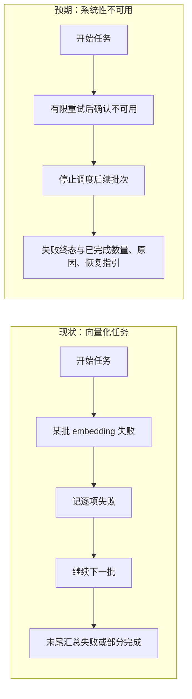

# PM 报告：批量向量化故障止损与全局状态提示

模式：M1 需求定义 + M2 体验走查 + M4 界面走查（严谨档）。

**证据声明**：组合模式整体为 🟡：维度提示的位置有用户提供的 `/import` 截图和代码直读（🟢），顶部运行中标识的实际观感及跨页面体验未做运行实测，以用户反馈和样式代码判断（🟡）。当前取证基于根仓库 `master@8075b91`；截图显示 kafka 的配置维度 1024、旧集合维度 4096，未重新测量运行中的维度。

## 1. 执行摘要

1. 🟢 维度冲突提示已经存在，但仅在导入表单靠下位置展示；搜索页另有自己的错误提示。顶部服务健康接口明确跳过逐 scope 维度诊断，不能直接当成该提示的数据源。用户真正需要的是“当前 scope 的语义能力异常，在任一站内页面都可见、可恢复”。证据：`web/src/pages/ImportPage.tsx:1305-1310`、`web/src/pages/SearchPage.tsx:421-438`、`src/lib/mcp-http-api.ts:573`。
2. 🟢 顶部导入任务标识是灰底小链接加静态 `↻`；导入页正文已经有 spinner 和进度条。应强化跨页面标识的识别度和状态变化，而非重做正文进度。证据：`web/src/layouts/AppShell.tsx:162-167`、`web/src/styles/ki.css:217-226,587-609`。
3. 🟢 核心批量写入会把 embedding 失败转换为逐项失败，外层导入每 200 条处理一批，异常也计数后继续；重建对返回的失败数累计后继续下一批。服务持续不可用时会反复请求，耗时且可能产生“任务完成/部分失败”的误导。证据：`src/zvec-engine/engine.ts:564-571`、`src/lib/batch-vectorize.ts:146-219`、`src/lib/rebuild-vector.ts:788-834`。
4. 🟢 同维度全量重建先删除旧向量，再向量化；若随后检测到持续不可用，立刻停虽能节省时间，但旧集合可能已经不完整。导入则先写新向量、后续才整理文件及索引，直接抛错也可能留下未被索引引用的向量。跨维度迁移已有暂存集合与失败不切换保护。证据：`src/lib/rebuild-vector.ts:737-770,849-855`、`src/lib/import.ts:765-785,849-865,1205-1237`。
5. 🟢 CLI 的 `ki import` 和 `ki restore --rebuild-vector` 在 daemon 模式下登记为任务，直连模式则在本进程执行；daemon 任务与 Web 任务又分别存于两个内存 Map，现有状态接口均需已知 jobId，页面无法自动发现 CLI 任务。证据：`src/import.ts:81-99`、`src/restore.ts:470-483`、`src/lib/daemon-rpc.ts:16-23,62-97`、`src/lib/mcp-http-api.ts:163-182`。

## 2. 需求理解与范围

目标用户是使用 Web 上传导入、CLI 导入/重建的知识库维护者。核心诉求是：**在向量能力确定不可用时及时止损，准确报告失败并保护可恢复数据；在任何站内页面都能立即看到当前 scope 的阻断原因和所有进行中的批量向量任务，并可进入统一任务页查看详情。**

本次分析覆盖 `ki restore <scope> --rebuild-vector --yes`、`ki import`、Web 上传导入，以及同一向量批量写入链的 `bulk-store`、批量 `sync-relation`、标签/路径辅助向量。单条数据内容错误仍应允许其他条目继续；全文模式（`--no-vector`）不依赖 embedding。

现状来源：用户截图及描述、上述代码直读。站内跨页面已由 `AppShell` 保持 `ImportPage` 挂载并传递 Web 导入任务摘要（`web/src/layouts/AppShell.tsx:162-176`，关联需求 `REQ-20260928-001`）；新增“后台任务”导航页用于集中查看 CLI 与 Web 任务。跨**浏览器标签页**应通过服务端任务状态重新读取，而非依赖某个页面的内存态。

### 现状 → 预期

现状来源：代码直读 `batch-vectorize.ts`、`rebuild-vector.ts`、`engine.ts`；预期为用户诉求的产品行为，具体故障分类和批次阈值待设计。

## 3. 需求清单与验收

| ID | 优先级 | 需求 | 可验收的结果 |
|---|---|---|---|
| R1 | P0 | 所有批量 dense 向量化入口统一识别“系统性不可用”：维度不匹配、配置/鉴权永久失败、向量集合不可写、provider 经有限重试仍持续不可用。 | 注入确定性故障时，在下一个尚未开始的批次之前停止；不继续尝试剩余文件；错误包含 scope、阶段、根因、成功/失败/未处理数量。单条内容错误仍只计该条。 |
| R2 | P0 | 失败终态真实反映向量任务结果。 | 发生 R1 时 CLI 非零退出；Web job 为 `failed`，顶部和详情显示“导入失败/向量不可用”，不得显示“导入完成，部分文件失败”。可查询已完成部分和恢复办法。 |
| R3 | P0 | 批量任务安全止损，保护旧向量、已写新向量和元数据的一致性。 | 跨维度迁移失败仍保留旧集合及 cache；同维度全量重建在发生持续故障后不得把旧集合置于无法恢复的半清空状态；导入提前停止时已写的新向量须完成安全清理或留有明确补偿记录，不产生静默孤儿。已提交数据如何恢复必须可说明和验证。 |
| R4 | P0 | 当前有权访问的 scope 的维度冲突在站内任一页面顶部可见，带配置/旧集合维度和可复制的 `ki restore <scope> --rebuild-vector --yes` 指引。 | 在 `/import`、`/browse`、`/search` 等页面切换时提示持续可见；切换 scope 后内容随之更新；恢复后可刷新诊断并移除提示。全文检索仍可操作。 |
| R5 | P1 | 顶部导入任务反馈区分读取、上传、导入、完成、失败、状态未知；运行中有醒目颜色与持续动效。 | 点击导入后不用返回导入页即可识别“正在运行”、目标 scope 和进度；结束后动画停止、状态颜色与文案改变，点击进入详情；减少动态效果的系统设置下仍可凭图标/文案识别。 |
| R6 | P0 | 相关批量入口与辅助向量写入沿用 R1 的中止语义，并保留部分成功明细。 | `bulk-store`、批量 `sync-relation`、标签/路径向量阶段出现系统性不可用时不再继续后续批次/阶段；对已写 KB 或向量显示“部分已提交”，不谎称已回滚。 |
| R7 | P0 | 维度诊断与任务状态在页面切换、恢复、scope 切换后刷新，避免过期提示。 | 当前 scope 的诊断独立于服务健康徽标；不能读取维度时显示“暂无法确认”而非误判不匹配；外部 CLI 重建完成后，用户可手动刷新并在再次进入页面时获得新状态。 |
| R8 | P0 | Web 自动发现当前运行的 CLI 与 Web 批量任务，至少覆盖 `ki import`、`ki restore --rebuild-vector` 和上传导入；任务模型包含来源、操作、scope、阶段、进度、时间、终态与失败原因。 | 在已打开的任一页面另启 CLI 任务，无需刷新或手填 jobId，顶部任务摘要与“后台任务”页在合理延迟内出现；多个任务并行不互相覆盖；CLI 直连模式也须有可被 Web 服务发现的登记路径。 |
| R9 | P1 | 左侧导航增加“后台任务”页，集中展示进行中、排队中和最近结束的任务，提供状态/来源筛选、详情及恢复指引；顶部高亮摘要点击直达此页。 | CLI 与 Web 任务按开始时间/状态清晰排列；可从任务详情回到相关操作页；失败与取消区分；无任务、断连、状态过期有明确空态，不把失联任务当成功。 |
| R10 | P0 | 任务发现与诊断遵守 scope 授权及多进程生命周期，避免泄露或虚假状态。 | 列表只返回当前访问者有权查看的 scope；直接按 jobId 查询也不能越权；服务/daemon 重启或任务源失联时标记状态未知并给出重查方式；任务历史保留期有明确产品文案。 |

注：R1 的“持续不可用”建议按错误类别判定：确定性的永久错误直接停止；网络/限流由已有有限重试处理，再根据连续批次失败判定。具体阈值和并发在途批次的收束由技术设计给出，不把一次局部抖动当作全局故障。

### 负向需求

| 场景 | 预期行为 |
|---|---|
| 单个文档文本非法、单个 embedding 子批次短暂失败 | 错误归到对应条目；其他可成功条目继续，避免误停整库任务。 |
| 维度不匹配但用户关闭“向量化” | 允许 FTS-only 导入；顶部仍说明当前 scope 的语义能力异常，不把全文模式标为失败。 |
| 启动后服务中断或用户主动取消 | `failed` 与 `cancelled` 分开；记录已完成与未处理数量，保留可用数据及重试指引。 |
| 重建中途故障且已写部分新向量 | 不显示“全部成功”；跨维度不切换新集合，同维度按 R3 保证可恢复性。 |
| 顶部诊断请求超时/被锁占用 | 显示“无法确认”及重试，不用旧诊断结果冒充当前 scope 状态。 |
| 顶部同时有服务异常、维度冲突和导入任务 | 按严重度组织信息，长文案不遮挡 scope 选择器；任务状态始终可点入详情。 |
| 导入 kafka 时将顶栏 scope 切到其他库 | 任务继续显示 kafka，维度告警只反映当前所选 scope，两个 scope 不得混淆。 |
| 当前用户无权访问某个 scope | 顶部诊断不展示该 scope 的维度及重建信息，沿用接口既有的 scope 授权规则。 |
| CLI 在 daemon 模式和直连模式分别启动任务 | 两种路径都应在 Web 服务可访问时被发现；若 Web 服务当前离线，重连后按保留策略展示任务状态，不伪称实时。 |
| 同时有多个任务，其中一个失败 | 顶部显示“2 个进行中 · 1 个失败”等聚合摘要；详情页保留每个任务独立状态，不能只显示最近一次上传。 |
| daemon 或 Web 服务重启、任务记录过期 | 显示“状态未知/记录已过期”，不把缺失记录推断成任务完成；明确历史保留期。 |

## 4. 关联功能与影响评估

| 受影响功能/方 | 影响类型 | 影响程度 | 证据 | 建议处理 | 需用户拍板 |
|---|---|---|---|---|---|
| CLI import、Web upload/import job、`bulk-store` | 流程/外部契约 | 破坏：系统性故障由部分完成改失败 | 🟢 `src/lib/import.ts:1210-1237`、`src/lib/mcp-http-api.ts:1147-1152`、`src/bulk-store.ts:75-76` | R1/R2/R6 同步处理，明确退出码和状态字段 | 是：外部脚本是否依赖旧的部分成功口径 |
| restore/rebuild 同维度全量 | 数据 | 可能破坏：先删旧后失败 | 🟢 `src/lib/rebuild-vector.ts:744-770` | R3 为安全前置条件，设计时比较暂存切换与可恢复标记 | 是：旧集合持续可用是否为硬要求 |
| 跨维度迁移 | 数据 | 预期内：失败不切换 | 🟢 `src/lib/rebuild-vector.ts:849-855` | 保留原有保护，增加尽早停 | 否 |
| 批量 sync-relation 与辅助向量 | 流程/数据 | 降级：KB 可能已写，向量未写 | 🟢 `src/sync-relation.ts:703-715,834-843`、`src/lib/path-vectorize.ts:93-114` | R6 说明部分提交，避免“整体失败”等于“全部回滚” | 是：是否覆盖这两个入口 |
| 搜索、知识库浏览、全文检索 | 展示/流程 | 预期内：语义检索阻断，全文仍可用 | 🟢 `web/src/pages/SearchPage.tsx:421-443`、`web/src/pages/ImportPage.tsx:1311-1315` | R4 文案与操作口径一致；全文功能保持可用 | 否 |
| 顶栏、scope 切换、服务健康 | 展示/性能 | 降级风险：额外诊断可能拖慢页面 | 🟢 `web/src/layouts/AppShell.tsx:152-170`、`src/lib/mcp-http-api.ts:573` | R4/R7 单 scope 诊断、缓存/重试策略；不在每次渲染逐 scope 扫描 | 否 |
| 带 scope 的只读接口授权 | 权限 | 破坏风险：新增全局诊断若绕过授权会泄露 scope 信息 | 🟢 `src/lib/mcp-http-api.ts:395-405` | 复用 `/api/import/config` 现有授权或对新增接口施加同等校验 | 否 |
| daemon 任务、Web 任务、CLI 直连模式 | 状态/架构 | 破坏风险：两个内存 Map + 按 jobId 查询无法支撑自动发现；直连任务未登记 | 🟢 `src/lib/daemon-rpc.ts:16-23,62-97,299-307`、`src/lib/mcp-http-api.ts:163-182,1195-1223`、`src/import.ts:81-99` | R8/R10 设计统一任务发现与生命周期，去重并做授权过滤；明确直连路径的登记机制 | 是：是否接受仅“Web 服务可访问时”实时可见 |
| 导航与跨页面任务摘要 | 信息架构/展示 | 预期内：新增独立页面，现有单导入标识变聚合入口 | 🟢 `web/src/layouts/AppShell.tsx:17-23,162-176` | R9 保留快速状态，详细进度移入任务页 | 否 |
| 任务历史 | 数据/留存 | 限制：现有两处内存任务约 1 小时后删除，进程重启即丢失 | 🟢 `src/lib/daemon-rpc.ts:62-75`、`src/lib/mcp-http-api.ts:176-182` | 首版定位“进行中 + 最近任务”；是否持久化和保留时长单独决策 | 是 |
| 外部订阅/自动化脚本 | 外部契约 | ⚪ 未发现（需确认） | 代码仓库无法覆盖外部消费方 | 核对是否消费 CLI `ok/errors`、daemon job 状态 | 是 |

## 5. 优先级排序

| 优先级 | 条目 | 来源 | Kano | 价值 | 成本 | 证据 | 建议方向 |
|---|---|---|---|---|---|---|---|
| P0 | R1/R2：系统故障止损与真实失败终态 | M1/M2 | 必备 | 高 | 高 | 🟢 | 防止重复无效请求和误报成功。 |
| P0 | R3：批量任务数据保护 | M1 | 必备 | 高 | 高 | 🟢 | 与快停配套，避免旧向量先被清空或新向量成孤儿。 |
| P0 | R4/R7：跨页面维度提示与状态刷新 | M1/M4 | 必备 | 高 | 中 | 🟢 | 核心操作被阻断时必须在当前页可见且状态准确。 |
| P0 | R6：其他批量入口 | M1 | 必备 | 中 | 中 | 🟢 | 防止同类入口绕过系统性故障止损。 |
| P1 | R5：运行中任务显著反馈 | M2/M4 | 期望 | 中 | 低 | 🟢 代码/🟡 观感 | 强化现有顶部任务入口。 |
| P0 | R8/R10：CLI 与 Web 任务自动发现、授权和生命周期 | M1/M4 | 必备 | 高 | 高 | 🟢 | 让“后台任务”真实覆盖用户发起的两种入口。 |
| P1 | R9：后台任务集中页面 | M1/M4 | 期望 | 高 | 中 | 🟢/🟡 | 汇总并发任务、来源、进度与失败恢复。 |

## 6. 关键假设与唯一确认点

| 假设 ID | 内容 | 若不成立的影响 | 验证方式 |
|---|---|---|---|
| H1 | “后台任务”是左侧导航中的独立站内页面；多个浏览器标签页从服务端读取相同任务列表，不要求浏览器之间直接通信。 | 若用户想要浏览器原生新标签页或系统托盘，需调整 UI 入口。 | 请用户确认。 |
| H2 | 系统性不可用应让本次任务失败并停止后续批次；单条内容错误可以继续；不自动切换 FTS-only。 | 改变 R1/R2/R6 的失败与降级口径。 | 请用户确认。 |
| H3 | 同维度全量重建期间若 provider 失败，旧向量仍应可恢复；是否要求重建期间持续可检索待定。 | 决定 R3 采用暂存切换还是其他恢复方案，成本差异较大。 | 请用户确认。 |
| H4 | CLI 任务只有在 Web 服务可以访问同一任务状态源时能实时显示；离线运行后的可追溯性取决于是否持久化任务记录。 | 决定直连 CLI 的登记机制与任务历史成本。 | 请用户确认。 |
| H5 | 首版任务中心展示“进行中 + 最近 1 小时结束的任务”，不是永久审计日志。 | 若需跨重启长期历史，需持久化、清理与迁移方案。 | 请用户确认。 |

**请集中确认 H1–H5，以及是否有外部脚本依赖 CLI 的部分成功返回。**本报告保持草案状态；UI 草案可以先评估，技术设计待关键边界确认。

## 7. 建议下一步

确认需求后，先设计故障分类、任务终态、数据保护和统一任务发现方案，再完成顶部告警与后台任务页的交互技术设计；实施时按“维度冲突、永久 provider 错误、持续网络失败、单条内容失败、主动取消、同/跨维度重建、CLI 与 Web 并发任务、服务重启”八类场景验收。
