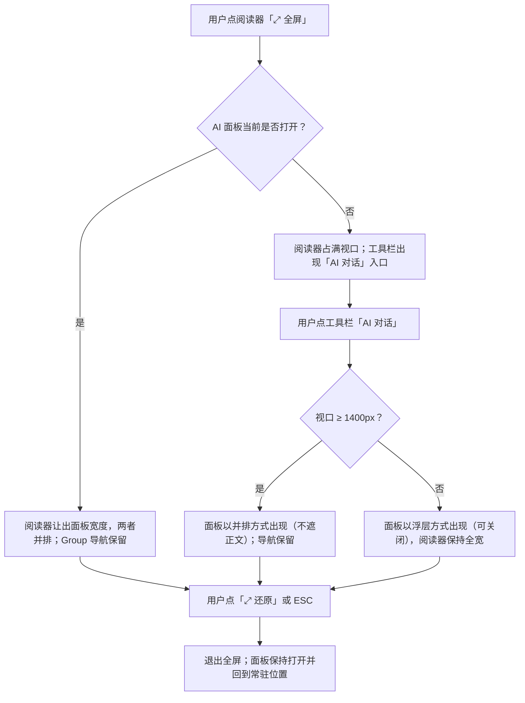
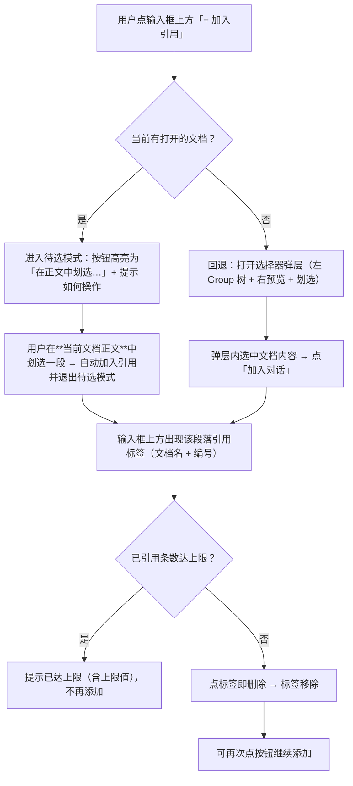
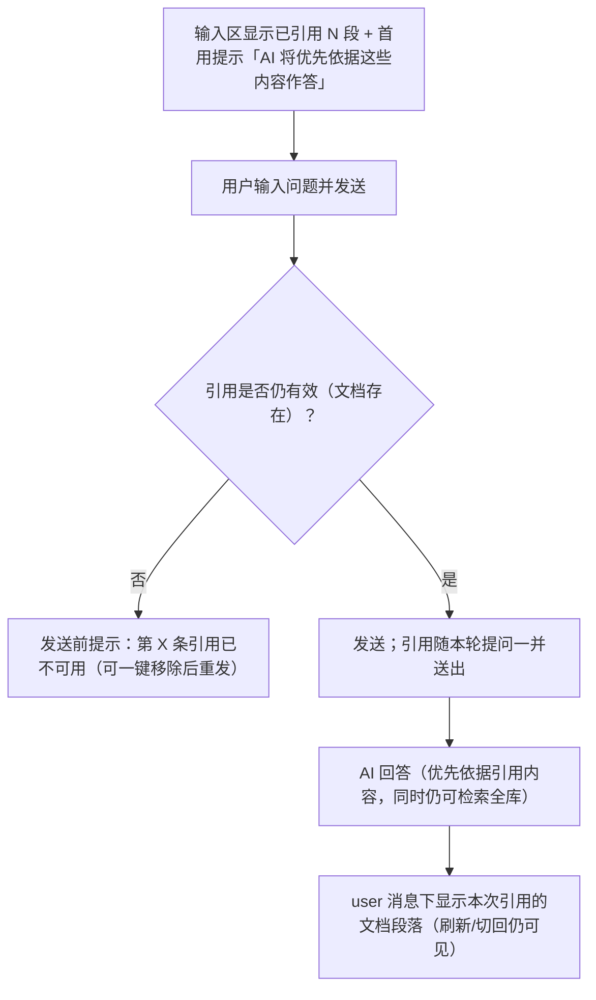
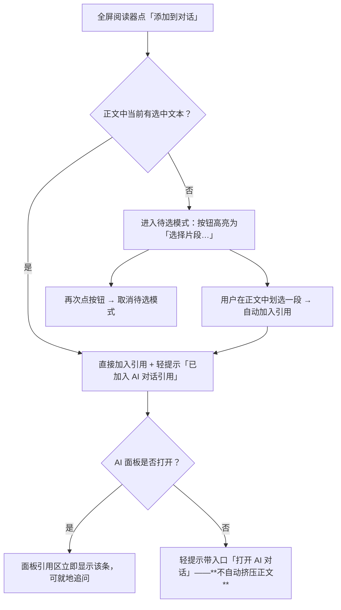
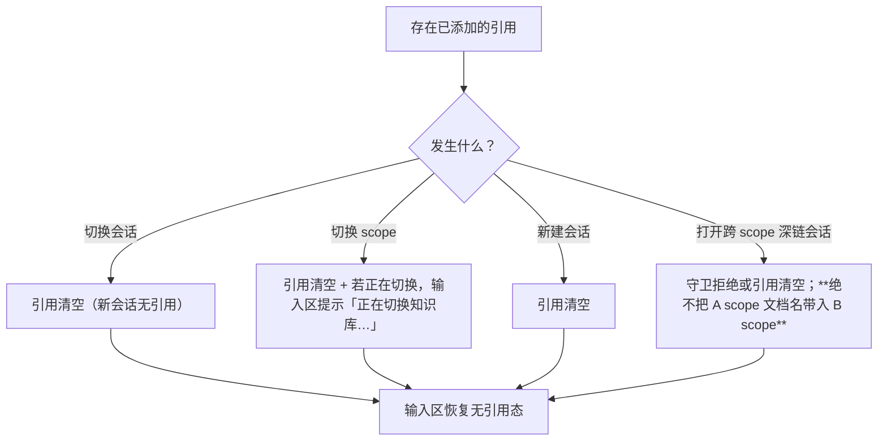

# 交互设计：全屏阅读与AI对话协同及文档引用

> 场景类型：**Web 系统**（ki 前端 SPA）
> 状态：草案
> 前置决策：共存空间策略 = **A 并排让位**（用户 2026-10-09 拍板）

## 1. 角色与意图

| 角色 | 核心目标 | 技术熟悉度 | 交互频率 |
|---|---|---|---|
| 知识库使用者（桌面宽屏 ≥1400px） | 全屏精读文档时，就具体段落向 AI 追问 | 中 | 高 |
| 知识库使用者（窄屏 <1400px / 触屏） | 小窗口或手机上读文档并使用 AI | 中 | 低 |

**核心意图链**：`读 → 起疑 → 不离开文档 → 提问`。任何要求用户"先退出全屏、再提问、再回到原位置"的设计都不满足本需求。

## 2. 交互场景清单

| 编号 | 场景 | 触发条件 | 优先级 | 成功标志 |
|---|---|---|---|---|
| S-01 | 全屏阅读时打开 AI 面板 | 阅读器全屏状态下点 AI 入口 | P0 | 面板可见可用；**正文阅读位置不丢** |
| S-02 | 退出全屏后面板状态保持 | 点"还原"或 ESC | P0 | 面板开/关与进全屏前一致 |
| S-03 | 添加文档段落引用 | 点"添加到对话" → 选择器选中段落 | P0 | 引用标签出现在输入框上方 |
| S-04 | 删除已添加的引用 | 点标签删除入口 | P0 | 标签消失，后续提问不含该引用 |
| S-05 | 带引用提问 | 有引用时发送 | P0 | 回答明显基于引用内容 |
| S-06 | 从全屏阅读器一键引用 | 阅读器内点"添加到对话" → 划选 | P1 | 引用进入面板，可同屏追问 |
| S-07 | 引用随会话/scope 切换清理 | 切会话 / 切 scope | P0 | 引用清空，无跨 scope 泄漏 |
| S-08 | 引用失效 | 发送时校验失败 | P1 | 明确提示哪条不可用 |
| S-09 | 窄屏降级 | 视口 < 1400 / < 1024 / 375 | P1 | 正文可读；引用仍可添加删除 |

**关联**：S-03→S-04→S-05 为需求 B 主链；S-01→S-02 为需求 A 主链；**S-06 为 A×B 交汇（本次合并的价值点）**。

## 3. 交互流程

### 3.1 S-01 / S-02：全屏与面板共存（A 方案）

**关键节点**：

| 节点 | 用户感知 | 备注 |
|---|---|---|
| 全屏 + 面板已开 | 正文仍完整可读，只是变窄；**阅读位置不变** | 面板打开导致重排，须保持滚动锚点 |
| 全屏 + 面板未开 | 工具栏可见「AI 对话」 | 现状为**完全无入口**（顶栏开关被覆盖层盖住） |
| 点入口（宽屏） | 面板从右侧出现，正文同步收窄；**导航保留可见**（2026-10-09 用户走查修正：导航是阅读定位手段，不得因开面板而强制隐藏） | 不遮挡、不跳转 |
| 点入口（窄屏） | 面板浮在正文之上，可一键关闭 | 见 S-09 |
| 退全屏 | 面板不关闭、内容不丢，回到常驻位置 | 沿用"隐藏不卸载"既有语义 |

### 3.2 S-03 / S-04：添加与删除引用

**关键节点**：

| 节点 | 用户感知 | 备注 |
|---|---|---|
| 点「+ 加入引用」 | **不弹模态框**：按钮高亮进入待选模式 + 提示条说明怎么操作 | 2026-10-09 用户走查修正：原实现在弹层里选文档，用户要求"直接在当前文档页面中选择" |
| 在正文里划选 | 选区落在阅读器内即自动加入；在面板内选字不受影响 | 判定依据：选区锚点 `closest('.ki-drawer')`（阅读器根带文档身份标记，跨组件无需通信） |
| 无打开的文档 | 回退到选择器弹层 | 否则没有可划选的内容；该兜底是否保留待用户确认 |
| 加入成功 | 标签出现在输入框上方（文档名 + 编号）+ notice 说明字数 | 同段落重复加入 → 提示"已在引用中"（去重）；超长自动截断并告知 |
| 删除 | 点标签即时移除，**不弹确认** | 误删可重新添加，成本低 |

### 3.3 S-05：带引用提问

| 节点 | 用户感知 | 备注 |
|---|---|---|
| 引用区首用提示 | "AI 将优先依据这些内容作答" | **预期管理**：软提示语义不等于"只在这些内容里搜"，须明确 |
| 引用失效 | 明确告知哪一条不可用 + 移除入口 | fail-loud，不静默丢弃 |
| 发送后 | user 消息带引用标记；会话内回看可见 | 引用作用于**当前对话框**（Q3） |

### 3.4 S-06：从全屏阅读器一键引用（A×B 交汇）

| 节点 | 用户感知 | 备注 |
|---|---|---|
| 点按钮（已有选中） | 立即加入，无需二次操作 | 复用「添加链接」的顺手路径 |
| 点按钮（无选中） | 按钮高亮为待选态 + 提示怎么选 | 复用 `linkArmed` 范式（`ModuleDrawer.tsx:559-578`） |
| 加入成功（面板关） | 轻提示，**不强行打开面板** | 避免打断阅读；用户自己决定何时问 |

### 3.5 S-07：引用清理

### 3.6 S-09：窄屏降级规则

| 视口 | 阅读器 | AI 面板 | 说明 |
|---|---|---|---|
| ≥1400px | 让出面板宽度并排 | 常驻 380px | A 方案主形态 |
| 1100–1400px | 全宽 | **浮层**（覆盖右侧，可关闭） | 视口不足以并排，降级为浮层 |
| <1100px | 全宽（内部导航已转浮层） | 浮层（宽度按 `min(420px, 92vw)`） | 与既有 `.ki-chat-panel--overlay` 同款 |
| ≤375px | 全宽 | 浮层近全宽，可关闭 | 触屏无 `@` 问题：入口是按钮 |

**统一规则**：任何视口下，面板都必须**有可见的关闭入口**，且关闭后正文立即恢复全宽。

## 4. 反馈与状态矩阵

| 节点 | 成功 | 失败 | 等待 | 空 |
|---|---|---|---|---|
| 打开全屏 + 面板 | 并排呈现，阅读位置保持 | 面板渲染失败 → 保持全屏阅读可用 | 面板加载会话列表 | 新会话无历史 → 空态引导 |
| 打开选择器 | 树 + 预览 + 搜索可用 | 文档列表拉取失败 → 选择器内错误态 + 重试 | 列表加载中 → 骨架 | 该 Group 无文档 → 空态文案 |
| 搜索文档 | 命中列表（跨组） | 请求失败 → 错误文案 + 重试 | 搜索中 | 无命中 → "未找到匹配文档" |
| 加入引用 | 标签出现 + 轻提示 | 段落已被覆盖 → 提示不可加入 | — | — |
| 删除引用 | 标签即时移除 | — | — | 引用区归零 → 整块隐藏（不显示"引用 0 段"） |
| 发送（带引用） | 消息带引用标记并可回看 | 引用失效 → 指出具体条目 | 生成中 → 停止按钮可用 | — |
| 引用区首用 | 显示"优先依据"提示 | — | — | — |

## 5. 异常与边界处理

| 异常场景 | 触发条件 | 用户感知 | 恢复路径 | 阻断主流程 |
|---|---|---|---|---|
| 引用文档被删除/重导覆盖 | 发送前校验失败 | 明确提示"第 X 条引用已不可用" | 一键移除该条后重发 | 否 |
| 引用段落超长 | 段落字符数超上限 | 提示已截断及截断后长度 | 用户可改选更短片段 | 否 |
| 引用条数超上限 | 达到上限值 | 提示已达上限并显示上限值 | 先删再添 | 否 |
| 重复添加同段落 | 同文档同段落再次加入 | 无新标签（静默去重，不报错） | — | 否 |
| 切 scope 时仍有引用 | 切换知识库 | 引用清空（无需确认，属预期） | — | 否 |
| 生成中增删引用 | `streaming.active` 为真 | 引用区仍可编辑，但发送被闸门拦截并给出原因 | 停止生成后发送 | 否 |
| 面板打开 + 导航展开（宽屏） | 用户手动展开 Group 导航 | 正文变窄；低于可读下限时给出轻提示建议收起其一 | 收起导航或关闭面板 | 否 |
| 窄屏打开面板 | 视口 < 1400px | 面板浮层覆盖正文 | 关闭面板恢复全宽 | 否 |
| 模型不支持工具（降级） | `tools-unsupported` | 降级文案需说明引用如何被处理 | — | 否 |

**边界情况**：

| 场景 | 条件 | 预期行为 |
|---|---|---|
| 空引用区 | 无引用 | 引用区整体不渲染（与"来源 0 处不显示"同款约定） |
| 超长文档名 | 文档名很长 | 标签内省略 + title 显示全名 |
| 多条引用 | 引用 5 条以上 | 引用区限高、内部折行/滚动，不挤占输入框 |
| 面板极窄（375px） | 全屏 + 面板浮层 | 面板近乎全宽，关闭入口常驻可见 |

## 6. 交互约束

| 约束类型 | 涉及操作 | 约束内容 | 用户感知 |
|---|---|---|---|
| 不可逆操作 | 删除引用 | 即时生效、可重新添加，**不设二次确认** | 点即删；重开选择器可再选 |
| 前置条件 | 加入引用 | 必须先在选择器内选中文档内容（段落级） | 未选中时按钮置灰 + 原因文案 |
| 前置条件 | 发送 | 沿用既有闸门（未配置模型/外发未确认/生成中/空草稿） | 输入框 placeholder 与提示行说明原因 |
| 确认点 | 无新增 | 本需求不引入任何新的确认弹窗 | — |
| 频率/防抖 | 加入引用 | 同段落去重，避免重复点击产生多条 | 无重复标签 |
| 依赖关系 | 引用生效 | 引用属于当前会话；跨会话/跨 scope 视为无引用 | 切走即清空 |
| 依赖关系 | 引用语义 | 软提示：AI 优先依据引用内容，但仍可检索全库 | 首用提示明确说明，避免误解为"只搜这些" |
| 可逆性 | 全屏共存 | 关闭面板 → 正文立即恢复全宽；退出全屏 → 面板回到常驻位 | 无"卡在中间态"的情况 |

## 7. 待确认事项

| 编号 | 事项 | 影响范围 | 状态 |
|---|---|---|---|
| T1 | 引用上限的具体数值（条数 / 总字符数） | R12、选择器与引用区容量 | 待技术设计给出默认值后回填 |
| T2 | "引用区首用提示"的展示时机（每次会话首次 vs 仅全局首次） | S-05 反馈 | 待确认 |
| T3 | ~~面板打开时自动收起导航~~ **已决（2026-10-09 用户走查）**：导航始终保留、不自动收起；正文宽度由用户自行权衡（导航自带收起入口） | S-01、窄屏 | 已决 |
| T4 | 摘要/定位信息在标签上的呈现粒度（文档名 + 行号？文档名 + 片段首 8 字？） | S-03/S-05 展示 | 待确认 |
| T5 | 从阅读器加入引用后，轻提示的停留时长与是否可撤销 | S-06 | 待确认 |
