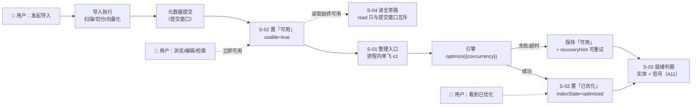
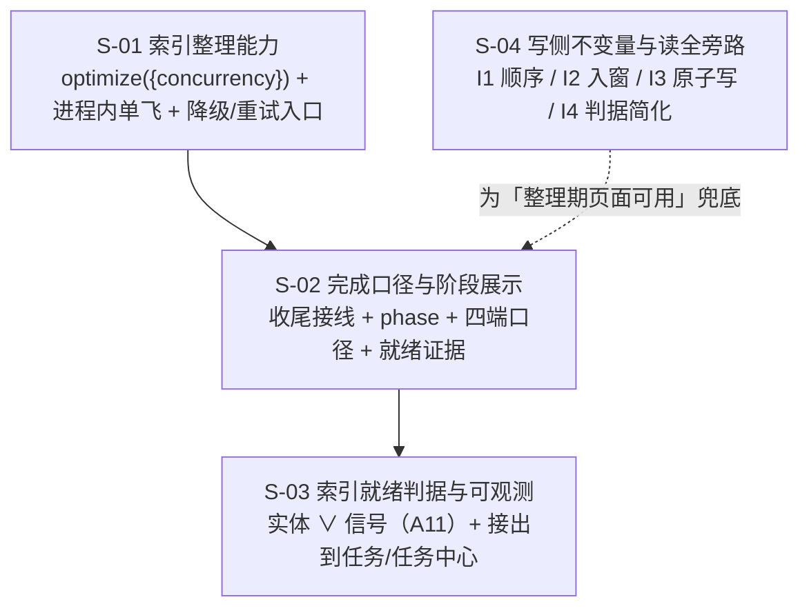

# 引擎收尾期可用性 · 总体设计（REQ-20261009-003 剩余主体）

> 需求：REQ-20261009-003 v7 · 设计输入：`design/design-input.md` · 计划台账：`.plans/2026-10-10-indexing-stage-two-tier`
> 覆盖：**R4**（接入 optimize）· **R6**（索引就绪可观测）· **R2**（阶段展示）· **R1**（两级完成口径）· **R5**（整理期提示）· **Q6 落地**（写侧不变量 + 读全旁路）
> 不含：R9 原"占槽上限 / 强制释放"（Q6 拍板后由 S-04 取代）· R8 剩余（**检索类降级口径**，见 G8）· R7（已由「增量导入」交付）· R10（已决策不做）

## 1. 需求背景 & 目标

**背景**：导入"成功" ≠ 索引就绪。引擎在写入停止后自行做 flush / compaction / dense 索引构建（现场实测：单核 100% ~10 分钟、`dense.index.3.proxima` **119MB** 落盘），而我们**既不触发它、也不观测它**；用户只看到"导入完成"，却遇到"搜不到"（索引未就绪）或"打不开"（队列槽被占死，已由 R8 部分修复）。

**目标**：把"导入完成"变成三件**诚实、可见、可控**的事：

1. 元数据提交完成 = **可用**（文档立即可浏览/编辑/检索，不因整理被推迟）
2. 收尾**异步、限核、进程内单飞**地触发一次索引整理 = 走向**已优化**
3. 整理失败/超时**不降级为失败**，只降级为「可用 + 可重试」

**非功能性默认假设**：单机 · 单 daemon · 单用户 · 无并发导入常态 · `maxWorkers=4` · 整理 `concurrency=1`（≈1 核）· 单 scope 万级文档。

⛔ **不在范围内**：引擎内部 compaction 旋钮（无 API）· 检索类降级的用户口径（G8）· 队列"占槽上限"（被 S-04 取代）· 跨进程批级一致性（P2）

## 2. 关键环节一览图

## 3. 总体方案设计

**依赖**：S-02 依赖 S-01（要能叫到整理）· S-03 依赖 S-02（挂在任务的 `indexReadiness` 上）· S-04 独立，但 **I4 生效必须先过 S-04 §3.3 的上线门槛**。

### 共享术语速查（跨子需求引用，子文档不重复定义）

| 术语 | 定义 | 归属 |
|---|---|---|
| **可用（usable）** | 元数据提交完成，文档可浏览/编辑/检索 | S-02 |
| **已优化（optimized）** | 一次成功的索引整理完成（dense 索引就绪） | S-01 / S-02 |
| **indexState** | 整理状态：`pending` / `indexing` / `optimized` / `failed:<原因>` / `skipped` | S-02 |
| **indexReadiness** | 索引就绪证据（信号 + 实体 + judgedBy），任务结束时写入 | S-03 |
| **索引实体** | `<vectorDir>/collections/<scope>/0/dense.index.*.proxima` | S-03 |
| **索引信号** | `stats.indexCompleteness.dense`（≈"已被显式整理"，**不等于**实体存在） | S-03 |
| **整理单飞** | **进程内**同时只跑一个 scope 的整理（跨进程并发为已知限制） | S-01 |
| **提交窗口** | `runMetadataCommit` / `withMetadataCommitSync`（read 唯一需要等待的区间，**进程内**） | S-04 |
| **I1 顺序** | 分片（列表）可见 ⇒ KB（详情）可取：新增/更新 KB 先、分片后；删除**分片先**、KB 后（**跨进程有效的根本保证**） | S-04 |
| **I2 入窗** | 多文件元数据写紧邻且整段在提交窗口内，中间不得夹引擎 I/O | S-04 |
| **I3 原子写** | 单文件落盘一律 `writeJson`（`.tmp` + rename + `.lock`） | S-04 |
| **I4 判据简化** | `read` 只与提交窗口互斥（受上线门槛约束） | S-04 |
| **DIR E** | 并发读观测到的「列表可见但详情 404」恶性中间态 | S-04 |

## 4. 全局风险 & 跨子需求依赖

| # | 风险 | 影响 | 处置 |
|---|---|---|---|
| G1 | `optimize` 独占引擎 worker：整理期间同 scope 的**检索/写入**排队（分钟级） | 检索变慢 | S-01 异步 + 限核 + 单飞；S-02 给文案；**检索侧无提示/无超时的部分登记为 G8** |
| G2 | 整理耗时不可预估（现场 ~10 分钟） | 任务长期停在 `indexing` | S-01 超时 = **中断**；S-02 降级「可用」+ 重试入口 |
| G3 | **读全旁路的前提是"所有变更路径满足 I1"** | 漏一条 ⇒ 稳定 404 | S-04 逐路径核对表 + **上线门槛 + 表驱动回归测试（P0）** |
| G4 | `src/zvec-engine` 改了但 dist 未重建 | 改了不生效（假更新） | 护栏：改引擎必 `npm run build:zvec-engine` |
| G5 | 进程重启导致整理中断 | 停在 `indexing` | S-01 明确定义"超时/退出 = 中断"；S-02 启动归一为 `available` + `recoveryHint`（不自动续跑） |
| G6 | 跨进程读者见到批级"半新半旧"分片 | 非 404，属既有口径 | P2（S-04 §3.6） |
| G7 | 整理与"再次导入同 scope"并发 | 二者互斥排队 | 队列天然串行；需验证不饿死（S-02 待定 1） |
| **G8** 🆕 | **整理期同 scope 检索排队（分钟级）而检索侧无提示、无独立超时** | 用户看到"一直转圈"，不知原因 | **本期已知限制**（S-02 §6 行 + 导入页/任务中心已有文案）；彻底解决需 R8 剩余"检索类降级口径"，**P2** |
| **G9** 🆕 | 多进程（CLI 直连 + daemon）并发整理**不同 scope** | 纯 CPU 竞争（每进程 1 核），非正确性问题（同 scope 已被 collection flock 排除） | Q4 口径确认为"**进程内**全局 ≤1"；补锁的重评条件见 S-01 D2（可观测：日志出现两进程同时整理） |

**接口契约变化风险（均为增量，无破坏性）**：`/api/import/status` 增 `usable` / `indexState` / `indexReadiness` / `maintenance`；`/api/tasks` 增同名可选字段；`/api/vector/status` 增 `readiness`（`?signal=1` 才读信号）；新增 `POST /api/vector/optimize`（**须登记越权校验列表**）与 CLI `ki index-optimize`。
