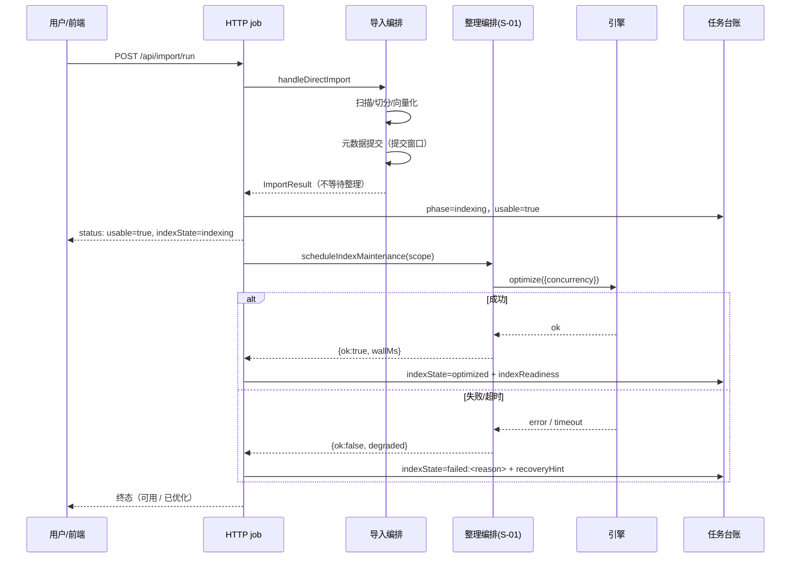

# S-02 完成口径与阶段展示（收尾接线 + `phase` + 四端口径 + 就绪证据）

## 1. 术语

- **可用（usable）**：元数据提交完成 ⇒ 文档可浏览/编辑/检索。**这是"导入完成"对用户的第一个承诺点。**
- **阶段（phase）**：复用既有 `TaskRecord.phase`（`src/lib/task-registry.ts:10/26/39`），新增取值不改枚举。
- **indexState**：`pending` / `indexing` / `optimized` / `failed:<timeout|unavailable|error>` / `skipped`——整理维度状态，与导入维度（state/phase）正交（评审 #21：`failed` 带原因码，便于分档文案）。
- **indexReadiness**：任务结束时写入的**索引就绪证据**（S-03 提供，评审 #6 决策：`indexState` 说"我们做没做"，`readiness` 说"索引在不在"）。

## 2. 现状（AS-IS）

| 位置 | 现状 |
|---|---|
| `src/lib/import.ts:1703-1712` | Phase 4 元数据提交（`runMetadataCommit` 窗口）→ Phase 5 / 收尾 → 返回 `ImportResult`；**不做任何索引整理** |
| `src/lib/import.ts:1844-1845` | finally 仅关 FTS 引擎（非 daemon 进程）；dense engine 随进程退出而终止 |
| `src/lib/task-registry.ts:38-41` | `TaskReporter.update/progress/finish`；无整理相关字段 |
| `src/lib/mcp-http-api.ts:1459-1481` | `runImportJob` → job 内存态；导入返回即 job done |
| `web/src/pages/ImportPage.tsx:1834` | 显示 `${done}/${total} 个处理单元`；终态文案取自 `job.state` |
| 全仓 | **无 `'indexing'` 阶段**（grep 无命中） |

## 3. 方案（TO-BE）

### 3.0 非功能性默认假设

默认单 daemon、单用户；轮询间隔沿用前端既有节奏（不引入高频轮询）；整理最长等待 = `vector.optimize.timeoutMs`。

### 3.1 阶段口径（一张表定死，四端按此实现）

| phase | 触发点 | 四端文案 | `usable` | `indexState` |
|---|---|---|---|---|
| `scan` / `vectorize` / `commit` | 既有阶段 | 不变 | false | `pending` |
| `indexing` | 元数据提交完成 + 整理入队后 | **导入完成（可用）· 索引整理中…** | **true** | `indexing` |
| `optimized` | 整理成功 | 导入完成 · **已优化**（附实体证据） | true | `optimized` |
| `available` | 整理跳过 / 失败 / 超时 / `enabled=false` | 导入完成（可用）· 索引待整理 | true | `failed:<原因>` / `skipped` |

> 关键口径：**"完成"看 `usable`，"优化度"看 `indexState` + `indexReadiness`**。`state` 仍表示"任务是否还在跑"，四端**不得**用 `state` 判断"能不能用"。
> `partial`（部分成功）：`usable = true`（已提交部分可用），`indexState` 照常推进；与 REQ-20261009-001 的未完成清单**并列展示**（清单在前、状态在后）。**该口径为定稿**（评审 #13：从待定项移出）。

### 3.2 接线（谁是整理的执行者）

| 入口 | 行为 |
|---|---|
| `handleDirectImport`（`src/lib/import.ts`） | **不等待整理**；返回结果新增 `indexMaintenance?: { scheduled: boolean; reason?: string }` |
| CLI 直连（`src/import.ts`） | 入队 + `await whenIndexMaintenanceIdle(timeoutMs)` → 打印「索引整理中…」/「索引已优化（实体 114MB）」/「索引整理未完成（重试：`ki index-optimize -s <scope>`）」；**退出码不变** |
| daemon HTTP job（`mcp-http-api.ts::runImportJob`） | 导入结束 → `state=succeeded|partial` + `usable=true` + `indexState=indexing`（**job 不关闭**）→ 整理结束 → `indexState=optimized|failed:…` + 写 `indexReadiness` → 关闭 job |
| CLI 经 daemon | 轮询任务状态直到 `indexState ∈ {optimized, failed:*, skipped}` 或超时，期间打印阶段 |
| **进程重启**（评审 #14 落点） | `task-registry` 初始化时扫描 ledger：`phase='indexing'` 且**本进程非该任务执行者** ⇒ 归一为 `available` + `recoveryHint`（不自动续跑） |

### 3.3 任务台账改动（最小）

- **不新增 state 枚举、不改 `finish` 时序**："可用"通过 `phase`（`available`/`indexing`/`optimized`）+ 派生 `usable` 表达。
- `TaskRecord` 增两个**可选**字段：`indexState?: string`、`indexReadiness?: IndexReadiness`（S-03 类型）。
  - `indexReadiness` 在**整理落定后一次性写入**（`includeSignal: true`，含实体大小与 judgedBy）⇒ 任务中心/导入页可展示"已优化（实体 114MB）"或"可用（索引未就绪）"，**兑现 A11 的可验证对应关系**（评审 #6 决策）。
  - **`update` / `finish` 时机（评审第 2 轮 N1）**：元数据提交完成 → `update({ state:'succeeded', phase:'indexing' })`（台账**即刻**显示「已完成 · 可用」，`update()` 本就允许 patch `state`，**无需扩展 `TaskReporter` 签名**）；整理落定 → `update({ phase:'optimized'|'available', indexState, indexReadiness })` → `finish('succeeded')`。即 **`finish` 仍只调用一次，且发生在整理落定后**；期间"能不能用"只由 `state`/`usable` 决定，与 `finish` 无关。

### 3.4 时序（评审 #9 补齐）



## 4. 接口设计

### 4.1 `GET /api/import/status`（增量字段，向后兼容）

```jsonc
// Demo：整理中（文档已可用）
{ "ok": true, "jobId": "imp_9aab7658", "state": "running", "usable": true,
  "phase": "indexing", "indexState": "indexing",
  "progress": { "done": 15594, "total": 15594 },
  "maintenance": { "running": true, "queued": [], "startedAt": 1760000000000, "pid": 12345 } }

// Demo：已优化（job 关闭，含就绪证据）
{ "ok": true, "jobId": "imp_9aab7658", "state": "succeeded", "usable": true,
  "phase": "optimized", "indexState": "optimized",
  "indexReadiness": { "signal": 1, "entity": { "exists": true, "bytes": 119386112 }, "ready": true, "judgedBy": "signal" },
  "maintenance": { "running": null, "queued": [], "last": { "ok": true, "wallMs": 41230 } } }

// Demo：整理超时（任务仍成功）
{ "ok": true, "jobId": "imp_9aab7658", "state": "succeeded", "usable": true,
  "phase": "available", "indexState": "failed:timeout",
  "indexReadiness": { "signal": 0, "entity": { "exists": true, "bytes": 118000000 }, "ready": true, "judgedBy": "entity" },
  "recoveryHint": "索引整理未在 600s 内完成（已中断）；可执行 ki index-optimize -s ai-docs 重试",
  "maintenance": { "last": { "ok": false, "degraded": "timeout", "wallMs": 600012 } } }
```

### 4.2 `GET /api/tasks`

`TaskRecord` 增 `indexState?` / `indexReadiness?`；`phase` 新增取值（`indexing`/`optimized`/`available`，老前端按未知字符串渲染不炸）。

### 4.3 CLI 输出

```
[2/5] 向量化 ... 15594/15594
[4/5] 提交元数据 ... 完成
✅ 导入完成（可用）：files=3741 chunks=15594 vectorized=15594
⏳ 索引整理中…（本知识库检索可能变慢，文档浏览/编辑不受影响）
✅ 索引已优化（41s · 实体 114MB · 信号 1）
```

## 5. 关键决策点

| # | 决策 | 被否决方案 + 理由 | 重新评估触发条件 |
|---|---|---|---|
| D1 | **不改任务终止时序**，用 `phase + usable` 表达两级完成口径 | 让任务停在 `running` 直到整理完成：用户会以为"还不能用"，违背 R1 初衷；新增 `TaskState` 枚举：破坏四端契约 | 产品要求"任务卡片只允许一个终态徽标" |
| D2 | CLI **默认等待**整理 | 立即返回：CLI 进程结束即终止 worker ⇒ 整理被中断（非 daemon 路径索引永远不建） | 提供 `--no-wait-index` 需求 |
| D3 | HTTP job **保持 open** 直到整理结束 | 提交即关 job：前端停轮询，`optimized` 永远看不到 | 前端改为订阅式推送 |
| D4 | `usable` 由**服务端**派生 | 四端各自判断 phase 语义：必然漂移 | 无 |
| D5 | **任务结束写入 `indexReadiness`**（含信号+实体） | 只写 `indexState`：无法核对"索引到底在不在"（Q7 已证二者不等价），R6 目的落空 | 索引实体判据被引擎信号取代 |
| D6 | `partial` 的 `usable=true`（定稿） | `usable=false`：会让"已提交的 3741 篇"显示为不可用，违背 REQ-20261009-001 的部分成功语义 | 无 |

## 6. 异常处理

| 场景 | 行为 | 是否对外暴露 |
|---|---|---|
| 整理失败/超时 | 任务仍 `succeeded`（或 `partial`），`indexState='failed:<原因>'` + `recoveryHint`（含重试命令） | 是 |
| 整理被跳过（`enabled=false` / `--no-vector`） | `indexState='skipped'`，文案「未整理索引」 | 是 |
| 整理期再次导入同 scope | 二者同属 engine-only ⇒ 队列天然串行；后到者排队（并提示"索引整理中"） | 是 |
| 用户在整理期编辑文档 | 编辑走 write ⇒ 与整理互斥排队；不丢编辑、不产生半写 | 否 |
| 用户 Ctrl+C（CLI） | 进程退出 ⇒ 整理**被中断**（S-01 术语）；下次导入或 `ki index-optimize` 补 | 是（`readiness` + hint） |
| 进程重启打断整理 | ledger 归一为 `available` + `recoveryHint` | 是 |
| **整理期同 scope 检索** | 检索请求在 worker 队列排队（分钟级）；**本期已知限制：检索侧无提示、无独立超时**（R8 剩余项"检索类降级口径"未定）；导入页与任务中心给文案，**父文档风险表已登记** | 是（父文档风险 G1/R5） |

## 7. 影响范围

| 文件 | 变更 |
|---|---|
| `src/lib/import.ts` | 返回 `indexMaintenance`；不等待整理 |
| `src/import.ts`（CLI） | 入队 + 等待 + 阶段打印 + 降级文案 |
| `src/lib/mcp-http-api.ts` | job 增 `usable`/`indexState`/`indexReadiness`/`maintenance`；整理接线 |
| `src/lib/task-registry.ts` | `TaskRecord` 增 `indexState?` / `indexReadiness?`；初始化时归一 stale `indexing` |
| `src/lib/daemon-rpc.ts` | 透传新字段 |
| `web/src/pages/ImportPage.tsx` | **判定点**（评审 #15）：轮询结果按 `usable` 决定"完成"徽标，`state==='running'` 仅表示"仍在跑"；`indexState` 决定二级徽标与提示行 |
| 任务中心页 | 同规则渲染 `indexState` + `indexReadiness` |
| `docs/{import,cli,mcp-http}.md` | 口径与文案同步 |

## 8. 待定问题

1. 整理期再次导入同 scope 的排队顺序（先到先得）→ 需实测确认不饿死；若饿死则加"整理中禁止同 scope 导入"的明确提示。
2. 检索页提示（"该库索引整理中，结果可能较慢/不全"）→ **P2**（与 R8 剩余"检索类降级口径"合并处理）；本期以"父文档已登记已知限制"兜底。
3. `--no-vector` 导入是否有必要打 `skipped`（而非不显示）→ 实现时按前端可读性定，默认打。
