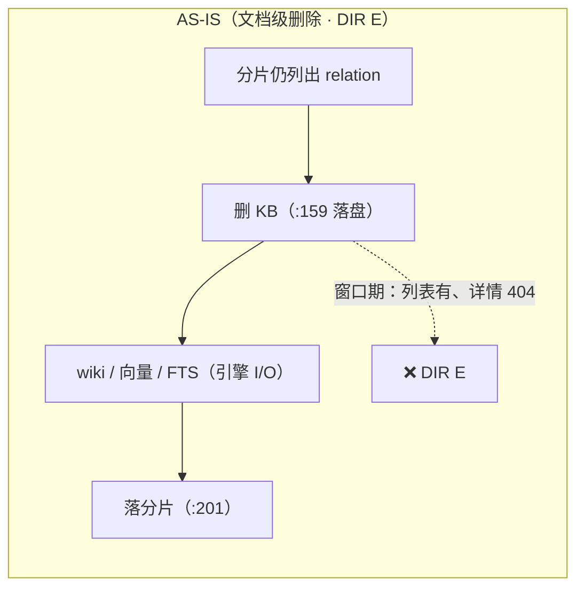
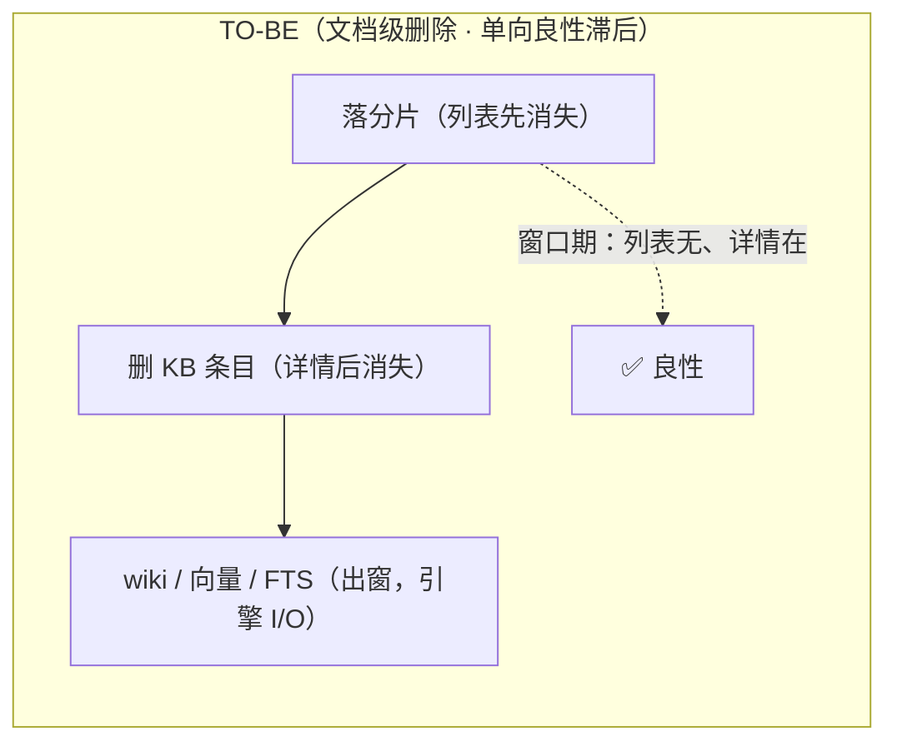

# S-04 写侧不变量与读全旁路（Q6 落地：read 只与提交窗口互斥）

## 1. 术语

- **I1 顺序不变量**：对任一 relation，落盘顺序必须保证「**分片（列表）可见 ⇒ KB（详情）可取**」——新增/更新 = **KB 先、分片后**；删除 = **分片先、KB 后**。
- **I2 入窗**：一次元数据变更涉及的多文件写必须**紧邻**且整段在提交窗口（`withMetadataCommitSync`）内，**中间不得夹引擎 I/O**。
- **I3 原子写**：单文件落盘一律 `writeJson`（`.tmp` + `renameSync` + `.lock`）。
- **I4 判据简化**：`read` 任务只与提交窗口互斥，与其余任何在跑任务**并行**。
- **跨进程边界（评审 #5）**：**并发读安全的根本保证是 I1**（顺序，跨进程/跨 CLI 均有效）；提交窗口是**进程内** `OperationCoordinator` 的机制，只提供**同进程**原子性——不得表述为"窗口=全局原子性"。
- **DIR E**：并发读观测到的「列表可见但详情 404」恶性中间态。

## 2. 现状（AS-IS）—— H2 验证结论（含实测）

### 2.1 单文件原子性：成立 ✅

所有元数据 JSON 走 `writeJson → walWrite`（`.tmp` + `renameSync` + 跨进程 `.lock`，`src/lib/wal.ts:134-154`）⇒ 不会读到半截 JSON。
**例外**：`src/lib/scope.ts:289`（`setSource`）是裸 `fs.writeFileSync` 写 `group-index.json`，且 `src/lib/import.ts:1724` 的 Phase 5 调用在提交窗口**外**。

### 2.2 逐路径顺序核对表（K = local KB 落盘 / S = relations 分片落盘 / W = 是否在提交窗口内）

| 变更路径 | 顺序与位置 | I1 | W |
|---|---|---|---|
| 导入 新增/覆盖 | K `import.ts:1119-1128` → S `:1706-1712` | ✅ | ✅ |
| 导入 回滚（失败文件） | K `:1974-1980` → S `:2049-2051` | ✅ | ✅ |
| doc/edit 发布 | K → S（`relation-edit-publish.ts:211-271`，失败回滚 KB） | ✅ | ✅（write lane + scope 写锁） |
| sync-relation 单条 | K `sync-relation.ts:249` → S `:1253` | ✅ | ⚠️ 未入窗（顺序正确 ⇒ 中间态良性） |
| sync-relation 批量 | K（逐条）→ S `:968`（阶段 4） | ✅ | ⚠️ 同上 |
| **delete-relation 文档级** | **K `delete-relation.ts:159` → S `:199-202`**，中间夹 wiki 移动 / 向量删除 / FTS 删除 | ❌ | ❌ **无窗口** |
| delete-relation 目录级 | S `:411/:419` → K `:383/:370` | ✅ | ⚠️ 未入窗 |
| manage-index 级联删除（`--force`） | **⚠️ 上线前必须核对**（见 §3.3 门槛） | ? | ? |
| restore / rebuild-vector | **⚠️ 上线前必须核对**（预计 ✅：只重写向量与 KB，分片不动） | ? | ? |

### 2.3 当前 vs 目标：写序对照（评审 #10）





### 2.4 队列判据现状（`src/lib/operation-coordinator.ts:195-198`）

```ts
if (item.kind === 'read') {
  return item.scopes.some((scope) => (this.committing.get(scope) ?? 0) > 0
    || (this.running.get(scope) ?? 0) - (this.runningEngineOnly.get(scope) ?? 0) > 0);
}
```
⇒ read 与**任何非 engine-only 的在跑任务**互斥 ⇒ 现场二"一个挂住的请求把整库读挡死 >10 分钟"（R8 只堵住两个已知源头）。

### 2.5 实测证据（`temp/verify-h2-delete-window.ts`，隔离 scope）

```
A2 中间态      : list=有  detail=404:文档原文不存在  kb=无   ← DIR E：列表里在、点开 404
A3 判定        : ✅ 复现「列表里在、点开 404」
B1 删除结果    : 30/30 成功；单轮最长耗时 4ms
B3 命中 DIR E  : 1 次（30 轮真实删除 + 并发读轮询）
```
> 该隔离 scope 无真实向量/FTS 工作 ⇒ 窗口仅 4ms；生产窗口 = 引擎 I/O 量级（开集合 ~0.7s 起，引擎忙时可分钟级，🟡 未实测）。

## 3. 方案（TO-BE）

### 3.1 修复删除路径（I1 + I2）

```ts
// src/delete-relation.ts（文档级 executeDeleteRelationLocal，约 :146-205）
// 1) 分片先落（列表先消失）+ 2) 紧邻删 KB（详情后消失）——同窗、无引擎 I/O
try {
  withMetadataCommitSync(scope, () => {
    if (result.cacheRemoved) {
      migrateLegacyRelationsCache(scope);
      persistCacheShape(scope, cache as never, new Set([resolvedGroup]));
    }
    // 幂等：KB 中本就没有该条目时**静默通过**，不写 result.reason（评审第 2 轮 N2：不得把幂等当告警）
    deleteLocalKbEntry(scope, resolvedGroup, relation);
  });
} catch (err) {
  // 与现状一致：失败只记 reason，不让整个删除抛错（保持 CLI 语义）
  result.reason = `${result.reason || ''} 元数据删除失败: ${(err as Error).message}`.trim();
}
// 3) 出窗后做长耗时清理（wiki → 回收站、向量删除、FTS 删除）
```

目录级删除同理：把 `:411/:419`（S）与 `:370/:383`（K）合并入窗并紧邻，之后再 `moveDirToTrash` / 树落盘。

> 代价（明确记录）：删除中途失败时，最坏状态是"**详情在、列表无**"（良性方向）+ `result.reason`；优于现状的"永久 DIR E"。被否决的是"保持 K 先删、只加窗口"——窗口内仍会产出 DIR E。

### 3.2 修 I3 原子写 + Phase 5 入窗

- `src/lib/scope.ts:289`：`setSource` 改 `writeJson(groupIndexPath, ...)`（与其它元数据同一原子写路径）。
- `src/lib/import.ts:1724`：Phase 5 的 `setSource` 调用**移入** Phase 4 的 `runMetadataCommit` 窗口（`:1706-1712`）。

### 3.3 判据简化（I4）+ **上线门槛（评审 #3）**

```ts
// src/lib/operation-coordinator.ts:195-198
if (item.kind === 'read') {
  return item.scopes.some((scope) => (this.committing.get(scope) ?? 0) > 0);
}
```

**上线门槛（三条全满足才可合入 I4）**：

1. §2.2 表中两条"待核对"路径（`manage-index --force` 级联删除、`restore`/`rebuild-vector`）**完成核对并登记结论**；若有违反 I1 者，先修顺序/补窗。
2. §3.4 回归测试覆盖 §2.2 表**全部路径**（未登记/未核对的路径使测试失败）。
3. `test/coordinator-read-lane.test.ts` 用例 ⑥ 的语义反转已更新（read 不再与 doc-edit 短写互斥）。

### 3.4 回归护栏（P0，不可省）

新增 `test/read-write-concurrency.test.ts`：
1. **表驱动**：对 §2.2 表每一条路径 → 造正常态 → 起并发读 hammer（`readAllGroupCaches` + `readDocumentForEdit`，≥1ms 间隔）→ 执行该变更 → 断言全程无 DIR E（`listed && !kbHas`）。
2. 收录 `temp/verify-h2-delete-window.ts` 的 A 段为**第一个用例**（修复前必红 ⇒ 证明测试有效性）。
3. **路径登记强制**：清单内未登记的变更路径 ⇒ 测试失败（防新路径绕过不变量）。

### 3.5 迁移策略（评审 #10 补齐）

- **存量数据无需一次性修复**：I1 只约束"变更发生时的顺序"，修复后**新的变更**即安全；历史残留的中间态不存在（每次变更都是稳态落盘）。
- **无需数据迁移**、无需停机；仅需 **daemon 重启**加载新代码。
- 回滚策略：I4（判据简化）是行为变更，若上线后出现异常，**单独回滚该一行**即可退化为"read 与写互斥"（其它修复可保留）。

### 3.6 跨进程（P2，本次不实现）

`bumpManifestRevision` 移到分片批写**之后**（不变量：revision 变了 ⇒ 分片已就位），消除"新 revision + 半新半旧分片"与错误缓存。需同步评估崩溃时 revision 不涨导致的缓存不失效问题。

## 4. 接口设计

无新增对外接口；内部改动：

```ts
// src/lib/delete-relation.ts（内部，不导出）
function deleteLocalKbEntry(scope: string, group: string, relation: string): boolean;  // 抽出的原子写单元

// src/lib/operation-coordinator.ts
private conflicts(item: Pending): boolean;   // read 分支简化为仅看 committing
```

**Demo：修复前后的用户可见差异**

```jsonc
// 修复前：并发删除期间读
{ "list": { "count": 1, "has": true }, "detail": { "status": 404, "code": "DOC_NOT_FOUND", "message": "文档原文不存在" } }
// 修复后（同一时刻）
{ "list": { "count": 0, "has": false }, "detail": { "status": 404, "code": "DOC_NOT_FOUND" } }   // 列表先消失 ⇒ 用户点不到它
```

## 5. 关键决策点

| # | 决策 | 被否决方案 + 理由 | 重新评估触发条件 |
|---|---|---|---|
| D1 | 用 **I1 顺序 + I2 入窗** 满足并发读安全，而非"给 read 加白名单/超时" | R9 路线 a（白名单 + 占槽上限）：只覆盖已知任务类型，未来新增任务又会复现；强制释放仍在跑的写任务违反 N10 红线 | 出现无法满足 I1 的路径（如需写外部系统才能完成同一变更） |
| D2 | read **仍与提交窗口互斥** | 完全放开：窗口内的多文件写可能被读到中间态，本设计前提不成立 | 提交窗口能压缩到"单文件单写"时 |
| D3 | 删除路径改为"**分片先落**"，接受"失败后详情在、列表无" | 保持 K 先删：会稳定产出 DIR E（已实测复现） | 无 |
| D4 | 新增**表驱动并发读回归测试**（路径未登记即失败） | 只加一条删除路径用例：新路径仍可能绕过不变量 | 测试维护成本过高时改为"按目录静态扫描" |
| D5 | 跨进程批级一致性列为 **P2** | 本次一并做：需重排 revision 语义，波及跨进程缓存失效，风险与目标（页面可用）不成比例 | 出现跨进程 DIR E 的真实案例 |

## 6. 异常处理

| 场景 | 行为 | 是否对外暴露 |
|---|---|---|
| 删除中途抛错（现状：S 永不落盘 ⇒ **永久** DIR E） | 修复后 S 已先落 ⇒ 最坏"详情在、列表无"（良性）；`result.reason` 记录 | 是（既有 reason 字段） |
| 提交窗口内读请求 | 排队等待（毫秒级），窗口退出立即放行 | 否 |
| 新增变更路径未登记 | 回归测试失败（强制登记） | 否（开发期可见） |
| 读与 `optimize`（S-01）并发 | read 旁路（不碰引擎）；检索类仍排队 | 是（S-02 的 R5 文案 + 父文档已知限制） |
| 跨进程读者见到中间态 | 单文件原子保证不读到半截；顺序保证不出现 DIR E；批级半新半旧为 P2 | 否 |

## 7. 影响范围

| 文件 | 变更 |
|---|---|
| `src/lib/operation-coordinator.ts` | `conflicts()` 的 read 分支简化（**行为变更，受 §3.3 门槛约束**） |
| `src/delete-relation.ts` | 文档级/目录级删除顺序反转 + 入窗 + 抽出 KB 删除单元 |
| `src/lib/scope.ts` | `setSource` 改原子写 |
| `src/lib/import.ts` | Phase 5 移入 Phase 4 窗口 |
| `test/read-write-concurrency.test.ts` | 新增（表驱动 + DIR E 断言） |
| `test/coordinator-read-lane.test.ts` | 需更新（用例 ⑥ 语义反转） |
| `docs/` | 说明"读只与提交窗口互斥"的新口径 |

## 8. 待定问题

1. §2.2 表两条待核对路径（`manage-index --force` 级联删除、`restore`/`rebuild-vector`）的结论 → **上线门槛，非"待定"**，实现期完成。
2. 跨进程批级一致性（P2）：是否需要"读者等 revision 稳定"的轻量机制？本次不做，先记录。
3. `sync-relation` 单条/批量是否需要入窗？I1 已满足（良性），入窗只是更强保证 → 实现期评估，不强制。

## 9. 不在范围内

- R9 原"占槽上限 / 强制释放"（本设计的 I1–I4 已取代其目标）
- 引擎内部 compaction 行为（无 API）
- 跨进程一致性（P2）
