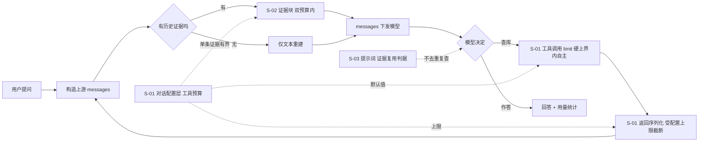
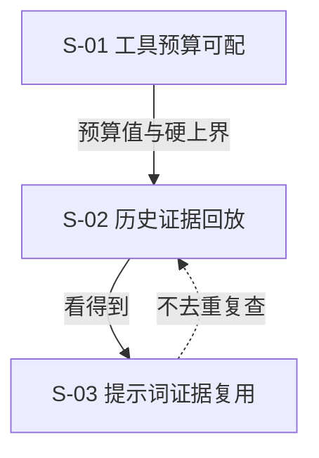

# AI 对话证据回放与工具预算可配 · 总体设计（父文档）

> 需求：`../requirement.md`（REQ-20261015-001 · 已确认）
> 已确认决策：**D1** 两级存储（`prompt-config.json` 覆盖 → 内置默认，不新增 `config.yaml` 字段）· **D2** 文本证据块回放 · **D3** 轮数 + 总量双预算

---

## 1. 需求背景 & 目标

**背景**：上游 messages 每轮从落盘重建，重建只取 `{role, content}`（`src/lib/chat/retrieval/tool-loop.ts:343-346`）⇒ 历史工具返回与引用原文对模型不可见，只能重复检索；两个工具预算（返回上限 10000、检索条数 5）是硬常量，用户与 AI 都改不了。

**整体目标**：
1. 既往轮次的**工具返回**与**引用原文**以有界证据块回到上下文（S-02）；
2. 两个工具预算交给用户配置，AI 在硬上界内**自主**决定检索条数（S-01）；
3. 提示词层补"已有证据优先复用"判据，与回放形成双保险（S-03）。

**不在范围内**：模型 token 窗口探测/换算；回放策略可视化；压缩时保留证据；按工具分别设限；CLI 配置命令；`config.yaml` 部署默认层。

**已确认的默认假设**：单机单用户、低并发（沿用现状）；回放与配置读写均为进程内操作，**无新增外部依赖**。

---

## 2. 关键环节一览图

---

## 3. 总体方案设计

### 3.1 子需求节点图

### 3.2 落点总览（子需求 → 文件）

| 子需求 | 主要文件 |
|---|---|
| S-01 | `src/lib/chat/prompt-config.ts`、`chat-contract.ts`、`chat-routes.ts`、`mcp-tool-registry.ts`、`retrieval/tool-response.ts`、`web/src/chat/PromptConfigLayer.tsx`、`web/src/chat/ChatPanel.tsx` |
| S-02 | `src/lib/chat/retrieval/replay.ts`（新增）、`retrieval/tool-loop.ts` |
| S-03 | `src/lib/chat/retrieval/retrieval-skill.ts`、`retrieval/tool-loop.ts`（`renderRefsBlock`） |

---

## 4. 全局风险 & 跨子需求依赖

### 4.1 跨子需求依赖

- **S-02 → S-01（弱）**：证据块"单条证据有界"使用 S-01 的 `toolResponseChars` 生效值；S-01 未交付时回落常量 10000，**不阻塞**。
- **S-03 与 S-02（协同）**：双保险、互不阻塞；**S-03 先交付并实测** —— 其实测结果决定 S-02 的预算与范围（见 §4.5）。

### 4.2 接口契约变化（跨子需求）

| 契约 | 变化 | 兼容性 |
|---|---|---|
| `GET /api/chat/prompt-config` → `limits` | **新增 6 字段**（`toolResponseChars{Min,Max,Default}`、`searchHits{Min,Max,Default}`） | 纯增量；旧前端忽略新字段（S-01 §4.1） |
| `PUT /api/chat/prompt-config` 请求体 | **新增 2 个可选字段** | 纯增量；整体替换语义不变（调用方须带全字段，既有测试 ④ 锁定） |
| `ChatToolResponse`（SSE `tool_end.response` + 落盘 `progress[].response`） | **新增可选 `limit`** | 旧记录缺失 → 前端回退文案；前后端双副本须同步（`contract-parity` 锁定） |
| 上游 messages 构造 | 本轮 user 末尾追加**证据块** | 无对外契约变化；纯后端行为（S-02） |
| 无变化 | `ChatMessage` / `ConversationFile` / `PromptInjectionSnapshot` / `ContextCharsParts` | 零迁移（S-02 不新增落盘结构） |

### 4.3 全局风险

| 风险 | 影响 | 缓解 |
|---|---|---|
| 上下文膨胀 | 每轮请求携带历史证据，成本与延迟线性上升 | 双预算（S-02）+ 既有 `context` 事件占比可见 + 压缩仍生效 |
| 压缩被回放架空 | 压完发现上下文没变小 | 回放只遍历 `conv.messages` ⇒ 已移出轮次天然不回放（S-02 §3.5） |
| 上游对长 user 消息的容忍度 | 证据块与本轮问题同处一条 user 消息 | 双预算限长；异常时的回退方案见 S-02 §7 决策 1 |
| 配置面膨胀 | 新增两个配置项 | 只暴露用户真正会调的项；回放预算暂不配置（S-02 §9 Q1） |
| 旧数据兼容 | 旧会话 `progress` 无 `response`、无 `limit` | 逐条跳过 + 文案回退，零报错（S-01/S-02 异常表） |
| 契约双副本漂移 | 前后端 `chatContract.ts` 各自维护 | `contract-parity` 测试锁定（既有机制） |
| 提示词文案漂移 | 已保存配置优先于代码默认 | 交付说明 + 界面「已修改/默认」标识 + 恢复默认入口（S-03 §3.5） |

### 4.4 共享术语速查

| 术语 | 定义（SSOT） |
|---|---|
| **工具预算** | 本设计新增的两项用户可配值：`toolResponseChars`（单次工具返回字符上限）、`searchHitsPerCall`（`ki_search` 未传 limit 时的条数） |
| **覆盖值 / 未覆盖** | `prompt-config.json` 里的可选字段；缺省 = 未覆盖 ⇒ 生效值回落到内置默认（与 `contextChars` 同语义） |
| **硬上界** | 用户不可配的代码常量：`toolResponseCharsMin/Max = 1000/100000`、`maxHitsPerCallHardMax = 50` |
| **证据** | 可回放的历史材料：`assistant.progress[].response`（工具返回，`kind !== 'skill'`）与 `user.refs[]`（用户引用） |
| **证据块** | 证据按轮次渲染的纯文本块，附在**本轮 user 消息末尾**（D2） |
| **回放预算** | 证据块双约束：`replayTurns = 5` + `replayMaxChars = 20000`（D3） |
| **本轮引用块** | 既有能力：本轮 `refs` 渲染的块（`renderRefsBlock`），与证据块**同消息、不同段** |

### 4.5 交付顺序（challenger 意见 4 修订）

**期一 S-03**（成本最低：三处文案）→ **期一末实测**（同会话连续 3 轮追问，统计 `ki_search` 调用次数下降幅度）→ **期二 S-01**（预算旋钮，独立可交付，立即缓解长文档截断）→ **期三 S-02**（据期一实测确认回放预算与范围：可缩为最近 2 轮，或仅回放 `ki_get_module_info` 整篇原文）。

> **为什么把 S-03 提到最前**：S-03 与 S-02 解决同一症状的两个成因。若提示词改完后重复检索已大幅下降，S-02 的边际收益主要是"原文可见性"，其预算可显著收窄 —— 先用最低成本量出收益，再决定最高成本的投入多少（避免为已部分解决的问题付每轮 2 万字符的持续成本）。
>
> **实测支撑（2026-10-15 demo，见 `../demo/verify-report.md`）**：同一问题、同一份证据、**仅措辞不同** —— 旧口径模型**发起 `ki_search`**（复现用户报告的行为），新口径**不调用工具、直接基于证据作答** ⇒ S-03 有效性已获**执行性证据**；同一实测显示 20000 字符证据使 TTFB **+40%**（超判据），故 S-02 预算已校准为 **10000**。
