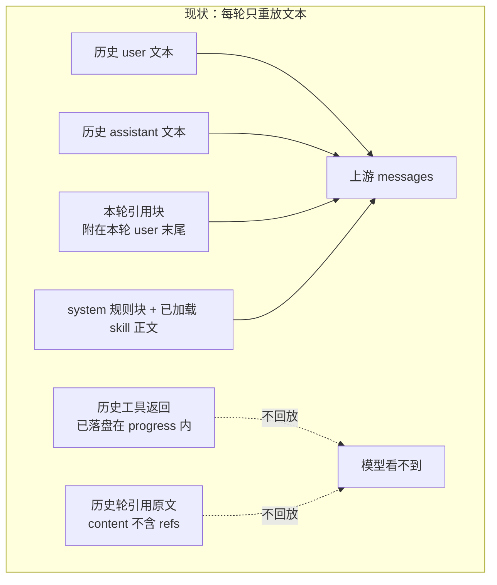
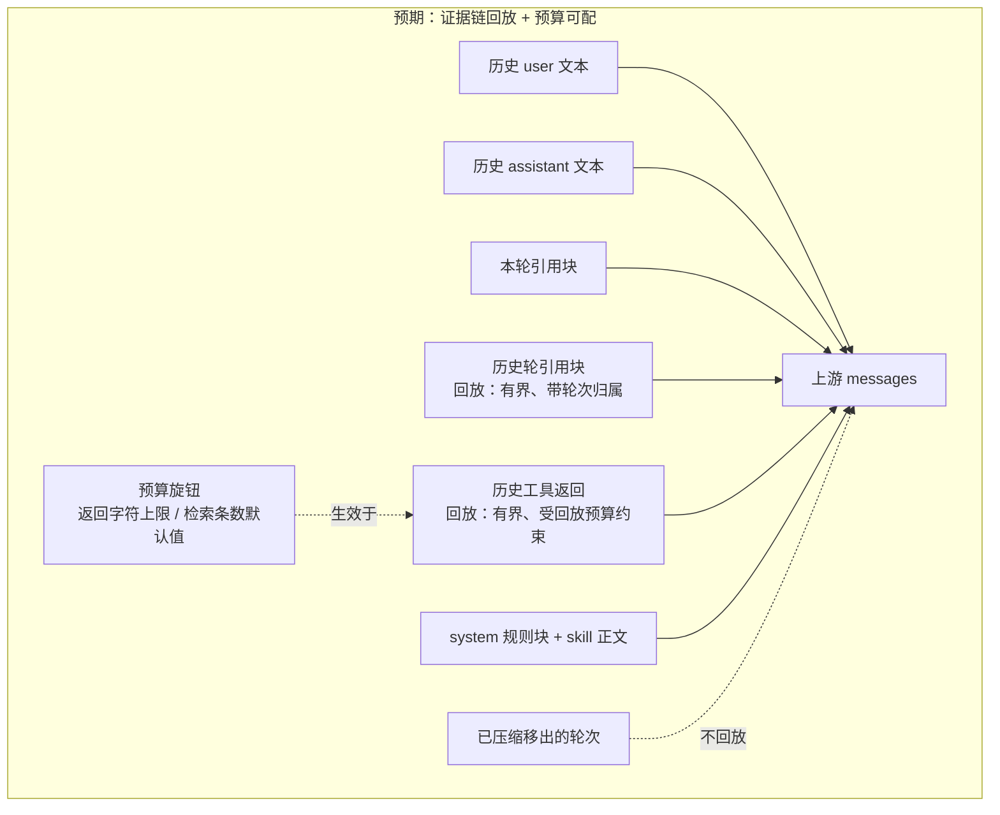
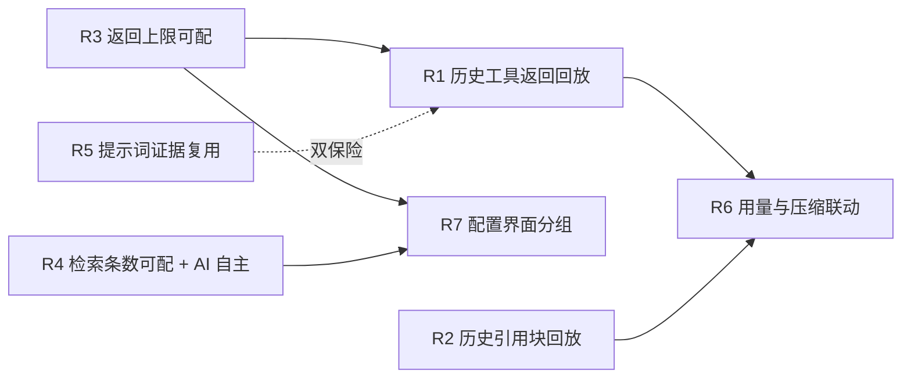

# PM 报告：AI 对话证据回放与工具预算可配

- **模式**：M1 需求定义（一次成型档；因涉及多模块 + 上游消息构造变更，分析按严谨档内容口径出全）
- **触发**：用户在看过多轮检索/预算分析报告后给出三条裁决（原话见 §1）
- **证据声明**：最高等级 **🟢**；取证方式 = **代码直读**（`src/lib/chat/*`、`web/src/chat/*`、`test/chat/*`）+ **ki 项目记忆**（`kisearch-memory`）。
  - **降级说明**：无运行实测（未起服务、未接上游模型）⇒ "AI 是否真的每次检索""回放后模型是否不再重复检索""上游对历史 tool 消息的接受度"均**未经实测**，各条目已挂验证方法。设计取舍标 🟡 并进 §6。

---

## 0. 关键结论（先读这一段）

### 0.1 三项裁决对应三条独立改动线，但共用同一个根因

根因：**AI 对话的上游 messages 是"每轮从落盘重建"的，而重建时只取 `role + content`**——历史轮次的工具返回、引用原文都不参与重建（`tool-loop.ts:343-346`）。🟢
⇒ ① 证据丢了（模型只能重查）；② 预算写死（10000 / 5 都是常量，改不了）。

| 用户裁决 | 改动线 | 现状定性 |
|---|---|---|
| P2 limit 可配置 + AI 可自主传值 | **工具面**（schema maximum + 默认值可配） | 不是"不能传"——AI **能**传 limit，只是 maximum 被压到 5，传了也没用（🟢 `mcp-tool-registry.ts:318,327,339`） |
| P1 历史工具返回 + 引用块进上下文 | **上游消息构造**（回放） | 数据**已落盘**（`progress[].response`，有界 10000），只是**没被回放**（🟢） |
| 10000 字符可配置、不进 config.yaml | **配置层**（prompt-config.json 用户覆盖值） | 现为硬常量，前端截断文案与 prompt 正文也各写死一遍（🟢） |

### 0.2 一个能显著降低 P1 成本的事实：证据已经落盘了

`ChatMessage.progress[]` 里存了每次工具调用的 `response`（`ChatToolResponse{text, originalChars, truncated}`，≤10000 字符）——**历史证据就在磁盘上**，P1 的工作量主要是"读取 + 回放 + 边界控制"，不是"新增存储"。🟢

**但有一个缺口必须在设计阶段解决**：progress 里**没有保存工具调用的完整参数与 `call_id`**：
- `defaultDescribe` 刻意排除大字段（`mcp-tool-registry.ts:274-279`），`ki_get_module_info` 的 `group/relation` 参数**根本不在 progress 里**；
- 因此**无法**把历史回放还原成严格的 `assistant.tool_calls` + `role:'tool'` 消息对。
- ⇒ 回放形式只有两条路（见 §6 D2）：**(a) 文本证据块回放**（沿用"已加载 skill 正文每轮重放"的既有模式，零协议风险）或 **(b) 补落盘调用参数与 call_id** 后重建协议消息（跨上游兼容性风险高）。**推荐 (a)**。

### 0.3 "引用块其实已经在上下文里"——用户直觉需要一处修正

引用（refs）**不是**"没进上下文"：本轮引用块附在本轮 user 末尾（`tool-loop.ts:455-458`），且前端 pendingRefs **发送后不清空、多轮持续携带**（`ChatPanel.tsx:1044-1045`，Q3 拍板）⇒ 只要用户不删，每轮都会带上同一份引用块。🟢

**真实缺口是两条**：① 用户**删除引用后**，此前轮次的引用原文在上下文中彻底消失（历史 content 不含 refs）；② 历史轮次的引用**没有归属**——模型不知道"第 3 轮引用过这篇文档"，无法把证据与当时的讨论关联。⇒ R2 的价值应重新定位为"引用作为历史证据的归属与留存"，不是"让引用进上下文"。

### 0.4 三条裁决里最贵的是 P1，必须带预算闸门

机制上"全部回放"会让上下文线性膨胀：**每轮 +（本轮工具返回总量）**。按现在的上限举例：单轮 5 次工具 × 10000 字符 = 5 万字符/轮，10 轮 = 50 万字符（≈15 万 token），且**每轮都要重发**——成本与延迟都会显著上升。🟢（`computeContextChars` 基于最终 messages 计算，回放会被自动计入，`tool-loop.ts:410-426`）
⇒ R1 必须同时定义**回放预算**（如：仅最近 N 轮 / 总字符上限 / 随压缩同步移除），否则"上下文更全"会变成"更快撞上限 + 更贵"。

---

## 1. 原始需求描述

> 用户原话（2026-10-15，三条裁决）：
>
> 1. 「P2 limit 可以为可配置，但注意 limit 配置的默认值。然后 AI 似乎不能自己传入 limit 的值，这个改为可以传，AI 可以自动控制 limit 的数值。」
> 2. 「P1 历史工具返回，以及引用快数据要进入上下文中，不然持续对话，AI 的上下文根本不全啊。」
> 3. 「10000 字符可配置，但是不要进 confiy.yaml 要单独存储，可以参考上下文限制的配置逻辑。」

---

## 2. 需求理解

**需求形态**：**真实需求**（三条都是效果诉求，不是伪装成需求的方案）。三条共同指向一个能力：**让 AI 在持续对话中拿到完整且可调的"证据与预算"**。

**功能本质**：把"AI 对话的上下文"从"每轮只重放对话文本"升级为"**重放对话文本 + 证据链（历史工具返回 / 历史引用）**"，并把两个写死的预算旋钮（工具返回字符上限、检索条数）交到用户与 AI 手里。

**使用场景**：
- 场景 A（P1 主场景，🟢 用户描述）：同一会话多轮追问同一篇文档 —— 第 1 轮用 `ki_get_module_info` 读了整篇原文，第 2 轮问该文档的细节。**现状**：第 1 轮的工具返回不在第 2 轮上下文里，模型只能重新检索。**预期**：直接基于已读原文作答。
- 场景 B（P1 引用场景）：用户引用一段内容并在多轮里讨论，删掉引用后继续追问 —— **现状**：之前引用的原文彻底消失。**预期**：历史引用作为证据留存可追溯。
- 场景 C（P2 + 10000 场景）：读一篇长文档被 10000 字符截断导致答不全 —— **现状**：无任何入口可调。**预期**：配置层可调，长文档能完整进入模型上下文（并在上下文预算内可见代价）。
- 场景 D（P2 limit 场景）：用户问一个需要多份材料横向比较的问题 —— **现状**：AI 最多一次拿 5 条，只能反复查。**预期**：AI 按问题复杂度自主决定查询条数（默认仍为 5）。
- 场景关联性：C/D 是"预算旋钮"，A/B 是"证据留存"；**A/B 让模型少查，C/D 让模型每次能查更多** —— 二者共同决定"上下文里有没有、够不够"。

**用户角色**：单一角色 —— 知识库使用者（本机单用户场景），无多角色权限诉求。

**核心痛点**：持续对话中 AI 反复检索同一批内容（慢、贵、噪音多）；需要整篇原文时被截断；查询条数被写死。

**期望体验**："聊到第 10 轮，AI 还记得第 1 轮读过的那篇文档的原文"；"需要的时候能把上限调上去"。

**非功能性需求**：
- **成本/性能**：回放必须**有界**，不得让上下文爆炸（见 §0.4）。
- **可用性**：新增配置项与现有「上下文窗口」同层同交互（保存即生效、可恢复默认、非法值被拦）。
- **兼容性**：旧会话（progress 未保存工具返回正文）必须能降级运行，不得报错。
- **一致性**：截断/条数相关文案（前端提示、prompt 正文、工具 schema）必须与配置值同源，不得各处写死。

**本次推理的关键假设**：

| 假设 ID | 假设内容 | 验证难度 | 验证建议 |
|---|---|---|---|
| H-01 | 用户要的"进上下文"= 后续轮次仍能看到既往轮次的工具返回与引用原文 | 低 | 用户确认（唯一确认点） |
| H-02 | 新配置项**不进 `config.yaml`**，只存 `prompt-config.json`（用户覆盖值），"恢复默认"回到内置默认 | 低 | 待用户确认（§6 D1；本条影响是否新增 `llm.*` 字段与 schema） |
| H-03 | limit 的**默认值必须保持 5**（未配置时行为与今天完全一致），AI 只是获得"能传更大值"的能力 | 低 | 用户确认（用户已强调"注意默认值"） |
| H-04 | 回放允许做成"文本证据块"而非严格 tool 协议消息（用户不关心实现形态，只关心模型看得到） | 中 | 设计阶段验证上游兼容性后定 |
| H-05 | 用户接受"回放有预算上限"（不是无限制全量回放） | 中 | 用户确认（§6 D3） |

### 2.10 变更面与「现状 → 预期」图示

**变更面**：**数据流**（上游 messages 的构造）+ **UI**（对话配置层新增分组）。**现状来源**：读代码确认（🟢，行号见图下）。

**图 1（数据流）**：





**图 2（UI：对话配置层新增分组）**：

```
┌────────────────────────────────┐
│ 对话配置                        │
│   基础提示词                    │
│   Skill                        │
│   上下文窗口                    │
│   ✚ 工具预算                    │
│      工具返回上限  [ 10 ] 千字符 │
│      检索条数默认  [  5 ] 条     │
│      恢复默认                   │
│   工具与权限                    │
└────────────────────────────────┘
```

**变更点表**：

| 变更点 | 现状 | 预期 | 类型 | 关联假设 |
|---|---|---|---|---|
| 上游 messages：历史工具返回 | 不回放（模型看不到） | 有界回放 | 新增 | H-01 / H-04 / H-05 |
| 上游 messages：历史引用块 | 不回放（仅本轮附加） | 有界回放，带轮次归属 | 新增 | H-01 / H-05 |
| 上游 messages：压缩移出轮次 | 不参与 | **明确不回放**（护栏） | 修改 | - |
| 工具 schema：`ki_search.limit` | maximum = 5（写死） | maximum 可配，AI 可自主传 | 修改 | H-03 |
| 工具返回序列化上限 | 10000 硬常量 | 配置值（默认仍 10000） | 修改 | H-02 |
| 截断文案（前端 / prompt 正文） | 各写死 10000 | 与配置值同源 | 修改 | H-02 |
| 对话配置层 | 基础提示词 / Skill / 上下文窗口 / 工具与权限 | + 工具预算（两项 + 恢复默认） | 新增 | H-02 |
| 提示词（引用块 / 基础 / skill 正文） | 无"已有证据优先复用"判据 | 补判据，数字不写死 | 修改 | H-01 |

---

## 3. 现状取证（🟢 代码直读）

| # | 事实 | 位置 |
|---|---|---|
| 1 | 上游重建**只取 `role + content`**；历史工具返回与历史 refs 均不进上下文 | `src/lib/chat/retrieval/tool-loop.ts:343-346` |
| 2 | 引用块**只附本轮 user**；且引用**不进 system 组** | `tool-loop.ts:455-458`、`:189-197`、`:340-342` |
| 3 | 前端引用**发送后不清空**（同会话多轮持续携带，直到手动删除 / 切会话 / 切 scope） | `web/src/chat/ChatPanel.tsx:1044-1045`、`:316`、`:359` |
| 4 | 工具返回**已落盘**（`progress[].response`，有界 10000，页面与模型共用） | `src/lib/chat/chat-contract.ts:104-137`、`chat-routes.ts:1519-1523` |
| 5 | progress 的 `describe` **刻意排除大字段**（`module_info`/`edits`/`text`/`items`）⇒ 工具参数与 `call_id` 未落盘 | `src/lib/chat/mcp-tool-registry.ts:274-279` |
| 6 | `ki_search.limit`：minimum 1 / **maximum = 5** / **default = 5**；执行缺省亦为 5 | `mcp-tool-registry.ts:318`、`:327`、`:339` |
| 7 | `maxHitsPerCall = 5` 是 `CHAT_BUDGET` 常量（T11 拍板，暴露面刻意收窄） | `chat-contract.ts:417-418` |
| 8 | `maxToolResponseChars = 10000` 硬常量；截断按码点、不切代理对 | `chat-contract.ts:419-420`、`retrieval/tool-response.ts:4-20` |
| 9 | 10000 的**另两处写死**：prompt 正文（"超过 10000 字符时会截断"）与前端文案（"超过 10000 字符已截断"） | `retrieval/retrieval-skill.ts:87`、`web/src/chat/ChatPanel.tsx:2455` |
| 10 | 上下文用量基于**最终 messages** 计算（含 tool 分量）⇒ 回放会被自动计入，无需另改 | `tool-loop.ts:410-426` |
| 11 | 压缩（摘要式/截断式）会把早期消息移出；摘要以独立 system 块注入 | `tool-loop.ts:394-408`、`chat-contract.ts:182-204` |
| 12 | 配置层先例：`contextChars` 走「prompt-config.json 用户覆盖 → config.yaml 部署默认 → 内置默认」，恢复默认 = **删键**；前端 `cloneConfig` 是白名单拷贝 | `src/lib/chat/prompt-config.ts:152-176`、`:403-416`、`web/src/chat/PromptConfigLayer.tsx:54-62`、`:296-362` |
| 13 | 配置改动生效范围：提示词/skill **只对新建会话**（会话快照）；工具开关与上下文上限**下一次提问**生效 | `prompt-config.ts:13-22`、`PromptConfigLayer.tsx:417-419` |

---

## 4. 需求清单

### 4.0 影响面（关联功能与影响评估）

| 受影响功能/方 | 影响类型 | 影响程度 | 证据 | 建议处理 | 需用户拍板 |
|---|---|---|---|---|---|
| 反幻觉约束（N17 硬性规则） | 流程 | 降级风险 | `retrieval-skill.ts:34-44` | 提示词只放宽"已有证据不必重复查"，**不动**"无命中不得冒充" | 是（幅度） |
| 上下文用量面板 / 预警 / 压缩 | 性能·展示 | **降级**（回放后占比涨得更快，更早触预警） | `tool-loop.ts:410-426`、`ChatPanel.tsx:1520-1527` | R6：口径与压缩联动必须同步；文案说明"证据回放会占用上下文" | 否 |
| 会话压缩 | 流程 | **破坏风险**（若回放已移出轮次 = 压缩白做） | `tool-loop.ts:394-408` | R6：回放范围必须与 messages 保留范围一致 | 否 |
| 旧会话（progress 无 response） | 兼容 | 降级（可接受） | `ChatPanel.tsx:2458-2462`（旧记录提示） | R1 降级：无正文则跳过回放 | 否 |
| 前端截断文案 | 展示 | **破坏**（不同步即说谎） | `ChatPanel.tsx:2455` | R3 必含 | 否 |
| prompt 正文内的数字 | 展示 | 降级（漂移） | `retrieval-skill.ts:87` | R5：数字不写死或动态渲染 | 是（三选一） |
| 页面 sources 列表 | 展示 | 无感（仍按现有口径截断） | `retrieval/projection.ts:88-107` | 明确"模型可见条数 = AI 传的 limit；页面来源列表口径不变" | 否 |
| 既有测试锚点 | 测试 | 需同步 | `test/chat/tool-response.test.ts:14-23`（10000 边界）、`tool-response-integrity.test.ts:60` | 参数化为"默认值" | 否 |
| 前后端配置契约副本 | 外部契约 | 降级（需同步） | `prompt-config.ts:152-176` + `web/src/api/chatContract.ts` | 新增字段 + `limits` 同步 | 否 |
| 工具执行耗时（limit 调大） | 性能 | 降级 | `mcp-tool-registry.ts:333-343`（`TOOL_TIMEOUT.WRITE` 60s） | limit 上界需与超时档位一起评估 | 是（上界） |

> `⚪ 未发现`：未发现除上述之外的消费方（`10000` 在 `docs/` 仅 `req-chat-mcp-tools-refactor.md` 有表述，实施时需一并核对；`test/` 与 `web/` 已列）。

### 4.1 需求清单

| 编号 | 需求 | 优先级 | 预期效果 | 变更点 | 依赖 | 验收标准 |
|---|---|---|---|---|---|---|
| **R1** | **历史工具返回进入上下文**：既往轮次已获取的工具返回（`progress[].response`）在后续轮次重建上游 messages 时被回放，且**有回放预算**（轮次/总量至少设一项） | P0 | 同一会话追问时，AI 不再重复检索已获取过的内容；能引用之前读到的整篇原文 | 上游 messages：历史工具返回 | R3（回放内容的边界值） | 同会话第 1 轮读取一篇文档 → 第 2 轮追问细节：模型侧可见第 1 轮返回正文（断言上游 messages 含该证据块）；且**不存在**因回放导致的上下文无界增长（超预算即按规则裁剪并有可见说明） |
| **R2** | **历史引用块进入上下文**：既往轮次的用户引用（refs）在后续轮次可被回放，并带"哪一轮引用"的归属；用户删除引用后历史引用仍可追溯 | P1 | 引用作为历史证据留存；追问时不必重新引用 | 上游 messages：历史引用块 | - | 第 1 轮引用片段 → 第 2 轮删除引用后追问该片段内容：模型仍能看到该片段（断言上游 messages 含历史引用块） |
| **R3** | **工具返回字符上限可配**（默认仍 10000）：对话配置层可查看/修改/恢复默认；值存 `prompt-config.json`，**不写 `config.yaml`**；前端截断文案与 prompt 正文随值同源 | P0 | 读长文档不再被硬截断；用户能自己权衡"完整度 vs 上下文占用" | 工具返回序列化上限；截断文案；对话配置层 | - | 未配置时行为与今天完全一致（10000）；改小/改大后**下一次提问**生效；截断提示显示实际生效值；`config.yaml` **逐字节不变** |
| **R4** | **检索条数可配 + AI 可自主传 limit**：`ki_search.limit` 的默认值可配（**默认必须仍为 5**）、上限放开（设硬上界），AI 可按问题复杂度自主选择条数 | P0 | 复杂问题一次拿到足够材料，不再反复查 | 工具 schema：`ki_search.limit` | - | 未配置时默认仍为 5（AI 不传时行为不变）；配置调大后 AI 传更大值被接受并生效；AI 传超界值被拒并回可见错误（不崩溃） |
| **R5** | **提示词补"证据复用"判据**：三处同源（引用块文案 / 基础提示词 / 检索 skill 正文）明确"已有证据足以回答时不必为确认而重复检索；需要引用之外的内容才检索并说明补充来源"；**数字不写死** | P1 | 减少无谓检索；与 R1/R2 形成双保险（看得到 + 不去重复查） | 提示词 | R1/R2/R3（文案与数值同源） | 同一会话连续 3 轮追问：`ki_search` 调用次数较现状显著下降；同时"无命中不得冒充"用例仍成立（回归不破 N17） |
| **R6** | **用量与压缩联动**：回放内容计入上下文明细（tool / refs 分量正确）；已压缩移出的轮次**不回放**；面板显示与实际一致 | P1 | 数字不说谎；压缩不会被回放架空 | 上游 messages：压缩移出轮次 | R1、R2 | 压缩前后：面板 `contextChars` 与下一轮实际请求一致；已移出轮次的证据不再出现在上游 messages |
| **R7** | **配置界面**：对话配置层新增「工具预算」分组（工具返回上限 + 检索条数默认值 + 恢复默认 + 语义说明），位置紧邻「上下文窗口」 | P0 | 用户能找到并调整 | 对话配置层 | R3、R4 | 分组可见可改；保存后不刷新页面即反映新值；非法值被拦并给人话原因；恢复默认回到内置默认 |

**"需配套改"项已进清单**（不是只写在影响表里）：R5 = 提示词缺口；R6 = 用量口径与压缩护栏；R7 = 配置入口（R3/R4 的可见性前提）。

### 4.2 远期需求（本次不做，登记备查）

| 阶段 | 需求 ID | 需求描述 | 预期效果 | 依赖 | 验收标准 |
|---|---|---|---|---|---|
| 远期 | REQ-F01 | 回放策略可视化（用户能看到"本轮上下文里回了哪些证据、占了多少"） | 上下文不再黑盒 | R1/R6 | 面板可见证据清单与占用 |
| 远期 | REQ-F02 | 手动压缩时**保留**证据（把证据摘要并入压缩摘要） | 压缩后仍不失忆 | R1/R6 | 压缩后可答压缩前读过的事实 |
| 远期 | REQ-F03 | 工具预算的"按工具分别设限"（如 `ki_get_module_info` 单独放宽） | 精细控制 | R3 | 不同工具不同上限 |

### 4.3 需求依赖图



**依赖关系说明**：R7 是 R3/R4 的可见性前提（无界面则退化为改文件）；R1 的回放边界值引自 R3；R6 依赖 R1/R2（回放与压缩必须同步，否则压缩失效）；R5 与 R1/R2 是"看得到 + 不去重复查"的双保险，可并行但同批价值最大。

**功能重叠**：无（与 REQ-20261014-001 的「上下文窗口」互斥：那是**读数分母**，本批是**真实行为预算**，语义不得混用——UI 文案必须区分）。

### 4.4 需求验证标准

| 需求 ID | 验证方式 | 验证指标 | 验证时机 |
|---|---|---|---|
| R1 | 端到端（隔离实例 + mock 上游，断言上游 messages 内容） | 第 2 轮追问时上游可见第 1 轮工具返回；回放总量不超预算 | 开发完成后 |
| R2 | 端到端（同上） | 删除引用后仍可见历史引用块；带轮次归属 | 开发完成后 |
| R3 | 单测 + 端到端 | 默认 10000 不变；改后下一次提问生效；`config.yaml` 逐字节不变 | 开发完成后 |
| R4 | 单测（参数校验边界）+ 端到端 | 默认 5 不变；AI 传大值生效；越界被拒且可见错误 | 开发完成后 |
| R5 | 端到端（连续 3 轮追问）+ 回归（无命中不冒充） | 检索次数下降且 N17 用例不破 | 开发完成后 |
| R6 | 端到端 | 用量数字与实际一致；压缩后不回放已移出轮次 | 开发完成后 |
| R7 | 端到端（DOM 断言） | 分组位置、可改、立即生效、恢复默认、非法拦截 | 开发完成后 |

### 4.5 成功度量指标

| 度量维度 | 指标名称 | 当前基线 | 目标值 | 度量方式 |
|---|---|---|---|---|
| 成本效率 | 同一会话多轮追问的重复检索次数 | 每轮均检索（用户观察） | 已有证据时 0 次 | 上游 messages / 工具步骤时间线 |
| 上下文完整度 | 追问时可见的历史证据量 | 0（仅文本） | ≥ 最近 N 轮工具返回正文 | 上游 messages 断言 |
| 体验 | 长文档阅读的答全率 | 被 10000 截断即答不全 | 用户按需调大后可完整读取 | 端到端场景 |

### 4.6 非功能性约束

- **成本**：回放必须有预算（本轮新增的上下文不得无界增长）；面板需让代价可见。
- **安全**：新增配置项只影响读取与预算，不触碰知识库写入面；配置写通路沿用既有 `prompt-config.json` 整体替换语义（不得新增写 `config.yaml` 的通路）。
- **兼容**：旧会话、旧配置、旧 daemon（未返回新字段）均需降级可运行。
- **一致性**：上限与默认值必须**单一真相 + 同源渲染**（前端文案、prompt 正文、工具 schema 三处不得各写死）。

### 4.8 复杂度评估

| 维度 | 评分 | 说明 |
|---|---|---|
| 技术难度 | 中 | 无新技术，但涉及上游消息构造 + 跨上游兼容性判断 |
| 范围大小 | 中 | 3 个模块：`chat/retrieval`、`prompt-config`、前端配置层（+ 测试） |
| 依赖关系 | 低 | 无外部依赖 |
| 需求清晰度 | 中 | 方向明确；回放形式与预算策略待设计 |
| 时间约束 | 低 | 无紧迫 deadline |
| 风险程度 | 中高 | 上游协议兼容性 + 上下文膨胀/成本 + 压缩联动 |

**综合复杂度**：**中偏高**（H=1 且 M≥3 ⇒ 按互斥规则判高）。**不可快速实现**。
**命中特征**：技术实现复杂、涉及多模块、架构影响不明确 → **`design-craft`（技术设计）**；其中"回放形式能否被上游接受"存在未验证技术假设 → 建议在设计前或设计中先做**最小验证**（`demo-verify`）。

### 4.9 可行性

- **可行性结论**：**条件可行**。
- **前置条件**：① 回放形式定案（文本证据块 / 协议重建，§6 D2）；② 回放预算策略定案（§6 D3）；③ 确认上游对"历史 tool 证据以文本块形式注入 system/assistant 分量"的接受度（实测验一次）。
- **落地障碍**：progress 未落盘工具参数与 `call_id`（若走协议重建需补落盘，涉及存储结构变更与旧数据兼容）。
- **可行性约束**：若前置条件 ① 未定，R1 不得开工（形式决定落盘是否要改，返工面大）。
- **外部依赖文档**：无（全为自有代码与已装上游 SDK 行为）。

---

## 5. 潜在风险与注意事项

1. **上游兼容性（最高风险）**：历史工具返回若以 `assistant.tool_calls` + `role:'tool'` 形式回放，部分 OpenAI 兼容上游对配对顺序/`call_id` 格式严格，易 400；且现有落盘缺参数与 `call_id`。⇒ 优先"文本证据块"路线（沿用已加载 skill 正文重放模式）。
2. **上下文膨胀与成本**：回放 = 每轮重复发送证据，token 成本随轮数线性增长；必须在设计阶段定预算（建议：只回放最近 N 轮 + 总量上限，且与外层上下文上限呼应）。
3. **压缩架空**：若不与压缩同步，用户"压缩后上下文变小"的预期会落空（数字降了、实际占用没降）——比不做更糟。
4. **与"上下文窗口"配置的语义混淆**：`contextChars` 是**读数分母**，本批的 `工具返回上限/检索条数` 是**真实行为预算**；UI 必须让两者一眼可分（否则用户会以为调窗口就是调能力）。
5. **数字漂移**：prompt 正文里的 10000 与 5 是**磁盘配置内容**（skill 正文用户可编辑、且已保存的旧内容优先于代码默认）—— 改代码不会自动更新已保存配置；R5 必须处理（不写死 / 动态渲染 / 明示漂移）。
6. **默认值回归风险**：R3/R4 引入配置后，任何"未配置"路径都必须回落到与今天完全一致的 5 / 10000（用户已明确强调 limit 默认值）。
7. **limit 上界与超时**：`ki_search` 走 `TOOL_TIMEOUT.WRITE`（60s）；limit 放开后检索耗时上升，需一起评估上界。
8. **界面 sources 口径**：模型可见条数随 AI 传值变化，但页面来源列表仍按既有口径截断 —— 需在文案或设计说明中讲清，避免"为什么模型说 20 条、我只看到 5 个来源"。

---

## 6. 待确认清单（需拍板）

| # | 待确认项 | 选项 | 推荐 |
|---|---|---|---|
| **D1** | 新配置项的**存储层数** | (a) 两级：`prompt-config.json` 用户覆盖 → 内置默认（**不新增 config.yaml 字段**） (b) 三级：+ `config.yaml` 的部署默认（与 `contextChars` 完全同构） | **(a)** —— 贴合用户"不要进 config.yaml"的原话；若要运维级默认再补 (b) |
| **D2** | **回放形式** | (a) 文本证据块（复用"已加载 skill 正文每轮重放"模式，零协议风险，无需补落盘） (b) 严格重建 `assistant.tool_calls` + `tool` 消息（需补落盘参数与 call_id，跨上游风险高） | **(a)** —— 成本低、风险小；缺的是"形式"不是"数据" |
| **D3** | **回放预算** | (a) 只回放最近 N 轮（N 可配，默认建议 5） (b) 总量上限（字符） (c) 两者都要 | **(c)** —— 轮数防线性膨胀，总量防单轮超长；两者都需与压缩同步 |
| **D4** | **prompt 正文数字处理** | (a) 不写具体数字（改说"超过上限会截断"） (b) 动态渲染当前配置值 (c) 接受漂移 | **(a)** —— 最稳，不受"已保存配置优先"影响 |
| **D5** | **limit 上限** | 放开到多少（如 20 / 50）+ 是否受配置约束 | 建议**配置化，默认 5、上界 50**，并同步评估 60s 超时 |
| **D6** | **提示词放宽幅度** | (a) 保守：仅"引用/上下文已有证据时不必为确认而重复检索" (b) 积极：同一 query+mode 不再重复调用 | **(a)** —— 保住 N17 底线；先做 (a)，实测后再评估 (b) |
| **D7** | 是否需要远期项（§4.2）纳入本次 | 要 / 不要 | 不要（本次已含 4 条 P0，先闭环） |

---

## 7. 关键假设

| 假设 ID | 内容 | 错了会怎样 | 验证方法 |
|---|---|---|---|
| **H-01** | 用户要的"进上下文"= 后续轮次仍能看到既往轮次的工具返回与引用原文 | 若用户其实想要"AI 少查"而不在乎原文可见性，R1 应退化为纯提示词改动 | 用户确认（唯一确认点） |
| **H-02** | 新配置项不进 `config.yaml`，只存 `prompt-config.json`；"恢复默认"回内置默认（见 D1） | 若需要运维级默认，需新增 `llm.*` 字段 + schema + 解析链路 | 用户确认 |
| **H-03** | limit 默认值必须保持 5（未配置时与今天完全一致） | 若默认值发生变化，所有既有会话的检索行为与 token 成本都会漂移 | 用户已强调；由回归测试锁定 |
| **H-04** | 回放可做成文本证据块 | 若必须严格重建协议消息，需补落盘参数 + `call_id`，成本与风险显著上升 | 设计阶段验证 + 一次上游兼容性实测 |
| **H-05** | 用户接受回放有预算上限（非全量） | 若要求全量回放，上下文会随轮数线性膨胀，成本与"撞上限"风险由用户承担 | 用户确认（同 D3） |
| **H-06** | 本次三项可同批交付（R1 是主体，R3/R4/R7 是旋钮） | 若 R1 因技术风险暂缓，R3/R4/R7 仍可独立交付（不得被拖住） | 依赖图已隔离：R7 ← R3/R4，与 R1 无强依赖 |

---

## 8. 建议下一步

1. **唯一确认点**：请确认 H-01/H-02/H-03/H-05 四条假设，并拍板 **D1（存储层数）、D2（回放形式）、D3（回放预算）** —— 这三项决定实现形态与工作量。
2. **复杂度**：中偏高，**不可快速实现** ⇒ 建议 **`design-craft` 出技术设计**（重点：上游消息构造与回放预算、配置项字段与 limits、压缩联动、旧数据兼容）；其中"回放形式"建议先做一次**最小技术验证**（`demo-verify`）再定案。
3. **可独立分批**：R3 + R4 + R7（工具预算可配，有 `contextChars` 现成先例）与 R1 + R2 + R6（证据回放，需设计）**分两批**，互不阻塞——先交付旋钮可立刻缓解长文档截断问题。
4. **本报告不修改任何产品代码**（PM 契约）；实施前经 `request-guard`、实施后经 `code-review`。
