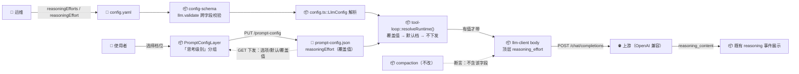
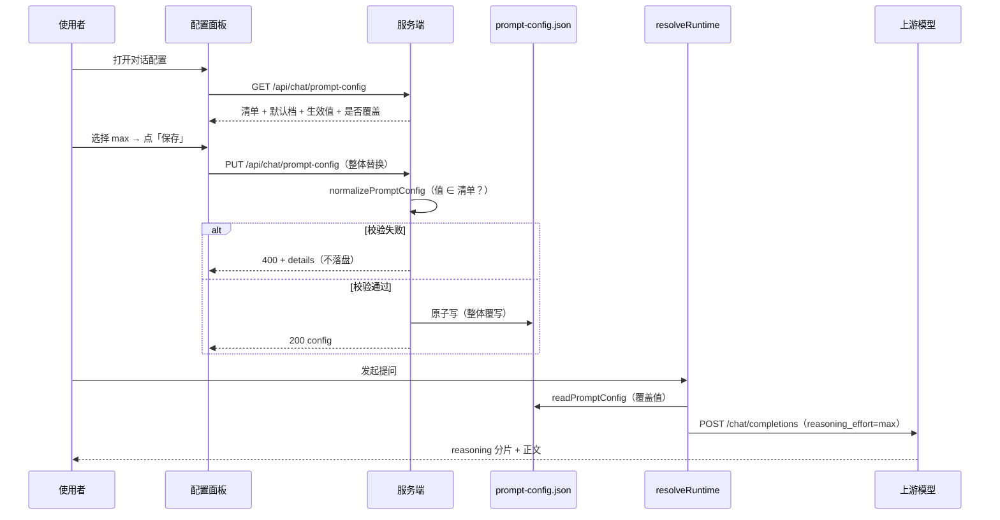

# AI 对话思考级别可配置 · 技术设计（单文档）

> 需求：`requirements/2026-10-16-AI对话思考级别可配置/requirement.md`（已确认 v4）· 质疑：同目录 `review/challenge-report.md`
> 单文档模式：用户确认"不拆分"，但**已知不满足** SINGLE_DOC 的严格条件（跨前后端 + 接口契约变更）—— 故本文补齐字段贯通表（§4.0）、接口契约（§8）、跨字段校验（§5 决策 1）、双白名单必改点（§11）与实施批次（§14）。

---

## 1. 需求背景 & 目标

**为什么要做**：AI 对话当前**完全不下发**思考级别参数（`llm-client.ts:267-282` 的 body 无该字段），用户无法按场景调优；实测又证明**上游对非法取值静默接受**（`medium`/`ultra` 均 200），因此"可选值必须由本地配置定义"是唯一可靠路径。

**目标**：① `config.yaml` 定义可选档位清单 + 部署默认档；② 面板按清单选择，覆盖值存 `prompt-config.json`；③ 都不配置时**请求体与现状逐字节一致**。

⛔ **不在范围内**：厂商特有能力（`thinking` 关闭思考）、`supportsReasoningEffort` 开关、按会话/按 scope 的档位、压缩摘要继承档位（D4）、OpenAI 之外的协议形态（如嵌套 `reasoning.effort`）。

---

## 2. 术语表

| 术语 | 配置位 | 含义 |
|------|--------|------|
| 可选档位清单 | `config.yaml` → `llm.reasoningEfforts`（`string[]`） | 面板选项来源 + **合法性白名单**；本地**不校验具体取值**（D5 通用协议）；`PUT` 的校验规则见 §8.2（两段校验）与 §5 决策 6 |
| 部署默认档 | `config.yaml` → `llm.reasoningEffort`（`string`） | 运维级默认档；若存在必须 ∈ 清单 |
| 覆盖值 | `prompt-config.json` → `reasoningEffort`（`string?`） | 面板保存；**缺省 = 未覆盖**（不是空串） |
| 生效档位 | 运行时派生 | 覆盖值 → 部署默认档 → **不下发**（三级链） |
| 跟随模型默认 | 面板选项（哨兵 `__follow_default__`） | 选中即**删除覆盖值**；哨兵是**保留字** —— 只存在于前端内存，不落盘、不下发；清单元素与 `PUT` 提交值均不得等于它（§9.1 / §4.3） |

---

## 3. 现状分析（AS-IS）

| 事实 | 证据 |
|------|------|
| 请求体无思考级别字段（仅 `model/messages/stream/stream_options` + 可选 `tools/temperature/max_tokens`） | `src/lib/chat/llm-client.ts:267-282` |
| `llm` 段无该配置字段 | `src/lib/config.ts:171-205`（`LlmConfig`）、`src/lib/config-schema.ts:207-227` |
| 三级链与"用户覆盖值"已有同构先例 | `src/lib/chat/prompt-config.ts:152-191`、`:418-464`（`contextChars` / `toolResponseChars` / `searchHitsPerCall`） |
| 装配点唯一，消费两处 | `src/lib/chat/retrieval/tool-loop.ts:137-146`（`resolveRuntime`）→ `:577-583`（工具路径）、`:862-873`（降级路径） |
| 压缩摘要独立参数块（不读覆盖值） | `src/lib/chat/compaction.ts:85-96` |
| 配置热生效（无需重启 daemon） | `src/lib/config.ts:314-336`（stat 指纹）+ 请求级配置快照 |
| 面板层为单层多分组、同一「保存」提交 | `web/src/chat/PromptConfigLayer.tsx:86-105`、`:446-460` |

---

## 4. 方案设计（TO-BE）

### 4.0 字段贯通表（新增配置元素的端到端链路）

| 字段 | 生产方 | 存储 | 读取点 | 下发接口 | 消费方 |
|------|--------|------|--------|----------|--------|
| `llm.reasoningEfforts` | 运维手改 `config.yaml` | `config.yaml` | `config.ts::parseAndExpand` → `KiConfig.llm` | `GET /api/chat/prompt-config`（`reasoningEffortOptions`） | 面板下拉选项；服务端 `PUT` 校验白名单 |
| `llm.reasoningEffort` | 运维手改 | 同上 | 同上 | 同上（`reasoningEffortDefault`） | 面板"默认"态显示；三级链第二级 |
| `prompt-config.reasoningEffort` | 面板保存（`PUT`） | `prompt-config.json` | `prompt-config.ts::readPromptConfig` | 同上（`reasoningEffort` + `reasoningEffortOverridden`） | 面板当前值；三级链第一级 |

### 4.1 配置层（后端）

- `src/lib/config-schema.ts`：`llm` 节点新增两字段声明 + **在 `llm` object 节点挂 `validate` 做跨字段校验**（默认档必须 ∈ 清单）。
- `src/lib/config.ts`：`LlmConfig` 新增 `reasoningEffort?: string` / `reasoningEfforts?: string[]`；`parseAndExpand` 中解析（**保持可选语义，缺失即 `undefined`，不给默认值**）。

### 4.2 装配与下发（后端）

- `src/lib/chat/retrieval/tool-loop.ts::resolveRuntime()`：新增 `reasoningEffort` 字段 = `promptCfg.reasoningEffort ?? llm.reasoningEffort`（`undefined` 即不下发）；`llmOpts` 与降级路径的参数块同步带上。
- `src/lib/chat/llm-client.ts`：`StreamChatOptions.llm` 新增 `reasoningEffort?: string`；body 组装处 `if (llm.reasoningEffort !== undefined) body.reasoning_effort = llm.reasoningEffort;`（**必须在 `if` 内 —— 未配置时键不得出现**）。

### 4.3 对话配置层（后端）

- `src/lib/chat/prompt-config.ts`：`PromptConfig` 新增 `reasoningEffort?: string`；`normalizePromptConfig` 新增校验（**两段校验**见 §8.2）；`defaultPromptConfig()` 不含该字段（缺省 = 未覆盖）。
- ★ **读取宽松 / 保存严格**（质疑 2 修复 · 见 §5 决策 7）：
  - **保存路径**（`savePromptConfig` → `PUT`）：非法值（非字符串 / 空串 / >64 字符 / 新提交且 ∉ 清单）→ 进 `issues` → `400`，**不落盘**；
  - **读取路径**（`readPromptConfig`）：该字段非法 → **只忽略该字段并把原因写进 `issue` 文本**，**不触发**既有的「任一字段非法 → 整份回退默认」（`prompt-config.ts:286-290`）—— 避免一个**可选增强字段**的笔误把提示词 / skill / 工具开关一起显示成默认值（磁盘内容其实未变）；
  - 实现：`normalizePromptConfig(input, issues, opts?)` 新增 `opts.effortSoft: boolean`（`readPromptConfig` 传 `true`），该字段的非法值改走**软通道**；**其余字段的整份回退语义保持不变**（既有 `context-limit-config.test.ts` ⑨ 的断言不受影响）。
  - **哨兵保留字**（推演问题 1）：`PUT` 收到 `__follow_default__` → `400`（`message=内部保留值，不应提交`）—— 强制"跟随默认"只在 UI 层表达为**删除字段**，避免内部实现细节被写进磁盘；`readPromptConfig` 读到该值同样按非法处理（软通道忽略）。

### 4.4 接口下发（后端）

- `src/lib/chat/chat-routes.ts::handlePromptConfigGet`：响应新增 4 字段（§8）；`handlePromptConfigPut` 复用既有 400 + `details` 通道，无需改结构。

### 4.5 前端

- `web/src/api/chatContract.ts`：`PromptConfig` 新增 `reasoningEffort?: string`；`PromptConfigOk` 新增 4 个下发字段；`PromptConfigLimits` 不新增（无数字上限）。
- `web/src/chat/PromptConfigLayer.tsx`：新增「思考级别」分组（下拉 + 「恢复默认」+ 三态徽标 + 文案）；★ **`cloneConfig` 必须显式搬运新字段**（§11 坑 1）。
- **文案模板（R6，实施时照抄；第 1 轮评审 🟡-7 补）**：
  1. 分组说明：`档位由 config.yaml 的 llm.reasoningEfforts 提供，仅作用于 AI 对话请求。`
  2. 波动与代价：`档位是上游软约束：同一档位单次思考量波动很大（实测可达 10 倍），更高档通常更慢、更贵；多轮检索场景会叠加。`
  3. 未配置清单：`未配置可选档位（请在 config.yaml 的 llm.reasoningEfforts 中列出可选值），本项暂不可调。`
  4. 脱离清单：`当前值「{v}」不在可选清单内（清单已变更）；仍会按此值发送，可点「恢复默认」回到默认档。`
- 新增 `web/src/lib/reasoningEffort.ts`：纯函数 `buildEffortOptions(options)`（清单前**恒定附加**"跟随模型默认"项，其值为保留字 `__follow_default__`；保留字不允许出现在清单中，故**无需去重**）与 `effortView(config, ok)`（三态 + 脱离清单态派生）。

### 4.6 压缩路径

`src/lib/chat/compaction.ts` **不改代码**（其参数块不含该字段即为正确），仅**新增断言**锁死"压缩请求体不含 `reasoning_effort`"。

### 4.7 错误可读性（R7 · 质疑 1 修复）

- `src/lib/chat/llm-client.ts::mapUpstreamError`（`:206-212`）的 4xx 分支：当本次请求**携带了 `reasoning_effort`** 且上游返回 400/422 时，错误文案追加可操作指引 —— `（提示：若该模型不支持思考级别，可在对话配置中把「思考级别」恢复默认（即不传），或修正 config.yaml 的 llm.reasoningEffort / llm.reasoningEfforts）`。
- 不新增错误码（沿用 `LlmUpstreamError` / 既有 `error` 事件形状），不改变 `retryable` 判定。
- **与"工具不支持"识别的冲突（推演问题 3）**：`looksLikeToolsUnsupported`（`llm-client.ts:190-203`）仅按 `tool`/`function` 关键词判定 —— 若上游 400 文案把 `tools` 与 `reasoning_effort` 一并列出，会被误判为"上游不支持 function calling" ⇒ 去掉 tools 重试仍带档位 ⇒ 再失败且提示指向错误方向。**修复**：该函数增加前置排除 —— **body 含 `reasoning_effort`（含空格变体 `reasoning effort`）时不认作"工具不支持"**，改走标准 4xx 映射 + 本节档位指引。

### 4.8 档位可见性（可选增强 · 质疑 4，不阻塞本批实施）

- 思考块头部（`web/src/chat/ChatPanel.tsx::ReasoningBlock`）在既有标题后追加档位徽标（如 `思考 · max`），数据来源 = `GET /api/chat/prompt-config` 的生效值；**不新增 SSE 契约**。
- 若本批不做，须在 §14 待定问题保留一行，避免遗忘。

---

## 5. 关键决策点

| # | 决策 | 采纳方案 | 被否决方案 | 否决理由 | 重新评估触发条件 |
|---|------|---------|-----------|---------|-----------------|
| 1 | 跨字段校验（默认档 ∈ 清单）落在哪 | `llm` 的 **object 节点 `validate`**（配置加载期 fail-loud） | ①单字段 `validate`；②读取期降级 + doctor 告警 | 单字段 `validate(value,path,add)` 拿不到兄弟字段；而"上游静默"+"失败要给出路"要求尽量前置；object 的 `validate` 在 `walkValue` 的 switch 之后执行，可拿到整个 llm 对象（`config-schema.ts:239-273` 🟢） | llm 段跨字段规则 > 5 条时（改为独立校验函数模块） |
| 2 | 清单/默认档的下发通道 | `GET /api/chat/prompt-config`（沿用 `defaults`/`limits` 范式） | ①`GET /api/chat/config`；②新开接口 | 面板数据已在一处取全，新增接口只增连接数；`contextCharsDefault` 的双通道先例正是"分散后前端拼接"的隐患来源 | 面板被拆为独立设置页时 |
| 3 | "跟随模型默认"的存储语义 | **删除覆盖字段**（哨兵仅存在于内存） | 存 `'default'` 字符串 | 会与"清单是否含 default"产生矛盾，且该字符串会被真的下发（上游静默接受 ⇒ 不可观测） | 需要"记住用户显式选过默认"时（当前无此诉求） |
| 4 | 清单未配置的接口表达 | 字段**缺失**（`undefined`） | 返回 `[]` | `[]` 无法区分"未配置"与"显式空"，两者文案/引导不同（`undefined` → 指向配置项；`[]` → 提示补档位） | 无 |
| 5 | 覆盖值脱离清单时的**运行时**行为 | **照发** + UI 明示"不在可选清单内" + 一键「恢复默认」 | ①静默回退部署默认；②静默清空该字段 | 上游对任意值静默接受，静默处理不可观测，会掩盖"值与配置不符"的事实 | 上游改为对非法值报错时 |
| 6 | `PUT` 对档位值的**校验规则**（第 1 轮评审 🔴 修复项） | **两段校验**：`值 ∈ 清单` **或** `值 === 既有已存值` → 放行；仅"**新提交**且不在清单内"→ 400 | ①不在清单内一律 400（本设计初稿写法）；②完全不校验清单（只校验类型与长度） | ①与决策 5 直接矛盾且造成**保存死锁** —— `PUT` 是整体替换语义，运维改小清单后用户连 skill 都改不动，且错误指向他没改过的字段；②违背 R5"服务端强校验、不信任客户端"（绕过前端即可写入任意值） | 上游改为对非法档位报错（可收紧为"一律 400"），或前端改为逐字段增量保存（死锁前提消失） |
| 7 | 配置写坏时的**读取语义**（质疑 2 修复项） | **读取宽松 / 保存严格**：读取时非法档位值只忽略该字段 + `issue` 透出；保存时非法值一律 400 | ①沿用「任一字段非法 → 整份回退默认」（不动现状）；②读取也严格（整份回退） | ①一个**可选增强字段**的笔误会让提示词 / skill / 工具开关**全部显示成默认值**（磁盘虽未变，用户会以为配置丢失）；②同上且更糟 | 配置层引入"逐字段校验状态"统一模型时（可从特例回归统一） |

---

## 6. 架构图 / 流程图



---

## 7. 模块/类设计

- **新增 1 个前端纯函数模块**（便于单测，避免三态逻辑散在组件里）：

```text
web/src/
├── lib/
│   └── reasoningEffort.ts   # [新增] EFFORT_FOLLOW_DEFAULT 哨兵、buildEffortOptions()、effortView()
├── chat/
│   ├── PromptConfigLayer.tsx # [修改] 新增「思考级别」分组 + cloneConfig 搬运新字段 + 文案
│   └── usePromptConfig.ts    # [不改] 沿用 save(draft) 整体替换语义，签名不变
└── api/
    ├── chatContract.ts       # [修改] PromptConfig / PromptConfigOk 新增字段
    └── chatApi.ts            # [不改] 函数签名与错误通道不变
src/lib/
├── config-schema.ts          # [修改] llm 两字段 + object.validate
├── config.ts                 # [修改] LlmConfig + parseAndExpand
└── chat/
    ├── prompt-config.ts      # [修改] PromptConfig + normalizePromptConfig + 白名单校验
    ├── chat-routes.ts        # [修改] handlePromptConfigGet 响应新增 4 字段
    ├── llm-client.ts         # [修改] StreamChatOptions.llm + body 组装
    └── retrieval/tool-loop.ts# [修改] resolveRuntime / llmOpts / 降级参数块
```

- **不新增后端类/模块**；无数据库、无迁移。

---

## 8. 接口设计

### 8.1 `GET /api/chat/prompt-config`（响应新增字段）

签名：`GET` → `200 PromptConfigOk`；无新增入参、无新增错误码。

```json
// Demo 返回示例（仅示意格式，非最终数据）
{
  "ok": true,
  "config": { "version": 1, "prompt": { "content": "…", "at": "1970-01-01T00:00:00.000Z" },
              "skills": [], "tools": {}, "reasoningEffort": "high" },
  "defaults": { "version": 1, "prompt": { "content": "…", "at": "…" }, "skills": [], "tools": {} },
  "limits": { "promptMaxChars": 4000, "skillMaxChars": 8000 },
  "reasoningEffortOptions": ["low", "high", "max"],
  "reasoningEffortDefault": "high",
  "reasoningEffort": "high",
  "reasoningEffortOverridden": true,
  "toolGroups": [],
  "issue": null
}
```

| 新字段 | 类型 | 语义 |
|--------|------|------|
| `reasoningEffortOptions` | `string[] \| undefined` | 清单；**缺失 = 运维未配置**（面板禁用并指引）；`[]` = 显式空（另文案） |
| `reasoningEffortDefault` | `string \| undefined` | 部署默认档（不写死前端常量） |
| `reasoningEffort` | `string \| undefined` | **生效档位**（覆盖值 ?? 默认档；都没有则缺失） |
| `reasoningEffortOverridden` | `boolean` | 是否用了覆盖值（决定"自定义/默认"徽标） |

> 降级：旧版 daemon 不返回这些字段 → 前端按"未配置"渲染并提示"服务端可能未重启"（沿用 `PromptConfigLayer.tsx:417-426` 的既有范式）。

### 8.2 `PUT /api/chat/prompt-config`（校验增强）

签名不变：入参 `PromptConfig`（整体替换）→ `200 { ok, config }`；失败 `400 PROMPT_CONFIG_INVALID` + `details[{field,message}]`（不落盘）。

新增校验（`normalizePromptConfig`，**两段校验** —— 见 §5 决策 6）：

| 场景 | 判定 | 行为 / `details` |
|------|------|-----------------|
| 提交值 ∈ 清单（含未提交该字段） | 通过 | 落盘 |
| 值 ∉ 清单，但 **`值 === 既有已存值`** | **放行**（保留既有态） | 落盘 —— 不因运维改清单而阻塞用户保存其它字段 |
| 值 ∉ 清单，且为**本次新提交的值** | 拒绝 | `400 PROMPT_CONFIG_INVALID`；`field=reasoningEffort`，`message=不在可选档位清单内（可用：low \| high \| max）` |
| 清单**未配置**，且提交了**新**值 | 拒绝 | 同上；`message=未配置可选档位清单（config.yaml 的 llm.reasoningEfforts）` |
| 清单**未配置**，且提交值 = 既有值 | **放行**（保留既有态） | 落盘 |
| 类型非字符串 / 空串 / 长度 > 64 字符 | 拒绝 | `message=应为 1–64 字符的字符串`（清单元素的上限校验属 `config-schema`，见 §9.1） |

**实现要点**：`savePromptConfig(config, input)` 先 `readPromptConfig(config)` 取既有覆盖值，作为**白名单补集**传入 `normalizePromptConfig(input, issues, existingEffort?)` —— 保持该函数纯函数性质（`readPromptConfig` 内部调用时可不传第三参）。

### 8.3 上游请求体（新增顶层字段）

```json
// Demo（配置生效时；未配置时该键不得出现）
{
  "model": "…", "messages": [], "stream": true,
  "stream_options": { "include_usage": true },
  "reasoning_effort": "high"
}
```

---

## 9. 数据模型

### 9.1 `config.yaml`

| 字段 | 类型 | 默认 | 约束 |
|------|------|------|------|
| `llm.reasoningEfforts` | `string[]` | 不配置 | 元素须为 **1–64 字符的非空字符串**（评审 🟡-4）；**元素个数 ≤ 20**（质疑 3，与 `MAX_SKILLS` 同风格）；重复元素报错；**不校验具体取值**（D5） |
| `llm.reasoningEffort` | `string` | 不配置 | 1–64 字符；必须 ∈ `reasoningEfforts`（`llm.validate` 跨字段校验；**有默认档但无清单 / 不在清单 → fail-loud**） |
| （保留字约束） | — | — | 清单元素与默认档**不得等于** `__follow_default__`（前端保留字，见 §2 / §4.3）；违反 → fail-loud |

### 9.2 `prompt-config.json`

| 字段 | 类型 | 默认 | 说明 |
|------|------|------|------|
| `reasoningEffort` | `string?` | 不写入 | 用户覆盖值；**缺省 = 未覆盖**；保存时若提交哨兵 → 删除该键（决策 3） |

---

## 10. 关键流程时序图



---

## 11. 异常处理 & 边界情况

| 场景 | 行为 | 是否对外暴露 |
|------|------|-------------|
| `config.yaml` 写错类型 / 默认档 ∉ 清单 / 清单含重复项 / 元素超限 / 元素 = 保留字 | 配置加载期 fail-loud：**所有 `ki` 命令在配置加载阶段即报错**（推演问题 2；排障入口可能同时不可用，实施时需实测）；错误文案必须给出两条出路（同步修改 `llm.reasoningEffort` / 删除它） | 是（stderr） |
| `PUT` 提交保留字 `__follow_default__` | `400`（内部保留值不应提交）；磁盘内容不变 | 是（错误详情） |
| 清单未配置，但 `prompt-config.json` 有覆盖值 | 请求**照发该值**；面板明示"未配置可选档位清单" + 「恢复默认」 | 是（面板） |
| 覆盖值脱离清单（运维改过清单） | 照发 + 徽标"当前值不在清单内" + 一键恢复默认（决策 5） | 是（面板） |
| 清单为显式 `[]` | 面板禁用 + 文案"清单为空，请补充档位"（与"未配置"区分，决策 4） | 是（面板） |
| 旧版 daemon 未返回新字段 | 面板按"未配置"渲染 + 提示"服务端可能未重启，本项保存可能不生效" | 是（面板） |
| `PUT` 提交值 ∉ 清单 | `400 PROMPT_CONFIG_INVALID` + `details`，**不落盘**（其余字段也一并保存失败 —— 整体替换语义） | 是（错误详情） |
| 上游对 `reasoning_effort` 报 400（其它模型/网关） | 沿用既有上游错误映射，文案追加"可清除该项（清空即为不传）" | 是（SSE `error` 事件） |
| `config.yaml` 在 daemon **运行中**被改坏（类型错 / 默认档 ∉ 清单） | `loadConfig` 走 **last-known-good**：沿用上一份可用配置并记录 `_configLoadIssue`（由 `/healthz` 暴露），**已有对话不受影响**；下次 `ki` 命令启动时 fail-loud（评审 🟡-5） | 是（stderr / `/healthz`） |
| 运维移除清单后，用户仅保存其它配置（草稿含既有档位值） | 按 §8.2 第二行**放行**（既有值不阻塞保存）；面板同时显示"不在可选清单内"提示 | 是（面板） |
| 手工把 `prompt-config.json` 的 `reasoningEffort` 写成非法值（空串 / 超长 / 非字符串） | **只忽略该字段**并把原因写进 `issue`，其余配置（提示词 / skill / 工具开关）**照常显示**；面板在配置层顶部展示 issue（既有通道） | 是（面板 issue） |
| 未配置（清单与默认档都无、无覆盖值） | **请求体逐字节与现状一致**（键不出现） | 否（静默正确） |

---

## 12. 性能 & 安全考虑

- **性能**：每请求仅多一个短字符串字段（≤64 字符护栏，评审 🟡-4）；**不影响上下文占用** —— 思考内容永不进 `messages`（N12 不变），故与「上下文窗口」面板读数/预警**无联动**（评审 🟢-9）；无新增 IO、无新增网络调用。
- **安全**：不落盘、不打印档位以外的任何上游数据；`config.yaml` 写入路径不在本次改动内（面板只写 `prompt-config.json`，不含密钥）。

---

## 13. 测试方案

| 测试文件 | 用例要点 |
|---------|---------|
| `test/chat/llm-stream-integrity.test.ts` | 本地真实 HTTP 上游断言：①配置了档位 → body 含 `reasoning_effort`；②**未配置 → 键不出现**（回归） |
| `test/chat/context-limit-config.test.ts`（仿写） | 三级链：覆盖 → 默认 → 不下发；「恢复默认」删字段后回落到默认档 |
| `test/chat/prompt-config.test.ts` | 归一化：值 ∈ 清单通过／不在清单 400／清单未配置但仍提交 → 400／非字符串 → 400 |
| `test/chat/prompt-config-routes.test.ts` | `GET` 新字段（含 `undefined` 与 `[]` 两种表达）；`PUT` 400 `details` 形状 |
| `test/chat/tool-budget-injection.test.ts`（仿写） | 真实 `runToolLoop` + mock 上游：捕获请求体断言档位落到**两条路径** |
| `test/chat/compaction.test.ts`（补断言） | 压缩请求体**不含** `reasoning_effort`（D4） |
| `web/test/reasoning-effort.test.mjs`（新增） | `buildEffortOptions`（去重、附加"跟随默认"）与 `effortView`（三态 + 脱离清单态） |
| `test/config-schema` 相关（补用例） | 默认档 ∉ 清单 → fail-loud；清单重复元素 → fail-loud；元素超 64 字符 → fail-loud；两者都缺 → 通过 |
| `test/chat/prompt-config.test.ts`（补用例，第 1 轮评审 🔴 回归） | **既有值脱离清单 + 保存其它字段 → 200 放行**（防死锁）；新提交非清单值 → 400 |
| **多轮叠加验收**（属 `acceptance-verify` 口径，非单测） | 真实上游发起含 2–3 轮工具调用的提问，记录**总时长 + usage**（challenger 意见 1；评审 🟡-6） |
| `test/chat/llm-stream-integrity.test.ts`（补用例，质疑 1） | 上游对带 `reasoning_effort` 的请求返回 400 → 错误文案含"恢复默认为不传 / 修正 config.yaml"指引 |
| `test/chat/prompt-config.test.ts`（补用例，质疑 2） | 读取路径：非法档位值 → **只回退该字段**（其余字段保持磁盘值）+ `issue` 非 null；保存路径：同值 → `400` |
| `test/config-schema` 相关（补用例，质疑 3） | `reasoningEfforts` 元素 21 个 → fail-loud（`≤20`） |
| `test/config-schema` 相关（补用例，推演问题 1/2） | 清单元素 = `__follow_default__` → fail-loud；默认档 ∉ 清单 → 错误文案含两条出路 |
| `test/chat/prompt-config.test.ts`（补用例，推演问题 1） | `PUT` 提交 `__follow_default__` → 400；读取磁盘上的保留字 → 软通道忽略 |
| `test/chat/llm-stream-integrity.test.ts`（补用例，推演问题 3） | 上游 400 文案含 `tools, reasoning_effort` → **不**抛 `ToolsUnsupportedError`，走标准 4xx + 档位指引 |

> 单测命令沿用项目口径；端到端断言优先用"真实 `runToolLoop` + mock 上游 + 记录参数"范式（不新增夹具导出即可）。

---

## 14. 风险 & 待定问题

### 风险

| 风险 | 影响 | 缓解 |
|------|------|------|
| 双白名单拷贝漏改（前端 `cloneConfig` / 服务端 `normalizePromptConfig`） | 保存其它配置时**静默清掉档位**（项目已踩两次） | 两处列为必改点 + 端到端回归「改档位 → 改 skill → 保存 → 档位仍在」 |
| 其它上游对未知字段返回 400（deepseek 静默接受**不可外推**） | 换模型后提问失败 | R7 错误文案指向配置项 + 面板可一键改回"不传" |
| 高思考档 × 多轮工具调用叠加延迟/费用 | 单次提问等待与计费成倍 | 面板文案写明；验收补多轮场景实测（总时长 + usage） |
| 旧版 daemon + 新版前端 | 面板显示可选项但服务端丢弃字段 | 沿用既有"服务端未返回默认值 → 前置提示"范式 |

### 待定问题

| # | 问题 | 处置 |
|---|------|------|
| 1 | 档位可见性徽标（§4.8，challenger 质疑 4） | **可选增强，不阻塞本批实施**；若本批不做，保留本行并在实现报告中登记 |

> D1–D6 已由用户拍板；5 项实现级决策 + 2 项修复决策（§5 决策 6/7）已定死，无其它未决项。

### 实施批次（供 `code-implement` 使用）

| 批次 | 范围 | 独立验证 |
|:---:|------|---------|
| **B1** 后端内核 | `config-schema` + `config.ts` + `tool-loop.resolveRuntime` + `llm-client` body（含"未配置不出现"回归） | `llm-stream-integrity` + `config-schema` 用例 |
| **B2** 配置贯通 | `prompt-config.ts`（字段/归一化/白名单）+ `chat-routes` GET 4 字段 | `prompt-config` / `prompt-config-routes` / 三级链用例 |
| **B3** 前端面板 | `chatContract` + `reasoningEffort.ts`（新增）+ `PromptConfigLayer`（分组/三态/双白名单搬运/文案） | `web/test/reasoning-effort` + 端到端回归（改档位 → 改 skill → 保存） |

> 批次之间无并行冲突（B1 只碰后端配置与请求体；B3 只碰前端），但 B3 依赖 B2 的接口字段，**须按序**。
