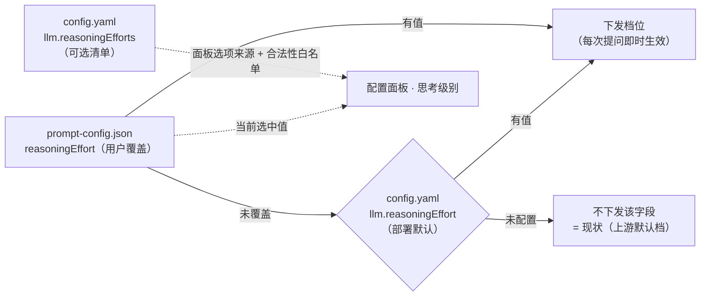

# PM 报告：AI 对话思考级别可配置

**模式**：M1 需求定义（一次成型档）
**触发**：用户提出「1、AI 对话支持思考级别，config.yaml 配置文件 中可以配置。不配置则不传思考级别（当前没有配置是怎么进行的？）2、AI对话框配置面板中调整思考级别，但是可选的思考级别必须在 config.yaml 配置文件 配置」并说明「当前配置的模型是 deepseek，它的思考级别有 low / high / max 三种，可以给你做测试验证」。
**证据声明**：最高证据等级 `🟢`。取证方式 = **代码直读**（符合性判定，含 `file:line`）+ **运行实测**（用户授权，对真实上游 `api.deepseek.com` / `deepseek-flash` 共 5 轮 60+ 次请求，脚本见 §9）+ **本机配置实读**（`~/.ki/config.yaml` 的 `llm` 段：`baseURL=https://api.deepseek.com`、`model=deepseek-flash`、`kbDisclosureAck=true`，**无任何思考级别字段**；密钥不回显）。无降级项；`🔴` 推断仅出现在 §5 待确认清单。

---

## 0. 关键结论（先读这一段）

### 0.1 现状：不是"没有思考"，而是"没人管它的档位"

当前链路**完全不下发**思考级别字段 —— 请求体只有 `model / messages / stream / stream_options` + 可选 `tools / temperature / max_tokens`（`llm-client.ts:267-282`），`config.yaml` 的 `llm` 段也没有该字段（`config.ts:171-205`）。上游照常思考：实测不传参数时 reasoning tokens 中位 **1273**，与显式传 `high`（中位 1344）**中位数接近**（差约 5.6%；n=8 且**非统计检验**，见 §2.3 样本污染说明）。🟢

⇒ 需求 1 的"不配置则不传"= **维持现状**（走上游默认档），**不是**"关闭思考"。用户问题「当前没有配置是怎么进行的？」的答案是：**照常思考，且思考量约等于 high 档**。

### 0.2 需求 2「可选级别必须在 config.yaml 配置」有硬依据：上游不校验取值

`reasoning_effort` 传 `medium`、甚至荒谬值 `ultra` 均返回 **200 且结果正常** ⇒ 拼错的值会被**静默接受**（很可能退化到默认档），本地拿不到任何报错。🟢

⇒ 白名单**只能**由本地定义（`config.yaml` 的清单）+ 服务端强校验（R2 / R5）来兜住；指望上游报错发现问题是不可能的。

### 0.3 档位有效果，但只有 `max` 稳定 —— 文案不得承诺"选 low 更快"

同一多步推理题、每档 8 次（`max_tokens=4096`）：不传 中位 **1273** / `low` **988** / `high` **1344** / `max` **2778**；**单次样本波动可达 10 倍**（同档位 405–4096 tokens）。🟢

⇒ `max` 显著且跨轮稳定；`low` 的抑制效果不稳定（不同轮次时高时低）⇒ 档位是**软约束**，验收不得用单次观测（见 R6、§2.3）。

### 0.4 实现成本低：与 `contextChars` 三级链完全同构，装配点只有一处

生效链：**对话配置覆盖值 → `config.yaml` 部署默认 → 不下发**（复刻 `prompt-config.ts:158-190` 的既有语义）；下发点：`tool-loop.ts:137-146` 的 `resolveRuntime()` 一处装配、两处消费（`:577-583` 工具路径、`:862-873` 预检索降级路径）。🟢



### 0.5 附带发现：厂商特有的「关闭思考」—— **不采纳**（D5 通用口径）

`thinking:{"type":"disabled"}` 实测可完全关闭思考（3/3 次 `reasoning_tokens = 0`，正文正常），但它是**厂商特有参数**；D5 已拍板「**只走 OpenAI 通用协议、不做任何厂商适配**」⇒ **本需求不实现**，仅记录（§8 A1）。🟢

### 0.6 面板预期形态

```text
┌ 对话配置 ─────────────────────────────────────────┐
│ 提示词 / Skill / 工具开关（既有）                   │
│ 上下文窗口        [ 1000 ] K        恢复默认        │
│ 工具预算          [ 10 ] K字符  [ 5 ] 条            │
│ ── 思考级别（本次新增）────────────────────────    │
│   档位由 config.yaml 提供；仅作用于 AI 对话请求      │
│   [ high ▾ ]（选项 = llm.reasoningEfforts）  恢复默认│
│   ⚠ 上游为软约束：同档位单次波动很大，max 档正文可能 │
│     要等 13–17 秒才出现                              │
│   （清单未配置时：该项禁用 + 说明"未配置可选档位"）  │
└───────────────────────────────────────────────────┘
```

---

## 1. 执行摘要

1. **现状（回答用户问题 1）**：AI 对话当前**完全不下发思考级别参数**，`config.yaml` 的 `llm` 段也没有该字段（`llm-client.ts:267-282` 的请求体只有 `model / messages / stream / stream_options` + 可选 `tools / temperature / max_tokens`）→ 运行方式 = **保持沉默、走上游默认档**。🟢
2. **上游默认档不是"不思考"**：实测 `deepseek-flash` 不传参数时仍输出思考（8 次多步推理题 reasoning tokens 中位 **1273**），其思考量与显式传 `high`（中位 1344）**无显著差异**即可判断"默认 ≈ high"，而 `max`（中位 **2778**）稳定显著更高。🟢
3. **上游不校验取值**：`reasoning_effort` 传 `medium`、甚至荒谬值 `ultra` 均返回 200 正常结果 → **拼错的值会被静默接受**（很可能退化到默认档），本地拿不到任何报错。这正是需求 2「可选级别必须由 config.yaml 定义」的正确性依据。🟢
4. **附带发现（不采纳）**：`thinking: {"type":"disabled"}` 可彻底关闭思考（3/3 次 reasoning tokens = 0），但属**厂商特有参数**，与 D5「只走 OpenAI 通用协议」冲突 ⇒ 仅记录（§8 A1）。🟢
5. **风险已前置排除**：高档位思考更久，但**不会撞首字超时** —— 流式下首个 chunk 仍稳定在 0.3–0.4s 到达（思考一开始就流式产出）；代价是**正文首字**延迟从 baseline 3.6–6.8s 升到 `max` 档的 12.9–16.8s。🟢
6. **架构有现成同构先例**：`contextChars` 的「对话配置覆盖 → `config.yaml` 部署默认 → 内置默认」三级链（REQ-20261014-001）可直接复刻，实施面小、无数据迁移。🟢

---

## 2. 现状与范围

### 2.1 分析边界

Web 侧边栏「AI 对话」的上游请求构造链路（工具路径 / 预检索降级路径 / 压缩摘要路径）+ `config.yaml` 的 `llm` 段 + 配置面板（`PromptConfigLayer`）。

### 2.2 现状取证（全部 🟢 代码直读）

| # | 事实 | 证据 |
|---|------|------|
| 1 | 上游请求体不含任何思考级别字段 | `src/lib/chat/llm-client.ts:267-282`（body 组装）；`opts.llm` 类型见 `:183`（baseURL/apiKey/model/temperature/maxTokens） |
| 2 | `config.yaml` 的 `llm` 段无该字段 | `src/lib/config.ts:171-205`（`LlmConfig`）；`src/lib/config-schema.ts:207-227`（字段白名单） |
| 3 | 上游 `reasoning_content` 已被完整支持：转发为 `reasoning` 事件、**不落盘（D7）**、**永不进 messages（N12）** | `llm-client.ts:468-470`；`tool-loop.ts:612-614`；`chat-contract.ts:332` |
| 4 | 前端已有思考过程折叠展示（`ReasoningBlock`） | `web/src/chat/ChatPanel.tsx:2555`；展开态 `:133-134` |
| 5 | `config.yaml` 改动**热生效**（stat 指纹失效 + 请求级配置快照）→ 改档位无需重启 daemon | `config.ts:314-336`；`docs/configuration.md:384-387` |
| 6 | 对话配置层（产品级）已有 3 个"用户覆盖值"：`contextChars` / `toolResponseChars` / `searchHitsPerCall`，缺省 = 未覆盖 | `src/lib/chat/prompt-config.ts:152-191`、`:418-464`；前端契约 `web/src/api/chatContract.ts:318-342` |
| 7 | 面板是**单层 + 同一保存动作**：提示词 / skill / 工具开关 / 上下文窗口 / 工具预算 | `web/src/chat/PromptConfigLayer.tsx:86-105`、`:446-460` |
| 8 | **压缩摘要也走同一上游**，但参数块独立（读 `cfg.llm`，不读对话配置覆盖） | `src/lib/chat/compaction.ts:85-96` |
| 9 | 配置写入通道已存在（仅写 `llm` 段单字段，用于 `kbDisclosureAck`）；界面改的值**不写** `config.yaml`（2026-10-14 用户裁决） | `chat-routes.ts:500-527`（`patchLlmConfigField`）|

### 2.3 上游实测（🟢 运行实测，2026-10-16）

上游 `https://api.deepseek.com`，模型 `deepseek-flash`，同一多步推理题；「不传 / low / high / max」各 8 次（`max_tokens=4096`）。**注（D5 口径）**：deepseek 只是**便于调试的样本**（其取值 low/high/max 仅为示例），产品侧的**取值集合一律由 `config.yaml` 清单决定、按 OpenAI 通用协议纯透传**，本地不内置任何厂商取值表：

| 档位 | reasoning tokens（8 次排序） | 中位 | 均值 |
|------|------------------------------|------|------|
| **不传（现状）** | 405, 655, 728, 1258, 1288, 1491, 2582, 4096 | **1273** | 1563 |
| `low` | 628, 709, 759, 843, 1132, 1457, 1530, 1640 | 988 | 1087 |
| `high` | 956, 1185, 1204, 1209, 1479, 1606, 1744, 1800 | 1344 | 1398 |
| `max` | 1087, 1322, 1552, 2034, 3523, 3919, 4096, 4096 | **2778** | 2704 |

结论：

- **`max` 效果稳定可信**（中位约为默认档 2.2 倍，跨轮一致）；
- **`low` 的抑制效果不稳定**（同一档位不同轮次既有低于、也有高于默认档的样本）→ **产品文案不得承诺"选 low 会更快/更省"**；
- **默认档的中位数 ≈ `high`**（差约 5.6%）；
- **单次请求波动极大**（同档位 405 ~ 4096 tokens，约 10 倍）→ "档位效果"只能用统计口径描述，**验收不能用单次观测**。

> **样本污染说明（challenger 意见5 落地）**：① 表中 `4096` = **撞顶**（`max_tokens` 上限），撞顶样本会**低估**该档的思考量 —— 本组 `baseline` 撞顶 1 次、`max` 撞顶 2 次（⇒ `max` 的真实差异只会更大）；② n=8 的中位数比较**不是统计检验**，"默认 ≈ `high`" 应按"**中位数接近**"理解，**不得**当作已验证事实写进产品文案或验收断言。


取值合法性实测：`medium`、`ultra` 均 `status=200` 正常返回 → **上游对取值不做校验，不报错**。

延迟实测（流式，同题）：

| 档位 | 首个 chunk | 首个 reasoning 分片 | 首个正文分片 | 总时长 |
|------|-----------|--------------------|-------------|--------|
| 不传 | 0.4s | 0.6–0.8s | 3.6–6.8s | 4.4–7.6s |
| `low` | 0.3–0.4s | 0.7–0.8s | 4.4–10.4s | 5.3–11.6s |
| `max` | 0.3–0.4s | 0.6–1.1s | 12.9–16.8s | 13.6–17.8s |

> **取样说明（challenger 意见5 落地）**：上表 9 个请求**并发**下发，数值含上游排队干扰，**仅反映相对趋势，不可作为时延基准**。

→ 首字超时（默认 30s）**不会被高档位误伤**（本上游实测；其它上游未验证）；但正文首字延迟显著上升，用户等待感的解释成本要算进产品设计。**且以上均为单轮数据** —— 多轮工具调用的叠加效应见 §3.0。

关闭思考实测：`thinking: {"type":"disabled"}` 3/3 次 `reasoning_tokens=0` 且正文正常 → 该上游**可完全关闭思考**，但这是厂商特有参数，**不纳入本需求**（D5 通用口径，见 §8 A1）。

---

## 3. 发现 / 需求

### 3.0 影响面（关联功能与影响评估）

| 受影响功能/方 | 影响类型 | 影响程度 | 证据 | 建议处理 | 需用户拍板 |
|---------------|---------|---------|------|---------|-----------|
| 会话压缩摘要（`compaction.ts:85`） | 性能 / 成本 | **降级** | 🟢 代码 | 明确"是否继承用户所选档位"：继承 → 摘要质量可能更好但压缩等待更久；不继承 → 口径不一致 | **是（D4）** |
| 预检索降级路径（`tool-loop.ts:862`） | 行为 | 无感（必须同步下发） | 🟢 代码 | 两条路径共用同一 `llmOpts`，一处改 | 否 |
| 上游请求体（`llm-client.ts:267`） | 外部契约 | 无感（新增可选字段，不传行为不变） | 🟢 代码 + 实测 | 未配置时不下发，保持现状 | 否 |
| **多轮工具调用**（`maxToolRounds = Infinity`，`llm-client.ts:67`；`tool-loop.ts:585` 的 `while(true)`） | 性能 | **降级** | 🟢 代码 + 🟢 实测（单轮 `max` 档正文首字 12.9–16.8s） | 每轮上游请求**都带同一档位** ⇒ 单次提问的等待与用量按轮次叠加（3 轮即 40–50s 量级）→ 面板文案必须写明"多轮检索会叠加"；验收补一条多轮场景实测 | 否 |
| 上游计费 / 用量 | 成本 | **降级** | 🟢 实测（`max` 档 reasoning tokens 约为默认档 2.2 倍） | 面板文案提示"档位越高越慢越贵"；可选增强 = 思考块显示「思考 N tokens」 | 否 |
| `config-schema` / `ki doctor` / `docs/configuration.md` | 展示 / 文档 | 无感 | 🟢 代码 | 新增字段校验 + 文档同步（`docs/configuration.md:139-155` 字段表） | 否 |
| 配置面板（`PromptConfigLayer` / `chatContract.ts`） | 展示 | 无感 | 🟢 代码 | 新增「思考级别」分组，沿用既有"保存后下一次提问生效"语义 | 否 |
| 旧版 daemon + 新版前端 | 展示 | 降级 | 🟡 结构可证 | 沿用既有降级范式（`PromptConfigLayer.tsx:417-426`：服务端未返回默认值时前置提示"可能未生效"） | 否 |
| 换模型 / 换上游（非 deepseek 系） | 外部契约 | **降级** | 🟡 结构可证（deepseek 实测静默接受；**其它上游未测**） | **D5 已拍板**：只走 OpenAI 通用 `reasoning_effort`、纯透传，**不加 `supportsReasoningEffort` 开关**；其它上游若 400 由 R7 错误可见兜住 + 面板可一键改回"不传"（N8） | 否（已拍板） |
| MCP 工具（`ki_search` 等） | — | 无影响 | 🟢 代码（不经 `streamChat`） | 无需处理 | 否 |

### 3.1 需求清单

| ID | 需求 | 优先级 | 预期效果 | 验收标准 |
|----|------|:------:|---------|---------|
| **R1** | `config.yaml` 的 `llm` 段新增**思考级别**配置：①可选档位清单；②可选部署默认档。**两者都不配置 → 完全不下发该参数**（严格保持现状） | P0 | 运维可为实例定义"可用档位集合"与默认档 | 不配置时请求体与现状 **逐字节一致**（回归断言）；配置后请求体出现对应字段；非法值 fail-loud |
| **R2** | 配置面板新增「思考级别」选择器，**可选项只能来自 `config.yaml` 的清单**；清单未配置时该项**禁用并说明原因**（不静默隐藏、不静默可用） | P0 | 界面不再允许用户填出上游不认的值 | 清单为 `[low,high,max]` 时下拉恰为三项；未配置清单时该项不可操作且有原因文案；提交非清单值被服务端 400 拒绝 |
| **R3** | 选中的档位随**每次提问**下发给上游，**即时生效**（无需新建会话、无需重启 daemon）；工具路径与预检索降级路径一致 | P0 | 改完下一次提问即按新档思考 | 面板保存 → 下一次提问的请求体即带新值（端到端断言）；两条路径均带值 |
| **R4** | 用户选择作为**覆盖值**存 `prompt-config.json`（三级链：覆盖 → `config.yaml` 默认档 → 不传）；「恢复默认」= **删掉覆盖值**（不是写死某档） | P1 | 与 `contextChars` 完全同构，运维改默认时"恢复默认"回到新默认 | 覆盖 / 恢复默认各一次后，请求体的档位符合三级链；删覆盖后 config.yaml 默认档重新生效 |
| **R5** | 服务端强校验（不信任客户端）：清单元素合法性、部署默认档必须落在清单内、面板提交值必须在清单内；配置层非法 → `config-schema` fail-loud + `ki doctor` 提示 | P1 | 拼错的值在本地就被拦住（上游不会报错） | 非法配置：`ki` 命令启动即报错并指出字段；面板提交非清单值被拒 |
| **R6** | 文案诚实性：说明档位是**上游软约束**、单次请求波动很大（实测同档位 405–4096 tokens）、`max` 档正文首字约 13–17s | P1 | 不让用户以为"选 low 必然更快" | 面板该项有说明文案；需求文档/文档同步写明波动事实 |
| **R7** | 错误可见性：模型/上游不支持该参数时（可能 400），错误映射为人话并**指向配置项**，不静默失败 | P2 | 换模型后出问题能自查 | 构造不支持的模型 → 报错文案含配置路径提示 |
| **R8** | **（待拍板）** 压缩摘要是否继承用户所选档位 | P2 | 统一口径 or 保护压缩延迟 | 见 D4 |

> **表注 ①（特殊值语义，必须定死）**：若采用"允许显式选择『跟随模型默认』"的方案（D2 ①），该选项在**本地**被解释为 **「不下发该字段」**，**绝不是**把 `default` / `none` 当作字符串透传给上游 —— 实测上游对任意字符串都返回 200，透传会"看起来正常"但语义不明（其它上游行为未知），还会掩盖"没配"与"配了默认"的区别。
>
> **表注 ②（不做内置取值表 —— D5 的硬约束）**：本地**不维护** `low / high / max / ...` 的内置档位表（否则换上游即失效）；`config.yaml` 的清单本身就是权威白名单，面板提交值与部署默认档都只对清单做校验。**D5 拍板"只走 OpenAI 通用协议、不做厂商适配"后，这不再是一条取舍而是一条硬约束**。代价：**清单自身拼错**（把 `high` 写成 `hihg`）本地无从发现 → 见 N11。
>
> **表注 ③（双白名单拷贝坑 —— 设计阶段必改点，challenger 意见4）**：前端 `PromptConfigLayer.tsx:61-72` 的 `cloneConfig` 是**白名单式拷贝**，服务端 `normalizePromptConfig`（`prompt-config.ts:302-467`）同为白名单且 `savePromptConfig` 用归一化结果**整体覆写**文件 —— 新增覆盖值若漏加入任一处，会在用户**保存其它配置时被静默清除**（项目在 `contextChars` 与工具预算上已各踩一次，前端源码注释里留有原话）。⇒ 两处均列为必改点，并加端到端回归：**改档位 → 改 skill → 保存 → 档位仍在**。
>
> **表注 ④（新增配置项的贯通链路 —— 设计阶段必须逐跳交代，challenger 意见3）**：本需求引入 1–3 个新配置元素（可选清单 / 部署默认档 / 用户覆盖值）。设计文档须给出「字段贯通表」：**字段 → 生产方 → 存储 → 读取点 → 下发接口 → 消费方（面板 / 请求体）**，并明确"清单未配置"在接口里的表达（`undefined` 与 `[]` **语义不同**：前者=未配置 ⇒ 面板禁用，后者=显式空 ⇒ 同样是禁用但性质不同）。现有两条下发通道：`GET /api/chat/config`（`contextCharsDefault` 范式）与 `GET /api/chat/prompt-config`（`limits` + `defaults` 范式，`chat-routes.ts:578-613`）。

### 3.2 负向需求

| # | 场景 | 期望行为 |
|---|------|---------|
| N1 | 档位名拼错（`hihg`）| **本地拦住**（上游对任意值都 200，不会报错）→ R5 |
| N2 | 清单配成空数组 `[]` | 面板无可选项：禁用 + 明示"未配置可选档位"，不得渲染空下拉或静默当"不传" |
| N3 | 已保存的覆盖值**不在**当前清单内（运维事后改了清单） | **推荐（challenger 意见6 落地）**：请求**仍按用户已存值下发**（不静默篡改用户选择）+ 面板明示"当前值不在可选清单内" + 一键「恢复默认」；若选"回退部署默认"，也**必须可见提示** —— 上游对任意值都返回 200，任何静默处理都不会报错（§2.3） |
| N4 | 清单里只配 1 个档位 | 允许（面板退化为只读展示），不报错 |
| N5 | `config.yaml` 里把档位写成数字 / 对象 / 数组里混入非字符串 | `config-schema` 报错（类型不符），启动 fail-loud |
| N6 | 部署默认档不在清单内 | fail-loud（配置自相矛盾，**不得静默取清单首项**） |
| N7 | 用户把 `max` 档用于日常问答 | 已有思考流可见（首块 0.3–0.4s），不会"看起来卡死"；R6 文案需给出速度提示 |
| N8 | 用户换到不支持该参数的上游 | R7：错误可见 + 指向配置；可一键改回"不传" |
| N9 | 多标签页同时改档位 | 沿用既有覆盖写语义（不做并发控制，与其余对话配置一致） |
| N10 | 面板改了档位但未点保存就离开 | 沿用既有未保存离开确认（`PromptConfigModal` 同款语义） |
| N11 | **清单自身**拼错（`hihg`） | 本地无内置取值表可比对（见 §3.1 表注 ②，故意不做）→ 面板照清单原样展示，不假装校验；可选增强 = `ki doctor` 对明显异常值（非 ASCII / 超长 / 重复项）给**告警但不阻断** |
| N12 | 上游某次请求因限流/超时失败 | 与档位无关，沿用既有错误映射（不因新字段改变错误路径） |

---

## 4. 优先级排序

| 优先级 | 条目 | Kano | 价值 | 成本 | 证据 | 建议方向 |
|:------:|------|------|:----:|:----:|------|---------|
| P0 | R1 配置定义 | 必备 | 高 | 低 | 🟢 | 新增 2 个 `llm` 字段 + schema 校验 |
| P0 | R2 面板选择器 | 必备 | 高 | 中 | 🟢 | 复用 `PromptConfigLayer` 分组范式 |
| P0 | R3 请求下发（两路径） | 必备 | 高 | **低** | 🟢 | 改 `resolveRuntime` + `llmOpts`（一处装配两处消费） |
| P1 | R4 覆盖值三级链 | 期望 | 高 | 低 | 🟢 | 直接复刻 `contextChars` 先例 |
| P1 | R5 服务端强校验 | 期望 | 高 | 低 | 🟢 | 本地拦是唯一防线（上游不校验） |
| P1 | R6 文案诚实性 | 期望 | 中 | 低 | 🟢 实测 | 面板说明 + 文档 |
| P1 | R7 上游不支持时的错误（**D5 依赖项**） | 期望 | 中 | 低 | 🟡 | 复用既有上游错误映射 + 错误文案指向配置项；**D5 拍板"纯透传、不加开关"后，它是其它上游报 400 时的唯一可恢复路径** |
| P2 | R8 压缩是否继承 | Kano 待定 | 中 | 低 | 🟢 | **D4 已拍板：不继承（完全不传）** |

**排序理由**：R1/R3 不做则功能不存在（必备）；R2 是需求的显式诉求且决定"可选值受控"；R4/R5/R6 决定"改错了能不能发现"，其中 R5 是本次实测暴露的关键缺口（上游静默）；**R7 因 D5（只走通用协议、不加适配开关）由 P2 升 P1** —— 它承担"其它上游 400"时的可恢复性（面板可一键改回"不传"，N8）。

---

## 5. 用户拍板（2026-10-16 · 需求已确认）

| ID | 决策点 | ✅ 裁决结果 |
|----|--------|------------|
| **D1** | `config.yaml` 配置形态 | **两个字段**：`llm.reasoningEffort`（部署默认档，可选）+ `llm.reasoningEfforts`（可选档位清单，字符串数组 —— 既是面板选项来源，也是合法性白名单）。与既有 `llm` 段扁平风格一致，schema 用现有 `stringArray` + `validate` 即可（`config-schema.ts:258-272` 确认 `validate` 对所有类型生效） |
| **D2** | 是否需要"不传（模型默认）"可选项 | **需要**：清单支持特殊值（`default` / `none`），面板可显式选回"跟随模型默认"；实现 = **不下发字段**（§3.1 表注 ①） |
| **D3** | 是否支持"关闭思考" | **不做** —— 原推荐被 **D5 推翻**：唯一可行手段 `thinking:{"type":"disabled"}` 是**厂商特有参数**，与"OpenAI 协议通用"冲突。未来若要"最快"，由清单**透传上游自己支持的值**（如 OpenAI 的 `minimal`），本地不做任何映射 |
| **D4** | 压缩摘要是否继承档位 | **不继承 = 压缩请求完全不携带该字段**（保持现状）；否掉"用部署默认档"方案（会让没配过的用户也被默认档影响，语义更绕）。必须写死，否则实现二义、测试无法断言（`compaction.ts:85-96` 有独立参数块） |
| **D5** | 厂商适配边界（★ 用户补充口径） | **只走 OpenAI 通用协议**：请求体使用 Chat Completions 的顶层 `reasoning_effort`，**纯透传**；**不做任何厂商特有映射**（不引入 `thinking` 等）、**不加** `supportsReasoningEffort` 开关。deepseek 的 low/high/max 仅作**调试样本**；产品取值集合一律由 `config.yaml` 清单决定，本地不内置取值表 |
| **D6** | 档位说明文案 | **原值 + 一句话说明**；说明只讲"上游软约束、单次波动大、档位越高越慢越贵"，**不得承诺速度差异**（实测 `low` 不稳定），也不得承诺"一定能看到思考过程"（上游不返回 `reasoning_content` 时按普通流处理） |

> **D5 的两处连带影响（已在本版同步）**：① §8 A1 的"关闭思考"由"可选能力"降级为**不采纳**；② 其它上游对未知字段可能返回 **400**（与 deepseek 静默接受不同）⇒ **R7 由 P2 提升为 P1 通用性保障项**（见 §4）。

---

## 6. 关键假设

| ID | 假设 | 错了会怎样 | 状态 / 验证方法 |
|----|------|-----------|----------------|
| H1 | 用户所说的"可选项必须在 config.yaml 配置"= config.yaml 里存在一份**档位清单**（数组） | 若本意是"只配一个固定值"，则面板只有 1 个选项（无意义）→ 需求需重写 | ✅ **已拍板（D1）** |
| H2 | "不配置则不传"包含"面板未选择 / 清空覆盖"的情形 | 若希望未选择时强制下发某默认档 → R1 语义需改 | ✅ **已拍板（D2）** |
| H3 | 该档位只作用于对话模型（`llm` 段），不涉及 embedding 等其它模型 | 无需其它改动 | ✅ 代码直读：embedding 不走 `streamChat` 🟢 |
| H4 | 档位字符串**直接透传**、不做枚举翻译 | 若某上游需要不同形态（如嵌套 `reasoning.effort`）→ 需另开需求 | ✅ **已拍板（D5：只走 OpenAI 通用协议、纯透传）**；其它上游未实测 🟡，由 R7 兜底 |
| H5 | UI 落点是既有对话配置层**新增分组**，不是新页面 | 若想要独立设置页 → 界面工作量上升 | ✅ **已确认**（其余项按推荐） |
| H6 | 用户接受"档位是软约束、单次波动大" | 若期望确定性（选 max 必然更慢更久）→ 目标需重定义 | ✅ 已用实测数据交底（§2.3） |

---

## 7. 建议下一步

1. ~~需求确认（唯一确认点）~~ → **✅ 已完成**：用户 2026-10-16 确认 D1–D6，并补充 **D5 口径**「模型配置要 **OpenAI 协议通用**，不专门适配 deepseek；deepseek 只是方便调试的例子」。本报告状态：**已确认**。
2. **进入 `design-craft`（技术设计）**，口径已定：
   - `config-schema` 新增 `llm.reasoningEffort`（字符串）+ `llm.reasoningEfforts`（字符串数组，复用 `validate` 校验元素为**非空字符串**，**不做取值枚举** —— D5 硬约束）；
   - `resolveRuntime()` 装配档位（覆盖值 → 部署默认 → 不下发）；
   - `streamChat` 的 body 新增**顶层 `reasoning_effort`**（Chat Completions 通用形态，**不做任何厂商特有映射**）；未配置时该键必须**完全不出现**（加回归断言）；
   - `PUT /api/chat/prompt-config` 的归一化与强校验；★ **双白名单必改点**（§3.1 表注 ③）+ 端到端回归「改档位 → 改 skill → 保存 → 档位仍在」；
   - ★ **字段贯通表**（§3.1 表注 ④），并写死"清单未配置"的接口表达（`undefined` ≠ `[]`）；
   - 压缩路径按 **D4** 明确"完全不携带该字段"并加断言。
   - 无需 `ui-designer`（无新页面/改版，仅复用既有分组范式）；无需数据迁移。
3. **验收必须补一条多轮场景**（challenger 意见1）：用真实上游发起一次会产生 2–3 轮工具调用的提问，记录**总时长 + usage** —— 单轮数据无法代表高思考档在多轮检索下的叠加代价。
4. **设计须覆盖"非 deepseek 上游"的通用性风险（D5 派生）**：deepseek 对未知字段是**静默接受**，**不可外推**到其它上游（可能返回 400）⇒ R7 的错误文案必须指向 `llm.reasoningEfforts` / `llm.reasoningEffort`，并保证面板可一键改回"不传"（N8）。

---

## 8. 附：本次未落地的关联发现（供后续排期参考）

| # | 发现 | 证据 | 说明 |
|---|------|------|------|
| A1 | `thinking:{"type":"disabled"}` 可完全关闭思考 | 🟢 实测 3/3 | **不采纳（D5 拍板）**：厂商特有参数，与"OpenAI 协议通用"冲突；未来若要"最快"，由清单**透传上游自己支持的值**（如 OpenAI 的 `minimal`），本地不做映射 |
| A2 | 上游对 `reasoning_effort` **不做取值校验** | 🟢 实测（medium/ultra 均 200） | 任何面向该字段的 UI 都必须自带白名单（R2/R5 已覆盖） |
| A3 | `max` 档正文首字 12.9–16.8s | 🟢 实测 | 若后续做"响应速度"相关体验优化，需纳入考虑 |

---

## 9. 附：取证脚本（临时验证文件）

| 脚本 | 用途 |
|------|------|
| `temp/probe-deepseek-reasoning-effort.py` | 首轮：字段接受度 + 取值合法性（含 `medium` / `thinking` 探测） |
| `temp/probe-deepseek-reasoning-effort2.py` | 第二轮：每档 3 次重复取样 + 荒谬值 + 关闭思考 |
| `temp/probe-deepseek-reasoning-effort3.py` | 第三轮：较难题目、每档 6 次（发现 max_tokens 撞顶需放大） |
| `temp/probe-deepseek-reasoning-effort4.py` | 第四轮（主证据）：`max_tokens=4096`、每档 8 次，分布分离 |
| `temp/probe-deepseek-reasoning-effort5.py` | 第五轮：流式首块 / 首正文分片延迟 |

> 脚本只读 `~/.ki/config.yaml` 取连接信息，**不回显 apiKey**。

---

## 10. 二次质疑（challenger）

**报告**：`review/challenge-report.md`（质疑对象 = 本需求分析报告；裁决 = **⚠️ 修改 6 条 🟡 建议后进入设计**，无 🔴）

本版（v3）已按 6 条建议逐项落地：

| 建议 | 落地位置 |
|------|---------|
| 意见1 多轮工具调用叠加（延迟/成本） | §3.0 影响面新增「多轮工具调用」「上游计费/用量」两行；§7 补第 3 条验收动作 |
| 意见2 D4 语义三态定死 | §5 D4（明确"不继承 = **完全不携带该字段**"） |
| 意见3 新增配置项贯通链路 | §3.1 表注 ④（要求设计文档出「字段贯通表」，并区分 `undefined` ≠ `[]`） |
| 意见4 双白名单拷贝坑 | §3.1 表注 ③（`cloneConfig` + `normalizePromptConfig` 列为必改点 + 端到端回归） |
| 意见5 统计措辞过强 / 样本污染 | §0.1 措辞降级为"中位数接近"；§2.3 加"撞顶 + n=8 非统计检验"说明与延迟表"并发取样"注 |
| 意见6 N3 策略缺推荐 | §3.2 N3 给出推荐（照发 + 可见提示 + 一键恢复默认） |

**未采纳/待用户拍板的质疑点**：无（6 条全部采纳；意见3/4 属设计阶段必改项，已写入 §7 建议下一步）。
