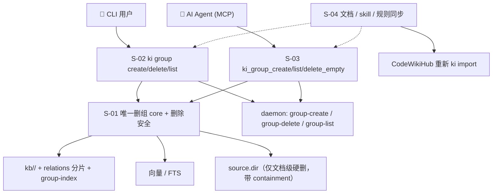
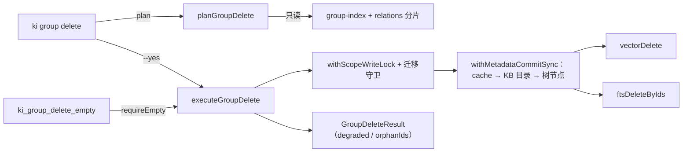

# `ki group` 命令重构 · 总体设计

> 需求：REQ-20261019-005（requirement v9）
> 设计日期：2026-10-19
> 子需求：S-01 删除 core 与安全 / S-02 CLI 命令族 / S-03 MCP 表面 / S-04 文档与 skill 同步

---

## 1. 需求背景 & 目标

### 1.1 背景

Group 的增删查目前散落在 `manage-index`、`query-group`、`delete-relation` 三处，删除有 3 套实现、副作用互不兼容：一套残留 assets、一套把 `source.dir` 下的用户文档搬进 `.ki/trash`、一套只删空节点。用户无法预判"删一个组会动到什么"，且 `--parent` / `--name` 让"删一个目录"变成参数拼图。

### 1.2 目标

| # | 目标 | 落地子需求 |
|---|------|-----------|
| G1 | 一个动作 = 一条命令 = 一个 core | S-01 / S-02 |
| G2 | 删除可预告：默认预览、`--yes` 才执行 | S-01 / S-02 |
| G3 | 删除不越界：只动 `kb/<scope>/<group>/`、关系、向量、FTS、树节点 | S-01 |
| G4 | 读写同族：`ki group list` 取代 `query-group` | S-02 / S-03 |
| G5 | 错误都给出路（含旧命令 RENAMED） | S-02 / S-03 |
| G6 | 零兼容：旧命令物理删除 | S-02 / S-03 / S-04 |

### 1.3 不在范围内

- 不改 `group-index.json` / relations 分片存储格式，不改 Group 概念本身。
- 不把 `ki scope list`、`get-module-info`、`sync-relation` 并入 `ki group`。
- 不做 `ki group list` 的纯路径枚举子命令（`list` 就是原 `query-group` 的完整能力 + `--json`）。
- 不做跨机分布式锁；不做删除操作的崩溃级原子性（见 §4.3）。

---

## 2. 关键环节一览图

依赖：`S-01 → S-02 → S-03 → S-04`。S-02/S-03 都必须经过 S-01 的同一 core；S-04 在命令表面定稿后一次性清扫。

---

## 3. 总体方案设计

### 3.1 分层

| 层 | 位置 | 职责 |
|---|---|---|
| 命令层 | `src/group.ts` | 参数解析、预览/执行分支、JSON 输出（S-02） |
| MCP 层 | `src/lib/mcp-tools/group*.ts`、`src/lib/chat/mcp-tool-registry.ts` | 工具注册、schema、RBAC、AI 可见文案（S-03） |
| core 层 | `src/lib/group-delete.ts`（新增）、`src/manage-index.ts`（仅保留 create 纯函数）、`src/query-group.ts`（保留查询实现） | 唯一删除实现、精确解析、预览/执行（S-01） |
| 传输层 | `src/lib/daemon-dispatch.ts`、`src/lib/daemon-client.ts` | RPC 名 `group-*`（S-02） |
| 数据层 | `scope.ts` / `group-cache.ts` / `vector-client.ts` / `fts-client.ts` | 不变 |

### 3.2 关键流向

### 3.3 共享术语速查

| 术语 | 定义 | 定义处 |
|---|---|---|
| 精确路径 | 与 group-index 树节点或 relations 分片键**完全相等**的组路径；不做语义补全 | S-01 §1 |
| KB 目录 | `kb/<scope>/<group>/`，含 `index.json` 与 assets | S-01 §1 |
| wiki 目标目录 | `resolveWikiTarget(scope)/<group>`，通常等于 `source.dir/<group>` | S-01 §1 |
| 删除 core | `src/lib/group-delete.ts` 导出的唯一删组实现 | S-01 §3 |
| 预览（plan） | 只读计算，零写入；返回 `GroupDeletePlan` | S-01 §4 |
| 执行（execute） | 持锁 + 提交窗口的破坏性操作；返回 `GroupDeleteResult` | S-01 §4 |
| degraded | 元数据删除成功，但向量/FTS 有失败项 | S-01 §6 |
| RENAMED | 旧命令被拦截并打印新命令的迁移提示，不执行 | S-02 §3.4 |

### 3.4 跨子需求契约变更

| 变更 | 涉及子需求 |
|---|---|
| 新增 `GroupDeletePlan` / `GroupDeleteResult` / `planGroupDelete` / `executeGroupDelete` | S-01（定义）、S-02 / S-03（消费） |
| 新增 `executeGroupCreate({scope, path})` + `createdScope` | S-02（定义）、S-03（消费） |
| 新增 `ki group list --json` 输出 `{groups:[{path,relations,children}], total}` | S-02（定义）、S-04（文档） |
| `ki_manage_index_*` / `ki_query_group` 工具名与 schema 变更 | S-03（定义）、S-04（文档） |
| `ScopeEntry` 增加 `topGroups` + `topGroupsStale` | S-03（定义）、S-04（文档） |
| daemon RPC 名 `group-create` / `group-delete` / `group-delete-empty` / `group-list` | S-02（定义）、S-03（复用） |

---

## 4. 全局风险 & 跨子需求依赖

### 4.1 跨子需求风险

| 风险 | 影响 | 缓解 |
|---|---|---|
| CLI 与 daemon 版本错配（RPC 改名 `delete-group` → `group-delete`） | 新 CLI 连旧 daemon 会报未知 operation | S-02 保留**一版旧名别名**（指向同一 handler）；错误信息提示 `ki mcp restart`；下一版本删除别名 |
| MCP 客户端缓存旧 tool list | 旧名调用返回 tool not found（零兼容的预期行为） | 文档说明需重连/重启客户端；`tools/list` 立即反映新名 |
| S-01 与 S-03 不同批发布 | S-01 的报错文案会指向尚不存在的 `ki group` | 四步同批发布，禁止单独发 S-01（见 S-02 §9） |
| `ki_scope_list` 加 `topGroups` 后落入读快车道 | 导入期间 `topGroups` 可能是中间态 | 明确定义为 best-effort（S-03 §3.3），不作为强一致契约 |

### 4.2 接口契约变化

- 删除：`ki manage-index --action delete` / `ki delete-relation -g <group>`（省略 `-r`）→ `ki group delete <path> --yes`。
- 查询：`ki query-group` → `ki group list`；`--subtree 
` → 位置参数 `
`。
- MCP：见 S-03 §4a.3。
- 输出：删组结果新增 `degraded` / `vectors` / `fts` / `warnings` 字段（破坏性，零兼容已接受）。

### 4.3 非功能性默认假设（显式声明）

- 单机、本地文件系统、单用户低频；不要求跨进程崩溃原子性。
- 删组耗时与组规模线性相关；万级 relation 时预计秒级（以 `withMetadataCommitSync` 内只做同步 FS 写为界）。
- 向量/FTS 删除依赖引擎可用性；失败不阻断元数据删除，但必须显式返回 `degraded` + `orphanIds`。

### 4.4 待定问题

| 编号 | 问题 | 影响范围 | 建议决策时间 |
|---|---|---|---|
| T-01 | 旧 daemon 未被重启时，CLI 侧提示文案的措辞与退出码需在实现时定稿 | S-02 | 实现前 |
| T-02 | 万级 relation 组的删除耗时无基线数据 | S-01 | 验收前补一次压测 |
| T-03 | 旧 RPC 别名已消除主要风险；是否额外做 daemon 版本探测（可选） | S-02 | 实现前 |
| T-04 | 外部 MCP 客户端是否需要一份"旧名 → 新名"迁移说明 | S-03 / S-04 | S-04 落盘前 |
| T-05 | 用户级 skill 不在 git 内，是否纳入发布流程（当前依赖本机操作） | S-04 | 发布前 |
