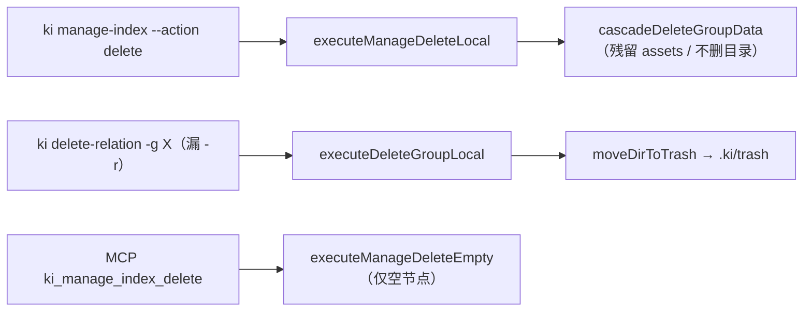
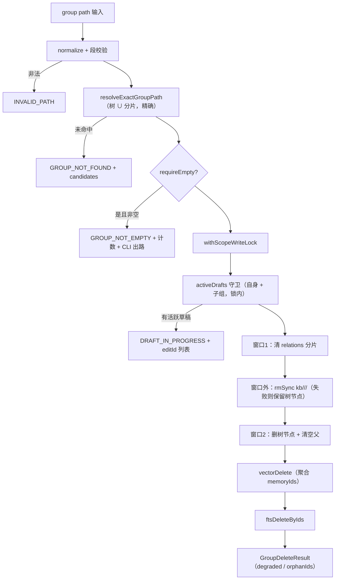
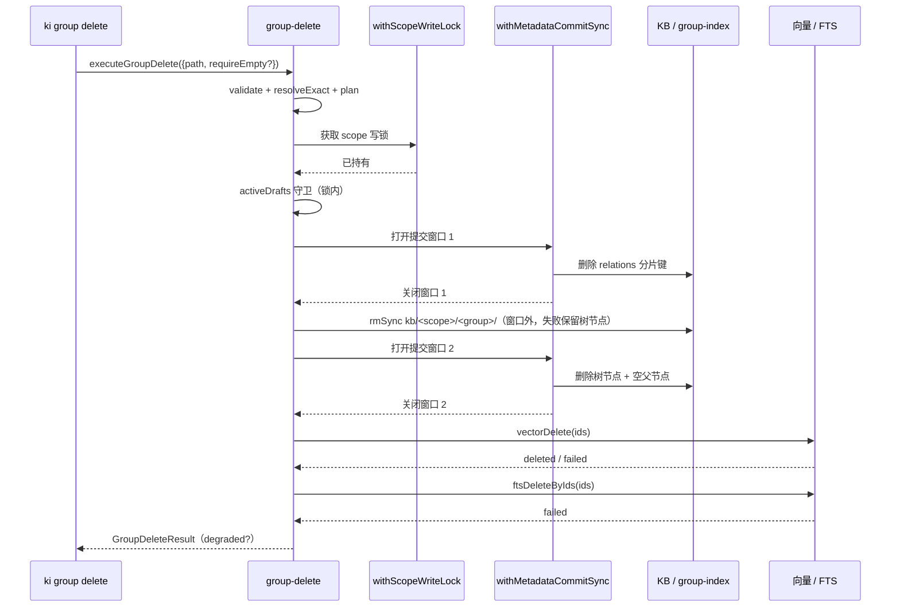

# S-01 删除 core 与安全

> 父文档：[DESIGN.md](./DESIGN.md)
> 覆盖需求：G1 / G2 / G3、D3 / D4 / D7、S1 / S5 / S6 / S7 / S9 / S10 / S11、M-02 / M-03 / M-04 / M-08 / M-14 / M-18

---

## 1. 术语

| 术语 | 含义 |
|---|---|
| 精确路径 | 与 group-index 树节点键或 relations 分片键**完全相等**的组路径；不做语义补全、不做前缀猜测 |
| KB 目录 | `kb/<scope>/<group>/`（`getKbDir(scope)` 之下），含 `index.json` 与 assets |
| wiki 目标目录 | `resolveWikiTarget(scope)/<group>`；因 `wiki-sync.ts:49-56` 优先取 `source.dir`，通常等于 `source.dir/<group>` |
| 级联键 | `key === group` 或 `key.startsWith(group + '/')` 的 relations 分片键集合 |
| 空节点 | 无子组、无 relation、KB 目录不存在或为空 |
| 元数据提交窗口 | `withMetadataCommitSync(scope, fn)` 包裹的同步写段：窗口内不夹引擎 I/O |
| degraded | 元数据删除成功，但向量/FTS 有失败项；结果仍 `ok:true` |

---

## 2. 现状（AS-IS）

### 2.1 现状描述

删除组存在三套实现：

- `src/delete-relation.ts:255-440` `executeDeleteGroupLocal`：清 cache → `rmSync` KB 子树 → `moveDirToTrash` 搬走 `source.dir/<group>` → 删树节点；有写锁与迁移守卫。
- `src/manage-index.ts:455-565` `cascadeDeleteGroupData`：只 `unlink` `kb/<scope>/<group>/index.json`，不动 assets、不删目录、不动 wiki。
- `src/manage-index.ts:206-330` `executeManageDeleteEmpty`：仅删空节点，不级联。

CLI 入口：`bin/ki.mjs:28-50` 的 `COMMANDS` 映射把 `manage-index` / `delete-relation` 直接 spawn；`delete-relation` 省略 `-r` 即走目录级删除（`:796-801`），零确认。



### 2.2 痛点

- 同一"删组"意图产生三种磁盘结果，用户无法预判（实测把暂存目录的 `playground/` 移入 `.ki/trash`，见需求 §2.1 实验 E5）。
- `manage-index` 路径残留 157 个 svg / 1.3MB 与空目录，与 `scope.ts:121-131` 的注释承诺相反。
- 文档级删除把源 `.md` 移入 `.ki/trash`，回收站机制无清理入口，长期堆积。

---

## 3. 方案（TO-BE）

### 3.1 方案概述

新增 `src/lib/group-delete.ts` 作为**唯一删组 core**，拆成 `planGroupDelete`（只读预览）与 `executeGroupDelete`（持锁执行）两个入口；`delete-relation.ts` 只保留 relation 级删除与「文档级硬删 + 草稿守卫」；`.ki/trash` 相关函数全部删除。

执行阶段必须在删除 relations 分片**之前**，把级联组的 `memoryIds` / `ftsIds` 收集到内存（`GroupDeletePlan` 只暴露计数，不暴露 id）；否则分片先删后无法再取向量 id。

### 3.2 关键决策点

| 决策 | 选择 | 理由 | 备选方案 | 否决原因 | 重新评估触发条件 |
|---|---|---|---|---|---|
| core 位置 | 新建 `src/lib/group-delete.ts` | 与 `delete-relation.ts` 的职责分离；G1 判据可直接指向单一文件 | 继续留在 `delete-relation.ts` | 文件语义变成"删关系 + 删组"，RPC/测试引用混乱 | 无 |
| 预览与执行是否同一函数 | 拆分 `plan` / `execute` | 预览要求零写入；合并后靠参数区分容易误写 | `execute({dryRun:true})` | 破坏性函数内部出现读写分支，审计困难 | 无 |
| 删除顺序 | cache 分片（窗口1）→ `rmSync` KB 目录（**窗口外**）→ 树节点（窗口2）→ 向量 → FTS | 提交窗口只包小 JSON 写；大目录 `rmSync` 移出窗口，避免按文件数阻塞同 scope 新操作（`operation-coordinator.ts:290`） | 全部放进一个元数据窗口 | KB 含 assets 时可能上万文件，窗口时长与文件数成正比，期间该 scope 的读请求全部排队 | 单组 KB 文件数稳定 < 500 且删除耗时 < 50ms |
| 大目录 `rmSync` 失败 | 保留树节点，返回 `ok:false`；重跑可收敛 | `rmSync` 在树节点删除之前，失败时组仍可被精确解析到，重跑会重试删除 | 先删树节点再删目录 | 目录删除失败后树节点已消失，无法再通过 `ki group delete` 重跑，只能手工清目录 | 无 |
| 文档级源文件归属校验 | `rel.sourcePath` 存在时，候选文件必须等于 `realpath(sourceDir + sourcePath)`；不匹配拒绝 | 硬删不可恢复，必须确认文件确属该 relation（`scoring.ts:31-32` 已有 `sourcePath`） | 沿用 `findWikiFile` 纯文件名匹配 | 同目录同名但无关的 `.md` 会被误删，且无回收站可恢复 | 所有 relation 都能保证 `sourcePath` 与 wiki 落点一致 |
| 文档级草稿守卫位置 | **固化在 `withScopeWriteLock` 内、`unlink` 前**（现状即如此：`delete-relation.ts:217` 的锁包住 `executeDeleteRelationLocal`，守卫在 `:139-147`） | 设计显式声明，避免实现改造时把守卫挪到锁外 | 删除前在锁外检查 | 锁外检查与 `unlink` 之间可插入草稿创建，硬删后草稿无法收口 | 无 |
| 向量/FTS 失败语义 | 返回 `degraded` + `orphanIds`，不抛错 | 元数据已删，抛错会让用户以为整组还在 | 抛错回滚 | 无法回滚已删文件；抛错丢失"已删一半"的事实 | 无 |
| 预览与执行的 TOCTOU | 执行时在锁内重新 plan，结果里返回实际计数 | 不引入额外状态；预览定位为"信息"而非"契约" | 预览签发 token，`--yes` 校验 | 需持久化 token 与失效逻辑，收益低于成本 | 出现"预览 3 条、误删 30 条"的真实工单 |
| 空父节点清理 | 删除后向上清理**确认为空**（无子组、无 relation、无 KB）的父节点 | 与现有 `removeGroupNode` 行为一致，避免空壳残留 | 保留空父节点 | 树中出现无法点击的空节点 | 用户要求保留父节点 |
| MCP 空节点删除 | 复用同一 core，`requireEmpty: true` | G1 单实现；空节点是级联的特例 | 独立实现 | 又长出第二套删除逻辑 | 无 |
| 路径 `..` / 编码绕过 | 先 `decodeURIComponent` 再按段校验，拒绝 `.` / `..` / 空段 / `\` / NUL | 删组是破坏性操作，必须先于任何 IO 拦截 | 交给 `path.join` 自然处理 | `path.join` 会把 `..` 解析成上级目录 | 无 |

### 3.3 TO-BE 流程图



### 3.4 行为差异对照

| 场景 | AS-IS（`manage-index`） | AS-IS（`delete-relation -g`） | TO-BE |
|---|---|---|---|
| KB 目录 | 只删 `index.json` | `rmSync` 递归 | `rmSync` 递归（含 assets） |
| assets | 残留 | 随目录删除 | 随目录删除 |
| wiki / `source.dir` | 保留 | 整棵移入 `.ki/trash` | **零写操作**（D3/D4） |
| 向量 / FTS | 删向量，**不删 FTS** | 删向量 + FTS | 删向量 + FTS |
| 确认 | `--force` | 无 | 默认预览，`--yes` 执行 |
| 写锁 / 迁移守卫 | daemon 有、CLI 内联无 | 有 | 全部入口统一 |
| 部分失败 | 静默 | `vectorRemoved:false` | `degraded` + 逐项计数 + `orphanIds` |

---

## 4. 接口 / 数据模型

### 4.1 对外接口

文件：`src/lib/group-delete.ts`（新增）

```ts
export interface GroupDeleteOptions {
  scope?: string;
  path: string;              // 组路径（单一路径，无 parent/name）
  requireEmpty?: boolean;    // MCP 空节点删除用
}

export interface GroupDeleteTargets {
  groups: string[];          // 自身 + 全部子组
  relations: number;
  kbDir: string;
  kbFiles: number;
  assets: number;
  vectors: number;           // 去重后的 memoryId 数
  ftsDocs: number;
  emptyParents: string[];    // 删除后将被清理的空父节点
}

export interface GroupDeletePlan {
  ok: true;
  scope: string;
  path: string;              // 归一化后的精确路径
  exists: boolean;
  willDelete: GroupDeleteTargets;
  willKeep: { wikiDir: string | null };
  hint: string;              // "追加 --yes 或 confirm 执行"
}

export type GroupDeleteErrorCode =
  | 'INVALID_PATH'
  | 'GROUP_NOT_FOUND'
  | 'SCOPE_NOT_INITIALIZED'
  | 'GROUP_NOT_EMPTY'
  | 'DRAFT_IN_PROGRESS'
  | 'SCOPE_OPERATION_BUSY'
  | 'VECTOR_MIGRATION_PENDING';

export interface GroupDeleteError {
  ok: false;
  scope: string;
  path: string;
  code: GroupDeleteErrorCode;
  error: string;
  candidates?: string[];
  detail?: Record<string, unknown>;
}

export interface GroupDeleteResult {
  ok: boolean;
  scope: string;
  path: string;
  deleted: {
    groups: string[];
    relations: number;
    kbDir: boolean;
    tree: boolean;
  };
  vectors: { deleted: number; failed: number; skipped: number; orphanIds: string[] };
  fts: { deleted: number; failed: number; orphanIds: string[] };
  degraded: boolean;
  warnings: string[];
  error?: string;
}

export function resolveExactGroupPath(
  scope: string,
  path: string,
): { canonical: string; groups: string[] } | null;

export async function planGroupDelete(
  opts: GroupDeleteOptions,
): Promise<GroupDeletePlan | GroupDeleteError>;

export async function executeGroupDelete(
  opts: GroupDeleteOptions,
): Promise<GroupDeleteResult>;
```

| 接口 | 输入 | 输出 | 异常 |
|---|---|---|---|
| `resolveExactGroupPath` | `scope`, `path` | 规范化路径 + 级联组；未命中 `null` | 不抛（纯查询） |
| `planGroupDelete` | `GroupDeleteOptions` | `GroupDeletePlan` 或 `GroupDeleteError` | 读盘失败转为 `error` 分支 |
| `executeGroupDelete` | `GroupDeleteOptions` | `GroupDeleteResult` | 锁冲突 / 迁移中返回 `ok:false` + code |

**Demo 返回示例（预览）**

```json
{
  "ok": true,
  "scope": "default",
  "path": "工具库/Redis",
  "exists": true,
  "willDelete": {
    "groups": ["工具库/Redis", "工具库/Redis/集群"],
    "relations": 12,
    "kbDir": "/Users/u/.ki/kb/default/工具库/Redis",
    "kbFiles": 18,
    "assets": 4,
    "vectors": 27,
    "ftsDocs": 3,
    "emptyParents": []
  },
  "willKeep": { "wikiDir": "/Users/u/docs/工具库/Redis" },
  "hint": "确认无误后追加 --yes 执行"
}
```

### 4.2 内部协作接口

- `src/lib/scope.ts`：`getKbDir` / `getLocalKbDir` / `getGroupIndexPath` / `readGroupIndex` 不变。
- `src/lib/group-cache.ts`：`listGroupPaths` / `loadGroupCache` / `deleteGroupCache` 复用。
- `src/lib/relation-edit-draft.ts`：`activeDrafts(scope)` 复用（已过滤 `published` / `cancelled`）。
- `src/lib/scope-write-lock.ts`：`withScopeWriteLock(scope, 'group-delete', fn)`。
- `src/lib/operation-coordinator.ts`：`withMetadataCommitSync(scope, fn)`。

### 4.3 文档级删除的结构变更

文件：`src/delete-relation.ts`

```ts
export interface DeleteResult {
  // ...既有字段不变
  wikiRemoved: boolean;                 // 语义改为「源文件是否被 unlink」
  wikiSkipReason?: 'not-configured' | 'file-not-found' | 'outside-source-dir' | 'source-mismatch';
  wikiMatch?: 'sourcePath' | 'legacy-name';  // 本次依据哪种方式认定归属
  wikiError?: string;                   // EACCES / EISDIR 等
}

function unlinkWithinSourceDir(
  sourceDir: string,
  filePath: string,
): { status: 'deleted' | 'file-not-found' | 'outside-source-dir' }
 | { status: 'io-error'; error: string };
```

规则：

1. `sourceDir = getSource(scope)?.dir ?? wikiSync.sourceDir`（与 `resolveWikiTarget` 同优先级）。
2. `sourceDir` 不存在或未配置 → 跳过，`wikiSkipReason` 对应，`ok:true`。
3. **归属校验**：`rel.sourcePath` 存在时，候选文件必须等于 `realpath(sourceDir + sourcePath)`，否则拒绝并返回 `wikiSkipReason='source-mismatch'`（`wikiMatch='sourcePath'`）。`rel.sourcePath` 缺失（历史 relation）时按文件名匹配，`wikiMatch='legacy-name'` 且写入 `warnings`。
4. `fs.realpathSync(file)` 必须落在 `fs.realpathSync(sourceDir)` 之内；否则拒绝，`wikiSkipReason='outside-source-dir'`。
5. `unlinkSync` 失败 → `wikiError`，`ok:true`（KB/向量已删），结果标注。
6. `activeDrafts` 守卫位于 `withScopeWriteLock` 内、`unlink` 之前（沿用 `delete-relation.ts:217` 的锁 + `:139-147` 的检查），命中即 `ok:false`。

---

## 5. 时序图（执行）



---

## 6. 异常处理

| 场景 | 行为 | 是否对外暴露 |
|---|---|---|
| 路径为空 / `/` / 全空白 | `INVALID_PATH`，零写入 | 是 |
| 含 `.` / `..` / NUL / `\` | `INVALID_PATH`，零写入 | 是 |
| 路径近似但不等 | `GROUP_NOT_FOUND` + `candidates`（最多 5 条）+ `ki group list` 提示 | 是 |
| `requireEmpty` 但非空 | `GROUP_NOT_EMPTY` + 子组/relation/KB 计数 + `ki group delete <path> --yes` 出路 | 是 |
| 存在活跃编辑草稿 | `DRAFT_IN_PROGRESS` + `editId:status` 列表 + cancel/finish 指引 | 是 |
| scope 写锁被占 | `SCOPE_OPERATION_BUSY`（沿用现有锁错误） | 是 |
| 迁移守卫命中 | `VECTOR_MIGRATION_PENDING` | 是 |
| 元数据写失败（磁盘满） | `ok:false` + `error` + 已提交项计数；不抛裸栈。树节点在失败时保持存在时，重跑可收敛（relations 已清则计 0，继续删 KB/树）；若树节点已删则不再提供重跑入口 | 是 |
| `rmSync` KB 目录失败 | `ok:false`，**树节点保留**，重跑可收敛（不进入窗口 2） | 是 |
| 文档级 `sourcePath` 与候选文件不符 | 拒绝 unlink，`wikiSkipReason='source-mismatch'`，`ok:true` | 是 |
| 历史 relation 无 `sourcePath` | 按文件名删除，`wikiMatch='legacy-name'` 写入 `warnings` | 是 |
| 向量删除部分失败 | `degraded:true` + `vectors.failed` / `orphanIds` + 提示用 `ki doc delete` 清理 | 是 |
| FTS 删除失败 | `degraded:true` + `fts.failed` / `orphanIds` | 是 |
| 文档级源目录未配置 | 跳过，`wikiSkipReason='not-configured'`，`ok:true` | 是 |
| 文档级源文件不存在 | 跳过，`wikiSkipReason='file-not-found'`，`ok:true` | 是 |
| 文档级文件逃逸 sourceDir | 拒绝 unlink，`outside-source-dir`，`ok:true` | 是 |
| 文档级 unlink EACCES / EISDIR | `wikiError`，`ok:true`（KB 已删） | 是 |

---

## 7. 性能 & 安全

### 性能

- 级联枚举 O(子组数)，只读子组对应分片，不整库扫描。
- 预览的 KB 文件计数需遍历目录；万级文件预计 < 300ms，超过 1s 时只返回 `kbDir` 与 `kbFiles: -1`（标注"未计数"）——本版先实现计数，保留降级开关。
- 提交窗口内只做小 JSON 写（分片删除 / 树节点更新），不夹 `rmSync`、不夹向量调用；大目录删除在窗口外执行。

### 安全

- 输入校验先于任何 IO：空路径、`.`、`..`、NUL、`\`、解码后二次校验。
- 删组**永不**触碰 `source.dir` / `wiki 目标目录`（无任何写路径）。
- 文档级硬删必须 realpath containment；拒绝符号链接逃逸。
- 所有入口共享 `withScopeWriteLock` + `assertNoPendingVectorMigration`。

---

## 8. 测试方案

| 类型 | 范围 | 工具 |
|---|---|---|
| 单元 | `resolveExactGroupPath` 精确/近似/`..`/编码；`planGroupDelete` 零写入；`requireEmpty` 三重判空；空父节点判定 | `npx jiti test/...`（现有风格） |
| 集成 | 真实临时 scope：建树 + 分片 + KB + assets → 删组 → 断言目录消失、assets 清空、树节点消失、`source.dir` 哈希不变 | `test/delete-group.test.ts` 重写 |
| 集成 | 文档级：配置源目录 → 硬删；未配置 → 跳过；软链逃逸 → 拒绝；活跃草稿 → 拒绝；`sourcePath` 不符 → 拒绝；无 `sourcePath` → `legacy-name` 警告 | 新增 `test/delete-relation-wiki.test.ts` |
| 集成 | 大组（> 5000 文件）删除时，同 scope `ki group list` 的 P99 不因提交窗口线性恶化 | 新增压测脚本，标注 `[需运行验证]` |
| 集成 | 部分失败：mock `vectorDelete` 失败 → `degraded` + `orphanIds` | 现有 mock 方式 |

不在测试范围内：跨机分布式锁、崩溃恢复（非目标）。

---

## 9. 迁移策略

### 存量数据处理

- 已存在的 `.ki/trash` 目录**不自动清理**（可能含用户文件），文档提示人工处理。
- 已删除但残留的 `kb/<scope>/<group>/assets` 不做批量修复；需要时用 `ki group delete`（若树节点已无）或手工清理。

### 旧接口 / 命令废弃

| 旧接口/命令 | 处理方式 | 废弃时间线 |
|---|---|---|
| `moveDirToTrash` / `moveToTrash` / `.ki/trash` | 直接移除 | 同批发布 |
| `executeDeleteGroupLocal` | 迁移为 `executeGroupDelete`；S1~S2 期间保留同名薄包装供 daemon 调用 | S-02 完成后移除包装 |
| `executeManageDelete*` / `cascadeDeleteGroupData` | 删除 | S2 |
| `ki delete-relation -g X`（省略 `-r`） | 报错并指向 `ki group delete X --yes` | 同批发布 |

### 回滚方案

代码可回滚，但 **D7 硬删的源文件不可恢复**；回滚不恢复已删除文件。发布说明必须写明。

---

## 10. 影响范围

| 影响对象 | 影响类型 | 影响描述 | 是否破坏性变更 |
|---|---|---|---|
| `src/lib/group-delete.ts` | 新增 | 唯一删组 core | 否 |
| `src/delete-relation.ts` | 行为变更 | 组级删除迁出；文档级改硬删 + containment + 草稿守卫 | 是 |
| `src/manage-index.ts` | 行为变更 | 删除 `executeManageDelete*` / `cascadeDeleteGroupData` / `executeListScopes`；create 迁至 `src/lib/group-create.ts` 后整文件删除（与 S-02 协同） | 是 |
| `src/lib/daemon-dispatch.ts` | 接口变更 | `delete-group` → `group-delete`，删 `manage-delete` | 是 |
| `test/delete-group.test.ts` 等 3 个测试 | 测试变更 | 改指向新 core | 是 |

---

## 11. 待定问题

| 编号 | 问题 | 影响范围 | 建议决策时间 |
|---|---|---|---|
| T-02 | 万级 relation 组的删除耗时无基线数据（预览计数 + 删除总耗时） | S-01 | 验收前补一次压测 |

R3（预览契约）/ R5（FTS）/ R6（组级草稿）/ R7（部分失败）/ R14（D7 异常分支）均在本设计内定稿。
