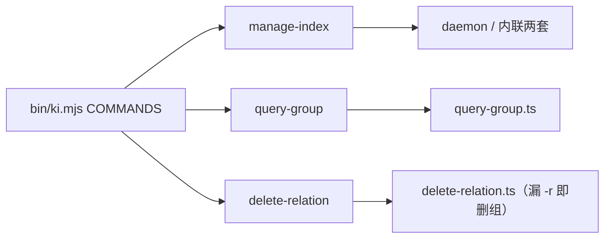
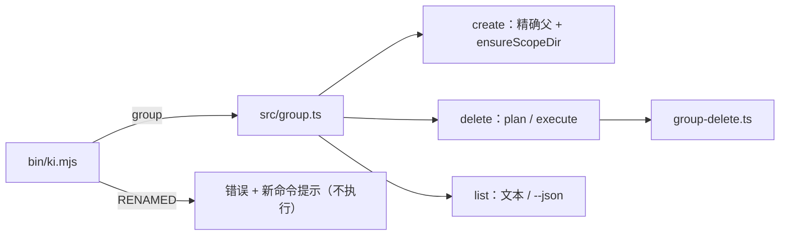
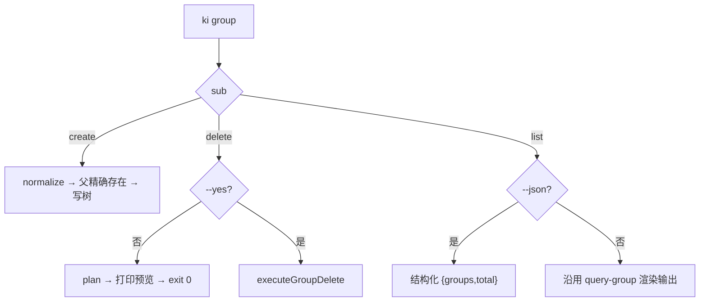
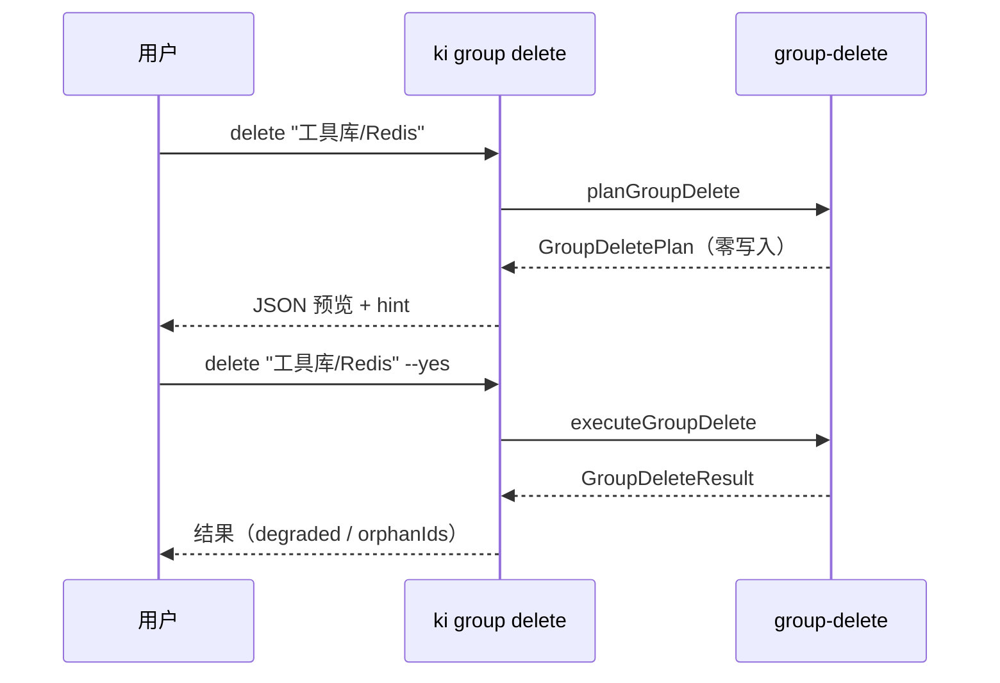

# S-02 `ki group` CLI 命令族

> 父文档：[DESIGN.md](./DESIGN.md) · 上游：[S01_删除core与安全_DESIGN.md](./S01_删除core与安全_DESIGN.md)
> 覆盖需求：G1 / G2 / G4 / G5 / G6、D1 / D5 / D6-2、S2 / S3 / S4 / S8 / S9、M-01 / M-05 / M-07 / M-10 / M-11 / M-15 / M-19

---

## 1. 术语

| 术语 | 含义 |
|---|---|
| 单一路径 | 组的位置只由 `<path>` 表达（如 `工具库/Redis`），无 `--parent` / `--name` / `--parents` |
| 预览 | `ki group delete <path>` 不带 `--yes`：调用 `planGroupDelete`，零写入，退出码 0 |
| RENAMED | 旧命令被 `bin/ki.mjs` 拦截，打印映射后的新命令，不 spawn、不执行 |
| 结构化输出 | `ki group list --json` 返回的 `{ok, scope, groups, total}` |
| 原子发布 | S1~S4 同批发布，禁止单独发 S-01（否则报错文案指向不存在的命令） |

---

## 2. 现状（AS-IS）

### 2.1 现状描述

- `bin/ki.mjs:28-50` 的 `COMMANDS` 映射包含 `manage-index` 与 `query-group`，直接 `spawn npx jiti <script>`。
- `manage-index` 有 `--action create|delete|list-scopes`、`--parent`、`--name`、`--force`（`src/manage-index.ts:571-579`），`--action` 默认 `create`。
- `query-group` 有 `--subtree <path>`、`--groups`、`--mode`、`--depth`、`--hot-count`、`--no-auto-fallback`（`src/query-group.ts:995-1007`）。
- `ki delete-relation -g X` 省略 `-r` 即递归删组（`src/delete-relation.ts:795-801`），零确认。
- `bin/ki.mjs` 帮助里仍写着不存在的 `--action create-root --root-name`。



### 2.2 痛点

- 同一能力四个入口，参数形态不一致，用户无法凭命令名判断副作用。
- 旧命令名无法给出迁移提示：`ki manage-index` 报"未知操作"或"需要 --name"，不指向任何新命令。
- `bin/ki.mjs` 帮助与实现脱节（`create-root` 已不存在）。
- 脚本依赖的结构化输出（`list-scopes`）在改名后没有对应物。

---

## 3. 方案（TO-BE）

### 3.1 方案概述

新增 `src/group.ts`，三个子命令 `create` / `delete` / `list`；`bin/ki.mjs` 用 `group` 替换 `manage-index` 与 `query-group` 的映射，并加 `RENAMED` 拦截表；`delete-relation` 省略 `-r` 改为报错并指向新命令。



### 3.2 关键决策点

| 决策 | 选择 | 理由 | 备选方案 | 否决原因 | 重新评估触发条件 |
|---|---|---|---|---|---|
| 子命令名 | `create` / `delete` / `list` | 与 `ki scope|doc|tag list` 同族；`list` 比 `query` 更贴合"列出组" | `query` | 用户实测认为 `list` 更形象；且与全仓动词表不一致 | 无 |
| create core 位置 | 新建 `src/lib/group-create.ts`，迁入 `executeManageCreate` 逻辑并改签名 `{scope?, path}` | 组域三个 core（create/delete/list 实现）归位到 `src/lib/`；`src/manage-index.ts` 可整文件删除 | 保留 `src/manage-index.ts` 只放 create | 文件名与职责不符，后续仍会被误认为"旧管理面" | 无 |
| ancestor 创建 | **不提供** `--parents` | 用户拍板"一律取消 parent 参数"；单节点语义最可预测 | `--parents` 自动补祖先 | 参数组合重新变复杂，且与"父必须存在"冲突 | 用户明确要求批量建树 |
| 预览退出码 | 0 | 预览是正常查询，不是错误 | 1 | 会让脚本误判失败 | 无 |
| `list` 的结构化输出 | 新增 `--json` | 脚本需要全路径；原 `list-scopes` 只到顶层 | 只保留文本 | 机器消费需解析渲染文本 | 无 |
| `--json` 与 `--mode` 的关系 | JSON 忽略 `--mode` / `--depth` / `--hot-count` | JSON 是结构快照，不是分区视图 | JSON 也做分区 | 输出体积与语义过度耦合 | 出现按分区机器消费的需求 |
| RENAMED 粒度 | 按旧 `--action` 分派到具体新命令 | G5 "错误都给出路"；泛化提示不解决问题 | 统一提示"请用 ki group" | 用户仍需自行推断 | 无 |
| `delete-relation` 漏 `-r` | 报错 + 指向 `ki group delete` | 消除"漏一个参数删整棵树" | 保留旧行为 | 与 D2 冲突 | 无 |
| RPC 名 | `group-create` / `group-delete` / `group-delete-empty` / `group-list` | 与命令族一致，便于 grep | 保留 `manage-*` / `query-group` | 内部名与外部名分叉 | 无 |
| RPC 过渡别名 | 旧名保留**一个版本**，指向同一 handler | 消除"新 CLI + 旧 daemon"的未知 operation 窗口；别名不是第二套实现，G1 不受影响 | 直接硬改名 | 用户未重启 daemon 时，所有写命令报未知 operation，需人工排查 | 下一版本删除别名后 |

### 3.3 TO-BE 流程图



### 3.4 RENAMED 映射表

| 旧调用 | 提示 | 是否执行 |
|---|---|---|
| `ki manage-index --action create --name X --parent Y` | `ki group create "Y/X"` | 否 |
| `ki manage-index --action delete --name X --parent Y --force` | `ki group delete "Y/X" --yes` | 否 |
| `ki manage-index --action list-scopes` | `ki scope list` | 否 |
| `ki manage-index`（无 action） | 三条都列出，并说明 `--action` 已取消 | 否 |
| `ki query-group --subtree <p>` | `ki group list <p>`（`--subtree` 改为位置参数） | 否 |
| `ki query-group -g a,b --mode full` | `ki group list --groups a,b --mode full` | 否 |
| `ki delete-relation -g X`（无 `-r`） | `ki group delete X --yes` | 否 |

---

## 4. 接口设计

### 4.1 CLI 表面

```bash
ki group create <path> [--scope <s>]
ki group delete <path> [--yes] [--scope <s>]
ki group list   [<path>] [--groups <a,b>] [--mode <m>] [--depth <n>] [--hot-count <n>]
                         [--no-auto-fallback] [--json] [--with-counts] [--scope <s>]
```

| 子命令 | 参数 | 返回 | 异常 |
|---|---|---|---|
| `create` | `path` 必填；`--scope` 可选 | `{ok, scope, path, createdScope}` | 父不存在 / 已存在 / 非法路径 → `ok:false` + 候选 |
| `delete` | `path` 必填；`--yes` 可选 | 无 `--yes`：`GroupDeletePlan`；有 `--yes`：`GroupDeleteResult` | 见 S-01 §6 |
| `list` | `path` 可选；`--groups` 与 `path` 互斥；`--with-counts` 仅与 `--json` 搭配 | 文本输出，或 `--json` 结构 | 互斥冲突 / scope 不存在 → `ok:false` |

`create` 调用 `src/lib/group-create.ts` 的 `executeGroupCreate({ scope, path })`（由 `src/manage-index.ts` 的 `executeManageCreate` 迁入并改签名）；`ensureScopeDir` 与 `createdScope` 语义保持不变。

### 4.2 JSON 输出

**`create`**

```json
{ "ok": true, "scope": "default", "path": "工具库/Redis", "createdScope": false }
```

**`list --json`**

```json
{
  "ok": true,
  "scope": "default",
  "groups": [
    { "path": "工具库", "children": ["工具库/Redis"] },
    { "path": "工具库/Redis", "children": [] }
  ],
  "total": 2
}
```

`--json` 默认只输出路径与 `children`，数据源是 `listGroupPaths(scope)`（O(组数)，**不读分片**）。
`--with-counts` 才追加 `relations` 字段（逐组 `loadGroupCache`，O(组数) 次分片读，属慢路径，文档标注"仅脚本按需使用"）。
`--mode` / `--depth` / `--hot-count` / `--no-auto-fallback` 在 JSON 模式下忽略；`<path>` 表示子树根，`--groups` 表示精确列表，二者互斥。

**`delete`（预览）**：见 S-01 §4.1 Demo。
**`delete --yes`**

```json
{
  "ok": true,
  "scope": "default",
  "path": "工具库/Redis",
  "deleted": { "groups": ["工具库/Redis"], "relations": 12, "kbDir": true, "tree": true },
  "vectors": { "deleted": 27, "failed": 0, "skipped": 0, "orphanIds": [] },
  "fts": { "deleted": 3, "failed": 0, "orphanIds": [] },
  "degraded": false,
  "warnings": []
}
```

### 4.3 daemon RPC 变更

| 旧 operation | 新 operation | 处理 | 过渡别名（保留一个版本） |
|---|---|---|---|
| `query-group` | `group-list` | 改名，参数不变 | 是（同一 handler） |
| `manage-create` | `group-create` | 参数改为 `{scope, path}`；handler 改为 `src/lib/group-create.ts` 的 `executeGroupCreate` | 是（同一 handler，旧参数适配） |
| `manage-delete-empty` | `group-delete-empty` | 参数改为 `{scope, path}` | 是（同一 handler） |
| `delete-group` | `group-delete` | 参数改为 `{scope, path}` | 是（同一 handler） |
| `manage-delete` | — | 删除 | 否（该路径无对应能力） |

> 别名只做参数适配后转调新 handler，不复制实现；下一个版本删除。`daemon-dispatch.ts` 的 `HANDLERS` 仍是一张表，G1 判据不受影响。

文件：`src/lib/daemon-dispatch.ts`、`src/lib/daemon-client.ts`、`src/lib/operation-coordinator.ts`（`READ_OPERATIONS` 同步改名）。

### 4.4 `bin/ki.mjs` 变更

- `COMMANDS`：删除 `manage-index` / `query-group`，新增 `group: 'src/group.ts'`。
- 新增 `RENAMED` 表，在 `Object.hasOwn(COMMANDS, command)` 之前判断；命中则打印提示并 `process.exit(1)`。
- 帮助文本：删除 `manage-index` / `query-group` 行与 `create-root` 示例，加入 `ki group create|delete|list`。
- `delete-relation` 的帮助补一句"只删 relation；删组请用 `ki group delete`"。

---

## 5. 时序图（delete 预览 → 执行）



---

## 6. 异常处理

| 场景 | 行为 | 是否对外暴露 |
|---|---|---|
| `create` 父路径不存在 | `ok:false` + `candidates` + "先创建父组" | 是 |
| `create` 目标已存在 | `ok:false` + `GROUP_EXISTS` | 是 |
| `create` 全新 scope | `ensureScopeDir` 后继续，返回 `createdScope:true` | 是 |
| `list` 同时给 `<path>` 与 `--groups` | `ok:false`（互斥） | 是 |
| `delete` 未知 `--scope` | 沿用 `resolveScope` / `validateScope` 错误 | 是 |
| 旧命令被调用 | RENAMED 提示，退出码 1 | 是 |
| `delete-relation` 漏 `-r` | 报错 + `ki group delete <group> --yes` | 是 |
| daemon 版本过旧（RPC 未知） | 原样返回 daemon 错误，附 `ki mcp restart` 提示 | 是 |

---

## 7. 性能 & 安全

- `create` / `delete` 均为 O(1) 树操作 + O(级联) 分片操作；`list` 复用现有查询复杂度。
- `list --json` 默认只枚举路径（O(组数)，不读分片）；`--with-counts` 才逐组读分片，文档标注为慢路径。
- 所有写命令经 daemon 队列与 `withScopeWriteLock`（由 core/S-01 提供）。
- RENAMED 只读参数，不触碰磁盘与 daemon。
- 路径校验复用 S-01 的 `normalizeGroupPath`（S-02 不重复实现）。
- `--scope` 的 default / strict 语义沿用 `resolveScope`。

---

## 8. 测试方案

| 类型 | 范围 | 工具 |
|---|---|---|
| CLI e2e | `create` 顶层/嵌套/父不存在/scope 自动建；`delete` 预览零写入 + `--yes` 生效；`list` 文本与 `--json` | `npx jiti test/group-cli.test.ts`（spawn `bin/ki.mjs`） |
| CLI e2e | RENAMED：4 条旧调用分别断言提示内容与退出码 1，且磁盘零变化 | 同上 |
| 单元 | `normalizeGroupPath` 边界（`..`、编码、空段） | `test/group-path.test.ts` |
| 集成 | 与 S-01 core 的契约：预览/执行结构字段齐全 | 复用 S-01 测试 |

不在测试范围内：`--help` 文案逐字断言（由 S-04 文档走查覆盖）。

---

## 9. 迁移策略

### 存量数据处理

无数据结构变更。

### 旧接口 / 命令废弃

| 旧接口/命令 | 处理方式 | 废弃时间线 |
|---|---|---|
| `ki manage-index` | 从 `COMMANDS` 删除，进 `RENAMED` | 同批发布 |
| `ki query-group` | 同上 | 同批发布 |
| `ki delete-relation -g X`（无 `-r`） | 报错 | 同批发布 |
| daemon `delete-group` / `manage-*` / `query-group` | 新名 + 旧名别名（同一 handler），`manage-delete` 删除 | 同批发布；别名保留一个版本后移除 |

### 回滚方案

CLI 与 daemon 必须同版本；回滚时两者一起回滚。已在 S-01 执行过的硬删文件不恢复。

---

## 10. 影响范围

| 影响对象 | 影响类型 | 影响描述 | 是否破坏性变更 |
|---|---|---|---|
| `src/group.ts` | 新增 | 三个子命令 | 否 |
| `src/lib/group-create.ts` | 新增 | create core（迁自 `manage-index.ts`，签名 `{scope, path}`） | 否 |
| `src/manage-index.ts` | 删除 | create 迁出、delete/list 能力移除后整文件删除 | 是 |
| `bin/ki.mjs` | 接口变更 | COMMANDS / RENAMED / 帮助 | 是 |
| `src/lib/daemon-dispatch.ts` | 接口变更 | 5 个 operation 改名/删除 | 是 |
| `src/delete-relation.ts` | 接口变更 | 漏 `-r` 从删组改为报错 | 是 |
| `test/manage-index.test.ts` / `test/query-group.test.ts` | 测试变更 | 改为覆盖真实 CLI 路径 | 是 |

---

## 11. 待定问题

| 编号 | 问题 | 影响范围 | 建议决策时间 |
|---|---|---|---|
| T-03 | 旧 daemon 未被重启时，是否在 CLI 侧主动探测版本并提示（而非等 RPC 报错） | S-02 | 实现前 |
