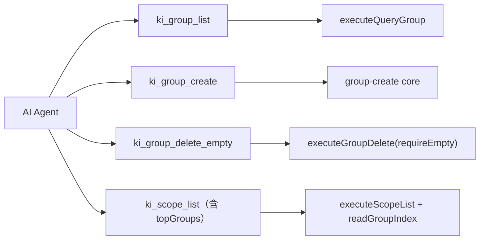
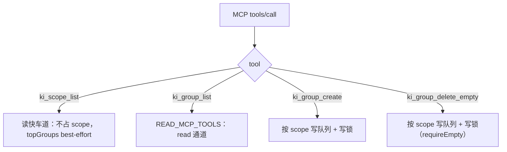
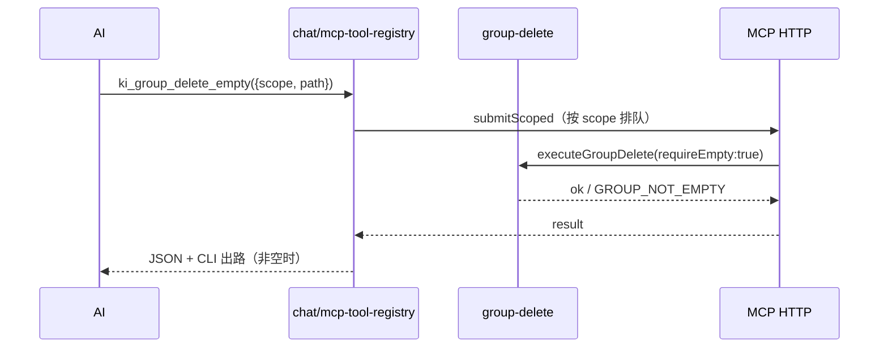

# S-03 MCP 表面

> 父文档：[DESIGN.md](./DESIGN.md) · 上游：[S01_删除core与安全_DESIGN.md](./S01_删除core与安全_DESIGN.md)
> 覆盖需求：G1 / G4 / G5、D6 / D6-1 / D6-2 / D6-3、S8、M-13 / M-15 / M-16 / M-17

---

## 1. 术语

| 术语 | 含义 |
|---|---|
| `ki_group_list` | 原 `ki_query_group`，参数与渲染输出不变 |
| `ki_group_create` | 原 `ki_manage_index_create`，入参改为 `{scope, path}` |
| `ki_group_delete_empty` | 原 `ki_manage_index_delete`，仅删空节点；**没有 CLI 对应物** |
| `topGroups` | `ki_scope_list` 新增字段：每个 scope 的顶层组名数组（仅第一层） |
| 读快车道 | `mcp-http.ts` 中不占用任何 scope 的只读通道（当前 `ki_scope_list` 独占） |
| best-effort | `topGroups` 在导入期间允许是中间态，不承诺强一致快照 |
| `topGroupsStale` | `topGroups` 的陈旧标记：该 scope 正在提交窗口内或读取失败时为 `true` |

---

## 2. 现状（AS-IS）

### 2.1 现状描述

- `src/lib/mcp-tools/manage-index.ts` 注册 `ki_manage_index_create`（scope/name/parent）、`ki_manage_index_list`（无参，`executeListScopes`）、`ki_manage_index_delete`（scope/name/parent，仅空节点）。
- `src/lib/mcp-tools/query-group.ts` 注册 `ki_query_group`（scope/groups/hot_count/depth/mode/auto_fallback），返回 `{ok, scope, output}`。
- `src/lib/chat/mcp-tool-registry.ts` 另有一套同名工具定义（供 chat 内 AI 使用），names/labels 重复维护。
- `src/lib/chat/prompt-config.ts:111-118` 的破坏性工具组标签写着「删除 Group 节点及其下内容」，与空节点能力不符。
- `src/lib/mcp-http.ts:138` 的 `SCOPE_LESS_TOOLS` 含 `ki_scope_list` 与 `ki_manage_index_list`；`:769` 把后者标为 `needsGlobal`（全局独占）以保证跨 scope 快照一致。
- `src/lib/operation-coordinator.ts:75` 的 `READ_MCP_TOOLS` 含 `ki_query_group`。

### 2.2 痛点

- 工具名与 CLI 不一致（`manage_index` / `query_group`），AI 侧与用户侧两套词汇。
- `ki_manage_index_list` 与 `ki_scope_list` 能力重叠，但前者在全局独占通道、后者在快车道，合并后调度语义不一致。
- `ki_manage_index_delete` 的名字不表达"仅空节点"，`prompt-config` 的标签更写成"及其下内容"，AI 会误判能力。

---

## 3. 方案（TO-BE）

### 3.1 方案概述

MCP 工具全部改名并收敛为 3 个：`ki_group_create` / `ki_group_delete_empty` / `ki_group_list`；`ki_manage_index_list` 删除，`topGroups` 并入 `ki_scope_list`；chat 注册表与提示词同步改名，标签改为准确描述。



### 3.2 关键决策点

| 决策 | 选择 | 理由 | 备选方案 | 否决原因 | 重新评估触发条件 |
|---|---|---|---|---|---|
| 删除工具命名 | `ki_group_delete_empty` | 同名必须同能力；后缀显式表达限制 | 统一为 `ki_group_delete`（级联） | 需推翻 NEG-15，MCP 无二次确认交互 | 用户决定给 MCP 加 `confirm` 两段式 |
| 空节点实现 | 复用 `executeGroupDelete({requireEmpty:true})` | G1 单实现，空节点只是特例 | 保留 `executeManageDeleteEmpty` | 第二套删除逻辑，M-18 失败 | 无 |
| list 工具归属 | 删除 `ki_manage_index_list`，`topGroups` 并入 `ki_scope_list` | 跨 scope 枚举属 scope 领域；避免新增无 CLI 对应物的工具 | 新增 `ki_group_list_paths` | 纯枚举与 `ki_group_list` 重叠（用户已否决） | 出现"只要路径、不要渲染"的高频机器调用 |
| `topGroups` 的一致性 | best-effort，`ki_scope_list` 保持读快车道；响应带 `topGroupsStale` 标记 | 保住"scope 下拉不因导入挂起"的既有设计，同时让 AI 能识别中间态 | 把 `ki_scope_list` 标 `needsGlobal` | 导入期间 scope 列表被阻塞，违背 `mcp-http.ts:766-768` 的注释设计 | 出现因 topGroups 中间态导致的错误决策 |
| 陈旧标记来源 | 新增 `OperationCoordinator.isScopeCommitting(scope)`，复用现有 `committing` 计数 | 不引入新的状态源；读取失败也置 `true` | 只写文档、不加字段 | AI 无法区分"真的没有组"与"正在导入" | 无 |
| create 入参 | `{scope, path}` | 与 CLI 单一 `path` 对齐；D6-2 | 保留 `name`+`parent` | 用户明确要求取消 | 无 |
| chat 工具定义 | 与 `mcp-tools/*` 同名同 schema | 避免两套定义漂移 | 只改一侧 | 会出现"CLI 已改、chat 仍旧"的分叉 | 无 |

### 3.3 TO-BE 流程图（调度）



### 3.4 行为差异对照

| 场景 | AS-IS | TO-BE | 影响 |
|---|---|---|---|
| 列出 scope | `ki_manage_index_list` 全局独占，含 topGroups | `ki_scope_list` 快车道，含 topGroups（best-effort） | 更快；导入期可能中间态 |
| 创建组 | `{scope, name, parent}` | `{scope, path}` | 破坏性 |
| 删除组 | `{scope, name, parent}`，仅空节点 | `{scope, path}`，仅空节点，名字带 `_empty` | 破坏性 |
| 查询组 | `ki_query_group` | `ki_group_list` | 破坏性（名称） |
| AI 看到的标签 | 「删除 Group 节点及其下内容」 | 「删除空 Group 节点（非空请用 CLI）」 | 能力边界清晰 |

---

## 4. 接口 / 数据模型

### 4.1 MCP 工具契约

**`ki_group_create`**

```ts
{
  scope?: string;   // 默认 default；strict 模式必填
  path: string;     // 单个组路径，父级必须已存在
}
```

返回：`{ ok, scope, path, createdScope }`；`ok:false` 时 `isError:true`，文本含 `candidates` 与"先创建父组"。

**`ki_group_delete_empty`**

```ts
{
  scope?: string;
  path: string;
}
```

返回：`GroupDeleteResult`；非空时 `isError:true`，文本含计数与 `ki group delete <path> --yes`。

**`ki_group_list`**

```ts
{
  scope?: string;
  groups?: string;          // 逗号分隔
  hot_count?: number;       // 默认 5
  depth?: number;           // 默认 4
  mode?: string;            // hot|warm|cold|emerging|full，可逗号多值
  auto_fallback?: boolean;  // 默认 true
}
```

返回：`{ ok, scope, output }`（与现 `ki_query_group` 完全一致）。

**`ki_scope_list`**（输出增字段）

```ts
{
  ok: true;
  scopeMode: 'default' | 'strict';
  vectorAvailable: boolean;
  vectorReason?: string;
  count: number;
  scopes: Array<{
    scope: string;
    kb: boolean;
    vector: boolean;
    registered: boolean;
    wikiCount: number;
    ftsOnlyDocCount: number;
    ftsDocCount: number;
    topGroups: string[];   // 新增：顶层组名，读失败为 []
    topGroupsStale: boolean; // 新增：true = 该 scope 正在提交窗口或读取失败，topGroups 仅供参考
  }>;
}
```

**Demo 返回示例（`ki_scope_list`）**

```json
{
  "ok": true,
  "count": 1,
  "scopes": [
    { "scope": "default", "kb": true, "vector": true, "registered": true,
      "wikiCount": 42, "ftsOnlyDocCount": 0, "ftsDocCount": 5,
      "topGroups": ["工具库", "项目架构"], "topGroupsStale": false }
  ]
}
```

### 4.2 数据模型

`src/scope.ts` 的 `ScopeEntry` 增加 `topGroups: string[]` 与 `topGroupsStale: boolean`；`executeScopeListLocal` 对每个 scope 调用 `readGroupIndex(scope)`，异常时 `topGroups=[]` 且 `topGroupsStale=true`。

`topGroupsStale` 的取值：`OperationCoordinator` 新增 `isScopeCommitting(scope): boolean`（直接读现有 `committing` 计数，`operation-coordinator.ts:197/253-260`），为 `true` 时该 scope 的 `topGroupsStale=true`。`executeListScopes` 删除。

### 4.3 契约变更声明

| 变更类型 | 接口 | 变更内容 | 影响的子需求 |
|---|---|---|---|
| 修改 | `ki_manage_index_create` → `ki_group_create` | 改名 + 入参 `{scope,path}` | S-03 / S-04 |
| 修改 | `ki_manage_index_delete` → `ki_group_delete_empty` | 改名 + 入参 `{scope,path}` | S-03 / S-04 |
| 修改 | `ki_query_group` → `ki_group_list` | 改名，schema 不变 | S-03 / S-04 |
| 废弃 | `ki_manage_index_list` | 删除，能力并入 `ki_scope_list` | S-03 / S-04 |
| 修改 | `ki_scope_list` 输出 | 增 `topGroups` + `topGroupsStale` | S-03 / S-04 |

### 4.4 代码位置

```text
src/lib/mcp-tools/
├── manage-index.ts        # [改名] → group.ts（create + delete_empty）
├── query-group.ts         # [改名] → group-list.ts（list）
└── scope-list.ts          # [修改] 输出沿用 executeScopeList（含 topGroups）
src/lib/mcp-server.ts      # [修改] 注册函数名
src/lib/chat/
├── mcp-tool-registry.ts   # [修改] 4 个工具名 + submitScoped 名 + 标签
├── prompt-config.ts       # [修改] 工具分组名 + delete 标签
└── retrieval/retrieval-skill.ts  # [修改] 文案中的 ki_query_group
src/lib/mcp-http.ts        # [修改] SCOPE_LESS_TOOLS / needsGlobal 分支
src/lib/operation-coordinator.ts # [修改] READ_MCP_TOOLS / READ_OPERATIONS + 新增 isScopeCommitting(scope)
src/scope.ts               # [修改] ScopeEntry.topGroups
src/lib/group-create.ts    # [新增] create core（S-02）；MCP create 直接调用
src/manage-index.ts        # [删除] create 迁出、list/delete 能力移除后整文件删除
```

---

## 5. 时序图（chat 内 AI 删除空节点）



---

## 6. 异常处理

| 场景 | 行为 | 是否对外暴露 |
|---|---|---|
| `path` 缺失 / 空 | schema 校验失败，`isError:true` | 是 |
| create 父级不存在 | `isError:true` + `candidates` + "先创建父组" | 是 |
| delete_empty 非空 | `isError:true` + 计数 + `ki group delete <path> --yes` | 是 |
| scope 未授权（HTTP Token） | 沿用 HTTP 层 403，工具不执行 | 是 |
| `topGroups` 读失败 | 该 scope `topGroups: []` 且 `topGroupsStale: true`，不影响其余字段 | 否（兜底 + 标记） |
| 旧工具名调用 | MCP 返回 tool not found（零兼容） | 是 |

---

## 7. 性能 & 安全

- `ki_scope_list` 每 scope 多一次 `readGroupIndex`（小 JSON，O(scope 数)）；不做缓存，避免引入新的失效点。
- `topGroups` 保持 best-effort：导入期间可能落后于最新树；`topGroupsStale` 由 `isScopeCommitting` 与读取失败共同置位，调用方据此决定是否改用 `ki_group_list` 复核。
- 写工具沿用 scope 队列 + 写锁；`ki_group_delete_empty` 不占用全局闸门。
- RBAC：`ki_group_create` / `ki_group_delete_empty` 必须带 scope；`ki_scope_list` 仍按授权过滤 scope 列表。

---

## 8. 测试方案

| 类型 | 范围 | 工具 |
|---|---|---|
| 单元 | `executeScopeList` 输出含 `topGroups`；`readGroupIndex` 抛错时 `[]` + `topGroupsStale:true`；`isScopeCommitting` 为 true 时 `topGroupsStale:true` | `test/scope-list.test.ts` |
| 契约 | `tools/list` 只含新名；旧名不存在 | `test/mcp-tools-naming.test.ts` |
| 集成 | `ki_group_create` 父级缺失 → 错误含候选；`ki_group_delete_empty` 非空 → 错误含 CLI 出路 | 现有 MCP 测试风格 |
| 契约 | chat registry 与 `mcp-tools/*` 名称/schema 一致 | `test/chat/tool-registry-parity.test.ts` |

不在测试范围内：`topGroups` 导入期中间态（best-effort，不做稳定性断言）。

---

## 9. 迁移策略

### 存量数据处理

无持久化结构变更（`ScopeEntry` 是运行时结构）。

### 旧接口 / 命令废弃

| 旧接口/命令 | 处理方式 | 废弃时间线 |
|---|---|---|
| `ki_manage_index_create` / `ki_manage_index_delete` / `ki_manage_index_list` | 删除，不留别名 | 同批发布 |
| `ki_query_group` | 删除，不留别名 | 同批发布 |

### 回滚方案

MCP 工具名随二进制回滚；客户端需重连才能看到旧名。

---

## 10. 影响范围

| 影响对象 | 影响类型 | 影响描述 | 是否破坏性变更 |
|---|---|---|---|
| `src/lib/mcp-tools/*` | 接口变更 | 两个文件改名，三个工具改名/改 schema，一个工具删除 | 是 |
| `src/lib/chat/mcp-tool-registry.ts` | 接口变更 | 工具名、submitScoped 名、标签 | 是 |
| `src/lib/chat/prompt-config.ts` | 行为变更 | 工具清单与标签 | 是 |
| `src/lib/mcp-http.ts` | 行为变更 | `SCOPE_LESS_TOOLS` 只剩 `ki_scope_list`；删除 `needsGlobal` 分支 | 是 |
| `src/scope.ts` | 数据变更 | `ScopeEntry.topGroups` + `topGroupsStale` | 是（输出增字段） |
| `src/lib/operation-coordinator.ts` | 接口变更 | 新增 `isScopeCommitting(scope)` | 否 |

---

## 11. 待定问题

| 编号 | 问题 | 影响范围 | 建议决策时间 |
|---|---|---|---|
| T-04 | 外部 MCP 客户端是否需要一份"旧名 → 新名"迁移说明（零兼容，无程序化提示） | S-03 / S-04 | S-04 落盘前 |
