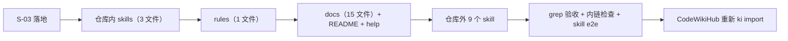
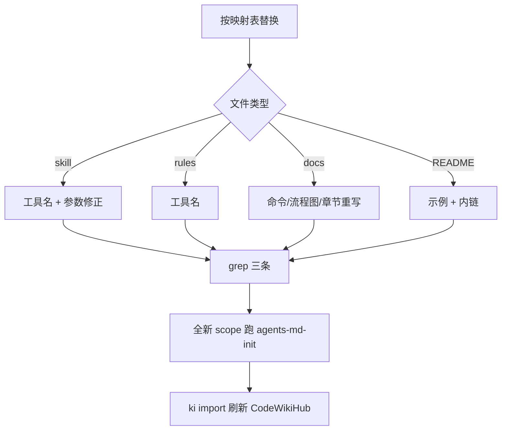
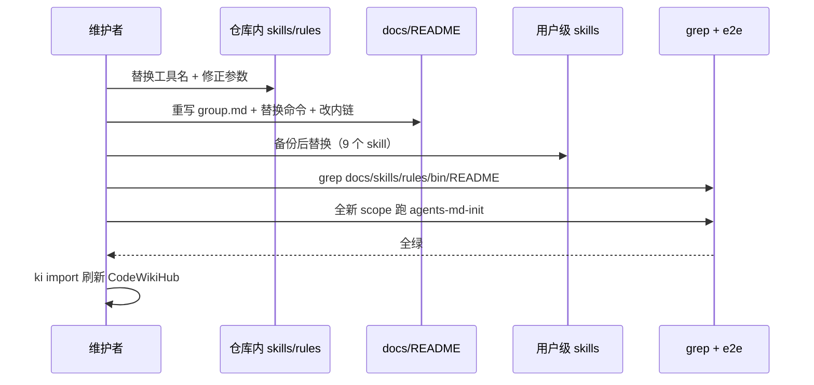

# S-04 文档 / skill / 规则同步

> 父文档：[DESIGN.md](./DESIGN.md) · 上游：[S02_CLI命令族_DESIGN.md](./S02_CLI命令族_DESIGN.md) / [S03_MCP表面_DESIGN.md](./S03_MCP表面_DESIGN.md)
> 覆盖需求：G5 / G6、S4、M-10 / M-11 / M-16 / M-17

---

## 1. 术语

| 术语 | 含义 |
|---|---|
| 同步清单 | 需求 §6.1 的逐文件、逐处替换表（本文档 §4 复制并补充判据） |
| 历史归档 | `docs/req-chat-mcp-tools-refactor.md`，PM 报告，**不改写** |
| 测试夹具 | `test-data/bk-monitor-wiki/**`，导入测试数据，**不改写** |
| 内链 | 文档之间指向 `docs/manage-index.md` 的相对链接（M-11 的 grep 抓不到） |
| 用户级 skill | `~/.codebuddy/skills/**`，仓库外文件，需用户环境写权限 |

---

## 2. 现状（AS-IS）

### 2.1 现状描述（2026-10-19 grep 实测）

| 区域 | 文件数 | 命中数 | 典型问题 |
|---|---|---|---|
| 仓库内 `skills/` | 3 | 34 | 工具名 + CLI 命令 + 非法参数写法 |
| 仓库内 `rules/` | 1 | 2 | `ki_query_group` |
| 仓库内 `docs/` | 15 | 102 | 两章旧命令、整篇 `manage-index.md`、流程图节点 |
| `README.md` | 1 | 13 | 文档索引 + 命令示例 |
| `bin/ki.mjs` 帮助 | 1 | 8 | 仍教 `--action create-root` |
| 仓库外 `~/.codebuddy/skills/` | 17 | 72（9 个 skill） | `ki_manage_index_*` / `ki_query_group` |
| 历史归档 | 1 | 2 | 不改写，需 allowlist |
| 测试夹具 | — | 多 | 不改写，不进 grep 范围 |

### 2.2 痛点

- 改名后 skill 会直接引用不存在的命令（`agents-md-init` 初始化 AGENTS.md 会在第一步失败）。
- `skills/agents-md-init/SKILL.md:81-82` 的 `mode: "full,depth=4"` / `mode: "hot,hot_count=3"` 是非法写法，未知 mode 片段被 `query-group.ts:613-619` 静默丢弃，`hot_count=3` 从未生效。
- `docs/manage-index.md` 是 355 行整篇文档，字符串替换无法覆盖。
- `README.md:375` 指向 `docs/manage-index.md`，改名后成为死链，M-11 抓不到。

---

## 3. 方案（TO-BE）

### 3.1 方案概述

按"代码 → skill → 规则 → 文档 → 外部 skill → 知识库刷新"的顺序一次性清扫；所有替换以 §4 的映射表为准，完成后用三条 grep + 一条内链检查 + 一次全新 scope 的 skill 初始化做验收。

### 3.2 关键决策点

| 决策 | 选择 | 理由 | 备选方案 | 否决原因 | 重新评估触发条件 |
|---|---|---|---|---|---|
| `docs/manage-index.md` 去向 | 改名 `docs/group.md` + 更新 README 链接 | 355 行独立主题，并入 `cli.md` 会让后者过长 | 整篇并入 `docs/cli.md` | `cli.md` 已 29 处引用，继续膨胀 | `docs/group.md` 超过 600 行 |
| 历史归档处理 | 不改写，M-11 allowlist | PM 报告是历史记录，改写会篡改结论 | 同步替换 | 破坏可追溯性 | 无 |
| 用户级 skill 处理 | 同批替换，改前备份到 `~/.codebuddy/skills/.backup-20261019/` | 仓库外文件不可 git 回滚 | 不动 | skill 指向不存在命令 | 无 |
| skill 非法参数 | 本次一并修正 | 与命令改名同批改动，成本最低 | 单独立项 | 会留下"改名后仍未生效"的隐性 bug | 无 |
| 验收 grep 范围 | `docs skills rules bin README` | 覆盖所有仓库内可执行文本 | 只查 docs | 漏 skills/rules（原 M-11 的缺陷） | 无 |

### 3.3 TO-BE 流程图

---

## 4. 交付物与映射规则

### 4.1 仓库内 skill（S-03 之后立即执行）

| 文件 | 命中 | 替换规则 |
|---|---|---|
| `skills/agents-md-init/SKILL.md` | 14 | `ki_manage_index_list` → `ki_scope_list`（7）；`ki_query_group` → `ki_group_list`（6）；`ki_manage_index_create(scope, name)` → `ki_group_create(scope, path)`（2）。**另修**：`:81` `mode: "full", depth: 4`；`:82` `mode: "hot", hot_count: 3` |
| `skills/agents-md-init/AGENTS-template.md` | 15 | 13 条 `ki manage-index create --scope X --name "Y"` → `ki group create "Y" --scope X`；`ki query-group` → `ki group list`；`ki_query_group(...)` → `ki_group_list(...)` |
| `skills/ki-search/SKILL.md` | 5 | `ki_manage_index_list()` → `ki_scope_list()`；`ki_query_group` → `ki_group_list`（2）；`ki_manage_index_create(scope, parent, name)` → `ki_group_create(scope, path)`；**第 167 行语义重写**：`ki_group_delete_empty` 只能删空节点，级联用 CLI `ki group delete <path> --yes` |

### 4.2 仓库内规则

| 文件 | 命中 | 替换规则 |
|---|---|---|
| `rules/ai-codekb-memory.md` | 2 | `ki_query_group` → `ki_group_list`（181 / 240 行） |

### 4.3 仓库内文档

| 文件 | 命中 | 处理方式 |
|---|---|---|
| `docs/manage-index.md` | 11（355 行） | **改名 `docs/group.md` 并整篇重写**（AS-IS/TO-BE、参数表、输出样例） |
| `docs/cli.md` | 29 | `manage-index` / `query-group` 两章合并为 `group` 一章；输出样例与真实输出逐字段对齐 |
| `docs/ki-command-guide.md` | 12 | 命令速查替换 |
| `docs/codekb-agent-guide.md` | 10 | 命令 + mermaid 节点文本 |
| `docs/query-kb.md` | 6 | 命令 + `manage-index.ts` 字样 |
| `docs/error-handling.md` | 6 | 错误文案与工具名 |
| `docs/verify-index.md` | 6 | 逐处替换 |
| `docs/backup-restore.md` | 4 | `list-scopes` → `ki scope list`；`create --name` → `group create` |
| `docs/workflows.md` | 4 | 命令 + 流程图节点 |
| `docs/tags-design.md` | 4 | 逐处替换 |
| `docs/architecture.md` | 3 | 组件名与 `query-group` 分区引用 |
| `docs/mcp-http.md` | 3 | MCP 工具名 + `SCOPE_LESS_TOOLS` 说明 |
| `docs/build-kb.md` | 2 | 逐处替换 |
| `docs/import.md` / `docs/vector-engine-mem.md` | 各 1 | 逐处替换 |
| `README.md` | 13 | 命令示例 + 文档索引；`:375` 内链改 `docs/group.md` |
| `bin/ki.mjs` 帮助 | 8 | 由 S-02 落地；S-04 只走查确认 |

### 4.4 仓库外用户级 skill

| skill | 命中 | 处理 |
|---|---|---|
| `ki-memory-lookup` | 34 | 工具名 → 新名 |
| `ki-memory-write` | 15 | 同上 |
| `ki-foundation` | 10 | 工具名 + 旧 CLI 名 |
| `memory-skill` | 5 | 工具名 |
| `codekb-skill` | 5 | 工具名 + 旧 CLI 名 |
| `strong-relation` | 2 | 工具名 |
| `code-review` | 1 | 工具名 |

### 4.5 不改写清单

| 文件 | 理由 |
|---|---|
| `docs/req-chat-mcp-tools-refactor.md` | PM 报告存档 |
| `test-data/bk-monitor-wiki/**` | 导入测试夹具（内容含旧命令属历史数据） |

---

## 5. 时序图（执行顺序）

---

## 6. 异常处理

| 场景 | 行为 | 是否对外暴露 |
|---|---|---|
| grep 仍命中旧名（非 allowlist） | 逐条修正，直到为 0 | 是（验收失败） |
| `README.md` 内链死链 | 改为 `docs/group.md` | 是 |
| 用户级 skill 目录不存在（如 `agents-md-init`） | 跳过，记录"未安装" | 否 |
| 用户级 skill 写入失败（权限） | 停止该文件，输出待手工执行的替换清单 | 是 |
| 全新 scope 初始化失败 | 视为 S-04 阻塞，回溯 skill 替换（重点查 `createdScope` 与 `path`） | 是 |
| CodeWikiHub `ki import` 失败 | 不影响代码交付，记录待重跑 | 是 |

---

## 7. 性能 & 安全

- 全部为文本替换与文档重写，无运行时性能影响。
- 用户级 skill 修改前备份；替换只做字符串与参数修正，不改语义。
- 历史归档与测试夹具不改写，避免污染证据与测试数据。

---

## 8. 测试方案

| 类型 | 命令 / 判据 |
|---|---|
| 仓库内旧名 | `grep -rn "manage-index\\|query-group" docs skills rules bin README` → 仅命中 `bin/ki.mjs` RENAMED 与历史归档 |
| 旧工具名 | `grep -rn "ki_manage_index\\|ki_query_group" skills rules` → 0 |
| 用户级 skill | `grep -rn "manage-index\\|query-group\\|ki_manage_index\\|ki_query_group" ~/.codebuddy/skills` → 0 |
| 内链 | `grep -rn "docs/manage-index.md" .`（排除 node_modules/.git）→ 0 |
| skill e2e | 全新 scope 执行 `agents-md-init`：create 自动建 scope + `ki_group_list(mode:"full", depth:4)` 成功 + 团队约定写入 |

不在测试范围内：`docs/` 全文语义正确性（由人工走查 M-10）。

---

## 9. 迁移策略

### 存量数据处理

- CodeWikiHub 自身知识库：S-04 完成后执行一次 `ki import` 刷新（旧文档会被新内容覆盖/新增）。
- 仓库外 skill：备份目录 `~/.codebuddy/skills/.backup-20261019/` 保留一个版本周期后手工删除。

### 旧接口 / 命令废弃

| 旧接口/命令 | 处理方式 | 废弃时间线 |
|---|---|---|
| 文档中的 `manage-index` / `query-group` | 全量替换 | 同批发布 |
| `docs/manage-index.md` | 改名 `docs/group.md` | 同批发布 |

### 回滚方案

文档可 `git revert`；用户级 skill 从备份目录恢复。

---

## 10. 影响范围

| 影响对象 | 影响类型 | 影响描述 | 是否破坏性变更 |
|---|---|---|---|
| `skills/agents-md-init/**` | 行为变更 | 工具名、参数、初始化流程 | 是 |
| `skills/ki-search/SKILL.md` | 行为变更 | 删除能力描述 | 是 |
| `rules/ai-codekb-memory.md` | 行为变更 | 工具名 | 是 |
| `docs/**` + `README.md` | 文档变更 | 命令、流程图、内链、整篇重写 | 是 |
| `~/.codebuddy/skills/**`（9 个） | 行为变更 | 工具名 | 是 |

---

## 11. 待定问题

| 编号 | 问题 | 影响范围 | 建议决策时间 |
|---|---|---|---|
| T-05 | 用户级 skill 是否随仓库发布流程一起交付（当前不在 git 内，依赖本机操作） | S-04 | 发布前 |
