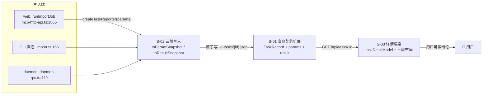
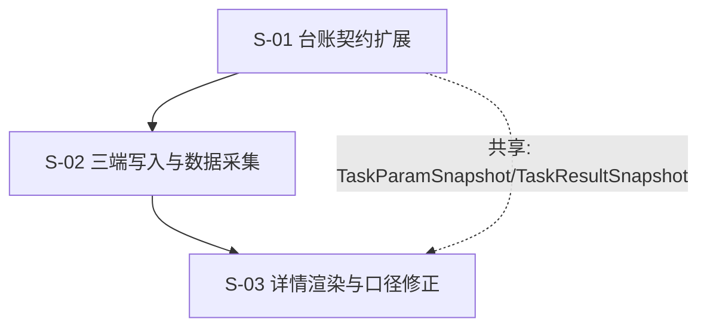

# 任务详情导入信息完备 — 技术设计（父文档）

## 1. 需求背景 & 目标

任务中心右栏详情只渲染 8 个字段，用户无法回答「导入了什么 / 成没成 / 哪里不对 / 下一步怎么办」。根因不是前端漏渲染，而是**任务台账 `TaskRecord` 没有采集导入参数与结果摘要**：三端（web job / CLI 直连 / daemon RPC）创建任务时只写 `{ operation, scope }`，结果只存在于内存 `Job.result`（TTL 1h / 50 条 / 重启即丢）。

**目标**：扩任务台账契约（参数快照 + 结果摘要 + 错误码 + 血缘），三端同写，前端按「参数 / 结果 / 时间」三段渲染；同时修正「进度 · 写入 100%（1/1）」这一误导性展示。

**不在范围内**：
- 不改 `handleDirectImport` 的统计口径（只透传，不重算）；
- 不做长期审计存储（任务仍 1h TTL，见待确认 ①）；
- 不重做任务中心信息架构；
- 不为 CLI/daemon 补 `/api/import/status` 式的 job 查询（不新增第二套真相）。

## 2. 关键环节一览图

## 3. 总体方案设计

### 3.1 子需求节点图

| 编号 | 子需求 | 独立验证方式 |
|---|---|---|
| S-01 | 台账契约扩展 + 32KB 护栏 + 旧记录兼容 | 单测：写满明细后文件仍 < 32KB 且 `getTaskRecord` 可读 |
| S-02 | 三端参数快照与结果摘要写入 + 错误码 + 血缘 | 三端各跑一次导入，`cat .ki-tasks/<id>.json` 字段一致 |
| S-03 | 详情三段渲染 + 进度口径修正 + 列表行摘要 | 走查：完成态不出现「写入 1/1」；缺字段显示「—」 |

### 3.2 跨子需求共享内容

共享术语与接口契约统一收敛到第 4 章（评审 #3：基线要求共享术语在第 4 章），避免两处定义漂移。

## 4. 全局风险 & 跨子需求依赖

### 4.1 共享接口契约速查

所有子文档引用的类型与函数**以本节为唯一事实源**：

| 契约 | 定义位置 | 使用方 |
|---|---|---|
| `TaskParamSnapshot` / `TaskResultSnapshot` | `src/lib/task-registry.ts`（S-01 §3.1） | S-02 构造、S-03 渲染 |
| `TaskRecord.params / .result / .retryOf` | 同上（S-01 §3.1） | S-02 写入、S-03 读取、`web/src/api/tasksApi.ts` 副本 |
| `TaskReporter.update({ params })` / `finish({ errorCode, result })` | 同上（S-01 §3.1） | S-02 三端调用 |
| `MAX_TASK_DETAIL_ITEMS = 20` | 同上（S-01 §3.3） | S-02 截断、S-03 文案 |
| `toParamSnapshot()` / `toResultSnapshot()` / `splitSkipped()` | `src/lib/task-snapshot.ts`（S-02 §3.1） | 三端写入点 |
| `buildTaskDetail()` / `taskSummaryLine()` | `web/src/lib/taskDetailModel.ts`（S-03 §3.1/§3.5） | `TasksPage.tsx` |

### 4.2 共享术语速查

| 术语 | 定义 | 归属 |
|---|---|---|
| `TaskParamSnapshot` | 本次任务的执行参数快照（不是当前配置） | S-01 定义，S-02 写入，S-03 渲染 |
| `TaskResultSnapshot` | 文件级结果摘要 + 原因拆分 + 明细（有上限） | 同上 |
| `unchanged` | 增量导入下内容未变、未重算的文件数，是 `completed` 的**子集** | 来自 `stats.files.unchanged` |
| `skippedReasons` | `skipped` 的三类拆分：`conflict` / `duplicate` / `other`，三者之和 = `skipped` | S-02 由 `conflicts`、`duplicatesSkipped` 与差值算出 |
| `retryOf` | 本任务重试自哪个任务（原任务 ID） | S-01 顶层字段 |
| `truncated` | 明细不完整（**不区分**「条数超 20」与「字节预算裁剪」） | S-01 裁剪，S-03 中性文案 |
| 「当前配置」 | 与「任务快照」相对：会随配置变更而变化，必须显式标注 | S-03 文案 |

### 4.3 风险表

| # | 风险 | 影响 | 缓解 |
|---|---|---|---|
| G1 | 台账文件超 32KB | `readRecordFile` 返回 `null` ⇒ **任务从列表与详情彻底消失** | 明细硬上限 20 条 + 写入前字节预算裁剪 + 单测锁死 |
| G2 | 每 5s 心跳整文件重写，写放大 | 心跳期间 IO 抖动 | 新增字段总量预算 ≤ 4KB（明细 20 条 × ~100B ≈ 2KB） |
| G3 | 三端漏改（历史已发生过：HTTP 端漏标 `kind`） | CLI/daemon 任务仍空 | 参数/结果抽取收敛到 `src/lib/task-snapshot.ts` **单一实现**，三端只调用不各自组装 |
| G4 | 旧任务记录无新字段 | 前端渲染 `undefined` | 所有新字段可选；渲染统一走 `taskDetailModel` 的 `dash()` 兜底 |
| G5 | `partialCommitted` 跨 operation 语义不同（导入=向量条目数，restore=成功条目数） | 标签失真 | 本次不改字段，S-03 按 `operation` 分支渲染标签 |
| G6 | daemon 路径的 `onProgress` 在队列外 | 参数快照可能为空 | 快照在 `createTaskReporter` 时从 `req.params` 取（此时已确定），不依赖进度事件 |
