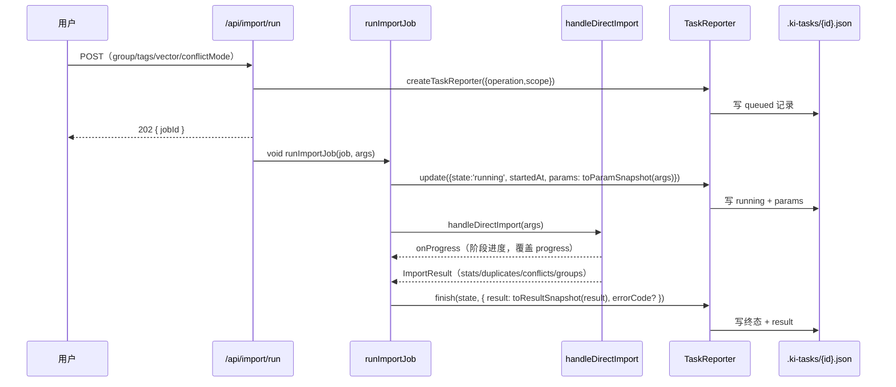

# S-02 三端写入与数据采集

## 1. 术语

| 术语 | 定义 |
|---|---|
| 参数快照 | 任务 args 就绪后写入一次，之后不变 |
| 结果摘要 | 任务 `finish()` 时写入一次 |
| 三端 | web（HTTP job）/ CLI 直连（`ki import` 直接跑）/ daemon RPC（`ki` 客户端 → daemon 执行） |

## 2. 现状（AS-IS）

三处创建任务时**只写 operation + scope**，而 args 在两三行之外就完整存在：

| 端 | 创建点 | 参数在哪 | 结果在哪 |
|---|---|---|---|
| web | `mcp-http-api.ts:258`（`createJob`） | `runImportJob` 的 `args`（`:1603-1617` 组装） | `Job.result`（内存） |
| CLI 直连 | `src/import.ts:166` | `importParams`（`:138-154`） | 局部 `result` 变量 |
| daemon | `src/lib/daemon-rpc.ts:380` | `req.params`（`:448`） | `outcome.result`（`:496`） |

结果只活 1h（`JOB_TTL_MS`）或随进程消亡；失败错误码 `failure.code` 在 catch 里拿到却只用于分支判断，未落台账。

## 3. 方案（TO-BE）

### 3.1 新增 `src/lib/task-snapshot.ts`（单一实现）

```ts
import type { TaskParamSnapshot, TaskResultSnapshot } from './task-registry.js';

/** 单类明细上限，与 task-registry 的 MAX_TASK_DETAIL_ITEMS 同值（此处 re-export 避免循环依赖） */
export const MAX_DETAIL = 20;

/** 导入类任务的参数快照；非 import operation 返回 undefined */
export function toParamSnapshot(
  operation: string,
  args: {
    sourceDir?: string;
    group?: string;
    tags?: string;
    vector?: boolean;
    conflictMode?: string;
    conflictSuffix?: string;
    skipDuplicates?: boolean;
    chunkSize?: number;
    chunkOverlap?: number;
  },
  /** 受控上传根目录：web 端传 getUploadsRoot()；CLI/daemon 缺省 `~/.ki/import-uploads` */
  uploadsRoot?: string,
): TaskParamSnapshot | undefined;

/** 导入类任务的结果摘要；非 import operation 或 result 不可解析时返回 undefined */
export function toResultSnapshot(operation: string, result: unknown): TaskResultSnapshot | undefined;

/** skipped 的三类拆分；保证 conflict + duplicate + other === skipped */
export function splitSkipped(
  skipped: number,
  duplicatesSkipped: number,
  conflicts: Array<{ action?: string }>,
): { conflict: number; duplicate: number; other: number };
```

**口径表**

| 快照字段 | 来源 | 规则 |
|---|---|---|
| `sourceKind` | `uploadIdFromSourceDir(sourceDir, uploadsRoot)` | 非 null ⇒ `'upload'`，否则 `'external'`；**web 端显式传 `getUploadsRoot()`**，避免与 `task-snapshot.ts` 默认值形成两份常量（challenger 意见 6） |
| `group` | `args.group` | 原样（S-01 负责净化） |
| `tags` | `args.tags` | 逗号分隔 → 数组，去空、去重、上限 20 |
| `vector` | `args.vector` | `undefined` 视为 `true`（与 `handleDirectImport` 缺省一致），显式写布尔 |
| `conflictMode` | `args.conflictMode` | `undefined` 写 `'incremental'`（`DEFAULT_IMPORT_CONFLICT_MODE`），让详情不显示「—」 |
| `conflictSuffix` | `args.conflictSuffix` | 仅 `conflictMode === 'suffix'` 时保留 |
| `skipDuplicates` | `args.skipDuplicates === true` | 显式布尔 |

| 结果字段 | 来源 |
|---|---|
| `files.*` | `ImportResult.stats.files` 的 6 个计数直取 |
| `files.skippedReasons` | `splitSkipped(skipped, duplicatesSkipped, conflicts)` |
| `vectorized` | `stats.vectorized` |
| `fullTextIndexed` | `stats.fullTextIndexed` |
| `assets` | `stats.assets` |
| `groups` | `result.groups` 去重、截断 20 |
| `duplicates` | `result.duplicatesSkipped` 前 20 条 |
| `conflicts` | `result.conflicts` 前 20 条（`action` 归一为 `renamed / skipped / overwritten`） |
| `truncated` | 任一明细被截断 ⇒ `true` |

> **`splitSkipped` 的不变量**：`import.ts:1961` 的 `skipped` 已是「过大 + 超限 + hook 失败 + 冲突跳过 + 疑似重复」的合并值，故
> `conflict = conflicts.filter(action === 'skip').length`、`duplicate = duplicatesSkipped`、`other = max(0, skipped - conflict - duplicate)`。
> 三者之和恒等于 `skipped`（`other` 兜住所有未分类成因），单测用 `Math.abs(sum - skipped) === 0` 断言。

### 3.2 写入入口：统一走 `update({ params })`

`TaskReporter.update` 的 patch 白名单新增 `'params'`（S-01 已定），**不新增第二个 API**。

**写入时点（challenger 意见 2 修正）**：`params` 必须在**进入 coordinator 队列之前**写入——否则「排队中」的任务点开详情时参数全为 `—`，而那恰好是用户最想确认策略的时刻。

```ts
// ✅ 正确：args 组装完成后立即写（此刻任务还可能是 queued）
job.taskReporter.update({ params: toParamSnapshot('import', args) });

// 出队后才写状态
coordinator.submit(req, () => {
  job.taskReporter.update({ state: 'running', startedAt: Date.now() });
  ...
});
```

> 允许两次写盘：`params` 一次（排队态即可见）、`state/startedAt` 一次（真正开始）。二者语义不同，合并会导致前者被推迟。
> CLI 直连与 daemon 路径本来就"创建即执行"，可在一次 `update` 内合并。

### 3.3 三端改造点（精确到行）

#### (1) web — `src/lib/mcp-http-api.ts`

| 位置 | 变更 |
|---|---|
| `createJob`（`:244`） | 新增第 4 可选参数 `extras?: { retryOf?: string }`，透传 `createTaskReporter({ ..., retryOf: extras?.retryOf })` |
| `:1821`（retry-incomplete） | `createJob(scope, 'import', requestConfig, { retryOf: requestedTaskId })` |
| `runImportJob`（`:1865`） | 开头 `job.taskReporter.update({ state:'running', startedAt: Date.now(), params: toParamSnapshot('import', args) })`，替换现有 `:1870` 的 `update({state:'running', startedAt})` |
| `runImportJob` 成功分支（`:1955-1962`） | `finish(partialState, { ..., result: toResultSnapshot('import', result) })` |
| `runImportJob` catch（`:1971-1982`） | 追加 `errorCode: code` + `result: toResultSnapshot('import', failure)`。**失败时通常只有 `errorCode`，`files` 允许缺失**（见下方"失败路径口径"） |

#### (2) CLI 直连 — `src/import.ts`

| 位置（符号定位） | 变更 |
|---|---|
| `if (!useDaemon) {` 分支内的 `createTaskReporter` | 追加 `retryOf: retryRecord?.taskId` |
| 紧随其后的 `task.update({ state:'running', startedAt })` | 追加 `params: toParamSnapshot('import', importParams)` |
| 该分支 `handleDirectImport` 成功后的 `task.finish(...)` | 追加 `result: toResultSnapshot('import', result)` |
| 该分支 catch 的 `task.finish(...)` | 追加 `errorCode: e.code` + `result: toResultSnapshot('import', error)` |
| **daemon 分支的 `callDaemon('import', importParams, …)`** | **必须注入血缘**：`callDaemon('import', { ...importParams, ...(retryRecord?.taskId ? { retryOf: retryRecord.taskId } : {}) }, …)` —— 否则 daemon 路径 `req.params.retryOf` 恒为空（评审 🔴-2）。`handleDirectImport` 只读已知字段，多余字段无副作用 |

#### (3) daemon — `src/lib/daemon-rpc.ts`

| 位置（符号定位） | 变更 |
|---|---|
| `stream` 分支内的 `createTaskReporter` | 追加 `retryOf`（取自 `req.params.retryOf`，由 CLI 注入，见上表末行） |
| `job.emitProgress = emitProgress;` 之前 | `taskReporter.update({ params: toParamSnapshot(req.operation, req.params as ImportArgsLike) })` |
| 成功分支的 `job.taskReporter?.finish(taskState, {…})` | 追加 `result: toResultSnapshot(req.operation, outcome.result)` |
| catch 分支的 `job.taskReporter?.finish(job.state, {…})` | 追加 `errorCode: error.code` + `result: toResultSnapshot(req.operation, job.result)` |

> 行号会随实施漂移，故本节改为符号定位（评审 #8）。

#### (4) restore / rebuild — `src/restore.ts`

**不改**：`rebuild-vector` / `restore-snapshot` 无导入参数概念。`partialCommitted` 已有值，S-03 按 operation 分支渲染标签即可。

### 3.4 错误码传递链

```
handleDirectImport 抛出 (err.code = 'ALL_FILES_DUPLICATES' | 'IMPORT_BUDGET_EXCEEDED'
                              | 'VECTORIZATION_STOPPED' | 'IMPORT_CANCELLED' | ...)
  ├─ web：  runImportJob.catch  → failure.code → finish({ errorCode })
  ├─ CLI：  import.ts catch      → err.code     → finish({ errorCode })
  └─ daemon: daemon-rpc catch    → error.code   → finish({ errorCode })
       ▼
.ki-tasks/{id}.json → result.errorCode
       ▼
S-03：按码表渲染「类别 + 可执行动作」（不再只说"查看服务日志"）
```

### 3.4.1 失败路径口径（challenger 意见 1 修正，🔴）

**不虚构数据**。实测三类失败错误的载荷：

| 错误码 | error 载荷 | 有 `stats.files`？ |
|---|---|---|
| `IMPORT_CANCELLED` | `message`（含「已完成 N/M 个文件」） | ❌ |
| `ALL_FILES_DUPLICATES` | `code` + message | ❌ |
| `VECTORIZATION_STOPPED` | `stats` 是 **chunk 级**（`total/succeeded/failed/notProcessed/partialCommitted`） | ❌ |

因此：
1. `toResultSnapshot('import', failure)` 对上述错误返回 `undefined`，`finish` 只落 `{ errorCode }`；
2. **文件级 N/M 由 `task.error` 文案承载**（取消分支的 message 已含「已完成 N/M 个文件」），S-03 直接展示原文，不解析、不重算；
3. 把 `files` 挂到 error 上属**改动导入核心**，不在本需求范围——已在需求「待确认」中登记为后续项。

### 3.5 血缘（`retryOf`）

- web：`/api/import/retry-incomplete` 已有 `requestedTaskId` ⇒ 直接作为 `retryOf`；
- CLI：`retryRecord?.taskId`（未完成清单的归属任务）；
- 清单为 legacy（无 `taskId`）时 `retryOf` 为 `undefined`，详情显示「归属未知」。

### 3.6 时序图（web 成功路径）



## 4. 接口设计

### 4.1 `toParamSnapshot` Demo

```jsonc
// operation = 'import'
// args = { sourceDir: "/home/u/.ki/import-uploads/9f1c...", group: "raw",
//          tags: "产品,v2", vector: true, conflictMode: "incremental", skipDuplicates: true }
{
  "sourceKind": "upload",
  "group": "raw",
  "tags": ["产品", "v2"],
  "vector": true,
  "conflictMode": "incremental",
  "skipDuplicates": true
}
```

### 4.2 `toResultSnapshot` Demo

```jsonc
{
  "files": {
    "scanned": 12, "completed": 10, "incomplete": 0, "skipped": 2,
    "unchanged": 9, "duplicatesSkipped": 1,
    "skippedReasons": { "conflict": 1, "duplicate": 1, "other": 0 }
  },
  "vectorized": 148,
  "fullTextIndexed": 132,
  "assets": 3,
  "groups": ["raw/browser"],
  "duplicates": [{ "path": "docs/a.md", "existingGroup": "raw", "existingRelation": "a" }],
  "conflicts": [],
  "truncated": false
}
```

## 5. 异常处理

| 场景 | 行为 | 是否对外暴露 |
|---|---|---|
| `result` 结构不符合预期（旧版本 / 异常中断） | `toResultSnapshot` 返回 `undefined`，不写 `result` | 否（UI 回退旧展示） |
| `sourceDir` 不在 uploads 根下 | `sourceKind: 'external'` | 否 |
| 明细超 20 条 | 截断 + `truncated: true` | 是（UI「明细已截断」） |
| `splitSkipped` 出现负值（口径漂移） | `other` 取 `max(0, ...)`，并 `logWarn` 一次 | 否（日志） |
| `errorCode` 未在白名单 | 丢弃 + `logWarn` 一次（fail-loud，避免未来新增码被静默吞掉；challenger 意见 7） | 否 |

## 6. 影响范围

| 文件 | 变更 |
|---|---|
| `src/lib/task-snapshot.ts` | **新增**（约 120 行） |
| `src/lib/mcp-http-api.ts` | `createJob` +3 行；`runImportJob` 4 处 |
| `src/import.ts` | 3 处 |
| `src/lib/daemon-rpc.ts` | 4 处 |
| `test/task-snapshot.test.ts` | **新增** 单测：`splitSkipped` 恒等式、`sourceKind` 判定、截断、非 import 返回 undefined |
| `test/task-registry.test.ts` | 1 例：`update({params})` + `finish({result, errorCode})` 落盘可读 |

## 7. 关键决策点

| # | 决策 | 被否决方案 | 否决理由 |
|---|---|---|---|
| D2-1 | 结果只落台账，**不做** `/api/import/status` 兜底 | 详情页并行查 job 结果（读取快、零写入） | job 仅 web 任务存在、1h 过期、服务重启 404、CLI/daemon 无 job ⇒ 会出现「同一页面两种真相」，且无法满足"可回溯"判据 |
| D2-2 | 参数/结果抽取收敛到 `task-snapshot.ts` | 三端各自组装 | 本项目已发生过同类事故（`kindForOperation` 在 HTTP 端漏标，`daemon-rpc.ts:492-493` 有明确注释），单一实现是唯一可靠护栏 |
| D2-3 | 快照用 `update()` 写入而非扩 `createTaskReporter` 入参 | 在 `createJob` 时就传 params | HTTP 路径创建 job 时 `args` 尚未组装（`mcp-http-api.ts:1589` vs `:1603`），强行前移要把 args 组装提前，改动面反而更大 |
| D2-4 | restore/rebuild 不写 params/result | 统一三 operation 都写 | 无对应语义字段，产出全是 `—`，反而制造噪声 |

## 8. 待定问题

| # | 问题 | 状态 |
|---|---|---|
| 1 | CLI/daemon 是否需要额外记录「执行进程」（daemon vs 本进程）便于排障 | 待评估（低优先） |
