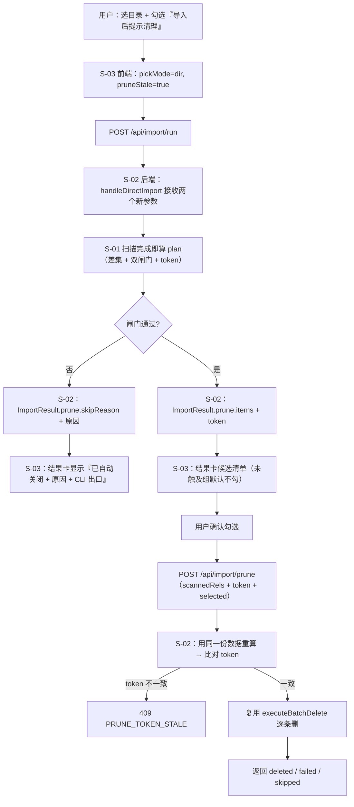
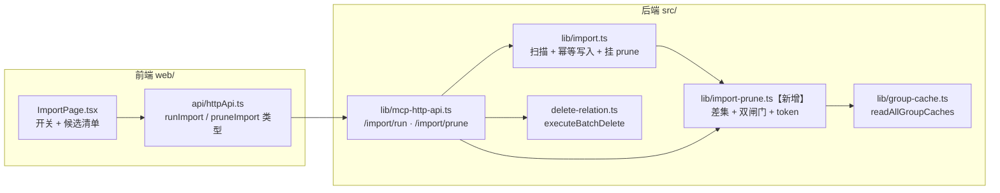

# 技术设计（父文档）：目录导入同步清理「库中存在、本次目录已没有」的文档

> 子需求文档：
> - [S01 候选计算与双闸门](./S01_候选计算与双闸门_DESIGN.md)
> - [S02 结果字段与删除接口](./S02_结果字段与删除接口_DESIGN.md)
> - [S03 前端开关与结果卡](./S03_前端开关与结果卡_DESIGN.md)

---

## 1. 需求背景 & 目标

Web 上传目录后，本地删掉的文档仍留在知识库，用户只能开终端逐条 `ki delete-relation`。本需求在导入完成后**实时算出**「库中存在、本次扫描目录里没有」的文档，经用户确认后批量删除。

- **不新增来源标识**：不记顶级目录名、不扩 `Relation`、`relations-cache` 格式零变更。
- **默认关闭**：上传前显式勾选才计算；删除永远需要用户二次确认。
- **顺序**：先导入并提交，再给候选，再删——导入失败/取消时不做任何删除。

**不在范围内**：自动删除、删除前备份、文档管理页单篇删除、`import.pruneMatchThreshold` 配置化（P2）、CLI `--prune`（P2，见 §4）。

---

## 2. 关键环节一览图

第 5 步与第 11 步**必须是同一份计算逻辑**（S-01 的纯函数），否则会出现「看到的和删掉的不一致」。

---

## 3. 总体方案设计

**改动清单**

| 文件 | 动作 | 子需求 |
|---|---|---|
| `src/lib/import-prune.ts` | 新增 | S-01 |
| `test/import-prune.test.ts` | 新增 | S-01 |
| `src/lib/import.ts` | 改：参数、3 个 return 点挂 `prune` | S-02 |
| `src/lib/mcp-http-api.ts` | 改：upload/run 收参、新增 `/import/prune`、`UploadSession.pickMode` | S-02 |
| `src/delete-relation.ts` | 改：导出 3 个类型（无逻辑变更） | S-02 |
| `web/src/api/httpApi.ts` | 改：新增类型与 `pruneImportCandidates` | S-03 |
| `web/src/pages/ImportPage.tsx` | 改：`pickMode` 采集、开关、结果卡候选区 | S-03 |

---

## 4. 全局风险 & 跨子需求依赖

**跨子需求契约（不可漂移）**

| 契约 | 约定 |
|---|---|
| `ImportPrunePlan` 结构 | 由 S-01 定义，S-02 原样透传、S-03 原样消费；任何一方想加字段必须先改 S-01 |
| 计算入口唯一性 | `run` 与 `prune` 必须调用同一个纯函数 `computePrunePlan`，禁止各写一份差集 |
| token 算法 | S-01 定义，S-02 校验，S-03 只透传；算法变更必须同步升版本标识 |

**全局风险**

| # | 风险 | 影响 | 缓解 |
|---|---|---|---|
| G1 | 同一 group 内小比例混装（其他来源占 17%） | 会被删掉那部分 | 已接受（需求 §8）；兜底＝默认关 + 未触及 group 默认不勾 + 清单可见 |
| G2 | 删除接口的文件集合来源 | 前端拼清单会漏掉被服务端拒绝的文件 → token 恒失配 | 默认走 `uploadId` 让服务端重扫同一暂存目录；`scannedRels` 仅作降级通道，且仍受 token 校验 |
| G3 | 三个 `ImportResult` 构造点漏挂 `prune` | 「全部未变」场景拿不到候选（恰是最需要的场景） | S-02 用单一 helper，三处统一调用 |
| G4 | 批量删除不做草稿卫兵（只在单条层） | 有草稿的文档会单条失败 | 设计为 `failed[]` 逐条回显，不阻塞其余 |
| G5 | 跨群同 `rel` 重复文档 | 若本次目录含该 `rel`，两篇都不删 | 保守策略（宁可少删），S-01 明确 |
| G6 | 暂存目录 24h 清理 | 事后无法靠 uploadId 重算 | 客户端 `scannedRels` 降级通道 + 明确过期提示（N13） |
| G7 | **上传阶段文件缺失**（网络中断/超限/读失败） | 本地仍在的文档被判「本次没有」→ 误删 | R11 硬门槛（`UPLOAD_INCOMPLETE`）+ `preserveRels` 并集；两闸门对此**无感**，不能替代 |

**接口契约变化总览**

| 契约 | 位置 | 变更 |
|---|---|---|
| `HandleDirectImportArgs` | `src/lib/import.ts` | +`pickMode?`、+`pruneStale?`（均可选） |
| `ImportResult` | 同上 | +`prune?: ImportPrunePlan`（可选） |
| `POST /api/import/upload` | `src/lib/mcp-http-api.ts` | body +`pickMode?` |
| `POST /api/import/run` | 同上 | body +`pickMode?`、+`pruneStale?` |
| `POST /api/import/prune` | 同上 | **新增**（契约见 S-02 §3.2） |
| `pruneImport` / `PruneImportResponse` | `web/src/api/httpApi.ts` | **新增** |
| `Relation` / `relations-cache.json` | — | **零变更** |

**共享术语速查**（定义归属见各子文档）

| 术语 | 一句话 | 归属 |
|---|---|---|
| `scannedRels` | 本次目录**扫描**到的全部文档相对路径；不等于实际写入的文件 | S-01 |
| 候选（candidate） | 作用域内 `sourcePath ∉ scannedRels` 的文档 | S-01 |
| 闸门 A | 路径重合率 ≥ 0.8 | S-01 |
| 闸门 B | 候选占比 ≤ 0.8（分母 `judicable`） | S-01 |
| `pruneToken` | 候选集指纹，防「看到后库变了」 | S-01 |
| 未触及 group | 本次没有任何文件落入的 group | S-01 |
| `judicable` | 有 `sourcePath`、可判定来源的文档数 | S-01 |
| `pickMode` / `pruneStale` | 选择方式 / 清理开关 | S-02 |

**不在范围内（父边界）**：S-04 CLI `--prune`、阈值配置化、删除撤销入口、`Task` 中心联动（删除是导入 job 结束后的独立动作，不并入导入任务卡）。
