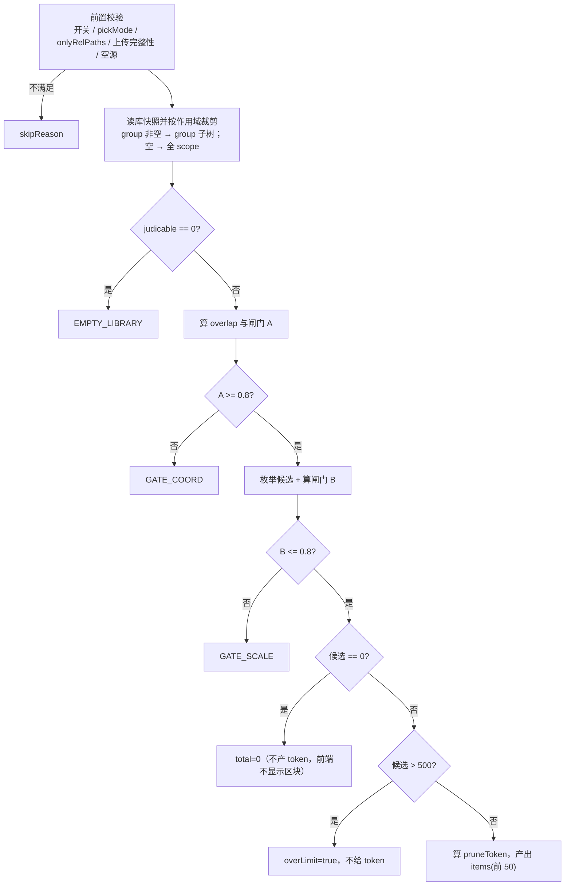

# S-01 候选计算与双闸门

> 父文档：[DESIGN.md](./DESIGN.md)　下游：[S02](./S02_结果字段与删除接口_DESIGN.md)　上游：无

## 1. 术语

| 术语 | 定义 |
|---|---|
| `scannedRels` | 本次 `collectMarkdownFiles(sourceDir)` 返回的全部文档相对路径（posix）。**不是**实际写入/更新的文件——增量下内容未变被跳过的文件也算"有" |
| 候选 | 作用域内 `sourcePath` 非空、且 `sourcePath ∉ scannedRels` 的文档 |
| 路径重合率（闸门 A） | `|scannedRels ∩ libRels| / min(|scannedRels|, |libRels|)`，两端均按去重集合 |
| 候选占比（闸门 B） | `候选数 / judicable` |
| `judicable` | 作用域内 `sourcePath` 非空的文档数（**闸门 B 的分母**） |
| 未触及 group | 本次没有任何文件落入的 group（`group ∉ importedGroups`） |
| `pruneToken` | 候选集指纹（sha256 前 16 hex），用于「看到后库变了」的检测 |

## 2. 现状（AS-IS）

| 事实 | 位置 |
|---|---|
| 现有 `preflight` 只做「内容重复」检测（原文哈希比对），与「本地已删除」无关 | `src/lib/import-preflight.ts:96-130` |
| 系统已能识别「源文件不存在」但只写进未完成清单，不触发删除 | `src/lib/import.ts:193`、`:800-846` |
| 读取全量关系缓存的原语已存在 | `src/lib/group-cache.ts:436-438` `readAllGroupCaches(scope)` |
| `resolveGroupForSource` 为 module-private，未导出 | `src/lib/import.ts:286-293` |
| 无任何「候选 / 差集 / 清理」模块 | `src/` 下无 `*prune*`、`*diff*`、`*incremental*` |

## 3. 方案（TO-BE）

新增 `src/lib/import-prune.ts`，**全部为纯函数 + 一个读缓存的薄包装**，不写任何磁盘、不调向量。

```
src/lib/import-prune.ts          # [新增]
  ├─ computePrunePlan(input)     # 纯函数：差集 + 双闸门 + token（可单测，零 IO）
  ├─ planImportPrune(args)       # 薄包装：readAllGroupCaches → 裁剪作用域 → computePrunePlan
  └─ verifyPruneToken(plan, token) # 供 /api/import/prune 的 token 比对
test/import-prune.test.ts        # [新增] 纯函数场景表驱动
```

### 3.1 计算流程（顺序不可调换）



**先算闸门 A、再枚举候选**：闸门不过时不构造候选数组（选错目录时库内可能有数万篇，白枚举一遍没有收益）。

### 3.2 接口签名

```ts
// src/lib/import-prune.ts

export interface PruneLibItem {
  group: string;
  relation: string;
  /** 非空；本次比对只认它 */
  sourcePath: string;
}

export interface PruneLibSnapshot {
  /** 作用域内的全部 group 键（含无文档的空组） */
  groups: string[];
  /** 作用域内文档总数（含 sourcePath 为空的） */
  docs: number;
  /** 作用域内 sourcePath 非空的文档数 —— 闸门 B 的分母 */
  judicable: number;
  items: PruneLibItem[];
}

export type PruneSkipReason =
  | 'DISABLED'          // 开关未开
  | 'NOT_DIR_MODE'      // pickMode !== 'dir'
  | 'SUBSET_RETRY'      // onlyRelPaths 非空（只重试未完成）
  | 'UPLOAD_INCOMPLETE' // 上传存在失败批次/文件（R11 硬门槛）
  | 'EMPTY_SOURCE'      // 本次扫描到 0 篇
  | 'EMPTY_LIBRARY'     // 作用域内没有可判定文档
  | 'GATE_COORD'        // 闸门 A 不通过
  | 'GATE_SCALE'        // 闸门 B 不通过
  | 'ERROR';            // 计算异常（fail-soft，不影响导入）

export interface PruneCandidateItem {
  group: string;
  relation: string;
  sourcePath: string;
  /** 所属 group 本次没有任何文件落入 */
  untouched: boolean;
}

export interface ImportPrunePlan {
  scope: string;
  /** 作用域 group 数 */
  scopeGroups: number;
  /** 作用域内文档总数 */
  libDocs: number;
  /** 可判定文档数（闸门 B 分母） */
  judicable: number;
  /** 本次扫描文件数 */
  scanned: number;
  /** 交集个数 */
  overlap: number;
  /** 闸门 A 实际值（0~1，保留 3 位） */
  coordRatio: number;
  /** 闸门 B 实际值（0~1，保留 3 位） */
  deleteRatio: number;
  /** deleteRatio > 0.2：**不关闭功能**，但前端必须强制二次确认（输入「删除」二字） */
  warn: boolean;
  /** 候选 > 500：只展示计数，不提供删除 */
  overLimit: boolean;
  /** 候选总数（完整计数） */
  total: number;
  /** 明细（≤ PRUNE_MAX_DETAIL，与可删上限一致） */
  items: PruneCandidateItem[];
  /** items 被截断 */
  truncated: boolean;
  /** 无法判定来源（sourcePath 为空）的文档数 */
  unableCount: number;
  /** 本次未触及的 group（前端单列、默认不勾） */
  untouchedGroups: string[];
  /** 仅 skipReason 为空、total>0、!overLimit 时给出 */
  token?: string;
  skipReason?: PruneSkipReason;
  /** 面向用户的原因补充（含实际数值），直接可渲染 */
  skipDetail?: string;
}

export const PRUNE_COORD_THRESHOLD = 0.8;
export const PRUNE_SCALE_THRESHOLD = 0.8;
export const PRUNE_WARN_THRESHOLD = 0.2;
export const PRUNE_MAX_ITEMS = 500;
/**
 * 明细上限**与可删上限对齐**：若明细少于可删数，用户会看到「共 500 篇」却只能勾选前 50 条，
 * 剩余项在界面上无入口（评审 B-1）。故两者取同一值；将来若下调明细，必须同时禁用删除。
 */
export const PRUNE_MAX_DETAIL = PRUNE_MAX_ITEMS;

export function computePrunePlan(input: {
  scope: string;
  group: string;              // '' = 全 scope
  scannedRels: string[];      // 已净化、posix、去重由函数内部完成
  /** R11：上传阶段失败的文件 rel（前端/会话提供），视为「本次有」，永不进候选 */
  preserveRels?: string[];
  importedGroups: string[];   // 由 import.ts 用 resolveGroupForSource 推导后传入
  lib: PruneLibSnapshot;      // 已按作用域裁剪
}): ImportPrunePlan;

export function planImportPrune(args: {
  scope: string;
  group: string;
  scannedRels: string[];
  importedGroups: string[];
}): ImportPrunePlan;

export function verifyPruneToken(plan: ImportPrunePlan, token: string): boolean;
```

### 3.3 关键算法细节

| 项 | 规则 | 理由 |
|---|---|---|
| 归一 | 所有 `rel` / `sourcePath` 转 posix（`\\`→`/`）+ `normalize('NFC')` + 去首尾 `/` + 去重；**不做大小写折叠**（折叠会让 `A.md` 与 `a.md` 互相顶替，扩大误配面） | 跨端分隔符差异（Windows）+ macOS/Linux 的 NFD/NFC 编码差异（否则同一文件会被判成"本地已删"） |
| **有效集合** | `effectiveRels = scannedRels ∪ preserveRels`，差集与闸门 A 一律用它 | R11：上传失败的文件不在暂存目录，若不算"本次有"就会被判为"本地已删"→ 误删本地仍在的文档 |
| 作用域裁剪 | `group` 非空：`key === group \|\| key.startsWith(group + '/')`；空：全部 key | 与 `resolveGroupForSource` 的落点规则一致（选了 G 后文件落 `G/<相对子目录>`） |
| 候选判定 | `sourcePath ∉ scannedSet`（**按 rel 字符串判，不按 group**） | 同一 `rel` 被导入到两个 group 时，本次目录含该文件 ⇒ 两篇都不删（保守） |
| 闸门 A 分母 | `min(|scannedRels|, |libRels|)`，`libRels` = 作用域内非空 `sourcePath` 去重集 | 只传子集时 `min` 取本次侧；只有本次是超集时取库侧，天然抗「新增大量文件」 |
| 闸门 B 分母 | `judicable`（非 `docs`） | `sourcePath` 为空占比高时，用 `docs` 会稀释比例、放大删除范围 |
| `unableCount` | `docs - judicable` | 只提示，永不进候选 |
| `untouchedGroups` | `scopeGroups ∖ importedGroups`（且该 group 内至少 1 篇文档） | 前端单列、默认不勾 |
| token | 候选按 `` `${group}\u0000${relation}\u0000${sourcePath}` `` 升序排序 → 换行 join → `sha256` 前 16 hex | 与顺序无关、与 JSON 序列化差异无关 |
| 异常 | 计算抛错 → `skipReason='ERROR'` + `skipDetail`，**不得让导入失败** | 清理是附加能力，不能反噬主流程 |
| 计算成本 | `readAllGroupCaches` 全量读取 + O(文档数) 集合运算；与既有 `preflight` 同量级（后者已全量读缓存 + 逐篇 sha256） | 数万篇量级为数十~数百毫秒，且仅在开关开启时发生 |

### 3.4 数据模型（返回值字段语义）

`ImportPrunePlan` 的字段分三组，前端按组渲染：

| 组 | 字段 | 前端用途 |
|---|---|---|
| 判定结果 | `skipReason` / `skipDetail` | 非空 → 渲染「已自动关闭 + 原因 + CLI 出口」，不渲染清单 |
| 量化指标 | `coordRatio` / `deleteRatio` / `scanned` / `libDocs` / `judicable` / `overlap` / `warn` | 文案里的具体数字；`warn` → 强警告行 |
| 可执行候选 | `total` / `items` / `truncated` / `untouchedGroups` / `overLimit` / `token` | 清单、分组、勾选、删除按钮可用性 |

## 4. 验收（场景表驱动，直接对应单测）

| # | 构造 | `skipReason` | `coordRatio` | `deleteRatio` | `total` |
|---|---|---|---|---|---|
| 1 | 库 130 篇、本次 128 篇（删 2） | — | 1.0 | ≈0.015 | 2 |
| 2 | 本次落点全为新 group（层级变了） | `GATE_COORD` | 0 | 1.0 | — |
| 3 | 库 group 与上传 group 同名，但路径全不同 | `GATE_COORD` | 0 | 1.0 | — |
| 4 | 库 130 篇，用户删掉整个 20 篇的子组 | — | 1.0 | ≈0.15 | 20 |
| 5 | 库 1000 篇全部来自别处，首次上传 | `GATE_COORD` | 0 | 1.0 | — |
| 6 | 只上传 3 个文件（都能在库里找到） | `GATE_SCALE` | 1.0 | ≈0.98 | — |
| 7 | 库 130 篇，本次 20 篇（删 110） | `GATE_SCALE` | 1.0 | ≈0.85 | — |
| 8 | 库内 30 篇 `sourcePath` 为空 | — | 1.0 | 按 `judicable` 算 | `unableCount=30` |
| 9 | 候选 501 篇 | — | 1.0 | ≤0.8 | `overLimit=true`、无 token |
| 10 | `pickMode='files'` | `NOT_DIR_MODE` | — | — | — |
| 11 | 128 篇中 3 篇上传失败（会话 errors 非空） | `UPLOAD_INCOMPLETE` | — | — | — |
| 12 | 3 篇上传失败但前端提供了 `preserveRels` | — | 1.0 | 正常 | 仅真实缺失项 |

> 场景 4 证明闸门不误伤「整组删除」；场景 6 证明只靠闸门 A 会被小集合骗过，必须有 B。

## 5. 关键决策点

| # | 决策 | 采用 | 被否决方案 | 否决理由 | 重新评估触发条件 |
|---|---|---|---|---|---|
| D-01 | 判定口径 | 逐文件 `sourcePath` 差集 | ① Group 结构吻合率；② 内容哈希差集 | ① 同名 group 撞车时结构 100% 吻合却整组误删，且「删掉整组」被误判为异常；② 大量文档内容相同（模板/复制），哈希差集会漏删 | 若引入来源标识（`sourceRoot`），可退回结构口径 |
| D-02 | 闸门数量 | A + B 双闸门 | 只用 A；只用 B | 只用 A 被「只传 3 个文件」骗过（A=100%）；只用 B 被「同名 group + 新目录更小」骗过（B≈30%） | 出现新的典型误判场景时补第三道 |
| D-03 | 闸门 B 分母 | `judicable`（有 `sourcePath`） | `docs`（文档总数） | 无 `sourcePath` 占比高时稀释比例，同一比例下实际删掉的可判定文档更多 | 若 `unableCount` 实测长期为 0，可简化 |
| D-04 | 计算位置 | `import.ts` 内（扫描后即有 `scannedRels`） | `/api/import/run` 层重新扫目录 | 二次扫描与本次实际集合可能不一致（扫描期间上传目录被改），且多一次 IO | — |
| D-05 | 跨群重复 `rel` | 任一群命中即不删 | 按 `(group, rel)` 精确判 | 精确判会把「同一文件被导入两个组」的历史重复判成候选，删掉其中一份与用户预期不符 | — |
| D-06 | token 数据源 | 客户端回传 `scannedRels` + 服务端重算 | 依赖 `uploadId` 重算 | 暂存目录空闲 24h 被清理（`mcp-http-api.ts:107`）后功能立刻不可用 | 若暂存区改为持久化，可切回 |

## 6. 待定问题

| # | 问题 | 现状处理 |
|---|---|---|
| T-01 | 超小库（`judicable` ≤ 3）时闸门 B 过于敏感（删 3 篇即 100%） | 按现有阈值执行；结果卡会显示实际比例，用户可改用 CLI。若实测干扰严重，再引入「库容 ≤ N 时跳过 B」 |
| T-02 | `untouchedGroups` 是否需要连 group 下的候选明细一起隐藏 | 设计为「单列展示、默认不勾」，明细仍可见（用户可能确实要删整组） |
