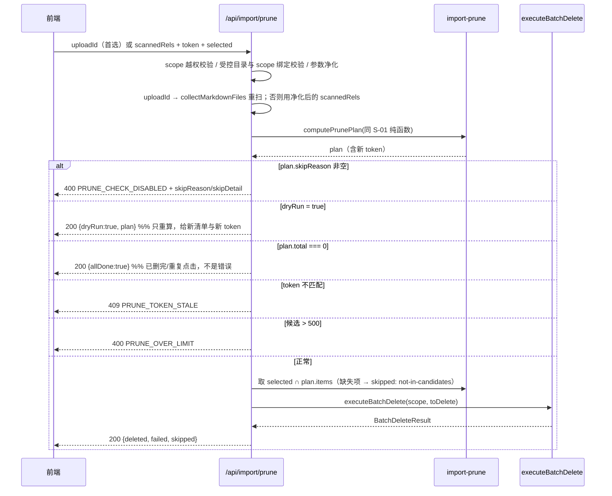

# S-02 结果字段与删除接口

> 父文档：[DESIGN.md](./DESIGN.md)　上游：[S01](./S01_候选计算与双闸门_DESIGN.md)　下游：[S03](./S03_前端开关与结果卡_DESIGN.md)

## 1. 术语

| 术语 | 定义 |
|---|---|
| `pickMode` | 本次上传的选择方式：`'dir'`（目录整体上传）/ `'files'`（多选文件） |
| `pruneStale` | 是否计算清理候选的开关，默认 `false`；仅 `pickMode==='dir'` 且非子集重试时生效 |
| `selected` | 用户在候选清单里勾选的 `{group, relation}` 子集；缺省 = 全部候选 |
| `PRUNE_TOKEN_STALE` | 重算后的候选指纹与请求携带的 `token` 不一致（库在期间变化） |

## 2. 现状（AS-IS）

| 事实 | 位置 |
|---|---|
| `ImportResult` 有 **3 个** return 构造点：主完成路径、整批未变早退、全部 skip 早退 | `src/lib/import.ts:1843-1885`、`:1063-1092`、`:1101-1125` |
| `ImportStats` 在 `:1847-1868` 内联组装（无独立函数） | 同上 |
| job 的 `result` **原样透传整个 `ImportResult`**，无裁剪 | `src/lib/mcp-http-api.ts:1867`、`:1991` |
| `/api/import/status` 响应里 `result: job.result` | `:1982-2004` |
| 路由为一条 `if` 链，`/import/run` 在 `:661`、`/import/preflight` 在 `:662` | `:650-690` |
| `UploadSession` 字段：`scope/updatedAt/state/batchCount/completedBatches/jobId/errors` | `:116-124` |
| `executeBatchDelete(scope, items)` 已存在，内部有 scope 写锁；`items` 元素 `{group, relation}` | `src/delete-relation.ts:733`、`:687-690` |
| `BatchDeleteItem` / `BatchDeleteResult` / `DeleteResult` **均未导出** | `:687`、`:692`、`:67` |
| 批量层**不做**草稿卫兵：单条有草稿 → 该条 `ok:false`，批量整体仍 `ok:true` | `:138-147`、`:704-728`、`:730` |
| `/api/import/run` 已用 coordinator `submit` 串行化 | `:1554-1561` |

## 3. 方案（TO-BE）

```
src/lib/import.ts          # [修改] 新参数 + 3 处 return 挂 prune
src/delete-relation.ts     # [修改] 导出 BatchDeleteItem / BatchDeleteResult / DeleteResult
src/lib/mcp-http-api.ts    # [修改] upload/run 收参；新增 POST /api/import/prune；UploadSession.pickMode
test/import-prune-api.test.ts  # [新增] 接口级（可复用 test-config.js）
```

### 3.1 导入侧：参数与结果

```ts
// src/lib/import.ts —— HandleDirectImportArgs 追加
export interface HandleDirectImportArgs {
  // …既有字段不变…
  /** 本次选择方式；CLI 目录导入视为 'dir'。缺省 undefined = 不判定 */
  pickMode?: 'dir' | 'files';
  /** 是否计算清理候选（默认 false）。仅 pickMode==='dir' 且 onlyRelPaths 为空时生效 */
  pruneStale?: boolean;
  /** R11：上传阶段失败的文件 rel，视作「本次有」，永不进候选 */
  preserveRels?: string[];
}

// ImportResult 追加（可选字段，向后兼容）
export interface ImportResult {
  // …既有字段不变…
  /** 清理候选；仅 pruneStale 开启且完成扫描时存在 */
  prune?: ImportPrunePlan;
}
```

**三个 return 点统一**（防漏挂，这是本子需求的核心实现约束）：

```ts
// 扫描完成后、任何早退之前算一次
const prune: ImportPrunePlan | undefined = args.pruneStale
  ? safePlanImportPrune({ scope, group, scannedRels, preserveRels: args.preserveRels, importedGroups })
  : undefined;

// safePlanImportPrune 内部 try/catch：抛错 → { skipReason: 'ERROR', ... }，
// 绝不允许清理计算导致导入失败（见 S-01 §3.3「异常」）

// 三处 return 一律：...(prune ? { prune } : {})
```

`importedGroups` 由 `src/lib/import.ts` 内部用 `resolveGroupForSource(group, rel, scope)` 对 `scannedRels` 逐个推导后传入（该函数保持 module-private，不扩大导出面）。

`pickMode !== 'dir'` 或 `onlyRelPaths` 非空时，`safePlanImportPrune` 直接返回带 `skipReason` 的 plan，不读缓存、不算差集。

### 3.2 HTTP 侧：新增 `POST /api/import/prune`

插入位置：`src/lib/mcp-http-api.ts` 路由链 `:664`（`/import/cancel`）之后、`:665`（`/import/incomplete`）之前。

**接口契约**

```ts
POST /api/import/prune
Content-Type: application/json

{
  "scope": "kisearch",
  "group": "wiki",              // 可选；与 run 时同口径，缺省 = 全 scope
  "uploadId": "0f3c…-…",       // 首选：服务端重新扫描同一暂存目录（与 run 完全同源）
  "scannedRels": ["a.md", "b/c.md"],   // 降级通道：仅 CLI/脚本场景；Web 端不使用（见下）
  "dryRun": false,              // 可选；true = 只重算并返回新清单 + token，不删除
  "token": "9f2c1a7b3e4d5c60",  // dryRun=false 时必填；来自 run 结果的 prune.token
  "selected": [                  // **必填**（challenger 意见 2）：删除类接口不得用「缺省=全删」
    { "group": "wiki", "relation": "old-a" }
  ]
}
```

> **`selected` 必填（fail-safe）**：`selected: []` → 200 `{deleted:0}`，不做任何删除；字段缺失 → 400 `PRUNE_MISSING_PARAM`。理由：前端状态重置/序列化遗漏/新接入方漏传时，不能表现为"删除全部候选"。

> **为什么首选 `uploadId` 而不是让前端拼 `scannedRels`**：前端持有的文件清单来自 `plan.selections[].name`，它**不含**被服务端拒绝的文件（扩展名不符/超限），而服务端 `collectMarkdownFiles` 扫的是暂存目录的**实际内容**。两者不一致时重算出的候选集必然不同 → token 恒失配 → 每次删除都 409。因此默认走 `uploadId` 重扫（与 run 时同目录、同集合），`scannedRels` 仅作为暂存被清理后的降级通道。

```ts
// 200（正常删除）
{
  "ok": true,
  "scope": "kisearch",
  "requested": 2,          // 服务端重算后的候选总数
  "selected": 2,           // 本次实际请求删除的条数
  "deleted": 2,
  "skipped": [{ "group": "wiki", "relation": "gone", "reason": "not-found" }],
  "failed":  [{ "group": "wiki/docs", "relation": "draft", "reason": "Relation 有 1 条未结束的编辑草稿，请先 cancel/finish" }]
}

// 200（候选已空：重复点击 / 上一次已删完）—— 不是错误，前端显示"已无剩余候选"
{ "ok": true, "scope": "kisearch", "allDone": true, "requested": 0, "selected": 0, "deleted": 0, "skipped": [], "failed": [] }

// 200（dryRun：只重算，不删除）
{ "ok": true, "scope": "kisearch", "dryRun": true, "plan": { /* ImportPrunePlan，含新 token */ } }
```

**处理步骤（顺序固定）**



要点：

1. **重算而非信任**：`scannedRels` 用于重算候选；伪造更小的集合会使候选变大 → 新 token 必然不匹配 → 409。
2. **幂等**：重算时已不存在的文档自然不在候选集，归入 `skipped: not-in-candidates`，不调用删除。
3. **selected 二次校验**：只允许删除「重算后仍在候选集」的项，其余 `skipped: not-in-candidates`。
4. **并发**：`executeBatchDelete` 自带 scope 写锁；HTTP 层再包一层 coordinator `submit({ operation: 'import-prune', params: { scope } }, fn, [scope], 'write')`，与 `/import/run` 同通道避让。
5. **同步执行**：上限 500 条，命中即返回，不建 job（见 D-03）。
6. **`dryRun` 与闸门**：`dryRun=true` 属**查询语义**——即使闸门不通过也返回 **200 + `plan.skipReason`**（前端据此展示原因）；非 dryRun 时闸门不通过才返回 400 `PRUNE_CHECK_DISABLED`（评审 W-2）。

**错误码**

| HTTP | `code` | 触发 | 用户可见文案 |
|---|---|---|---|
| 400 | `PRUNE_MISSING_PARAM` | 缺 `scope`/`token`/`selected`，或 `uploadId` 与 `scannedRels` **同时为空** | 请求缺少必要参数 |
| 400 | `PRUNE_SOURCE_UNAVAILABLE` | `uploadId` 不存在/已过期且未提供 `scannedRels` | 上次导入的暂存目录已清理，请重新导入一次后重试 |
| 400 | `PRUNE_CHECK_DISABLED` | 重算后 `skipReason` 非空（含 `NOT_DIR_MODE`/`SUBSET_RETRY`/`EMPTY_SOURCE`/`EMPTY_LIBRARY`/闸门） | 携带 `skipDetail` 原文展示 |
| 400 | `PRUNE_OVER_LIMIT` | 候选 > 500 | 候选超过单次上限 500 篇，请分批或用 CLI |
| 403 | — | scope 越权（复用 `rejectScopeViolation`） | 与既有越权文案一致 |
| 409 | `PRUNE_TOKEN_STALE` | 重算 token 与请求不一致 | 库在这期间发生了变化，请刷新候选清单后重试 |
| 500 | `PRUNE_FAILED` | 计算抛错 | 清理失败：{message} |
| 503 | — | 台账不可读 / 有导入在跑（复用 `rejectIfImportBusy`） | 与既有忙态文案一致 |

### 3.3 上传与运行侧收参

| 接口 | 新增字段 | 处理 |
|---|---|---|
| `POST /api/import/upload` | `pickMode?: 'dir' \| 'files'` | 校验枚举，写入 `UploadSession.pickMode`（供 run 缺省回落；重试路径不需要） |
| `POST /api/import/run` | `pickMode?`、`pruneStale?`、`preserveRels?` | `pickMode` 显式值优先，缺省读 `session.pickMode`；`pruneStale===true` 且 `pickMode!=='dir'` → **400**（`PRUNE_NOT_DIR_MODE`），不得静默降级 |

**R11 上传完整性校验（run 侧，硬门槛）**：

```ts
// 计算候选前先判上传是否完整
const incomplete = (session.errors?.length ?? 0) > 0
  || (session.batchCount !== undefined
      && (session.completedBatches?.length ?? 0) < session.batchCount);

// incomplete === true → 不产候选，plan.skipReason = 'UPLOAD_INCOMPLETE'
// 导入本身照常执行（上传失败不应阻断已成功文件的导入）
```

> `preserveRels` 必须**复用 `sanitizeOnlyRelPaths`**（拒绝绝对路径 / `..` / 超长，上限 50 000 条），与 `onlyRelPaths` 同规则——它直接改变"哪些文档不进候选"，属安全敏感入参（challenger 意见 3）。

`preserveRels` 与完整性校验是**叠加关系**：有失败清单时走 `preserveRels`（只排除这些文件、其余照常清理）；拿不到失败清单时退化为 `UPLOAD_INCOMPLETE`（整次不给清理）。两者都没有 → 硬门槛生效，绝不产候选。

> 为什么 upload 也要落：`/import/run` 可能由「刷新页面后恢复」路径触发，此时前端可能不再持有 pickMode；从 session 回落可避免误判。run 显式值优先保证可控。

### 3.4 数据模型变更汇总

| 对象 | 变更 | 兼容性 |
|---|---|---|
| `HandleDirectImportArgs` | +`pickMode?`、+`pruneStale?` | 可选，CLI/daemon 不传即旧行为 |
| `ImportResult` | +`prune?` | 可选，老前端忽略 |
| `UploadSession` | +`pickMode?` | `.upload-session.json` 新增可选键，旧文件缺省 `undefined` |
| `delete-relation.ts` | 导出 3 个类型 | 仅可见性变更，零逻辑变更 |
| `Relation` / `relations-cache` | **无变更** | — |

## 4. 异常处理

| 场景 | 行为 | 是否对外暴露 |
|---|---|---|
| `pruneStale` 未开 | 不计算，`ImportResult` 无 `prune` 字段 | 否 |
| `pickMode='files'` 且 `pruneStale=true` | run 直接 400 `PRUNE_NOT_DIR_MODE` | 是（400 + 文案） |
| 子集重试（`onlyRelPaths` 非空） | plan 带 `skipReason='SUBSET_RETRY'`，不产候选 | 是（结果卡提示「重试未完成时不做清理」） |
| 上传存在失败批次/文件（R11） | 有 `preserveRels` → 并入有效集合正常计算；无 → `skipReason='UPLOAD_INCOMPLETE'`，**不产候选** | 是（结果卡提示「本次有 N 篇未上传成功，已跳过清理」） |
| 扫描到 0 篇 | `skipReason='EMPTY_SOURCE'` | 是 |
| 清理计算抛错 | `skipReason='ERROR'` + `skipDetail`；**导入照常成功** | 是（结果卡提示） |
| 候选 0 篇 | `total=0`，无 token，前端不渲染区块 | 否（静默，避免噪音） |
| 候选 > 500 | `overLimit=true`，无 token；prune 接口再算仍超限 → 400 | 是 |
| 删除期间库变化 | 重算 token 不一致 → 409，前端要求刷新 | 是 |
| 单条有未结束编辑草稿 | 该条进 `failed[]` 并带原因，其余继续 | 是（逐条回显） |
| 单条已不存在 | 重算时已不在候选 → `skipped: not-in-candidates` | 是（折叠显示） |
| 批量执行整体抛错 | 返回 500 `PRUNE_FAILED`；已删的不可回滚，前端提示「部分可能已删除，请刷新核对」 | 是 |
| 大候选（>100 篇）删除耗时较长 | 前端 loading + 文案「正在删除 N 篇，请勿关闭页面」 | 是（体验层） |

## 5. 影响范围

| 受影响方 | 影响 | 说明 |
|---|---|---|
| CLI `ki import` | 无感 | 不传 `pruneStale`，结果结构不变 |
| daemon 分发 `import: handleDirectImport` | 无感 | 参数可选 |
| `/api/import/retry-incomplete` | 无感 | 不传 `pruneStale`；且子集重试本身被 S-01 拦 |
| `/api/import/upload` 前端 | 需补 1 个可选字段 | 不传则 `session.pickMode` 为 `undefined`，run 时 `pruneStale=true` 会被 400 拒绝 |
| 任务中心 `TasksPage` | **不联动** | 删除发生在导入 job 结束后，属独立动作；候选只挂在 job 结果里供导入页消费 |

## 6. 关键决策点

| # | 决策 | 采用 | 被否决方案 | 否决理由 | 重新评估触发条件 |
|---|---|---|---|---|---|
| D-01 | 结果承载 | 挂 `ImportResult.prune` | 新增 `GET /api/import/prune-candidates` 单独查 | 多一次往返；且候选与本次 `scannedRels` 强绑定，脱离导入上下文后需要额外持久化一份扫描快照 | 若将来 CLI/其他客户端需要独立查询候选 |
| D-02 | 删除接口的数据来源 | `uploadId` 重扫优先 + `scannedRels` 降级 + token 校验 | ① 只让前端拼 `scannedRels`；② 只信 `uploadId` | ① 前端清单不含被服务端拒绝的文件，与服务端扫描集合不一致 → token 恒失配 → 每次删除都 409；② 暂存 24h 清理后接口直接不可用 | 暂存区改为持久化后，可删除降级分支 |
| D-03 | 执行形态 | 同步执行（≤500 条） | 建 job 异步 + 轮询 | 前端要多一套轮询与状态机；本操作低频、条数有上限 | 实测 500 条 P95 > 60s，或上限被提高 |
| D-04 | 超限行为 | 不提供删除按钮（只显示计数） | 自动分批删 / 截断成前 500 删 | 自动分批会在用户不知情下扩大删除规模；截断会让「删了哪些」不可预期 | — |
| D-05 | 已不存在项语义 | `skipped`（幂等成功） | 计入 `failed` | 用户重复点删除会看到一片「失败」，误判为功能故障 | — |
| D-06 | `pickMode` 必填性 | run 时可缺省回落 session | 强制必填 | 刷新恢复路径拿不到该值会直接失败 | — |

## 7. 待定问题

| # | 问题 | 现状处理 |
|---|---|---|
| T-01 | coordinator `operation` 名称是否需要登记到白名单 | 设计取 `'import-prune'`；实现时核对 `operation` 是否受枚举约束，若有白名单需同步添加 |
| T-02 | 500 条删除的实测 P95 耗时 | 设计阶段未实测；实现后补一次压测，若 > 60s 则改 D-03 为异步 |
