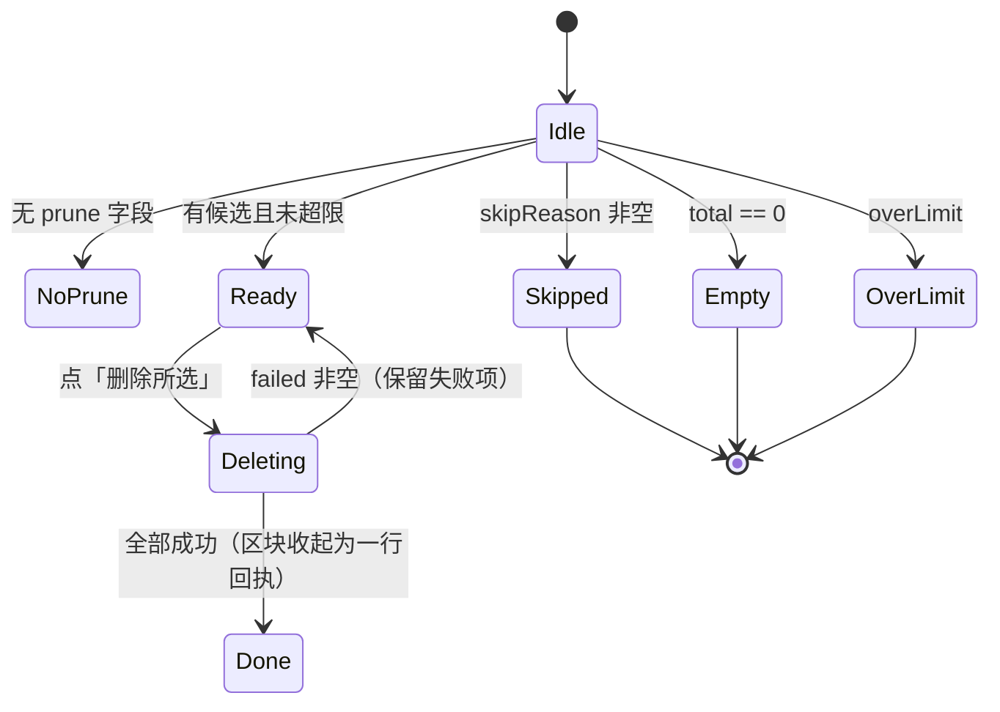

# S-03 前端开关与结果卡

> 父文档：[DESIGN.md](./DESIGN.md)　上游：[S02](./S02_结果字段与删除接口_DESIGN.md)　下游：无

## 1. 术语

| 术语 | 定义 |
|---|---|
| `pickMode` | 本页面当前选择方式的本地态：`'dir' \| 'files' \| null`（null = 还没选） |
| `pruneStale` | 开关状态，默认 `false`；`pickMode !== 'dir'` 时强制 `false` |
| 候选 key | `${group}\u0000${relation}`，用作勾选集合的稳定键 |
| 已触及组 | `importedGroups`（本次有文件落入的 group） |
| 未触及组 | `prune.untouchedGroups`（本次完全没有文件落入） |

## 2. 现状（AS-IS）

| 事实 | 位置 |
|---|---|
| 目录/文件来源信息在汇合处**丢失**：`openDirPicker` 直接调 `collectRawFiles`，文件选择走 `scanSelectedFiles` | `web/src/pages/ImportPage.tsx:925`、`:861`、`:845` |
| 三个选入口：目录选择器（`showDirectoryPicker` + `webkitdirectory` 回退）、多选文件、拖拽 | `:905-951`、`:953-977` |
| 结果卡为「卡 2：结果摘要」，含 stats、部分成功块、同名处理列表、错误列表、动作区 | `:1939-2074` |
| `result` 的 inline 类型是前端对 `ImportResult` 的局部镜像 | `:1251-1268` |
| `ImportJob.result` 未强类型化（`Record<string, unknown>`） | `web/src/api/httpApi.ts:163-190` |
| 轮询在 `useEffect` 内 `setInterval`，2s 一次 | `:718-813` |
| 页内 `phase`：`idle \| scanning \| uploading \| importing \| done \| failed \| unknown` | `:326-330`、`:483` |

## 3. 方案（TO-BE）

```
web/src/api/httpApi.ts        # [修改] 新增 pruneImport + 类型；runImport/uploadFiles 补字段
web/src/pages/ImportPage.tsx  # [修改] pickMode 采集、开关区块、结果卡候选区、删除动作
web/src/styles/ki.css         # [修改] 候选区样式（追加，不改既有规则）
```

### 3.1 `pickMode` 采集（唯一新增的状态源）

```ts
const [pickMode, setPickMode] = useState<'dir' | 'files' | null>(null);
const [pruneStale, setPruneStale] = useState(false);
const [selectedCandidates, setSelectedCandidates] = useState<Set<string>>(new Set());
const [pruning, setPruning] = useState(false);
```

| 入口 | 现有位置 | 改动 |
|---|---|---|
| 目录选择器（FS Access） | `openDirPicker` `:905-951` | 选完调 `collectRawFiles(files, 'dir')` |
| 目录选择器（`webkitdirectory` 回退） | `:938-951` | 同上 |
| 拖拽 | `:953-977`（`webkitGetAsEntry`） | 有任一 entry `isDirectory` → `'dir'`，否则 `'files'` |
| 多选文件 `<input multiple>` | 文件选择分支 | `collectRawFiles(files, 'files')` |

`collectRawFiles(files, mode)` 在现有 `:845` 基础上加第二参数，内部 `setPickMode(mode)`；若 `mode === 'files'` 则 `setPruneStale(false)`（切模式自动关闭，防「先开开关后换文件选择」）。

`resetAfterImport()`（`:569` 附近）追加 `setPickMode(null)`、`setPruneStale(false)`、`setSelectedCandidates(new Set())`。

### 3.2 上传前开关

位置：`同名文档处理` 区块之后、`Tags` 之前（新卡片，不塞进下拉，见 D-01）。

```
┌ 目录同步 ─────────────────────────────────────────────┐
│ [ ] 导入后提示清理：库中存在、本次目录已没有的文档      │
│     开启后导入完成才给出候选清单，不会自动删除          │
│     （选择文件上传时不可用）                            │
└───────────────────────────────────────────────────────┘
```

| 状态 | 表现 |
|---|---|
| `pickMode === null` | 勾选框 `disabled`，辅助文案「请先选择要导入的目录」 |
| `pickMode === 'files'` | `disabled` + 文案「仅「选择目录」上传可用」 |
| `pickMode === 'dir'` | 可用，默认未勾 |

### 3.3 结果卡候选区

插入位置：结果卡 stats 文案之后（`:1966-1973`）、部分成功块之前（`:1986`）。只读 `result.prune`，不额外请求。



**渲染矩阵**

| `prune` 状态 | 渲染 |
|---|---|
| 字段缺失 | 不渲染任何东西 |
| `skipReason` 存在 | 提示条：原因（见下表映射）+ `skipDetail`（含实际数值）+ CLI 出口命令示例 |
| `total === 0` | 不渲染（避免噪音） |
| `overLimit` | 提示条：「候选 N 篇，超过单次上限 500：请用 CLI `ki delete-relation` 清理；或先在本地恢复部分文件后重新导入」，**无删除按钮**（不存在"分批产生候选"的路径——challenger 意见 5） |
| 正常 | 分组清单 + 勾选 + 删除按钮 |

**`skipReason` 文案映射**

| `skipReason` | 文案 |
|---|---|
| `NOT_DIR_MODE` | 仅「选择目录」上传时可用 |
| `SUBSET_RETRY` | 「重试未完成」模式不做清理 |
| `EMPTY_SOURCE` | 本次未扫描到任何文档，已跳过清理 |
| `UPLOAD_INCOMPLETE` | 本次有 {N} 篇文件未上传成功，已跳过清理（这些文件本地仍在，不能被当作已删除） |
| `EMPTY_LIBRARY` | 库中没有可判定来源的文档，无需清理 |
| `GATE_COORD` | 本次上传的路径与库中记录仅 {coordRatio} 吻合，低于 80% 阈值；直接清理会误删 {潜在} 篇。**这也可能意味着本次选错了目录层级，请核对。** |
| `GATE_SCALE` | 本次将删除库中 {deleteRatio} 的文档（{total}/{judicable}），超过 80% 阈值 |
| `ERROR` | 清理候选计算失败：{skipDetail}（不影响导入结果） |

所有闸门关闭态都附一行：
`如需强制清理：ki delete-relation -g <组> -r <文档>`

**清单布局**

```
┌ ⚠ 库中另有 2 篇文档，本次上传的目录里没有 ──────────────┐
│ [x] 全选（已触及组）                                    │
│   组 wiki                                               │
│     [x] old-a.md   → 「old-a」                          │
│     [x] old-b.md   → 「old-b」                          │
│                                                         │
│ ▸ 本次上传未涉及的组（默认不勾选，3 篇）  [展开]         │
│   ⚠ 这些组本次没有任何文件落入，全部删除可能不是你要的  │
│                                                         │
│ ⚠ 本次将删除库中 45% 的文档（超过 20% 阈值）              │
│   请在下框输入「删除」以确认（challenger 意见 1）  [____]  │
│ ⓘ 删除后即刻从列表与检索消失；原文移入回收站             │
│ ⓘ 本清单 1 小时内有效（服务重启即失效），过期需重新导入   │
│ [ 忽略 ]                          [ 删除所选 2 篇 ]      │
└─────────────────────────────────────────────────────────┘
```

- 「全选（已触及组）」只勾 `untouched === false` 的项；未触及组需展开后单独勾「该组全部」或逐条勾。
- **明细与可删集合一致**：`total ≤ 500` 时全部展示、全部可勾。`truncated` 仅在将来调整上限时出现；一旦出现，列表尾部提示「仅显示前 N 条，共 {total} 篇」且**禁用删除按钮**（避免"看到 500 只能删 50"——评审 B-1）。
- 明细为空但 `total > 0` 不可能（`items` 至少 1 条）。

### 3.4 删除动作

```ts
async function handlePrune(): Promise<void> {
  const plan = result?.prune;
  if (!plan?.token) return;
  setPruning(true);
  try {
    const res = await pruneImport({
      scope: plan.scope,
      group: groupPath || undefined,
      uploadId: resolveUploadId(),   // 本次上传的 uploadId（见下）
      token: plan.token,
      selected: [...selectedCandidates].map((k) => {
        const [g, r] = k.split('\u0000');
        return { group: g, relation: r };
      }),
    });
    // 成功项从本地清单移除，失败项保留标红
  } finally {
    setPruning(false);
  }
}
```

**`uploadId` 的来源**：本次运行的上传计划里已有 `plan.uploadId`。页面刷新会丢内存态，故在**上传成功后**写入 `sessionStorage['ki.import.uploadId.<scope>']`（key 带 scope，避免多 scope / 多标签页串号——评审 W-6），`resolveUploadId()` 先读内存再读 sessionStorage。

**不要用前端文件清单当 `scannedRels`**：`plan.selections[].name` 不含被服务端拒绝的文件（扩展名不符/超限），与服务端 `collectMarkdownFiles` 的实际扫描集合不一致 → token 恒失配。设计上只走 `uploadId` 让服务端重扫；`scannedRels` 仅在 `uploadId` 已被清理（400 `PRUNE_SOURCE_UNAVAILABLE`）时由服务端提示重新导入。

**`preserveRels` 的传递前提（R11）**：前端仅在**所有上传批次都收到成功应答**时才构造并传递 `preserveRels`；只要出现任一批次 fetch 异常或无应答，就**不传**任何 `preserveRels`（避免"部分失败清单"造成漏判），让服务端 `UPLOAD_INCOMPLETE` 硬门槛整体接管。

**重新检测（`dryRun`）**：中断后或怀疑库已变化时，调 `pruneImport({ ..., dryRun: true })` 重算，用返回的 `plan`（含新 token）替换本地清单，再允许删除。重复点击删除时若服务端返回 `allDone`，直接收起区块为「已无剩余候选」，**不显示错误**。

### 3.5 状态与文案

| 状态 | 表现 |
|---|---|
| `pruning === true` | 按钮 loading「正在删除 N 篇…」，禁用勾选与「忽略」 |
| 删除成功 | 区块收缩为一行回执「已删除 N 篇」；若仍有候选，**自动 `dryRun` 刷新清单与 token**（否则下一次删除必 409，评审 W-1），失败项保留并标红 |
| 409 `PRUNE_TOKEN_STALE` | 顶部警告「库在这期间发生了变化，请刷新清单后重试」，并禁用删除按钮 |
| 其他错误 | 顶部错误条 `{error}`，保留勾选状态可重试 |

## 4. 异常处理

| 场景 | 行为 | 是否对外暴露 |
|---|---|---|
| 开关开启后用户改成「选择文件」 | 自动置 `pruneStale=false` 并提示 | 是（一行提示） |
| 结果里有 `prune` 但 `pickMode` 已变 | 以服务端结果为准，正常渲染 | 否 |
| 页面刷新后仍有 job 结果 | 从 `sessionStorage` 恢复 `uploadId`，清单与删除均可用 | 否 |
| 刷新后暂存目录已清理（400 `PRUNE_SOURCE_UNAVAILABLE`） | 禁用删除，提示「上次暂存的目录已清理，请重新导入一次」 | 是 |
| 删除请求 400（闸门已关闭/超限） | 显示服务端 `error`，禁用按钮 | 是 |
| 删除请求 409 | 显示 token 失效提示，禁用按钮 | 是 |
| 部分失败 | 失败项保留并标红 + 原因；成功项移除 | 是 |
| `untouchedGroups` 中有空组 | 服务端已过滤（组内至少 1 篇文档），前端不再判 | 否 |

## 5. 影响范围

| 受影响 | 影响 | 说明 |
|---|---|---|
| 现有导入流程 | 无感 | 开关默认关，`pickMode` 仅新增参数 |
| `collectRawFiles` 签名 | 改 | 加第二参数；调用点 4 处需同步 |
| 结果卡布局 | 改 | 新区块插入 stats 与部分成功块之间；无 `prune` 时零占位 |
| 拖拽区文案 | 微调 | 增加「目录模式 / 文件模式」标识（让用户确认自己传的是整目录） |
| 移动端/窄屏 | 需验证 | 候选清单为纵向列表，窄屏需确认长 relation 名换行不顶破 |

## 6. 关键决策点

| # | 决策 | 采用 | 被否决方案 | 否决理由 | 重新评估触发条件 |
|---|---|---|---|---|---|
| D-01 | 开关位置 | 独立卡片（同名处理下方） | 塞进「同名文档处理」下拉做第 5 个选项 | 两者正交（一个是冲突策略、一个是清理策略），合并会让「选增量还是选清理」变成假二选一 | — |
| D-02 | 未触及组默认勾选 | 默认不勾 | 与已触及组一起默认全勾 | 未选 Group 时作用域是全库，全勾等于「把本次没传的 group 全删」 | 若实测用户普遍每次上传整个 scope，可改为默认勾 |
| D-03 | 承载形态 | 结果卡内嵌区块 | 弹窗 modal 二次确认 | 需要打断导入结果阅读；且 modal 内列表滚动体验差 | — |
| D-04 | 删除后数据刷新 | 本地移除已删项 | 重新拉 `/api/import/status` | 服务端 `plan` 是导入时快照，不会因删除而变化，刷新后已删项仍在 | 若 S-02 增加「候选实时重算」能力 |
| D-05 | 全选语义 | 只作用于已触及组 | 一次全选所有候选 | 与 D-02 同因 | — |

## 7. 待定问题

| # | 问题 | 现状处理 |
|---|---|---|
| T-01 | 刷新后 `sessionStorage` 被清（隐私模式/换标签页） | 降级为提示重新导入；若实测高频，再让 S-02 在 job 结果里回传 `uploadId` 供恢复 |
| T-02 | 候选 > 50 时是否提供「查看全部」 | 本期只显示前 50 + 计数；如需要可加「下载清单」 |
