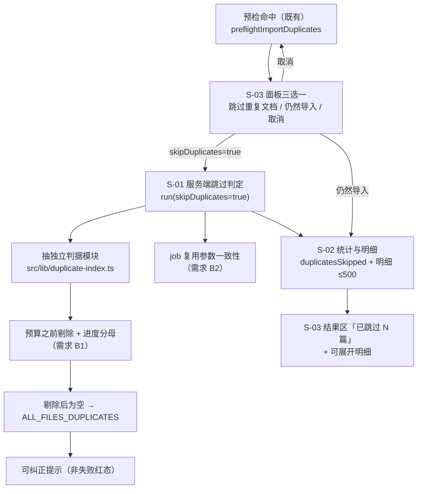
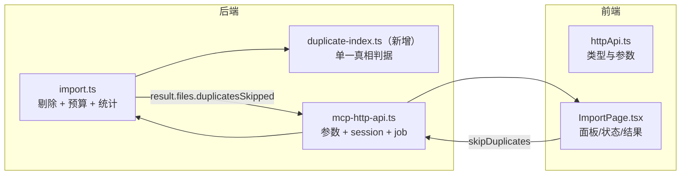

# 技术设计：重复导入可「跳过重复文档」（父文档）

> 需求：`REQ-20261019-002`（`requirement.md` v2）
> 设计输入：需求 v2 + 场景推演报告（`review/scenario-rehearsal.md`，2 🔴 已回填）+ 代码直读
> 范围：Web 导入页「预检 → 决策 → 执行 → 结果」链路；**不含** CLI / MCP / 逐篇勾选

---

## 1. 需求背景 & 目标

导入前预检命中「内容一致但 sourcePath 不同」时，面板只有「仍然导入（建副本）」与「取消（整批放弃）」两个极端动作。本次增加第三条路：**跳过这批重复、其余照常导入**（按钮「跳过重复文档」），并保证：

1. 跳过项**零写入**（KB / 向量 / FTS / 附件）；
2. 未跳过项与"不跳过时"逐项等价；
3. 统计口径自洽：`completed + incomplete + skipped = scanned`；
4. 不产生不可逆意外副本（同 `uploadId` 的幂等复用不得吞掉跳过意图）；
5. 不传新参数时全链路行为不变。

**不在范围内**：CLI `--skip-duplicates`、MCP 工具参数、逐篇勾选、预检判据调整（模糊相似度）、跳过决策持久化、`retry-incomplete` 继承跳过决策。

---

## 2. 关键环节一览图

---

## 3. 总体方案设计

**跨子需求接口契约（单一处声明，子文档引用）**

| 契约 | 位置 | 形态 |
|---|---|---|
| `POST /api/import/run` body | S-01 | 新增 `skipDuplicates?: boolean` |
| `HandleDirectImportArgs.skipDuplicates` | S-01 | `boolean \| undefined` |
| `ImportStats.files.duplicatesSkipped` | S-02 | `number` |
| `ImportResult.duplicatesSkipped` | S-02 | `{ path; existingGroup; existingRelation }[]` |
| `ImportResult.duplicatesSkippedTruncated` | S-02 | `boolean` |
| `Job.errorCode`（新增可选） | S-02 | `string \| undefined`（如 `ALL_FILES_DUPLICATES`） |
| `run` 同步 409 错误码 | S-01 | `IMPORT_JOB_PARAMS_MISMATCH`（复用参数不一致） |
| `runImport(args).skipDuplicates`（前端） | S-03 | `boolean` |

---

## 4. 全局风险 & 跨子需求依赖

### 4.1 共享术语速查（各子文档不再重复定义）

| 术语 | 定义 | 归属 |
|---|---|---|
| 疑似重复文档 | 原文 sha256 与库中某文档一致 **且** `sourcePath ≠ rel` | S-01 |
| 跳过集 | run 时刻服务端重算出的疑似重复 `rel` 集合（前端清单只用于展示） | S-01 |
| 剔除 | 从待处理文件列表中移除跳过集，发生在预算闸门与进度分母之前 | S-01 |
| `skipDuplicates` | run 请求新增布尔参数，缺省 `false` | S-01 |
| `files.duplicatesSkipped` | 被跳过的重复文件数，是 `skipped` 的子集 | S-02 |
| `result.duplicatesSkipped` | 跳过明细数组（`path/existingGroup/existingRelation`），上限 500 | S-02 |
| 可纠正提示 | 全部重复被拦截时的 UI 呈现：非红色失败态，`phase` 不落 `failed` | S-03 |
| 幂等复用 | 同 `uploadId` 已有 job 时返回既有 `jobId` 的既有分支 | S-01 |

### 4.2 跨子需求风险 & 依赖

| # | 风险 / 依赖 | 影响 | 处理 |
|---|---|---|---|
| 1 | **循环依赖**：`import-preflight.ts` 已 `import` `import.ts`，`import.ts` 反向引用会成环 | 构建失败或判据被复制漂移 | S-01 抽 `duplicate-index.ts`（无 `import.ts` 依赖），两侧同时改为引用它 |
| 2 | **预算闸门位置**（需求 B1） | 跳过反而失败 | S-01 把剔除提前到预算之前；不传 `skipDuplicates` 时预算输入保持原 `files` |
| 3 | **job 复用吞参数**（需求 B2） | 静默建副本（不可逆） | S-01 增加 session 参数快照 + 终态/参数分流判据 |
| 4 | **恒等式被破坏**（S-02 与 S-01 口径不一致） | 结果区数字对不上、用户质疑丢文件 | `scanned` 用剔除前、`skipped` 含跳过数、`duplicatesSkipped` 为子集；S-02 统一定义 |
| 5 | **错误呈现**：`ALL_FILES_DUPLICATES` 只能经 job 失败回传（判定在 import 内） | 用户点正常按钮看到"导入失败" | S-02 补 `Job.errorCode`；S-03 按错码渲染可纠正提示 |
| 6 | **既有行为回归**：`onlyRelPaths` 的预算口径是"按全量"（`import.ts:722-761` 早于 `:813-851`） | 顺手改动会破坏 AC8 | 只有 `skipDuplicates=true` 时才改用剔除后列表；否则保持原样 |
| 7 | 性能：跳过判定需遍历库内 local KB 做 sha256 **+ 本批文件二次读盘** | **已实测**（`temp/probe-duplicate-hits-cost.ts`，500 篇 × ~2KB、热缓存）：判定合计 **17ms**（buildIndex 9ms + collectHits 8ms，0.034ms/篇）；线性外推 1 万篇 ≈ **340ms**，按真实文档体积 5–10 倍估算冷缓存 **1.5–3.4s** | 一次完成、循环前不复算；实测已回填 S-01「性能与降级」；>5s 才启用降级预案（当前不启用） |
| 8 | 依赖：S-02 依赖 S-01 的跳过集；S-03 依赖 S-02 的字段 | 顺序必须 S-01 → S-02 → S-03 | 按依赖拓扑落盘与实施 |
