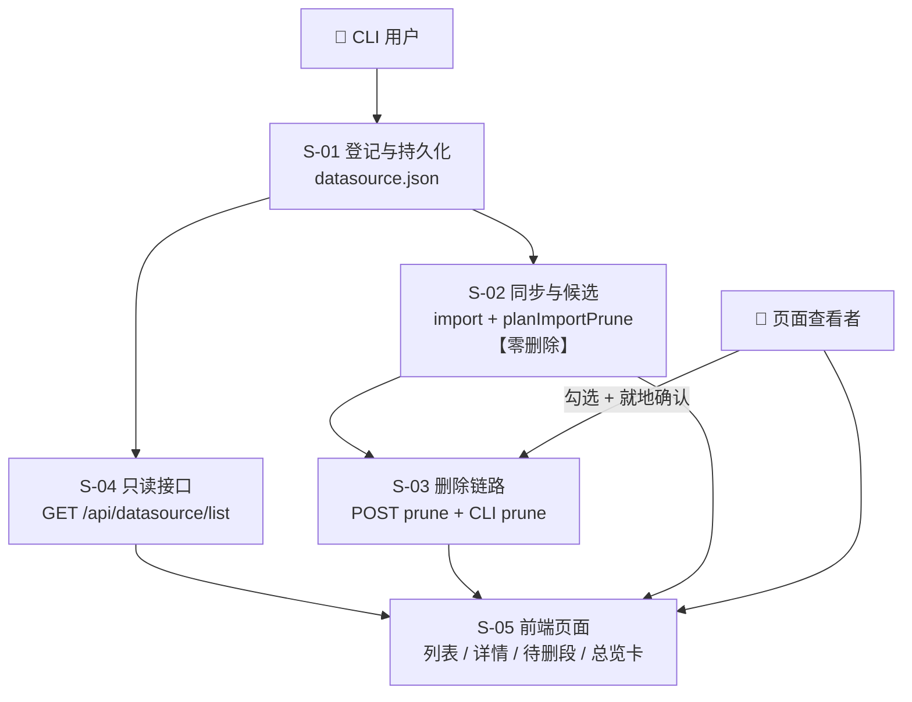
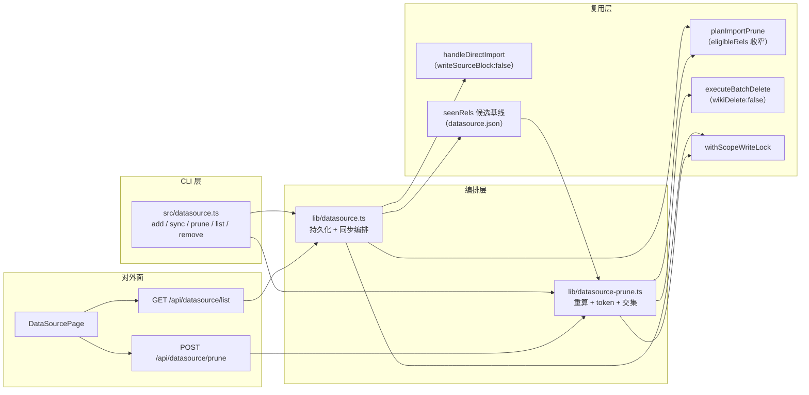

# 设计总览：数据源登记与同步（REQ-20261020-001）

> 关联需求：[`../requirement.md`](../requirement.md) v6 ｜ 场景推演：[`../review/scenario-rehearsal.md`](../review/scenario-rehearsal.md)
> 证据声明：`🟢` 代码直读（未运行实测）；界面为已确认 ASCII 草图

---

## 1. 需求背景 & 目标

**背景**：`ki import` 每次都要重敲一长串参数（`--source` / `--group` / `--conflict-mode` / 切分…），项目里没有"源"的概念。`group-index.json.source` 只记最近一次的 `dir/chunkSize/chunkOverlap`，无法还原完整参数，也不会被当成可复用实体。

**目标**：
1. 登记一次（`ki datasource add`），之后一条命令同步（`ki datasource sync --scope X`）
2. 同步**只导入 + 计算待删候选**，绝不删除；删除是页面上的显式动作
3. 页面可看数据源列表/详情/待删清单，可勾选删除，**不能触发同步**
4. 总览第 4 卡由「注册」改为「数据源」数
5. **同步不写 `group-index.json.source`**（2026-10-21 Q-C 裁决）：数据源与「一次性导入源」在存储上隔离，wiki 写回不再指向用户源目录

**非功能假设（显式标注）**

| 维度 | 假设 | 突破时会怎样 |
|---|---|---|
| 数据量级 | 单目录数百~数千篇（实测参考：627 篇 `--no-vector` 约 2s，带向量约分钟级） | 上万篇时同步耗时线性增长；候选 >500 走分批删除（见 S-03） |
| `datasource.json` 体积 | `lastSync.seenRels` 存全量 rel 列表，万篇约 400KB，每次同步整文件原子重写 | 数万篇时单次写放大到 MB 级（本地 IO，仍可接受）；届时把 `seenRels` 拆独立文件 |
| 并发 | 单机单用户、低频（一天几次）；同步与删除互斥（scope 写锁） | 多人共用同一 dataDir 时需评估锁竞争与 token 失配频率 |
| 可用性 | 无 SLA；失败可重跑（导入幂等） | 无自动重试，崩溃后靠用户重新执行 sync |
| 一致性 | **最终一致**：导入成功后才写 `lastSync`；删除成功后才更新 `pendingDelete` | 中途崩溃 → 下次 token 失配 → 强制重算（安全侧） |
| 延迟 | 列表接口 <300ms（只读 JSON 摘要）；详情 <300ms | 详情含 ≤500 条 items，若 N 个 scope 同时打开需分接口（已拆） |

**不在范围内**：多源（一 scope 一源）、远程/git/url 源、`--all` 批量同步、定时自动同步（原 REQ-20261019-003 已放弃）、网页登记/网页触发同步、同步历史多版本（P2）。

---

## 2. 关键环节一览图

**分期**：一期 S-01 + S-04（能登记、能看见）→ 二期 S-02（能同步、能看到待删）→ 三期 S-03（能删除）→ 四期 S-05（完整体验）。

---

## 3. 总体方案设计

### 3.1 共享术语速查

| 术语 | 定义 | 归属 |
|---|---|---|
| **数据源（datasource）** | 一个 scope 唯一的外部目录登记 + 导入参数。唯一键 = `scope` | S-01 |
| **`datasource.json`** | `<kbDir>/datasource.json`，单对象，含配置与 `lastSync` | S-01 |
| **`source` 块** | `group-index.json` 的 `source = { dir, chunkSize, chunkOverlap }`。**只由一次性 `ki import` 写入**；数据源同步不触碰、`remove` 也不清空（Q-C 裁决） | S-01 |
| **`seenRels`（候选基线）** | 上一次**成功**同步时全量扫描到的 `rel` 集合，落 `lastSync.seenRels`。候选只在它里面找（"本数据源见过的文件"），从而不会把其他通道导入的文档列为待删 | S-01 / S-02 |
| **`eligibleRels`** | 传给候选计算的候选白名单（= 上一版 `seenRels`）。缺省 `undefined` 时退化为现有的「全 scope 差集」——Web 导入页行为完全不变 | S-02 / S-03 |
| **`pendingDelete`** | 同步时算出但**未执行**的待删候选集，含 `token` 指纹 | S-02 |
| **候选指纹（token）** | 候选集 `sha256` 前 16 位，删除时用于判断"目录/库是否已变" | S-02 / S-03 |
| **`overLimit`（超限）** | 候选数 > 单次上限 500。**不是"不可删"**：token 照常生成，页面按 500 一批分批删除，删完刷新继续 | S-02 / S-03 / S-05 |
| **重算** | 删除前服务端按当前源目录重新算候选，不信任前端清单 | S-03 |
| **就地确认** | 页面内展开的二次确认条（篇数 + 不可恢复），确认前零请求 | S-05 |
| **同步** | 导入 + 算候选，写库 | S-02 |
| **删除** | 只删库，不导入 | S-03 |

---

## 4. 全局风险 & 跨子需求依赖

| 风险 | 影响 | 缓解 |
|---|---|---|
| **候选范围 = 整个 scope 库**（🟢 `inScope(groupPath, '')` 恒真，`lib/import-prune.ts:139-142`） | `--group` 留空时，其他通道（Web 上传、一次性 `ki import`）导入的文档也在候选集内。数值反例：数据源 100 篇 + 其他通道 100 篇 ⇒ 重合率 100/min(100,200)=**1.0 过闸门 A**、删除占比 100/200=0.5 **过闸门 B** ⇒ 另外 100 篇成为待删候选 | **候选所有权口径**（S-02 D6）：`eligibleRels = 上一版 lastSync.seenRels`，候选只在「本数据源上次见过的 rel」里找；首次同步无 `seenRels` ⇒ 零候选（安全默认） |
| **候选口径用错集合** | 本次失败/跳过/预算剔除的文件被判"本地已删" → 用户点删除即真删 | S-02 硬约束：`scannedRels` 必须取 `collectMarkdownFiles` **全量**结果（`lib/import.ts:765-771` 已记录该坑），且 `seenRels` 也按全量写 |
| **候选重算的扩展名白名单与导入不同源** | 两次扫描集合不同 ⇒ token 恒失配（每次都提示"源目录已变化"）；放宽过 `.mdx` 的 scope 还会把仍在本地的大量文件判成已删 | S-03 D7：两侧必须共用同一个解析入口 `resolveImportExtensions(config, scope)`（`getScopeImportConfig(...)?.extensions ?? DEFAULT_EXTENSIONS`），禁止各写一份（先例：`mcp-http-api.ts:1827` 注释已把该差异定为 P0） |
| **跨时间的清单** | 用户看着 10 分钟前的清单删除，目录已变 | S-03 强制重算 + `token` 失配 409；前端就地提示"请重新同步" |
| **`tasks` 台账 TTL 1h**（`lib/task-registry.ts:160`） | 详情页若依赖台账会空白 | S-02 把 `params/result` 快照写进 `datasource.json.lastSync`，页面不读台账 |
| **删除会连带硬删用户源文件**（P0） | `executeDeleteRelation` 第 3 步硬删源 `.md`（`delete-relation.ts:183-229`），源目录解析见 `:366-374`（`getSource().dir` 优先、`wikiSync.sourceDir` 兜底）。**注意：设计初稿"候选必走 `findWikiFile` 回退"的论证不成立** —— 候选一定带非空 `sourcePath`（`readPruneLibSnapshot` 直接 `if (!sourcePath) continue`），而"sourcePath 文件不存在但约定路径存在"这一支代码**明确拒绝删除**（`:196-199` `source-mismatch`）。真实残余风险是：`<dir>/<sourcePath>` **确实存在**时被硬删（典型成因是扩展名口径分叉），以及 scope 残留历史 `source` 块时删到旧目录 | S-03 D6：数据源 prune 强制 `wikiDelete:false`（`executeBatchDelete` 需新增该开关并透传到 `daemon-dispatch` 的 `batch-delete`）。数据源自身不写 `source` 块（Q-C）已让常规路径不触达源目录，但历史 source 块可能与之重合，护栏保留 |
| **7 处 `getSource()` 消费方看不到数据源**（Q-C 裁决的直接代价） | `rebuild-vector` / `fts-rebuild` 拿不到数据源的 `chunkSize/chunkOverlap`（回退默认 1000/150）；`wiki-sync` / `group-delete` / `delete-relation` / `document-editor` / `relation-edit-publish` 拿不到源目录 | 本期接受：数据源自定义切分参数与重建参数可能不一致，`add` 与详情页需明示；跟进项见 S-01 §7 Q3（让重建类命令读 `datasource.json` 作为更高优先级） |
| **改 `--group` 造成文档重复** | 旧 group 文档保留 + 新 group 新建（`resolveImportConflict` 按 `sourcePath` 全局命中旧记录，`import-conflict.ts:95`） | `add` 改 `--group` 需 `--force` 并明确告知"旧 group 文档保留且重复"；该行为**仍需实测确认**（推演 P12 未关闭） |
| **`datasource.json` 与库内容的最终一致窗口** | `lastSync` 在 import 返回后由编排层写入；两者之间崩溃 ⇒ 库已更新而 `lastSync` 仍是上一版 | 已接受：页面只展示 `lastSync` 快照并显示同步时间；不承诺实时一致。注意 **`source` 块与 `datasource.json` 不再有双写窗口**（Q-C 后只剩单文件写） |
| **daemon / 直连两条路径漏改** | 任务台账字段缺失、snapshot 不写（本项目已发生过：`update({params})` / `finish({result})` 三处漏改） | S-02 验收要求：改完必须用真实 CLI 跑一次并检查台账文件内容 |

**跨子需求依赖**：S-02 产出的 `pendingDelete` 契约是 S-03 与 S-05 的输入；S-04 的 `running` 字段依赖任务台账的 `operation='datasource-sync'`（S-02 定义）。任一改动需同步更新本表与三处消费方。

### 4.1 接口清单速查（跨子需求契约）

| 方法/路径 | 归属 | 定义于 | 消费方 | 是否写 |
|---|---|---|---|---|
| CLI `ki datasource add/list/remove` | S-01 | `S01_登记与存储_DESIGN.md` §3.2 | 用户 | 写 |
| CLI `ki datasource sync` | S-02 | `S02_同步与候选_DESIGN.md` §3.1 | 用户 / 任务台账 | 写（导入） |
| CLI `ki datasource prune` | S-03 | `S03_删除链路_DESIGN.md` §3.4 | 用户 | 写（删除） |
| `POST /api/datasource/prune` | S-03 | `S03_删除链路_DESIGN.md` §3.1 | S-05 详情页 | 写（删除） |
| `GET /api/datasource/list` | S-04 | `S04_只读接口_DESIGN.md` §3.1 | S-05 列表页、总览卡 | 只读 |
> 契约变更必须同时改「定义于」文档与所有消费方；两个 GET 必须登记 `mcp-http-api.ts:502-503` 的只读白名单。
> **⚠ 白名单只能约束"带 `scope` 参数的 GET"**：无 scope 时它回落 `'default'` 做鉴权（`mcp-http-api.ts:504-506`），并不限制返回范围。`/datasource/list` 省略 scope 时**必须**在 handler 内按 `authScopes` 过滤输出（S-04 D5），否则远程 token 可枚举本机全部 scope 与绝对路径。

---

## 5. 2026-10-21 设计裁决与需求回写清单

本节记录设计评审后的三处裁决（均已经用户拍板）以及由此产生的**需求文档回写项**。实现前先按下表回写 `requirement.md`，避免"需求说一套、设计做一套"。

### 5.1 裁决

| ID | 裁决 | 影响的设计章节 | 关键理由 |
|---|---|---|---|
| **Q-C** | **数据源同步不写 `group-index.json.source`**（数据源自己记切分参数） | S-01 §3.3/§3.4/§4 D5、S-02 §3.1、S-03 D6、DESIGN §4 | 用户拍板：宁可接受 7 处消费方看不到数据源，也不让 `sync_relation` 把 KB 内容写进用户的源文档目录。代价清单见 §4 风险表 |
| **Q14（候选所有权）** | **候选所有权 = `lastSync.seenRels`**（上次成功同步见过的 rel 集合），不再用"全 scope 差集" | S-02 §3.3/D6、S-03 §3.2 | 否则 `--group` 留空时其他通道导入的文档会成为待删候选（双闸门拦不住，见 §4 第 1 行） |
| **Q15（超限分批）** | **超限 = 分批删除**（不是"不可删"、也不做"按 Group 删除"） | S-02 D7、S-03 §3.1/§3.2、S-05 §3.5 | 现状后端在 `overLimit` 时既不生成 token 又直接 400，CLI/页面/按组三条路径全都不通（🟢 `import-prune.ts:276`、`mcp-http-api.ts:1881-1888`） |

### 5.2 需求文档回写（已于 2026-10-21 应用到 `requirement.md` v7）

| 需求条目 | 原口径 | 现行口径 |
|---|---|---|
| R1 | 仍列 `[--no-sync-delete]` | 移除（Q13 已取消该语义）；补 `--chunk-size/--chunk-overlap`；注明**不写** source 块 |
| R2 | 退出码「成功 0 / 失败 1 / **护栏降级未删 2**」 | 只剩 0 / 1：同步永不删除，不存在该终态 |
| R4 | 候选基于全量扫描 rel | 追加**候选所有权**（Q14）：只在上一版 `seenRels` 内找；首次同步零候选；失败/取消保留上一版并标 `stale` |
| R6 | 两个接口 | 三个：`GET /list`、`GET /detail`、`POST /prune`；补"list 省略 scope 时按 authScopes 过滤"；prune 要求 `selected ≤ 500` |
| R10 | remove 同时**清空** `group-index.json.source` | 只删登记，**不碰 source 块**；迁移提示可能重新出现属预期 |
| R13 | 五个状态标记 | 保持；另由 `pendingDelete.stale` 表达"候选来自上次同步" |
| R15 | remove 后提示不再出现（依赖清空 source） | 改为"可能重新出现，属预期" |
| R17 | 候选 >500 时「按 Group 分别删除」 | **分批删除**（每批 ≤500，删完刷新继续，显示「已显示 500 / 共 N」） |
| R18 | `--group` 未定义语义 | 只在客户端筛选 `selected`，不传给服务端；每次 ≤500 |
| §5 CLI | remove 副作用 = 清空 source 块 | 改为"不触碰 source 块"；prune 的 `--yes` 说明分批 |
| §6 schema | 含 `"syncDelete": true`、嵌套 `source` 对象、结尾写「仍沿用 `setSource()`」 | 删 `syncDelete`；**改扁平结构**（避免与 `group-index.json.source` 同名混淆）；增 `seenRels` / `overLimit` / `eligibleCount` / `stale`；删除「沿用 setSource」 |
| §7 | Q-C「待拍板」 | 关闭并记录结论 |
| §8 | ② `TOO_MANY` 不产候选；③ 重算后再校验 500 上限 | ② 超限仍产候选 + token；③ 500 改为 `selected ≤ 500` 的分批约束；补 `wikiDelete:false` 与"交集对象 = 可见 items" |
| §9 | N4「按 Group 删除」、N10「可复制命令」、N11「remove 必须清空 source」 | N4 改分批；N10 改纯文本说明；N11 改写为"提示可重新出现属预期"，并新增 N12（候选混入其他通道）与 N13（扩展名口径） |
| §11 | A2「+ 可选 prune」 | 改为"计算候选（不删除）" |
| §12 | 「裁决 Q-C（唯一未决）」 | 改为已裁决 + 列出实施前必须实测的两项（P12、分批删除全链路） |

> `review/scenario-rehearsal.md` 保持为 2026-10-20 的**历史推演快照**，不按本裁决回改；其中 P1 的修复方式（清空 source 块）与 P24（删除前无法预览）已被 Q-C/Q15 取代——阅读时以本文件 §5 为准。
