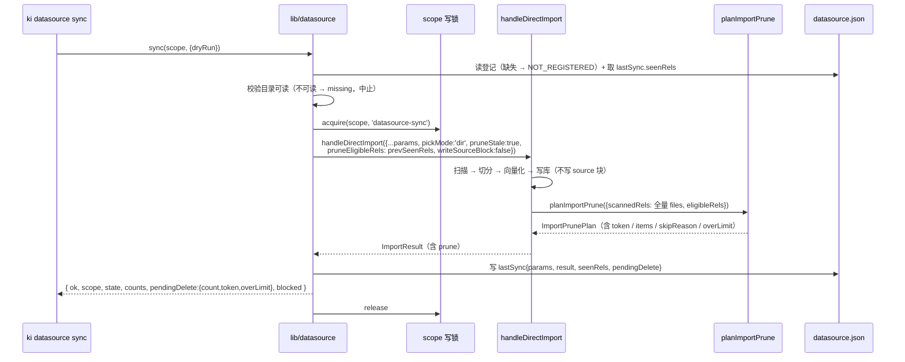

# S-02 同步编排与候选计算（`sync`：只导入 + 算候选，零删除）

> 父文档：[`DESIGN.md`](DESIGN.md) ｜ 需求：R2 / R3 / R4 / R5 / R13 / R14、N1 / N3 / N5 / N13

## 1. 术语

| 术语 | 定义 |
|---|---|
| **同步** | 读登记参数 → `handleDirectImport` → 用**全量扫描** `rel` 算待删候选 → 写 `lastSync`。**永不删除**，**不写 `source` 块** |
| **候选** | `eligibleRels ∩ 库中 sourcePath` − 本次扫描 `rel` 集合（按 `(group, relation)` 定位）。`eligibleRels` = 上一版 `lastSync.seenRels`；**首次同步为零候选** |
| **`seenRels`（候选基线）** | 本次同步**全量扫描**到的 rel 列表（与 `scannedRels` 同源同口径，含失败/跳过/预算剔除的文件），仅在 `state ∈ {ok, partial}` 时更新 |
| **`lastSync`** | 一次同步的完整快照：`params` / `result` / `seenRels` / `pendingDelete` / 时间，页面据此渲染，不读任务台账 |

## 2. 现状（AS-IS）

```
handleDirectImport(args)                                     lib/import.ts
  ├─ 扫描 collectMarkdownFiles(sourceDir, extensions)         :370, :753-755
  │     extensions = getScopeImportConfig(config, scope)?.extensions ?? DEFAULT_EXTENSIONS（:736）
  ├─ pruneStale 时：planImportPrune({ scannedRels: files })   :767-782
  │     ★ 必须用全量 files，不能用 filesForImport/budgetFiles（:765-766 注释）
  └─ 末尾：runMetadataCommit → writeJson(groupIndex) + setSource(...)   :1902-1913
        ★ 数据源同步传 `writeSourceBlock:false` 跳过 setSource（Q-C）
```

> **首次同步没有基线**：`seenRels` 只在成功同步后才有；把 `undefined` 直接透传会退化成"全 scope 差集"（见 §3.1 的警告）。

- **CLI 与 daemon RPC 都不传 `pickMode` / `pruneStale`** ⇒ 恒不产候选（`lib/import.ts:282-291` 注释明确）→ 这是本需求唯一要打通的底层缺口
- `planImportPrune` 的前置闸门：`pruneStale` / `pickMode==='dir'` / 非子集重试 / 上传完整 / 扫描数 > 0（`lib/import-prune.ts:113-122, 161-180`）

## 3. 方案（TO-BE）

### 3.1 CLI 契约

```
ki datasource sync --scope <s> [--dry-run]
```

- `--scope` **必填**（不做 `--all`）；漏写 → 退出码 1 并列出可选 scope（附各自上次同步时间）
- `--dry-run`：输出导入计划 + 候选摘要，**零写入**

**调用 `handleDirectImport` 时新增的参数**

```ts
{
  ...datasourceParams,        // dir / group / conflictMode / conflictSuffix / vector
  chunkSize, chunkOverlap,    // ★ 显式取自 datasource.json（null → 1000/150）；
                              //   import.ts 不会自己读 getSource（lib/import.ts:629-630）
  pickMode: 'dir',            // 关键：让 PrunePrecheck 通过
  pruneStale: true,           // 关键：计算候选
  pruneEligibleRels: prevSeenRels,  // ★ 新增：候选所有权基线（S-02 D6）
  onScannedFiles: (files) => { scannedForBaseline = files; },  // ★ 新增：拿到全量扫描结果写 seenRels
  uploadIncomplete: false,    // 数据源是本地目录，不存在上传会话
  preserveRels: undefined,    // 数据源无"上传失败清单"语义
  writeSourceBlock: false,    // ★ 新增：不写 group-index.json.source（Q-C）
}
```

> ⚠️ **为什么需要 `onScannedFiles` 回调**：`ImportResult` **不携带**扫描到的 rel 列表（只有 `stats.files.scanned` 计数）。若编排层自己再扫一遍目录，既多一次 IO，又可能因两次扫描之间目录变化导致 `seenRels` 与本次候选基线不一致。回调在 `collectMarkdownFiles` 之后同步触发，保证 `seenRels` 与候选计算用的是**同一份**扫描结果。
> ⚠️ 不把 `scannedRels` 塞进 `ImportResult`：它是 CLI 的 stdout 契约，几万条 rel 会把输出撑爆（且 Web 导入并不需要）。

> ⚠️ `pickMode` 与 `pruneStale` 必须**同时**传：只传 `pruneStale` 会落 `NOT_DIR_MODE`（graceful 无候选）。
> ⚠️ `pruneEligibleRels` 为空数组（首次同步）时**必须传空数组而不是 `undefined`** —— 前者语义是"没有旧基线 ⇒ 零候选"，后者会退化成"全 scope 差集"（把其他通道的文档也算进来）。

### 3.2 编排流程（时序）



### 3.3 `lastSync` 结构（写入 `datasource.json`）

```jsonc
"lastSync": {
  "at": 1760900000000,
  "durationMs": 42000,
  "state": "ok",                  // ok | partial | failed | cancelled
  "taskId": "8f2c…",              // 对应任务台账（1h 内可查，过期不影响本快照）
  "params": {                     // = toParamSnapshot('datasource-sync', args)
    "group": "wiki",
    "conflictMode": "incremental",
    "vector": true,
    "chunkSize": null,
    "chunkOverlap": null
  },
  "result": {                     // = toResultSnapshot('datasource-sync', ImportResult)
    "files": { "scanned": 128, "completed": 123, "skipped": 4, "incomplete": 1,
               "unchanged": 12, "duplicatesSkipped": 0,
               "skippedReasons": { "conflict": 2, "duplicate": 0, "other": 2 } },
    "vectorized": 430,
    "fullTextIndexed": 430,
    "groups": ["wiki/API接口文档"],
    "conflicts": [{ "path": "api/auth.md", "relation": "认证", "action": "overwrite" }],
    "failures": [{ "path": "api/oauth.md", "reason": "向量化超时" }]
  },
  "seenRels": ["api/auth.md", "api/oauth.md", "…"],  // ★ 候选基线：本次全量扫描（≤ 数万条）
  "pendingDelete": {
    "token": "a1b2c3d4e5f60718",   // ★ 只要 total > 0 就有 token（含 overLimit，2026-10-21 裁决）
    "computedAt": 1760900000000,
    "total": 12,
    "overLimit": false,            // true = 候选 > 500，需分批删除（页面显示前 500）
    "truncated": false,            // = total > items.length
    "items": [
      { "group": "wiki/old", "relation": "legacy", "sourcePath": "old/legacy.md", "untouched": true }
    ],
    "candidateSourcePaths": ["old/legacy.md"],  // ★ 全量候选（≤500 = items；超限时完整）
    "untouchedGroups": ["wiki/old"],
    "unableCount": 3,              // 库中无 sourcePath 的文档数（永不进候选）
    "eligibleCount": 120,          // 候选基线文档数（= seenRels ∩ 库中可判定文档）
    "stale": false,                // 源目录不可读 / 本次未重算 → 保留上次候选并标记
    "staleReason": null,           // 'source-missing' | 'source-unreadable' | 'not-recomputed'
    "blocked": null                // 'EMPTY_SOURCE' | 'GATE_COORD' | 'GATE_SCALE' | 'ERROR'
  }
}
```

**写入规则（`state` 决定更新哪些字段）**

| `state` | `seenRels` | `pendingDelete` | 说明 |
|---|---|---|---|
| `ok` / `partial` | **覆盖为本次全量扫描** | 覆盖为本次计算结果（`blocked` 非空时 items 为空但 `blocked` 有值） | partial 仍算成功（扫描完整，只是部分文件导入失败） |
| `failed` / `cancelled` | **保留上一版**（复制不丢） | **保留上一版**并置 `stale:true` + `staleReason:'not-recomputed'` | 否则一次失败的同步会抹掉唯一可用的候选基线与 token |

> **为什么 `seenRels` 只在 ok/partial 更新**：失败的同步可能连扫描都没完成；用它做基线会让"没扫到的文件"在下一轮被判成已删除。宁可保守（少报候选）。

**字段来源一一对应**（防两套口径漂移）：

| `lastSync` 字段 | 来源 |
|---|---|
| `params` | `toParamSnapshot('datasource-sync', args)`（`lib/task-snapshot.ts:44`，需扩 operation 白名单） |
| `result` | `toResultSnapshot('datasource-sync', result)`（同文件 `:125`，需扩 + 加 `failures`） |
| `result.failures` | **派生**：`ImportResult.incomplete`（`:212`，含 `path`/`reason`）取前 20 条；无 `incomplete` 时回落 `ImportResult.errors`（`:223`）——**`ImportResult` 没有现成的 `failures` 字段** |
| `seenRels` | `onScannedFiles` 回调拿到的**同一份** `collectMarkdownFiles(dir, extensions).files`（不是编排层另扫一次） |
| `pendingDelete` | `ImportResult.prune`（`ImportPrunePlan`，`lib/import-prune.ts:76-111`） |

### 3.4 任务台账与 `operation`

- `createTaskReporter({ source: 'cli', operation: 'datasource-sync', scope })`
- `toParamSnapshot` / `toResultSnapshot` 的 `operation !== 'import'` 判断改为白名单：`new Set(['import','datasource-sync'])`
- 前端 `OPERATION_LABEL` 加 `'datasource-sync': '数据源同步'`
- 既有的 `isLegacy` 判据（终态且无 `params` 也无 `result`）不受影响

> **台账的 `params` 只含 `{ scope, dryRun }`**（daemon RPC 在 `daemon-rpc.ts:460` 自动调 `toParamSnapshot(req.operation, req.params)`，不需要额外塞数据源配置）。完整的登记参数与 `result/seenRels/pendingDelete` 一律落 `datasource.json.lastSync`——台账只是 1h 内的实时进度载体，**不是 SSOT**。

### 3.5 daemon 与直连（**必须复用 import 的长任务形态**）

```
executeDatasourceSync(scope, opts)
  ├─ shouldUseDaemonClient()
  │    → callDaemon('datasource-sync', { ...params, jobId, dryRun }, 0, {
  │         streamProgress: true, jobId,
  │         onProgress: (e) => task.progress(e.progress),
  │      })
  │    → SIGINT：process.once('SIGINT', () => { abort(); cancelDaemonJob(jobId) })
  └─ 否则 withScopeWriteLock(scope, 'datasource-sync', () => local())
       → local 内：createTaskReporter(...) + handleDirectImport({ abortSignal, onInterrupt })
```

`daemon-dispatch.ts` 的 `HANDLERS` 注册 `'datasource-sync'`；`operation-coordinator.ts` 的 `kindForOperation` 归入 `engine-only`（与 `import` 同档）。

> **⚠ 不能只写 `callDaemon(..., timeoutMs=0)`**：同步是分钟级长任务，必须同时具备 ① 进度流（`streamProgress`）、② 取消通道（`abortSignal` / `onInterrupt` → `cancelled` 落盘）、③ 客户端不超时（`timeoutMs <= 0`，`daemon-client.ts:126-131` 明确该语义）。对照实现：`src/import.ts:157-190`（直连）与 `:272-281`（daemon）。
> **取消后的落盘口径**：`state='cancelled'`，`seenRels` / `pendingDelete` 保留上一版 + `stale`（S-02 §3.3 的写入规则表）。daemon 侧 `daemon-rpc.ts` 会自动把任务记为 `cancelled`（`:422`），但 `datasource.json` 的这个状态**必须由编排层自己写**——两者不是一回事。

## 4. 关键决策点

| # | 决策 | 被否决方案 | 否决理由 |
|---|---|---|---|
| D1 | 复用 `handleDirectImport` | 新写"数据源专用导入器" | 切分/向量化/FTS/幂等 upsert/附件收集/清洗全部要重写，且两条链路会漂移（本项目已有"两处入口各写一份判断"的教训） |
| D2 | `operation = 'datasource-sync'` + 扩 snapshot 白名单 | 复用 `operation='import'` | 任务台账无法区分"网页上传 / 手工 CLI 导入 / 数据源同步"，且 `/api/tasks` 过滤与重试语义会混淆。否决成本仅是 2 处判断 |
| D3 | `lastSync` 存 `params/result` 快照 | 只存 `taskId`，页面查 `/api/tasks/:id` | 台账 TTL 1h（`lib/task-registry.ts:160`），过期后详情页空白 |
| D4 | 同步时算候选（`pruneStale: true`） | 页面点"检查待删"时再算 | 需要额外一次全量扫描（几百 ms~数秒）且要引 HTTP 触发扫描；同步时本来就要扫描，顺带算零成本 |
| D5 | 候选明细上限 500 与单次可删上限**对齐**（沿用 `PRUNE_MAX_DETAIL === PRUNE_MAX_ITEMS`，`lib/import-prune.ts:28-33`） | 明细少、可删多 | 明细少于可删数会让用户看到「共 N 篇」却只能勾到一部分，剩余项在界面上无入口（设计评审 B-1） |
| **D6** | **候选所有权口径**：`eligibleRels = 上一版 lastSync.seenRels`；`ComputePrunePlanInput` 新增可选 `eligibleRels`，候选先在它里面收窄；闸门 B 分母取「基线内可判定文档数」 | 维持全 scope 差集 | 否则 `--group` 留空时其他通道（Web 上传 / 一次性 `ki import`）导入的文档会成为待删候选，且双闸门**拦不住**（反例见父文档 §4 第 1 行）。`eligibleRels` 缺省 `undefined` ⇒ 现有 Web 路径行为完全不变 |
| **D7** | **超限（>500）= 分批删除**：`ComputePrunePlanInput` 新增 `emitTokenWhenOverLimit`（仅数据源路径传 `true`）；`overLimit` 时仍返回前 500 条 `items` + `token`，页面按批删除、删完刷新继续 | ① `blocked='TOO_MANY'` 且不可删（初稿）；② 按 Group 分别删除（需求 R17 原文） | 现状代码在 `overLimit` 时**既不生成 token 又直接 400**（🟢 `import-prune.ts:276`、`mcp-http-api.ts:1881-1888`），CLI/页面/按组三条路全不通；按组删除还要额外定义「按组删全部」语义且单组仍可能 >500。分批删除复用现有「勾选→确认」交互，只多一行提示 |

**重新评估触发条件**：若 `PRUNE_MAX_ITEMS` 上调到 ≥2000，D5/D7 需重新评估（明细体积会撑大快照与响应）；若将来允许一个 scope 多个数据源（或引入"来源标签"），D6 必须重开（`seenRels` 无法区分两个源）。

## 5. 异常处理

| # | 场景 | 行为 | 对外暴露 |
|---|---|---|---|
| E1 | scope 无登记 | 退出码 1，`NOT_REGISTERED`，列出已登记 scope | 是 |
| E2 | 目录不存在/不可读 | `state='failed'` + `code='SOURCE_MISSING'/'SOURCE_UNREADABLE'`；**不扫描**；`seenRels` 与 `pendingDelete` **原样保留**并置 `stale:true` + `staleReason`（否则一次失败会抹掉唯一可用的基线/token） | 是 |
| E3 | 扫描到 0 个文件 | 导入阶段即抛错（`lib/import.ts:756-758`）；候选 `blocked='EMPTY_SOURCE'`；**`seenRels` 不更新** | 是 |
| E4 | 候选超 500 | 导入照常成功；`pendingDelete.overLimit=true` + 前 500 条 `items` + **token 照常生成**；页面分批删除（S-05） | 是 |
| E5 | 双闸门不通过 | 导入照常成功；`blocked='GATE_COORD'/'GATE_SCALE'` + `skipDetail`；`items` 为空 | 是 |
| E6 | 导入部分失败 | `state='partial'`；候选**照常计算**（失败文件在扫描集合内，不进候选）；`seenRels` 照常更新 | 是 |
| E7 | 中途 Ctrl+C | `state='cancelled'`；已导入部分保留；`seenRels` / `pendingDelete` 保留上一版 + `stale`（同 E2 口径） | 是 |
| E8 | 同 scope 已有任务 | `SCOPE_OPERATION_BUSY`，退出码 1 | 是 |
| E9 | `planImportPrune` 内部异常 | `blocked='ERROR'`，导入结果仍成功（fail-soft，不因候选计算失败丢掉导入成果） | 是 |
| E10 | 首次同步（无 `seenRels` 基线） | 正常导入；候选 **total=0** —— 基线为空时库里其他文档不属于本数据源 | 是（`pendingDelete.eligibleCount=0`） |

> ⚠ **E10 / 空基线的实现陷阱**：`computePrunePlan` 的闸门 A 是 `overlap / Math.min(scanned.length, libRels.length)`（`lib/import-prune.ts:236`）。若 `eligibleRels` 过滤后 `libRels.length === 0`，分母为 0 → `NaN`/`Infinity`。**必须在算闸门前早退**：`eligibleRels !== undefined && eligibleInLib.length === 0` ⇒ 直接返回零候选 plan（`skipReason` 缺省，`total:0`），不得进入闸门计算。

## 6. 影响范围

| 文件 | 改动 |
|---|---|
| `src/lib/datasource.ts` | [新增] 同步编排（读登记 → 调 import → 组装 lastSync → 原子写） |
| `src/lib/task-snapshot.ts` | [修改] 2 处 operation 判断改白名单；`toResultSnapshot` 增 `failures`（≤20 条，从 `ImportResult.incomplete`/`errors` 派生） |
| `src/lib/task-registry.ts` | [修改] `TaskResultSnapshot` 增 `failures?: {path,reason}[]` |
| `src/lib/daemon-dispatch.ts` | [修改] 注册 `'datasource-sync'` |
| `src/lib/operation-coordinator.ts` | [修改] `kindForOperation` 归 `engine-only` |
| `src/lib/import.ts` | [修改] 新增 `writeSourceBlock?: boolean`（跳过 `setSource`）、`pruneEligibleRels?: string[]`（透传给 `planImportPrune`）、`onScannedFiles?: (files: string[]) => void`（扫描后回调）；`pickMode`/`pruneStale` 已存在 |
| `src/lib/import-prune.ts` | [修改] `ComputePrunePlanInput` 增 `eligibleRels?` / `emitTokenWhenOverLimit?`；`PruneLibSnapshot` 增 `eligible` 相关计数。**缺省参数时行为与现状逐字节一致**（Web 导入页零回归） |

## 7. 待定问题

| # | 问题 | 影响 | 建议 |
|---|---|---|---|
| Q1 | `result.failures` 从哪来 | `ImportResult` **没有** `failures` 字段（🟢 `lib/import.ts:200-230`） | 已定：从 `incomplete[]`（path+reason）派生，取前 20；无则回落 `errors[]`。不在导入侧新增字段 |
| Q2 | `--dry-run` 是否需要写 `lastSync` | 写会让页面看到"未真同步"的数据 | **不写**，只在 stdout 输出 |
| Q3 | 闸门 B（删除占比）的分母 | 用全库 `judicable` 会把"删光自己全部文档"稀释成小比例（100/200=50%） | 数据源路径下分母取 **基线内可判定文档数**（`eligibleCount`），删光自己 = 100% ⇒ 命中 `GATE_SCALE`。Web 路径分母保持 `judicable` 不变 |
