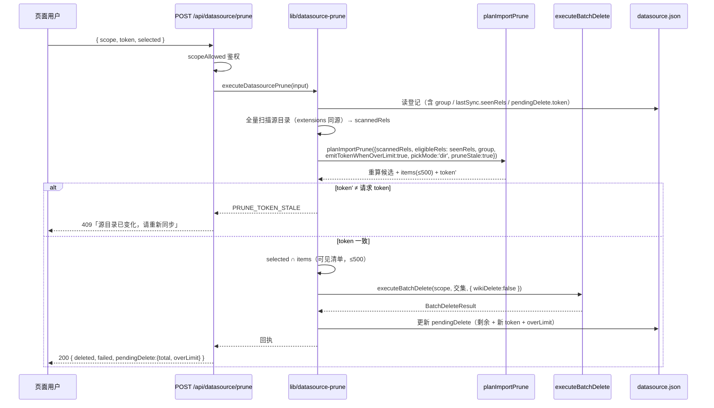

# S-03 删除链路（`POST /api/datasource/prune` + `ki datasource prune`）

> 父文档：[`DESIGN.md`](DESIGN.md) ｜ 需求：R17 / R18、N4 / N12 / N13 ｜ 复用：`REQ-20261019-001` 的 token 机制

## 1. 术语

| 术语 | 定义 |
|---|---|
| **重算** | 收到删除请求后，服务端按**当前源目录**重新扫描并算候选，不信任前端 `items` |
| **候选** | `eligibleRels ∩ 库中 sourcePath` − 本次扫描 `rel`。`eligibleRels` = `datasource.json` 的 `lastSync.seenRels`（S-02 D6）——**不是全 scope 差集** |
| **候选指纹（token）** | `sha256(排序后的 (group, relation, sourcePath) 列表)` 前 16 位；同步时算一次、删除时算一次。**候选 >500 时同样生成**（S-02 D7） |
| **交集** | 前端 `selected` ∩ 重算候选；只删交集 |
| **分批删除** | 单次最多删 500；候选更多时页面提示「已显示 500 / 共 N」，删完刷新继续 |
| **就地确认** | 页面内展开的确认条（篇数 + 不可恢复），确认前零请求（属 S-05） |

## 2. 现状（AS-IS）

```
POST /api/import/prune                                    lib/mcp-http-api.ts:1752
  ├─ 鉴权 scopeAllowed(authScopes, scope)                  :1767
  ├─ dryRun=true → 只重算返回 plan                          :1863-1866
  ├─ token 必传；重算后比对，失配 409 PRUNE_TOKEN_STALE      :1889-1896
  ├─ selected 必填（删除类接口不允许缺省为全部）              :1780-1783
  ├─ 服务端重算不信任前端清单                                :1736-1750
  └─ executeBatchDelete(scope, toDelete)                    :1911
```

- 绑定"上传会话"：`uploadId` 优先重扫暂存目录，其次用 `scannedRels`
- **数据源场景没有 uploadId**，源目录是长期存在的本地路径 ⇒ 重扫更简单且更可靠

## 3. 方案（TO-BE）

### 3.1 接口契约

`POST /api/datasource/prune`

| 项 | 内容 |
|---|---|
| 方法/路径 | `POST /api/datasource/prune` |
| 鉴权 | `scopeAllowed(authScopes, scope)`（回环免鉴权；远程 token 需该 scope 授权） |
| 请求体 | `{ scope: string, token: string, selected: {group,relation}[], dryRun?: boolean }` |
| 成功响应 | `200 { ok:true, scope, plan:{...}, deleted, failed, results[], pendingDelete:{token,total,overLimit,...} }` |
| 错误码 | `400 PRUNE_MISSING_PARAM` / `400 PRUNE_NO_DATASOURCE` / `400 PRUNE_SOURCE_UNAVAILABLE` / `400 PRUNE_EMPTY_SELECTION` / `400 PRUNE_SELECTION_TOO_LARGE`（`selected > 500`）/ `409 PRUNE_TOKEN_STALE` / `409 PRUNE_BLOCKED` / `403 scope forbidden` |

> **变化（2026-10-21）**：初稿的 `group` 请求参数**删除**——它原为"超限按组删除"服务，而超限现已改为分批删除（S-02 D7）。分组筛选仍由前端做（待删清单按组展示），但**删除请求只认 `selected`**，服务端不提供"按组删全部"的捷径（避免出现一条请求删掉整组的高危入口）。
> **`token` 与 `selected` 都是必填**（与 `/api/import/prune` 同口径：删除类接口不允许缺省为全部候选）。

**请求示例**

```json
{
  "scope": "monitot",
  "token": "a1b2c3d4e5f60718",
  "selected": [
    { "group": "wiki/old", "relation": "legacy" },
    { "group": "wiki/deprecated", "relation": "a" }
  ]
}
```

**成功响应 Demo（仅示意格式，非最终数据）**

```json
{
  "ok": true,
  "scope": "monitot",
  "deleted": 2,
  "failed": 0,
  "results": [
    { "relation": "legacy", "group": "wiki/old", "deleted": true,
      "cacheRemoved": true, "kbRemoved": true, "wikiRemoved": false,
      "fullTextRemoved": true, "memRemoved": true,
      "relationVectorRemoved": true, "relationVectorDeleted": 1 }
  ],
  "pendingDelete": {
    "token": "9f8e7d6c5b4a3210",
    "total": 10,
    "overLimit": false,
    "stale": false,
    "items": [{ "group": "wiki/deprecated", "relation": "b", "sourcePath": "deprecated/b.md", "untouched": true }],
    "truncated": false,
    "blocked": null
  }
}
```

**`dryRun: true` 响应**：只返回 `{ ok, plan }`（含 `total / items / skipped / token`），零写入 —— 用于页面刷新时重算候选。

> **与 2026-10-21 提交 `fd78f11` 的衔接**：`DeleteResult` 新增**必填**字段 `relationVectorRemoved`（以及可选的 `relationVectorDeleted` / `relationVectorReason`），数据源 prune 的 `results[]` 原样透传即可。该提交**没有**给 `executeBatchDelete` 增加 opts 参数 ⇒ **D6（`wikiDelete:false`）仍然需要实现**。

### 3.2 服务端规则（顺序不可换）

```
1. 校验 scope 非空 → 读 datasource.json（无 → PRUNE_NO_DATASOURCE）
2. 目录可读？ 否 → PRUNE_SOURCE_UNAVAILABLE（400）
3. 取候选输入三件套（★ 与同步严格同源）：
   - extensions = resolveImportExtensions(config, scope)   // D7
   - group      = datasource.json.group                    // 不用请求参数
   - eligible   = **本次扫描 ∪ pendingDelete.candidateSourcePaths**（见下方 ⚠）
4. 全量扫描 collectMarkdownFiles(dir, extensions) → 用 eligible 收窄 → 重算候选
5. 重算结果过双闸门（**两次都按 eligible 收窄后的库集合算**：闸门 A 的 `libRels` 与闸门 B 的分母 `eligibleCount` 均不含其他通道的文档）→ 不通过 → 409 PRUNE_BLOCKED（附 skipDetail）
6. 计算重算后的 token（覆盖全量候选，含 >500 的情形）；与请求 token 比对 → 失配 → 409 PRUNE_TOKEN_STALE
7. selected 与**重算返回的 items（可见清单）**取交集 → 交集为空 → 400 PRUNE_EMPTY_SELECTION；selected > 500 → 400 PRUNE_SELECTION_TOO_LARGE
8. executeBatchDelete(scope, 交集, { wikiDelete: false })
9. 更新 datasource.json.lastSync.pendingDelete（移除已删项；用剩余候选的新 token；重算 overLimit/total）
   ★ 剩余候选**直接从第 4 步的重算计划里过滤已删项**得到，**不要为更新再扫一遍目录**（否则多一次全量扫描且两次结果可能不一致）
10. 返回 deleted / failed / results / pendingDelete（含剩余 total 与 overLimit，供页面"继续删除"）
```

> **顺序不可换**：先重算再比 token（若先比 token 就无法验证"目录已变"）；先比 token 再取交集（避免删掉不在当前候选里的文档）。
> **⚠ 为什么 `eligible` 不用 `seenRels`**：同步成功后 `seenRels` 已更新为**本次扫描**，而候选恰恰是"上次见过、本次没了"的那些。用它重算会把候选清零（实现期实测：删文件后 sync 产出候选 1 篇，prune 预览 total=0）。因此同步时把**全量候选**存进 `pendingDelete.candidateSourcePaths`，prune 以「本次扫描 ∪ 候选」为基线：文件若重新出现，会落回扫描集合 ⇒ 候选减少 ⇒ token 失配 409。`seenRels` 只服务于**下一次同步**的候选评估。
> **交集对象是"可见 items"而不是全量候选**：保证"只删界面看得见的"——否则脚本可以删掉界面上没渲染出来的候选（尤其 `overLimit` 时的第 501+ 条）。
> **`overLimit` 不再阻断删除**：只要 `selected ≤ 500` 就执行，响应带剩余数；下一批由页面刷新后重新勾选。

### 3.3 时序



### 3.4 CLI 契约

```
ki datasource prune --scope <s> [--group <g>] [--yes]
```

- 默认预览（等价 `dryRun`）：打印候选（前 500 条 + `共 N 篇`）+ token + 是否 `overLimit`
- `--yes` 才执行：**每次最多删 500 条**（即预览里的可见清单），回执打印 `剩余 N 篇`，提示重复执行继续
- `--group <g>`：**只在客户端做筛选**（把 `selected` 收窄到该组，仍 ≤500）；服务端不接受 `group` 参数（无"按组删全部"入口）
- 与页面共用 `lib/datasource-prune.ts`，不各自实现
- 输出固定提示一行：「本次只删知识库记录，不动源目录文件」（`wikiDelete:false`）

## 4. 关键决策点

| # | 决策 | 被否决方案 | 否决理由 |
|---|---|---|---|
| D1 | 删除独立接口 | 在 `sync` 上加 `--yes` 边导边删 | 用户 2026-10-21 明确反转（Q12）：同步必须零破坏。合并后"确认对象"与"实际删除对象"跨两次扫描，必然错位 |
| D2 | 服务端重算 + token | 直接按前端 `selected` 删 | 前端清单是"同步那一刻"的快照；两次扫描之间目录可能已变（推演 P2） |
| D3 | 只删交集 | 全按 `selected` 删 | 若候选缩小，`selected` 里的残留 key 会删掉界面上已看不见的文档 |
| D4 | 无 uploadId，直接重扫源目录 | 复用 `/api/import/prune`（要求 uploadId 或 scannedRels） | 数据源没有上传会话；让前端每次上传 `scannedRels` 会让前端成为候选的权威来源，与 D2 冲突 |
| D5 | **超限 = 分批删除**：单次 ≤500，页面/CLI 显示剩余数，删完继续 | ① 放开 500 上限；② 按 Group 分别删除 | 放开上限会让单次请求长时间持锁并把明细响应撑大；按组删除需要额外定义"按组删全部"，且单组仍可能 >500。分批保留了 500 这个"单次爆炸半径"约束，又不把用户堵死（2026-10-21 裁决） |
| **D6** | 数据源 prune 调 `executeBatchDelete` 时**必须关闭源 .md 硬删**（`wikiDelete: false`） | 复用默认行为（会删源文件） | **P0 数据丢失**，但**设计初稿的论证是错的**（2026-10-21 核对）：候选一定带非空 `sourcePath`（`import-prune.ts:311-313`），而"sourcePath 文件不存在但约定路径存在"这一支代码**明确拒绝删除**（`delete-relation.ts:196-199` `source-mismatch`），所以不会走 `findWikiFile` 误删。**真实残余风险**：候选的 `<dir>/<sourcePath>` **确实存在**时会被 `unlinkWithinSourceDir` 硬删（典型成因 = 扩展名白名单口径分叉，D7），以及 scope 残留历史 `source` 块时删到旧目录（Q-C 后数据源不写 source 块，但历史值可能仍在）。结论不变：数据源 prune 一律 `wikiDelete:false` |
| **D7** | 候选重算的 `extensions` **必须**与导入同源：抽 `resolveImportExtensions(config, scope)`（`getScopeImportConfig(...)?.extensions ?? DEFAULT_EXTENSIONS`），`import.ts` / `mcp-http-api.ts` / `datasource-prune` 三处共用 | 各自写 `collectMarkdownFiles(dir)` 用默认 `.md` | 两次扫描集合不同 ⇒ token **恒失配**（用户每次删除都被提示"源目录已变化"）；放宽过 `.mdx` 的 scope 还会把仍在本地的大批文件判成已删。该差异在 2026-10-20 的 code review 中被定为 🔴（`mcp-http-api.ts:1824-1828` 注释原文） |

**重新评估触发条件**：若 `PRUNE_MAX_ITEMS` 上调或 `executeBatchDelete` 支持事务式批量，D5 需重开；若数据源未来支持"库删 + 源删"双删语义，D6 需重开；若 `collectMarkdownFiles` 改为从 scope 配置内部解析扩展名（不再由调用方传参），D7 自然消失。

## 5. 异常处理

| # | 场景 | 行为 | 对外暴露 |
|---|---|---|---|
| # | 场景 | 行为 | 对外暴露 |
|---|---|---|---|
| E1 | 无登记 | 400 `PRUNE_NO_DATASOURCE` | 是 |
| E2 | 目录不可读 | 400 `PRUNE_SOURCE_UNAVAILABLE`，**不删任何东西** | 是 |
| E3 | token 失配 | 409 `PRUNE_TOKEN_STALE` + 新候选摘要（供前端就地刷新） | 是 |
| E4 | 重算后闸门不过 | 409 `PRUNE_BLOCKED` + `skipDetail` | 是 |
| E5 | `selected` 空 / 全不在可见 items | 400 `PRUNE_EMPTY_SELECTION`（不静默成功） | 是 |
| E6 | 部分删除失败 | 200 + `deleted/failed` + 逐条 `reason`；`pendingDelete` 保留失败项 | 是 |
| E7 | 删除中途崩溃 | 已删的不回滚（物理删除）；`pendingDelete` 未更新 → 下次请求 token 会失配 → 强制重算 | 是（下一次） |
| E8 | 与 sync 并发 | 两者都走 `withScopeWriteLock`；冲突返回 `SCOPE_OPERATION_BUSY` | 是 |
| E9 | 远程 token 跨 scope | 403 `scope forbidden`（`rejectScopeViolation`） | 是 |
| E10 | `selected > 500` | 400 `PRUNE_SELECTION_TOO_LARGE`（提示分批：删完刷新继续） | 是 |
| E11 | 关闭源文件硬删 | 每条结果 `wikiRemoved:false` + `wikiSkipReason:'wiki-delete-disabled'`（**新增该枚举值**，不冒用 `not-configured`——那会在"已配置源目录"时给出错误解释） | 是 |
| E12 | 候选 >500（分批场景） | 正常执行（不 409）；响应 `pendingDelete.total` 为剩余数、`overLimit` 为是否仍超限 | 是 |

## 6. 影响范围

| 文件 | 改动 |
|---|---|
| `src/lib/datasource-prune.ts` | [新增] `executeDatasourcePrune()` / `planDatasourcePrune()`（重算 + token + 交集 + 回执） |
| `src/lib/import-prune.ts` | [修改] `ComputePrunePlanInput` 增 `eligibleRels?` / `emitTokenWhenOverLimit?`；闸门 B 分母支持 `eligibleCount`。**缺省参数 ⇒ 行为与现状逐字节一致** |
| `src/lib/mcp-http-api.ts` | [修改] 新增 `POST /datasource/prune` 分支（`p === '/datasource/prune'`）+ `handleDatasourcePrune()` |
| `src/datasource.ts` | [修改] 增 `prune` 子命令 |
| `src/delete-relation.ts` | [修改] **D6**：`executeBatchDelete(scope, items, opts?: { wikiDelete?: boolean })` 与 `executeDeleteRelation(..., { wikiDelete })` 增加开关，默认 `true`（既有 CLI/HTTP 行为不变）；数据源 prune 传 `false`。同步改 `daemon-dispatch.ts` 的 `batch-delete` handler 透传该开关（**daemon 路径漏改会让保护失效**） |
| `src/lib/import-path.ts`（或 `config.ts`） | [修改] 新增 `resolveImportExtensions(config, scope)`；`import.ts:736` 与 `mcp-http-api.ts:1827` 改为调用它（D7，消除三处各写一份） |

## 7. 待定问题

| # | 问题 | 影响 | 建议 |
|---|---|---|---|
| ~~Q1~~ | ~~`executeBatchDelete` 是否要禁止删源文件~~ | **已核实并解决**（论证已按 2026-10-21 核对重写，见 D6） | 已定 |
| Q2 | 删除后是否要重新导入 | 不需要 | 删除只降不升；下次 sync 会补回（若文件又出现） |
| Q3 | `wikiDelete:false` 是否要在 CLI 输出里体现 | 用户可能疑惑"为什么没删源文件" | 数据源 prune 的输出固定一行提示："本次只删知识库记录，不动源目录文件" |
| Q4 | 分批删除时 `pendingDelete.token` 的更新时机 | 删完一批后剩余候选的 token 会变 | 删除成功后**立即**用重算结果的 token 覆写（S03 步骤 9），使页面"继续删除"无需重新同步；仅当源目录在此期间真的变了才会 409 |
