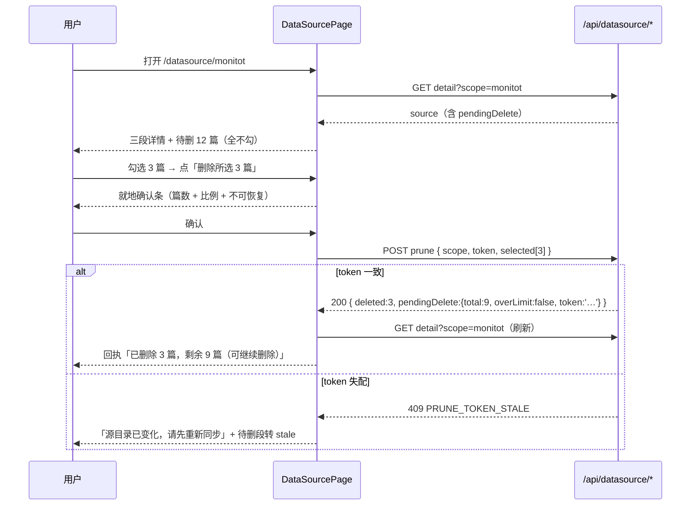

# S-05 前端页面（列表 / 详情 / 待删段 / 总览卡）

> 父文档：[`DESIGN.md`](DESIGN.md) ｜ 需求：R7 / R8 / R17 ｜ 接口：S-04（读）、S-03（删）
> 界面以需求 v6 §10 已确认的 ASCII 为准（原图内嵌，不重画）

## 1. 术语

| 术语 | 定义 |
|---|---|
| **数据源页** | 侧边栏第 6 项，列表（跨 scope 一行一 scope） |
| **详情页** | 单 scope 的数据源详情，与**任务详情同构**（三段 + 待删段） |
| **待删段** | 详情页里唯一可写区域：按 Group 分组勾选 → 就地确认 → 删除 |
| **就地确认** | 展开在按钮附近的确认条（篇数 + 不可恢复），确认前零请求 |
| **组件抽取** | 把 `TasksPage.tsx` 的私有渲染组件移到 `components/`，两页共用 |

## 2. 现状（AS-IS）

| 位置 | 现状 |
|---|---|
| `web/src/router/routes.tsx:12-23` | 7 条路由，无 data source |
| `web/src/layouts/AppShell.tsx:61-70` | `NAV_MAIN` 5 项；顶栏标题复用同一数组（`AppShell.tsx:257-259`） |
| `web/src/components/icons.tsx:9-84` | 图标表**无 database 类**图标 |
| `web/src/pages/TasksPage.tsx:51-146` | `TaskProgressBar` / `SectionTitle` / `RowList` / `ItemTree` 均为**私有函数**，无法跨页复用 |
| `web/src/lib/taskDetailModel.ts:14-62` | `DetailRow` / `DetailItem` / `TaskNotice` 类型已 export |
| `web/src/pages/DashboardPage.tsx:328-331` | 第 4 卡「注册」= `list.filter(x=>x.registered).length` |
| `ki.css` | `.ki-task-detail__*` / `.ki-task-tree*` / `.ki-task-notice*` / `.ki-task-state--*` 全部现成 |

## 3. 方案（TO-BE）

### 3.1 新增/修改文件

```
web/src/
├── pages/
│   ├── DataSourcePage.tsx            # [新增] 列表（跨 scope）
│   └── DataSourceDetailPage.tsx      # [新增] 详情（或同文件内的条件渲染）
├── components/
│   ├── TaskDetailParts.tsx           # [新增] SectionTitle / RowList / ItemTree / TaskProgressBar（从 TasksPage 抽出）
│   └── icons.tsx                     # [修改] 增 database 图标
├── lib/
│   ├── syncDetailModel.ts            # [新增] buildDataSourceDetail(ds) → 与 TaskDetailView 同构
│   └── hooks.ts                      # [修改] useDataSourceList / useDataSourceDetail
├── api/httpApi.ts                    # [修改] getDataSourceList / getDataSourceDetail / pruneDataSource
├── router/routes.tsx                 # [修改] /datasource + /datasource/:scope
├── layouts/AppShell.tsx              # [修改] NAV_MAIN 插入 { to:'/datasource', label:'数据源', icon:'database' }
└── pages/DashboardPage.tsx           # [修改] 第 4 卡改数据源数
```

### 3.2 路由与导航

```
/datasource              → DataSourcePage（全宽列表）
/datasource/:scope       → DataSourcePage（列表 + 右侧详情抽屉，520px）
```

选中态由 URL 参数驱动（`/datasource/monitot` 直接可分享/刷新可恢复）。**2026-10-21 用户定稿改为「列表 + 右抽屉」**：不再用 TasksPage 式左右分栏；抽屉打开时主区右让 536px、列表降为 Scope/源目录/状态 三列，避免被抽屉盖住；窄屏（<960px）抽屉全宽。

### 3.3 列表页

- 数据源：`useDataSourceList()`（`queryKey: ['datasourceList']`，`staleTime: 15_000`）
- 列：Scope / 源目录（`~` 缩写 + `title` 全路径）/ 落点 Group（长值截断 + `title`）/ 上次同步（相对时间）/ 状态（`ki-task-state--*` 胶囊）；有 `pendingDelete.total > 0` 时在状态列前加「待删 N」小徽标（点击进详情）
- 顶部副标题：「共 N 个 · M 个超过 24h 未同步」
- 空态：`ki-empty`，文案「还没有数据源。数据源只能通过命令行登记：`ki datasource add --scope <scope> --source <目录>`」（**纯文本，不提供复制按钮**）
- `missing[]` 与 `migrationHints[]` 各渲染为一条 `ki-task-notice--warn`，不混进表格
- 列表**不提供任何动作**：无同步、无删除、无复制命令

**2026-10-21 定稿（用户走查）**：列表改**全宽六列表格**（Scope / 源目录 / 落点 Group / 上次同步 / 状态 / 待删）；`上次同步` 显示**绝对时间** `YYYY-MM-DD HH:mm:ss`（不再相对时间）；**客户端分页默认 10，可选 50 / 100**（页脚：`第 X / Y 页 · 共 N 个` + 每页选择 + 上一页/下一页）；卡片标题由「已登记」改为「数据源」。

### 3.4 详情页（与任务详情同构）

```
buildDataSourceDetail(source) → {
  header: { title:'数据源同步', state, stateLabel },
  params: DetailRow[],        // 知识库 / 源目录 / 落点 Group / 同名策略
  results: DetailRow[],       // 扫描·新增·更新·跳过·失败（双列 + hint）
  details: { failures: DetailItem[], conflicts: DetailItem[] },
  times: DetailRow[],         // 上次同步 / 用时
  pending: {
    total, items, groups: { group, count }[],
    token, computedAt, truncated, blocked, untouchedGroups,
    overLimit, eligibleCount, stale, staleReason
  },
  notices: TaskNotice[]
}
```

**渲染复用**：`SectionTitle` / `RowList` / `ItemTree` / `TaskProgressBar` 从 `components/TaskDetailParts.tsx` 引入；样式零新增（全部 `.ki-task-detail__*` / `.ki-task-tree*`）。

**不显示**：命令行、可复制按钮、同步按钮、编辑入口。

### 3.5 待删段（唯一写区域）

**状态机**

```
idle ──勾选──▶ selected(>0)
  │                │
  │                ├─ 点「删除所选 N 篇」──▶ confirming（就地确认条）
  │                │        ├─ 取消 ──▶ selected（勾选保留）
  │                │        └─ 确认 ──▶ submitting（按钮 loading，禁用勾选）
  │                │                ├─ 200 ──▶ 回执 + 刷新详情（pendingDelete 缩小）
  │                │                ├─ 409 STALE ──▶ stale 提示（含"请重新同步"文案）
  │                │                └─ 其他错误 ──▶ 就地错误行 + 可重试
  │                └─ 全不勾 ──▶ idle（按钮 disabled）
  └─ blocked != null ──▶ 不可操作态（展示 blocked 原因，无勾选框）
  └─ stale = true ──▶ 仍可操作（候选来自上次同步）+ 顶部提示；服务端重算失败会返回 400/409
```

**勾选规则**

| 规则 | 说明 |
|---|---|
| 默认 | **全不勾**（破坏性不给默认值） |
| 组头 | 三态 checkbox（`indeterminate` 必须设置，否则"部分选中"会画成"已全选"） |
| 组头勾选 | 只作用于该组**可见**项 |
| `untouched` 组 | 组头加 `⚠ 本次未涉及` + 「勾选即清空整组（N 篇）」 |
| 提交 | `selected` 与**当前渲染的可见清单**取交集（防残留 key 删掉界面上看不见的文档） |
| 超限（`overLimit`） | 清单只渲染前 500 条，顶部常显「已显示 500 / 共 N 篇 · 删除后刷新继续」；每次提交 ≤500 |

**确认条文案**（含 20% 提示）

```
将删除 12 篇（本数据源 128 篇的 9.4%）· 不可恢复
[取消]  [确认删除]
```

> 比例分母 = `pendingDelete.eligibleCount`（本数据源基线内文档数），不是全库文档数——否则删光自己的全部文档也只显示 50%，低估后果。
> 超过 20% 时追加一行 `ki-task-notice--warn`：「本次将删除本数据源 23% 的文档，比例偏高，请确认源目录无误」。

**`blocked` / `stale` / `overLimit` 呈现**

| 状态 | 文案 | 可选操作 |
|---|---|---|
| `blocked='EMPTY_SOURCE'` | 源目录里没有可导入文件，未生成候选 | 无 |
| `blocked='GATE_COORD'` | 与库中记录路径重合率过低（源目录可能不是同一个） | 无 |
| `blocked='GATE_SCALE'` | 待删占比过高（>80%），已拒绝生成候选 | 无 |
| `blocked='ERROR'` | 候选计算失败（不影响导入） | [重试]（调 `dryRun` 重算） |
| `stale=true` | 「候选来自上次同步（源目录当前不可读 / 本次未重算）」+ `staleReason` 文案 | [重新同步]（仅提示命令，页面不能触发） |
| `overLimit=true` | 「已显示 500 / 共 N 篇；删除后刷新继续」 | 正常勾选删除（≤500/批） |

### 3.6 总览卡替换

```tsx
// DashboardPage.tsx:328-331
<div className="ki-stat-card">
  <div className="ki-stat-label">数据源</div>
  <div className="ki-stat-value">{dsList?.total ?? '—'}</div>
</div>
```

- 加载中显示 `—`（不显示假 0）
- **保留 `useScopeList`**（`HealthList` 仍消费 `ftsDocCount`，`DashboardPage.tsx:395`）
- `registered` 不再有任何页面呈现处（`ScopeSelect.tsx:18` 仅作默认值兜底）

### 3.7 关键交互时序



> `overLimit` 不影响删除流程：删除成功后 `pendingDelete` 更新为剩余候选，页面重新渲染下一批（仍是前 500 条），用户可继续勾选。

## 4. 关键决策点

| # | 决策 | 被否决方案 | 否决理由 |
|---|---|---|---|
| D1 | 抽取 `TaskDetailParts` 共用 | 在 DataSourcePage 里复制一份 `RowList/ItemTree` | 两套渲染会在"hint 取舍 / 折叠阈值 / 树的 meta 去重"上立刻漂移（本项目已因两处口径分叉吃过亏） |
| D2 | `buildDataSourceDetail` 新函数，不伪造 `TaskRecord` | 把 `lastSync` 包成假 `TaskRecord` 喂 `buildTaskDetail` | `TaskRecord` 有 12+ 必填字段（`heartbeatAt/phase/progress/error/retryOf`…），伪造出来的对象一旦被别的分支读到就是脏数据 |
| D3 | 详情用**右侧抽屉**（URL 参数驱动） | ① 左右分栏（TasksPage 同款）；② 弹窗 | 用户 2026-10-21 定稿：列表需要全宽展示 6 列（Scope/源目录/落点/上次同步/状态/待删），分栏会把列表压成侧栏；抽屉宽 520px 可容纳同步参数与待删段，且可点遮罩/Esc 关闭 |
| D4 | 待删默认全不勾 | 默认全选 | 破坏性操作不能有默认值（推演 P24 的取舍已确认） |
| **D5** | 超限走**分批删除**（前 500 条 + 删完刷新继续） | ① 按 Group 删除；② 前端虚拟列表一次渲染全部 | 按组删除需要额外定义"按组删全部"且单组仍可能 >500；虚拟列表只解决渲染，不解决"单次删除上限"。分批复用现有勾选交互，且**删除成功后服务端立即换发新 token**（S-03 步骤 9），所以"多次请求必然失配"的旧结论不成立（初稿 D5 作废） |
| D6 | 列表与详情拆页 | 单页展开行 | 待删清单可能 500 条，展开行会把列表撑爆 |

**重新评估触发条件**：若 `PRUNE_MAX_ITEMS` 上调到 ≥2000，D5/D6 需重开（前端虚拟列表 + 更大的单批上限）。

## 5. 异常处理

| # | 场景 | 行为 | 对外暴露 |
|---|---|---|---|
| E1 | 列表接口失败 | `ki-empty` + 错误行 + [重试] | 是 |
| E2 | 无数据源 | 空态 + 一行命令说明（不可复制） | 是 |
| E3 | 详情 404（未登记 / 已 remove） | 提示 + [返回列表] | 是 |
| E4 | 同步进行中（`running:true`） | 详情页顶部 `ki-task-state--running` 胶囊 + 「同步进行中」；待删段**只读**（禁用勾选，避免与写入竞争） | 是 |
| E5 | 删除 409 token 失配 | 就地提示「源目录已变化，请先重新同步」；勾选清空；提供 [刷新候选]（调 `dryRun` 重算） | 是 |
| E6 | 删除部分失败 | 回执行内列出失败项（`ki-task-tree--list`）+ 待删段保留失败项 | 是 |
| E7 | 目录不可读（`missing`） | 列表顶部 `ki-task-notice--warn`（**不混进表格**，与 S-04 的 `missing[]` 口径一致）；详情页待删段转 `stale`，显示上次已知结果 | 是 |
| E8 | 网络中断在确认后 | 按钮恢复可用 + 错误行；**不自动重试**（删除类操作不重试） | 是 |
| E9 | 页面在删除中刷新 | 重新拉详情；已删的项自然消失；`pendingDelete` 由服务端权威 | 是 |

## 6. 影响范围

| 文件 | 改动 | 回归风险 |
|---|---|---|
| `TasksPage.tsx` | 删除 4 个私有组件，改从 `TaskDetailParts` 引入 | **任务详情页零行为变化**（纯搬移 + export）；需跑 web 单测 + 手测详情页 |
| `AppShell.tsx` | `NAV_MAIN` 插一项 | 顶栏标题自动跟随（`currentLabel` 复用同数组） |
| `DashboardPage.tsx` | 第 4 卡换数据源 | 保持 4 列版式（`ki.css:605` 固定 `repeat(4, …)`） |
| `icons.tsx` | 新增 `database` 图标 | `IconName` 类型自动扩展 |
| `ki.css` | **可能零改动**（复用 `.ki-task-*`）；若需待删段样式，只在 `.ki-datasource-*` 新增 | 不改既有类 |

## 7. 待定问题

| # | 问题 | 影响 | 建议 |
|---|---|---|---|
| Q1 | 详情页是否需要「同步进行中」的进度条 | S-02 的 sync 是长任务（数百篇数分钟） | 需要：复用 `TaskProgressBar` + `progressPercent`，数据来自 `/api/tasks` 的 running 记录 |
| Q2 | 列表是否显示 `pendingDelete.total > 0` 的徽标 | 用户可能不知道有待删 | 显示小徽标「待删 12」（点击进详情） |
| Q3 | 窄屏（<960px）下主从布局如何退化 | `TasksPage` 已有同款媒体查询可抄 | 详情改为整页覆盖（列表隐藏），返回时回列表 |
