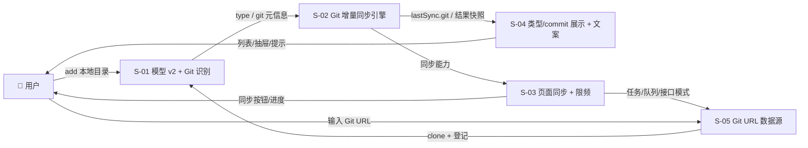
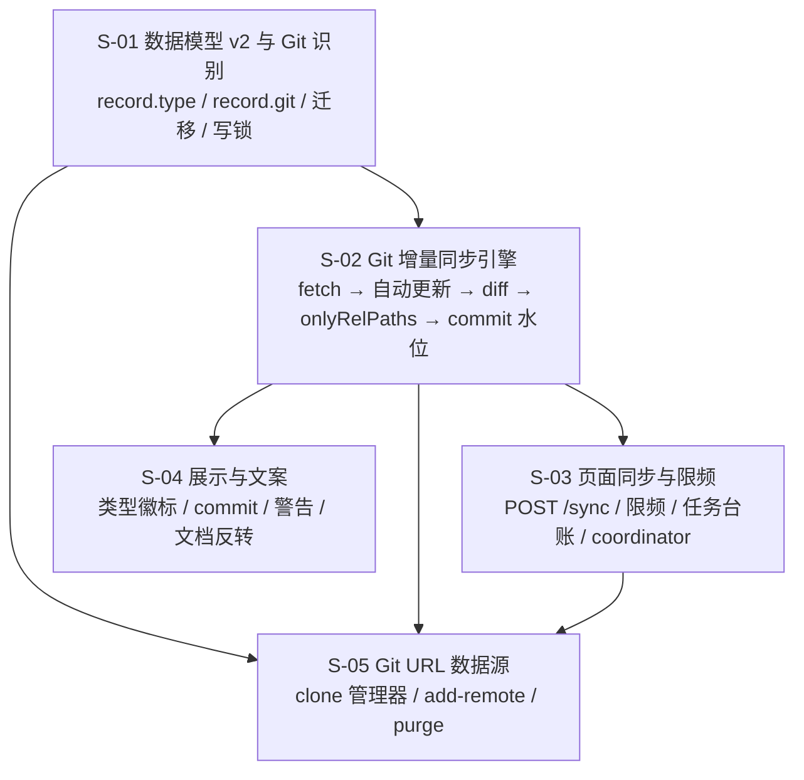
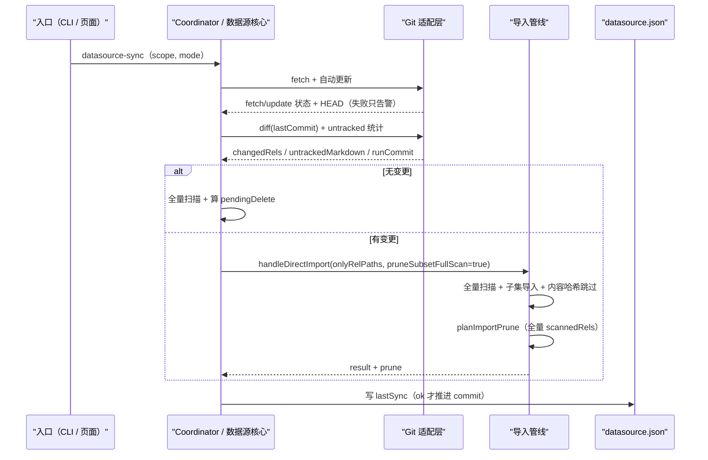

# 数据源 Git 增量同步与页面操作 — 总体设计

> 需求：`REQ-20261021-003`（v2，已确认）
> 依赖：`REQ-20261020-001`（数据源登记与同步）
> 设计版本：v1（2026-10-21）
> 交付：批次 A（S-01~S-04）+ 批次 B（S-05）

---

## 1. 需求背景 & 目标

数据源当前是「全量扫描 + 内容哈希跳过」：能避免重复 embedding，但每次仍清洗/切分/哈希全部文件，也没有 commit 追踪；页面只读，登记与同步只能在 CLI；数据源没有类型概念。

本设计要达成：

- **Git 增量**：记录 commit 水位，同步前 fetch + 自动更新，只把 tracked 变更送入导入；删除仍只进待删候选。
- **页面操作**：可同步、可添加 Git URL 数据源；非 Git 目录 30 分钟限频；CLI 始终可强制。
- **可解释**：展示类型、仓库/分支/commit、本次增量、未跟踪警告、fetch/update 警告。

**不在范围内**：定时/后台自动同步；页面输入服务器本地目录；一 scope 多数据源；submodule / Git LFS；私有仓库凭据 UI；页面同步取消（Q10 后置）。

---

## 2. 关键环节一览图

---

## 3. 总体方案设计

### 3.1 子需求与职责

| 子需求 | 一句话职责 | 批次 |
|---|---|---|
| S-01 | 定义 `DataSourceRecord` v2、Git 探测、旧记录迁移与写锁 | A |
| S-02 | 实现 Git 同步状态机：自动更新、变更集、增量导入、commit 水位、未跟踪警告 | A |
| S-03 | 服务端页面同步接口、30 分钟限频、任务台账与 coordinator 接入 | A |
| S-04 | 页面类型/commit/警告展示、同步按钮、文案与文档反转 | A |
| S-05 | 托管 clone、URL 安全、页面/CLI 添加 Git URL 数据源与 `--purge` | B |

### 3.2 同步主流程（全局）

---

## 4. 全局风险 & 跨子需求依赖

### 4.1 全局风险

| 风险 | 触发条件 | 影响 | 缓解 |
|---|---|---|---|
| 自动更新破坏本地工作区 | 本地 git 数据源有分叉/未提交修改 | 用户本地改动被覆盖 | 只允许 `merge --ff-only`；失败告警并继续本地内容；绝不 reset 本地仓库 |
| 子目录数据源更新整个仓库 | 数据源是仓库子目录 | 仓库其他目录文件也被更新 | 文档/页面显式提示；仍只导入 `relativeRoot` 下的变更 |
| untracked 静默停更 | 源目录存在未跟踪文档 | 变更不同步 | 每次同步计数 + 页面/CLI 警告 + `--full` 出口 |
| 待删候选停算 | 直接给 `onlyRelPaths` 复用旧 `SUBSET_RETRY` | 删除提醒消失 | 新增 `pruneSubsetFullScan`，全量扫描仍作为候选基线 |
| commit 水位误推进 | partial/cancelled/failed 也推进 | 失败文件永久漏同步 | 仅 `state=ok` 推进；`commit` 与 `runCommit` 分离 |
| `datasource.json` 并发写 | 页面同步 + CLI add/remove 并发 | 字段丢失/覆盖 | `add/remove/sync` 全部持 `withScopeWriteLock`（嵌套锁自动复用） |
| 页面写入口越权 | 新 POST 接口漏鉴权 | 跨 scope 写入 | 所有新接口走 `scopeAllowed`；按 scope 过滤 |
| daemon 无 git 凭据 | SSH agent / credential helper 不在 daemon 环境 | fetch/clone 认证失败 | 错误映射 + 文档指引；不把认证失败报成仓库不存在 |
| 旧 daemon 降级记录 | 新 CLI + 旧 daemon 写 `datasource.json` | type/git 字段丢失 | 升级后必须重启 daemon；文档标注混合版本不支持 git 数据源 |
| clone 清理不彻底 | clone 中断/失败 | 半成品目录 + 磁盘占用 | 失败清理 + `remove --purge` + 路径守卫 |

### 4.2 跨子需求依赖与契约

| 契约 | 定义位置 | 消费方 | 备注 |
|---|---|---|---|
| `DataSourceRecord` v2（`type` / `git`） | S-01 | S-02/S-03/S-04/S-05 | 旧记录读取默认 `directory` |
| `lastSync.git`（`commit` / `runCommit` / 统计 / 警告） | S-02 | S-03/S-04 | `commit` 是下次 diff 的水位 |
| `pruneSubsetFullScan` | S-02（`import.ts` 新增可选参数） | 数据源核心 | 默认 `false`，Web 导入行为不变 |
| `syncAvailability` | S-03（`datasource-policy.ts`） | S-04 | 页面只展示，服务端仍强制 |
| `POST /api/datasource/sync` | S-03 | S-04 | 返回 `taskId` |
| `POST /api/datasource/add-remote` | S-05 | S-04 | 托管 clone + 登记 + 入队首次同步 |
| `DataSourceSummary/Detail` 新字段 | S-04 | Web | 旧 daemon 缺字段时前端降级 |

### 4.3 共享术语速查

| 术语 | 定义 |
|---|---|
| `repoRoot` | Git 仓库根绝对路径，可能是数据源目录的祖先 |
| `relativeRoot` | 数据源目录相对 `repoRoot` 的 posix 前缀；仓库根为 `''` |
| `commit` | 上次成功同步推进的水位，下次 diff 的起点；partial/失败不推进 |
| `runCommit` | 本次自动更新完成后、扫描开始前捕获的 HEAD |
| `onlyRelPaths` | 导入子集白名单；Git 增量只放 tracked 变更 |
| 全量扫描 | `collectMarkdownFiles` 的结果；用于 `seenRels` 与 `pendingDelete`，与 `onlyRelPaths` 独立 |
| `pendingDelete` | 待删候选；同步只计算，永不自动删除 |
| `--full` / `mode='full'` | 忽略 commit diff，处理全部文件（含 untracked） |
| managed clone | 工具托管的远端仓库副本，位于 `~/.ki/datasources/<scope>/repo` |
| `syncAvailability` | 页面同步可用性：`active` / `cooldown` / 允许 |

### 4.4 默认非功能性假设

| 维度 | 默认假设 | 备注 |
|---|---|---|
| 部署形态 | 单机、单 daemon、同一 scope 同时只有一个同步任务 | coordinator 已串行；不承诺多 daemon 并发写 |
| 数据规模 | 单仓库变更集 < 64MB、源目录 < 导入预算（20k 文件 / 4GiB / 300k chunks） | 超限 fail-loud；超大仓库后续再评估流式 diff |
| 外部依赖 | 本机 `git` 可用；远端 git 服务的网络/凭据由运行环境提供 | fetch 失败只告警；clone 失败任务失败 |
| 超时 | fetch 15s / merge·reset 30s / diff 60s / clone 10min | 均可后续配置化 |
| 页面轮询 | 列表 15s、抽屉 3s（active）/ 15s | 复用现有 hooks |
| 一致性 | 文档在同步完成后可见；同步中的中间态由既有 read lane 承担 | 不新增实时一致性要求 |
| 安全边界 | Git URL 由用户主动输入，信任级与 CLI 相同；不存储凭据 | 拒绝 `ext::` / 凭据 URL |
