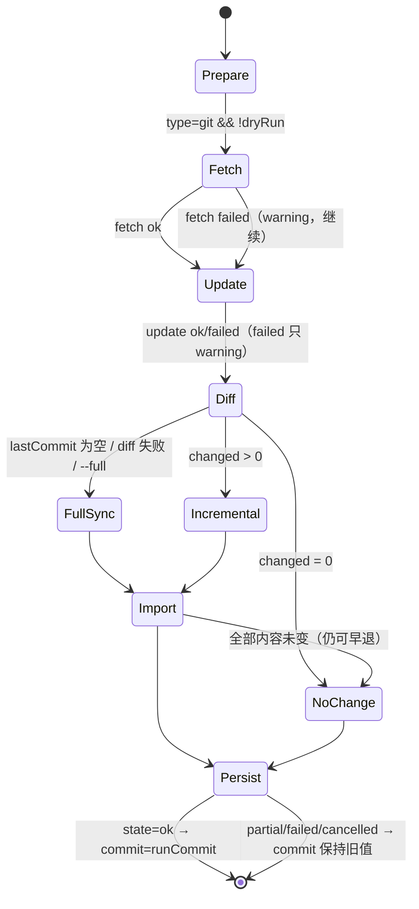
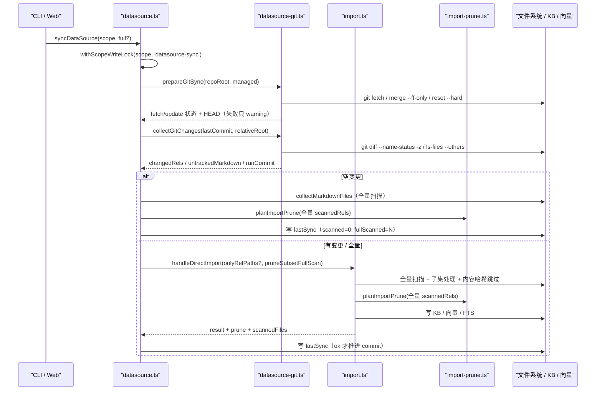

# S-02 Git 增量同步引擎 — 详细设计

> 父文档：[DESIGN.md](./DESIGN.md)
> 依赖：[S-01](./S01_数据模型与Git识别_DESIGN.md)
> 被依赖：S-03 / S-04 / S-05

---

## 1. 术语

| 术语 | 定义 |
|---|---|
| 自动更新 | `git fetch` 后按类型执行 `merge --ff-only`（本地）或 `reset --hard origin/<branch>`（托管 clone） |
| 变更集 | `git diff <lastCommit> -- <relativeRoot>` 中状态为 A/M/T/C/U 的 tracked 文件（相对数据源目录） |
| untracked | `git ls-files --others --exclude-standard` 中可导入的文件；**不进入变更集**（Q2） |
| `commit` 水位 | 上次 `state=ok` 推进的 commit；下次 diff 的起点 |
| `runCommit` | 本次自动更新完成后、扫描开始前捕获的 HEAD |
| 全量扫描 | `collectMarkdownFiles` 结果，用于 `seenRels` 与 `pendingDelete` |
| 空变更 | 变更集为空；不调用导入，但仍算候选、写快照 |

---

## 2. 现状（AS-IS）

| 事项 | 现状 | 证据 |
|---|---|---|
| 同步编排 | `syncDataSource` = 目录校验 → `handleDirectImport`（全量）→ `onScannedFiles` 写 `seenRels` → 落 `lastSync` | `src/lib/datasource.ts:533-650` |
| 导入子集 | `onlyRelPaths` 可只处理白名单文件；未列出的文件不读、不切、不向量化 | `src/lib/import.ts:267-273`、`:954-968` |
| 待删候选 | 传入非空 `onlyRelPaths` ⇒ `subsetRetry=true` ⇒ prune 前置校验直接跳过 | `src/lib/import.ts:797`、`src/lib/import-prune.ts:185` |
| 全量扫描 | `onScannedFiles(files)` 在 `onlyRelPaths` 过滤**之前**回调 | `src/lib/import.ts:776-781` |
| 内容级增量 | 每个文件仍清洗/切分/哈希，内容未变才跳过重算 | `src/lib/import.ts:1171-1186` |
| commit | 无任何 Git 概念 | `src/lib/datasource-types.ts:95-113` |
| 任务参数 | `toParamSnapshot` 已支持 `datasource-sync`，但无 `type/mode` | `src/lib/task-snapshot.ts:44-75` |
| 锁 | `handleDirectImport` 会持 scope 写锁；`syncDataSource` 自身未持锁 | `src/lib/import.ts:635-636` |

---

## 3. 方案（TO-BE）

### 3.1 状态机



### 3.2 Git 适配层（扩展 `src/lib/datasource-git.ts`）

```ts
export interface GitUpdateResult {
  fetch: 'ok' | 'failed' | 'skipped';
  fetchDetail?: string;
  update: 'updated' | 'up-to-date' | 'skipped' | 'failed';
  updateDetail?: string;
  branch: string | null;
  headCommit: string | null;
  headSubject: string | null;
  headAuthorTime: number | null;
}

export async function prepareGitSync(input: {
  repoRoot: string;
  managed: boolean;
  branch: string | null;
  timeoutMs?: number;
}): Promise<GitUpdateResult>;

export interface GitChangeSet {
  changedRels: string[];
  untrackedMarkdown: number;
  deletedCount: number;
  headCommit: string | null;
  /** lastCommit 不可解析时为 true（调用方走全量） */
  commitUnknown: boolean;
}

export async function collectGitChanges(input: {
  repoRoot: string;
  relativeRoot: string;
  lastCommit: string | null;
  extensions: string[];
  timeoutMs?: number;
}): Promise<GitChangeSet>;
```

#### `prepareGitSync`

1. `git -C <repoRoot> remote` → 无 remote：`fetch='skipped'`、`update='skipped'`，直接返回当前 HEAD。
2. `git -C <repoRoot> fetch`（timeout 15s，`LC_ALL=C`，`GIT_TERMINAL_PROMPT=0`，`maxBuffer=8MB`）。
   - 失败：`fetch='failed'` + stderr 尾部（脱敏、≤500 字），**继续**。
3. 更新：
   - `managed=true`：解析远端分支（`git.rev-parse --abbrev-ref @{u}` 或 `origin/<branch>`）→ `git reset --hard <upstream>`；失败 → `update='failed'` + detail，**继续**。
   - `managed=false`：无 upstream → `update='skipped'`；有 upstream → `git merge --ff-only <upstream>`；成功且 HEAD 变化 → `updated`，无变化 → `up-to-date`；失败 → `update='failed'` + detail（如 "Not possible to fast-forward" / "Your local changes would be overwritten"），**继续**。
4. `git rev-parse HEAD`、`git log -1 --format=%s%n%ct`（subject / authorTime）；空仓库 → `headCommit=null`。
5. 不改变用户本地仓库的提交历史，不产生 merge commit，不 reset 本地仓库。

#### `collectGitChanges`

1. `lastCommit` 为空 → `{ commitUnknown: false, changedRels: [], untrackedMarkdown: <统计>, headCommit }`，调用方走全量。
2. `git diff --name-status -z --no-renames <lastCommit> -- <relativeRoot>`：
   - `-z` 输出格式（已实测）：`<status>\0<repoRelativePath>\0` 循环。
   - 状态：`A/M/T/C/U` 进入候选；`D` 只计入 `deletedCount`，不导入（全量扫描会把它送进待删候选）。
   - `--no-renames`：重命名表现为 `D old` + `A new`，新路径导入、旧路径由 prune 处理。
   - 失败：
     - `bad object` / `unknown revision` / `not a valid object` → `commitUnknown=true`（调用方全量 + warning）。
     - 其他错误 → 抛 `GIT_DIFF_FAILED`，调用方全量 + warning。
3. 过滤：
   - 只保留导入扩展名（`resolveImportExtensions(config, scope)`）。
   - 排除路径中任一段以 `.` 开头或等于 `node_modules`（与 `collectMarkdownFiles` 同口径）。
   - 按 `relativeRoot` 去前缀；`relativeRoot=''` 时保留全部。
4. untracked：
   - `git ls-files -z --others --exclude-standard -- <relativeRoot>`。
   - 只统计可导入 + 可扫描的路径；**不进入 `changedRels`**。
5. `git rev-parse HEAD` 作为 `headCommit`。
6. 路径解码为 UTF-8；`maxBuffer=64MB`，超限抛 `GIT_CHANGESET_TOO_LARGE`。

### 3.3 `syncDataSource` 编排

新增输入：`full?: boolean`、`onPhase?: (phase: 'git-fetch' | 'git-update' | 'git-diff') => void`。新增输出字段：`mode`、`git?`、`warnings`。

**校验顺序（必须调整，challenger 意见1）**：

| 类型 | 顺序 |
|---|---|
| `type=directory` | 沿用现有顺序：`checkSourceDir` → 导入 |
| `type=git && !dryRun` | ① `checkSourceReachable(dir)`（仅 stat/access；缺失/不可读 fail-loud）→ ② `prepareGitSync`（fetch + 自动更新）→ ③ `checkSourceDir`（空源/扩展名/dataDir 边界，针对**更新后**的工作区）→ ④ diff/导入 |
| `type=git && dryRun` | 不更新；按当前工作区执行 `checkSourceDir` |

> 原因：自动更新可能新增/删除文件。若在更新前判空，空工作区会直接 `SOURCE_EMPTY` 返回，fetch/update 永远不执行；即使远端之后恢复文档，数据源也永久失败。

伪代码：

```ts
async function syncDataSource(input) {
  // 非 dry-run 持 scope 写锁（handleDirectImport 内部同锁嵌套复用）
  return input.dryRun ? syncUnlocked(input) : withScopeWriteLock(scope, 'datasource-sync', () => syncUnlocked(input));
}

async function syncUnlocked(input) {
  const record = readDataSource(scope);
  const prevCommit = record.lastSync?.git?.commit ?? null;
  const warnings: DataSourceWarning[] = [];

  // 0. 校验顺序（见上表）：directory 先 checkSourceDir；git 先可达性
  if (record.type === 'directory') {
    const dirCheck = checkSourceDir(record.dir, config, scope);
    if (!dirCheck.ok) return fail(dirCheck.code, dirCheck.error);
  } else if (!input.dryRun) {
    const reachable = checkSourceReachable(record.dir);
    if (!reachable.ok) return fail(reachable.reason === 'missing' ? 'SOURCE_MISSING' : 'SOURCE_UNREADABLE', reachable.reason);
  } else {
    // git + dry-run：不更新，按当前工作区校验
    const dirCheck = checkSourceDir(record.dir, config, scope);
    if (!dirCheck.ok) return fail(dirCheck.code, dirCheck.error);
  }

  // 1. Git 前置（dry-run 不 fetch / 不更新）
  let gitUpdate: GitUpdateResult | null = null;
  if (record.type === 'git' && !input.dryRun) {
    input.onPhase?.('git-fetch');
    gitUpdate = await prepareGitSync({ ... });   // 内部在 update 前 onPhase('git-update')
    if (gitUpdate.fetch === 'failed') warnings.push({ code: 'GIT_FETCH_FAILED', ... });
    if (gitUpdate.update === 'failed') warnings.push({ code: 'GIT_UPDATE_FAILED', ... });

    // 1.1 自动更新完成后才判空源/扩展名（challenger 意见1）
    const dirCheck = checkSourceDir(record.dir, config, scope);
    if (!dirCheck.ok) return fail(dirCheck.code, dirCheck.error);
  }

  // 2. 模式
  let mode: 'incremental' | 'full' = record.type === 'git' && !input.full ? 'incremental' : 'full';
  let changedRels: string[] = [];
  let untrackedMarkdown = 0;
  let runCommit = gitUpdate?.headCommit ?? null;

  if (record.type === 'git') {
    input.onPhase?.('git-diff');
    const changes = await collectGitChanges({ ..., lastCommit: mode === 'full' ? null : prevCommit });
    untrackedMarkdown = changes.untrackedMarkdown;
    if (mode === 'incremental' && (changes.commitUnknown || !prevCommit)) {
      mode = 'full';
      warnings.push({ code: 'GIT_COMMIT_UNKNOWN_FALLBACK_FULL', ... });
    }
    if (mode === 'incremental') changedRels = changes.changedRels;
    runCommit = changes.headCommit ?? runCommit;
    if (untrackedMarkdown > 0) warnings.push({ code: 'GIT_UNTRACKED_SKIPPED', ... });
  }

  // 3. 空变更：早退
  if (mode === 'incremental' && changedRels.length === 0) {
    return finalizeNoChange(...); // 全量扫描 + planImportPrune + 写 lastSync
  }

  // 4. 导入
  const result = await handleDirectImport({
    ...existingArgs,
    ...(mode === 'incremental' ? { onlyRelPaths: changedRels } : {}),
    // ★ 关键：变更集是子集，但 files 仍是全量扫描，候选可正常计算
    pruneSubsetFullScan: mode === 'incremental',
    onScannedFiles: (files) => { fullScanned = files.length; },
  });

  // 5. 快照 + 水位
  // ★ state=ok 的口径必须与 CLI 任务一致：stats.errors 也算不完整
  const state = result.cancelled
    ? 'cancelled'
    : (result.partial || result.stats.errors > 0)
      ? 'partial'
      : 'ok';
  const commitNext = state === 'ok' ? runCommit : prevCommit;
  writeLastSync({ ...result, git: { commit: commitNext, runCommit, ... }, warnings });
}
```

> **`state=ok` 判据（challenger 意见2）**：仅 `partial=false` 不够。`stats.errors` 包含 tag 向量、附件复制、向量清理、全文索引等错误；CLI 任务态已按 `partial || stats.errors > 0` 判 partial。数据源必须同口径，否则 commit 水位会越过错误批次，失败项再也不会被增量重试。若将来要区分「文件级错误」与「辅助错误」，必须在 import 结果里新增可判别字段，不能靠数组长度/文案猜。

> **pathspec 细节**：`relativeRoot=''` 时 pathspec 用 `.`（`git diff … -- .` / `git ls-files … -- .`），不能传空字符串——空 pathspec 在某些 git 版本上会被当成「无限制」或直接报错。

> **分支回写**：`prepareGitSync` 返回当前分支。若 `gitUpdate.branch !== record.git.branch`，同步成功后在同一把 scope 锁内回写 `record.git.branch`；`managed=true` 的 `remoteBranch` 保持不变（它表达的是托管 clone 跟踪的远端分支）。

#### 空变更早退（`finalizeNoChange`）

1. `collectMarkdownFiles(record.dir, extensions)` 全量扫描。
2. `importedGroups = unique(files.map(resolveGroupForSource))`。
3. `planImportPrune({ scope, group, scannedRels: files, importedGroups, precheck: { pruneStale: true, pickMode: 'dir', subsetRetry: false, uploadIncomplete: false, scannedCount: files.length }, eligibleRels: prevSeen, emitTokenWhenOverLimit: true })`。
4. `seenRels`：成功且未被闸门拦截时更新为全量；闸门拦截时沿用现有冻结规则。
5. `lastSync.result.files = { scanned: 0, fullScanned: files.length, changed: 0, completed: 0, unchanged: 0, skipped: 0, incomplete: 0, duplicatesSkipped: 0 }`；`groups: []`。
6. `lastSync.state='ok'`；`params.mode='incremental'`；`git.commit = runCommit ?? prevCommit`（Q6：无文件变化但 HEAD 变化时推进）；`runCommit` 同值；`git.changedCount=0`、`git.fullScanned=files.length`、`git.untrackedMarkdown=实测`；`warnings` 必须写入（fetch/update/untracked/fallback 等）。
7. 不调用 `handleDirectImport`，不产生 embedding 请求。

#### 失败/取消时的水位保持

`preservePrevSync` 必须扩展：

- `git.commit` 保持 `prev.lastSync.git.commit`（**不得置空、不得置为本次 HEAD**）；
- 若本次已捕获 HEAD，写入 `runCommit`（仅展示用）；
- 写入本次 `fetch/update` 状态与 `warnings`；
- `result` 仍按现有口径写空/部分结果。

否则一次失败会把唯一可用的水位抹掉，下次只能全量重跑。

#### 统计口径

| 字段 | 全量同步 | 增量同步 | 空变更 |
|---|---|---|---|
| `files.fullScanned` | 全量扫描数 | 全量扫描数 | 全量扫描数 |
| `files.changed` | `fullScanned` | 有效变更集大小（`retryFilter.matched` 优先） | 0 |
| `files.scanned` | 导入管线基准（≈ fullScanned） | 导入管线基准（≈ changed） | 0 |
| `files.unchanged` | 内容哈希未变数 | 内容哈希未变数 | 0 |
| `git.changedCount` | `fullScanned` | `changed` | 0 |
| `git.untrackedMarkdown` | 实测计数 | 实测计数 | 实测计数 |

> `files.scanned` 保留导入管线原语义，不改成全量数；页面用 `fullScanned` + `changed` 表达「全量扫描 / 本次变更」。

### 3.4 `import.ts` 唯一改动

新增可选参数：

```ts
export interface HandleDirectImportArgs {
  // ...
  /**
   * 数据源 Git 增量：`onlyRelPaths` 是变更子集，但 `files` 已完成全量扫描，
   * 候选计算可以按全量差集进行。
   */
  pruneSubsetFullScan?: boolean;
}
```

prune 前置校验：

```ts
precheck: {
  // 原有：onlyRelPaths 非空 ⇒ 子集重试，不算候选
  // 新增：显式声明「子集导入但全量扫描」时不算子集重试
  subsetRetry: Array.isArray(args.onlyRelPaths)
    && args.onlyRelPaths.length > 0
    && args.pruneSubsetFullScan !== true,
  // ...
}
```

默认 `undefined` ⇒ 现有 Web「重试未完成」行为逐字节不变。

### 3.5 `--full` 与 dry-run

| 场景 | 自动更新 | diff | 导入范围 | 推进 commit |
|---|---|---|---|---|
| 增量 | 是 | 是 | tracked 变更 | ok 时推进 |
| `--full` | 是 | 否 | 全部（含 untracked） | ok 时推进 |
| `--dry-run`（增量） | **否**（零写入） | 只读 diff | 不导入 | 不写 |
| `--dry-run --full` | **否** | 否 | 不导入 | 不写 |

- `dry-run` 不 fetch/update（两者都会写 `.git` 或工作区），只按当前工作区计算计划；响应新增 `mode`、`changedFiles`、`untrackedMarkdown`、`wouldFallbackFull`。
- `--full` 仍先自动更新；更新失败只告警，继续全量导入本地内容。

### 3.6 警告与展示

`lastSync.warnings`（≤10 条）由以下来源生成：

| code | 触发 | 文案（示例） |
|---|---|---|
| `GIT_FETCH_FAILED` | fetch 失败/超时 | 远端更新检查失败：`<脱敏原因>`；本次同步基于本地内容 |
| `GIT_UPDATE_FAILED` | ff-only 失败 / reset 失败 | 自动更新失败：`<原因>`；本地工作区未改动，本次同步本地内容 |
| `GIT_COMMIT_UNKNOWN_FALLBACK_FULL` | 上次 commit 不可解析 | 上次同步的 commit 不存在（可能被 force push/rebase），本次已降级为全量同步 |
| `GIT_UNTRACKED_SKIPPED` | untracked 可导入文件 > 0 | 检测到 N 个未跟踪文件不参与增量；需要同步请执行全量同步 |
| `GIT_CHANGESET_MISSING_PATHS` | 变更文件在导入时已消失 | 有 N 个变更文件在扫描前已不存在，已跳过 |
| `GIT_DIFF_FAILED` | diff 非 commit 类错误 | Git 变更计算失败（`<原因>`），本次已降级为全量同步 |

- 页面展示见 S-04；CLI `sync` 把 warnings 打到 stderr，JSON 输出保留 `warnings`。
- `lastSync.git.update/fetch` 保留结构化状态，供页面给不同颜色/图标。

### 3.7 任务参数与结果

- `TaskParamSnapshot` 新增 `type?: 'directory'|'git'`、`mode?: 'incremental'|'full'`（S-01/S-03 消费）。
- CLI `taskParamsOf(record, dryRun, mode)` 传入 `type/mode`。
- Web 同步任务使用同一 `toParamSnapshot('datasource-sync', …)`。
- 任务结果快照：新增 `toDatasourceSyncResultSnapshot(summary)`（或复用 `toResultSnapshot` 的 `datasource-sync` 分支），只写 `files/vectorized/fullTextIndexed/groups`；**完整 Git 信息仍在 `datasource.json.lastSync`（SSOT）**，不重复落台账。

---

## 4. 时序图



---

## 5. 数据模型

详见 S-01 §4。本子需求负责填充：

```ts
lastSync.git = {
  commit: string | null,        // 水位（下次 diff 起点）
  runCommit: string | null,     // 本次 HEAD
  shortCommit: string | null,   // 7 位
  subject: string | null,
  authorTime: number | null,
  changedCount: number,
  fullScanned: number,
  untrackedMarkdown: number,
  update: 'updated' | 'up-to-date' | 'skipped' | 'failed',
  updateDetail?: string,
  fetch: 'ok' | 'failed' | 'skipped',
  fetchDetail?: string,
};

lastSync.result.files = {
  scanned, fullScanned, changed, completed, unchanged, skipped, incomplete, duplicatesSkipped
};

lastSync.warnings = { code: string; message: string }[];

// SyncSummary（页面/CLI 共用）在现有 state/durationMs/files/pendingDelete 之外，
// 补 vectorized / fullTextIndexed / groups，供 S-03 映射任务结果快照。
```

---

## 6. 异常处理

| 场景 | 行为 | 是否对外暴露 | 错误码 / 警告 |
|---|---|---|---|
| git 不存在 | 无法探测/diff/fetch；若已登记为 git | 是 | `GIT_UNAVAILABLE`；同步降级全量 + warning；add 时 fail-loud |
| 目录不再是仓库 | 同步无法确定变更 | 是 | `NOT_A_GIT_REPO`；提示改 `--type directory` 或恢复 `.git` |
| 子目录路径非法 | `relativeRoot` 越界 | 是 | `GIT_SUBDIR_INVALID`；拒绝执行 |
| fetch 失败/超时/认证失败 | 跳过 fetch，继续本地同步 | 是 | warning `GIT_FETCH_FAILED` |
| 自动更新失败（非快进/工作区冲突） | 不改工作区，继续本地同步 | 是 | warning `GIT_UPDATE_FAILED` |
| 上次 commit 不存在 | 降级全量同步 | 是 | warning `GIT_COMMIT_UNKNOWN_FALLBACK_FULL` |
| diff 输出超 maxBuffer | 无法安全计算变更 | 是 | `GIT_CHANGESET_TOO_LARGE`；建议减少变更或拆分仓库 |
| 变更文件在导入前消失 | 跳过该文件 | 是 | warning `GIT_CHANGESET_MISSING_PATHS` |
| 无跟踪文件 | 只计数、不导入 | 是 | warning `GIT_UNTRACKED_SKIPPED` |
| 导入部分失败 | 已成功文件提交；失败进未完成清单 | 是 | `state=partial`；commit 不推进 |
| 取消 | 保留旧 commit；已提交部分可用 | 是 | `state=cancelled` |
| scope 锁被占用 | 拒绝并提示 | 是 | `SCOPE_OPERATION_BUSY` |
| 源目录缺失/不可读 | 现有 fail-loud | 是 | `SOURCE_MISSING` / `SOURCE_UNREADABLE` |
| 旧 daemon 不支持 Git 能力 | CLI 侧 fail-loud，不把 v2 记录交给旧 daemon 写回 | 是 | `DAEMON_OUTDATED`；提示重启 daemon |

---

## 7. 关键决策点

| 决策 | 采用 | 被否决方案 | 否决理由 | 重新评估触发条件 |
|---|---|---|---|---|
| diff 基线 | `lastCommit` vs **工作区**（含未提交 tracked 变更） | 只 diff 已提交的 commit 区间 | 会漏掉用户未提交的修改，与「目录内容即数据源」语义冲突 | 用户要求只同步已提交内容 |
| untracked | 不进入增量（Q2） | 纳入增量 | 用户已拍板；纳入会让 commit 水位无法表达 untracked 变化 | 用户改变 Q2 |
| 重命名 | `--no-renames`，D old + A new | 解析 `R100 old new` | 解析复杂；旧路径本来就要进待删候选 | 重命名占比高且候选噪音大 |
| 子集与 prune | 新增 `pruneSubsetFullScan` | 让 `onlyRelPaths` 隐式代表全量扫描 | 会改变「重试未完成」语义，导致误删候选 | 无 |
| 空变更 | 编排层早退 | 传空 `onlyRelPaths` | 空数组会被当「未指定」→ 全量重跑 | 无 |
| commit 推进 | 仅 `ok` | partial 也推进 | 失败文件下次不再出现在 diff，永久漏同步 | 具备按文件水位时 |
| commit 字段 | `commit` + `runCommit` 两字段 | 只存一个 commit | partial 时无法同时表达「本次 HEAD」与「下次起点」 | 无 |
| 本地自动更新 | `merge --ff-only` | `reset --hard` | 会丢本地提交与未提交修改 | 用户显式要求强制更新 |
| dry-run | 不 fetch / 不更新 | 先 fetch/update 再算 | 违反 `--dry-run` 零写入承诺 | 无 |
| Git 调用 | `execFile` + 固定参数 + `--` | shell 字符串 | 注入风险 | 无 |
| diff 缓冲 | `execFile` + 64MB maxBuffer | `spawn` 流式解析 | 首版代码量更大；大仓库变更通常远小于 64MB | 单次变更 > 64MB |

---

## 8. 影响范围

| 文件/模块 | 变更 |
|---|---|
| `src/lib/datasource-git.ts` | 新增 `prepareGitSync` / `collectGitChanges` / 解析与过滤工具 |
| `src/lib/datasource.ts` | `syncDataSource` 加 `full`、写锁、Git 前置、空变更早退、commit 水位、warnings |
| `src/lib/import.ts` | 新增 `pruneSubsetFullScan?: boolean`；precheck 公式（唯一改动） |
| `src/lib/import-prune.ts` | 无逻辑改动；补注释/回归用例（子集 + 全量扫描） |
| `src/datasource.ts` | `sync --full`；daemon 参数；输出 warnings/git |
| `src/lib/daemon-dispatch.ts` | `datasource-sync` 透传 `full` |
| `src/lib/task-snapshot.ts` | 参数快照加 `type/mode`；结果快照映射（可选） |
| `test/datasource-sync-incremental.test.ts` | 新增九场景（真实临时 git 仓库） |
| `test/import-prune-api.test.ts` / `import-prune.test.ts` | 新增 `pruneSubsetFullScan` 对照用例 |
| 页面/HTTP | 由 S-03/S-04 消费新快照字段 |

---

## 9. 待定问题

| 问题 | 当前处理 | 需要谁决定 |
|---|---|---|
| 单次 diff 超过 64MB | fail-loud `GIT_CHANGESET_TOO_LARGE` | 后续按真实仓库评估是否流式 |
| submodule 变更 | `git diff` 只显示 gitlink 变化，不递归；不导入子模块内容 | 明确不在范围 |
| `.gitignore` 内但未被扫描器跳过的文档 | 不进入 git 增量；`--full` 可同步 | 文档说明即可 |
| 远端更新失败时的重试 | 用户下次点击同步再试；不做自动重试 | 已定 |
| commit subject 编码 | 按 UTF-8 解码；非 UTF-8 显示替换字符 | 已接受 |

---

## 10. 不在范围内

- HTTP 同步接口、页面按钮/限频（S-03）。
- 类型/commit 的页面呈现（S-04）。
- 远端仓库 clone、托管目录、purge（S-05）。
- 定时/后台自动同步；submodule 递归；Git LFS 对象处理。
