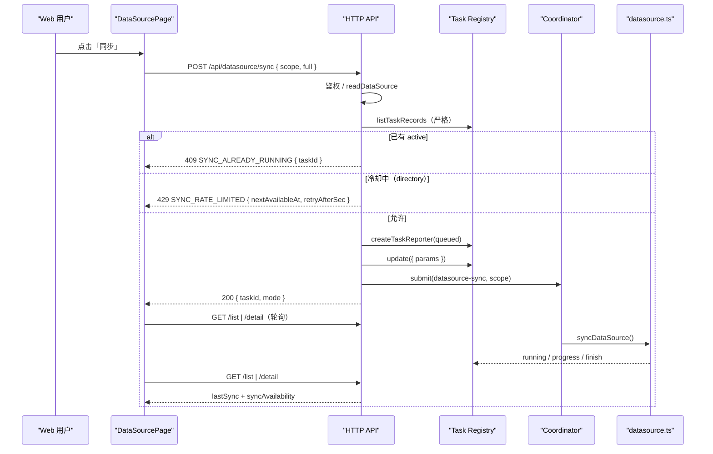

# S-03 页面同步与频率限制 — 详细设计

> 父文档：[DESIGN.md](./DESIGN.md)
> 依赖：[S-01](./S01_数据模型与Git识别_DESIGN.md)、[S-02](./S02_Git增量同步引擎_DESIGN.md)
> 被依赖：S-04 / S-05

---

## 1. 术语

| 术语 | 定义 |
|---|---|
| 页面同步 | 由 Web 页面触发的 `datasource-sync`，受服务端限频与并发闸门约束 |
| 冷却 | 普通目录在上一次 `state=ok` 同步后的 30 分钟内，页面不可再次触发 |
| `syncAvailability` | 服务端计算的页面同步可用性（`active` / `cooldown` / 允许） |
| 同步任务 | 任务台账中 `operation='datasource-sync'` 的记录，页面据此显示排队/运行 |
| CLI 强制 | `ki datasource sync --scope <s>` 不受页面冷却限制 |

---

## 2. 现状（AS-IS）

| 事项 | 现状 | 证据 |
|---|---|---|
| 页面 | 只读；唯一写动作是删除待删候选 | `web/src/pages/DataSourcePage.tsx:1-12`、`:250-257` |
| HTTP | 只有 `GET /list`、`GET /detail`、`POST /prune` | `src/lib/mcp-http-api.ts:729-732` |
| 同步入口 | 仅 CLI；daemon 模式下 `callDaemon('datasource-sync')` | `src/datasource.ts:257-278` |
| 队列 | `datasource-sync` 已登记为 `engine-only`；同 scope 串行 | `src/lib/operation-coordinator.ts:97` |
| 运行态 | 页面通过任务台账识别 `queued/running` | `src/lib/datasource-runtime.ts:24-40` |
| 任务 | CLI 会创建 `datasource-sync` 任务；Web 无入口 | `src/datasource.ts:280` |
| 限频 | 无任何限频机制 | — |

---

## 3. 方案（TO-BE）

### 3.1 文件结构

```text
src/lib/
├── datasource-policy.ts       # [新增] computeSyncAvailability（纯函数）
├── mcp-http-api.ts            # [修改] POST /datasource/sync、handleDatasourceSync
├── task-snapshot.ts           # [修改] 参数快照加 type/mode（S-02 提供）
└── operation-coordinator.ts   # [复用] datasource-sync 已登记 engine-only

web/src/
├── api/httpApi.ts             # [修改] syncDataSource()
├── pages/DataSourcePage.tsx   # [修改] 同步按钮/全量同步/冷却提示
└── lib/dataSourceDetailModel.ts # [修改] 同步可用性提示（S-04）
```

### 3.2 限频规则（纯函数）

```ts
// src/lib/datasource-policy.ts
export const DATASOURCE_PAGE_SYNC_MIN_INTERVAL_MS = 30 * 60 * 1000;

export type SyncAvailabilityReason = 'active' | 'cooldown' | null;

export interface SyncAvailability {
  allowed: boolean;
  /** 冷却结束的绝对时间（epoch ms）；非冷却为 null */
  nextAvailableAt: number | null;
  /** 相对秒数；便于前端倒计时，避免客户端时钟偏差 */
  retryAfterSec: number | null;
  reason: SyncAvailabilityReason;
}

export function computeSyncAvailability(input: {
  type: 'directory' | 'git';
  lastSync: { at: number; state: 'ok' | 'partial' | 'failed' | 'cancelled' } | null;
  active: boolean;
  now?: number;
}): SyncAvailability;
```

规则（顺序固定）：

1. `active=true` → `{ allowed:false, reason:'active' }`（不显示冷却时间）。
2. `type='git'` → 允许（增量同步成本低；仍受并发闸门）。
3. `type='directory'`：
   - `lastSync.state !== 'ok'` → 允许（失败/部分失败允许立即重试）。
   - `lastSync.state === 'ok'` 且 `now < at + 30min` → 冷却，返回 `nextAvailableAt` / `retryAfterSec`。
   - 其他 → 允许。

> **部分失败不启动冷却**：`partial` 常用于「修好 embedding 后重试未完成」，冷却会直接堵死补救路径。

### 3.3 HTTP 接口

#### `POST /api/datasource/sync`

请求：

```json
{ "scope": "langchain", "full": false }
```

成功（200）：

```json
{
  "ok": true,
  "scope": "langchain",
  "taskId": "0f3b8d1e-6a7c-4f0e-9f6b-2c1d8a7e5b40",
  "mode": "incremental",
  "state": "queued"
}
```

错误：

| HTTP | code | 触发 | 响应体 |
|---|---|---|---|
| 400 | `DATASOURCE_SYNC_MISSING_SCOPE` | 缺 `scope` | `{ ok:false, code, error }` |
| 403 | `SCOPE_FORBIDDEN` | token 无该 scope 权限 | 现有脱敏 403 |
| 404 | `DATASOURCE_NOT_FOUND` | 未登记 | `{ ok:false, code, error, next }` |
| 409 | `SYNC_ALREADY_RUNNING` | 已有 queued/running 的 `datasource-sync` | `{ ok:false, code, error, taskId }` |
| 409 | `SOURCE_UNREACHABLE` | `stat/access` 失败（不扫目录） | `{ ok:false, code, error }` |
| 429 | `SYNC_RATE_LIMITED` | 普通目录冷却中 | `{ ok:false, code, error, nextAvailableAt, retryAfterSec }` |
| 503 | `TASK_REGISTRY_UNAVAILABLE` | 任务台账不可读/不可写 | `{ ok:false, code, error }` |

实现要点：

1. 鉴权：与 `/api/datasource/prune` 同口径（`scopeAllowed` + `rejectScopeViolation`）。
2. 读取记录：`readDataSource`；类型/上次同步一并取出。
3. 并发闸门：**严格读取任务台账**（`listTaskRecords`）；读失败 → 503，不得放行（否则会重复处理上千篇）。
   - 复用 `pickActiveDatasourceSync`；同 scope 有 active → 409，带 `taskId`。
4. 限频：`computeSyncAvailability({ type, lastSync, active:false })`；冷却 → 429。
5. 源可达性：`checkSourceReachable(record.dir)`（只 `stat + access`，不扫目录）→ 409。
6. **per-scope 同步闸门（原子化 check + create，challenger 意见3）**：
   - daemon 进程内维护 `const syncGates = new Map<string, string>()`（scope → taskId）；
   - 在事件循环内**同步**执行：`if (syncGates.has(scope)) return 409` → `syncGates.set(scope, taskId)`；再 `createTaskReporter`；任一步失败都 `syncGates.delete(scope)`；
   - 任务 `finish` 的 `finally` 中 `syncGates.delete(scope)`；daemon 重启后 Map 清空，由任务台账的 active 检查兜底；
   - 通过闸门后再**重新计算一次** `computeSyncAvailability`，防止两个请求在闸门外同时读到旧 `lastSync`；
   - CLI 不创建页面任务；coordinator 串行与 scope 写锁是第二道防线。
7. 创建任务（在闸门内）：
   - `taskId = crypto.randomUUID()`；
   - `createTaskReporter(config, { id: taskId, source:'web', operation:'datasource-sync', scope })`；
   - 在入队前写 `params`：`toParamSnapshot('datasource-sync', { sourceDir, group, vector, conflictMode, conflictSuffix, chunkSize, chunkOverlap, type, mode })`。
8. 提交 coordinator：
   ```ts
   void getSharedOperationCoordinator().submit(
     { operation: 'datasource-sync', params: { scope, full } },
     () => runWithConfigSnapshot(requestConfig, async () => {
       task.update({ state: 'running', startedAt: Date.now() });
       try {
         const result = await syncDataSource({
           scope, full, taskId, config: requestConfig,
           onProgress: (p) => task.progress(p),
           // challenger 意见8：Git 阶段也要可见
           onPhase: (phase) => task.update({ phase }),
         });
         const state = result.ok ? result.summary.state : 'failed';
         task.finish(mapState(state), {
           result: toDatasourceSyncResultSnapshot(result),
           error: result.ok ? undefined : result.error,
           errorCode: result.ok ? undefined : result.code,
         });
       } catch (err) {
         task.finish('failed', { errorCode: 'SYNC_FAILED', error: (err as Error).message });
       } finally {
         syncGates.delete(scope);
       }
     }),
     scope,
   );
   ```
9. 立即返回 `{ ok:true, taskId, mode }`；**不等同步完成**。

> **并发验收（必须）**：同 scope 并发 5 个 POST → 1 个 200 + 4 个 409；`/api/tasks` 只有 1 条 queued/running 的 `datasource-sync`。修复前会创建多条 queued 任务并绕过冷却。

> **闸门释放**：`submit` 本身被拒绝/抛错时，外层也要 `syncGates.delete(scope)`（不能只依赖闭包内的 `finally`）；daemon 重启后 Map 清空，由任务台账 active 检查兜底。

> `syncDataSource` 自身会写 `datasource.json.lastSync`；任务台账只是运行态与 1h 内回看，SSOT 仍是 `lastSync`。

结果快照映射（任务台账只保留 1h，完整 Git 信息在 `lastSync`）：

```ts
function toDatasourceSyncResultSnapshot(result: SyncDataSourceResult): TaskResultSnapshot | undefined {
  if (!result.ok || result.dryRun) return undefined;
  const s = result.summary;
  return {
    files: {
      scanned: s.files.scanned,
      completed: s.files.completed,
      incomplete: s.files.incomplete,
      skipped: s.files.skipped,
      unchanged: s.files.unchanged,
      duplicatesSkipped: s.files.duplicatesSkipped,
    },
    vectorized: s.vectorized,
    fullTextIndexed: s.fullTextIndexed,
    groups: s.groups,
  };
}
```

`SyncSummary` 的 `vectorized/fullTextIndexed/groups` 由 S-02 从导入结果透传。

#### `GET /api/datasource/list|detail` 增量字段

每个 source 增加：

```json
{
  "type": "directory",
  "syncAvailability": {
    "allowed": false,
    "nextAvailableAt": 1792561234567,
    "retryAfterSec": 1420,
    "reason": "cooldown"
  }
}
```

- `active` 优先：若任务台账有 queued/running，`reason='active'`、`allowed=false`。
- 台账读取失败时列表降级为空 active（现有行为），但 **POST 会严格拒绝**；页面以 POST 结果为准。

### 3.4 页面行为

| 状态 | 按钮 | 提示 |
|---|---|---|
| 空闲且允许（git） | 「同步」可用；次级「全量同步」 | 提示「增量同步；会先 fetch + 自动更新」 |
| 空闲且允许（directory） | 「同步」可用 | 提示「全量同步；30 分钟一次」 |
| 冷却中 | 禁用 | 「距上次成功同步不足 30 分钟。如需立即同步：`ki datasource sync --scope <s>`」+ 剩余时间 |
| 排队中/同步中 | 禁用 | 「排队中」/「同步中」；状态列与抽屉头部同源 |
| 旧 daemon 无 `syncAvailability` | 隐藏/禁用 | 「当前 daemon 不支持页面同步，请升级并重启」 |
| 请求 409 | 保持禁用 | 显示已有任务 ID + 「查看任务」 |
| 请求 429 | 禁用 | 显示 `retryAfterSec` 倒计时 + CLI 命令 |
| 请求 403/404 | 恢复可用 | 行内错误 |
| 同步完成 | 恢复可用 | 刷新列表/详情/待删候选；不弹全局 toast，复用抽屉回执 |

- 点击后立即 `invalidateQueries(['dataSourceList'])` 与 `['dataSourceDetail', scope]`，让台账里的 queued/running 尽快出现在列表。
- 全量同步：
  - 仅 `type='git'` 显示；请求 `{ scope, full:true }`。
  - 用于同步 untracked 文件；入口放在抽屉的「同步」旁（次级菜单），不做二次确认（全量导入不是删除）。
- 冷却倒计时：使用服务端 `retryAfterSec` 为起点，本地每 30 秒递减；列表刷新时重置。避免直接依赖客户端时钟。
- 同步中列表刷新沿用现有 15s；抽屉详情沿用 3s（`activeState` 非空时）。

### 3.5 CLI 强制口径

- CLI `ki datasource sync` 不经过 `computeSyncAvailability`，始终允许。
- CLI 成功同步会更新 `lastSync.at/state`，因此**页面冷却会随之重置**（冷却口径是数据源，不是入口）。
- 页面在冷却提示中给出精确命令，用户可直接复制。

---

## 4. 接口设计

### 4.1 `syncDataSource`（Web API 客户端）

```ts
// web/src/api/httpApi.ts
export interface DataSourceSyncTriggerResponse {
  ok: boolean;
  scope: string;
  taskId: string;
  mode: 'incremental' | 'full';
  state: 'queued';
}

export async function syncDataSource(input: {
  scope: string;
  full?: boolean;
}): Promise<DataSourceSyncTriggerResponse> {
  return req<DataSourceSyncTriggerResponse>('/api/datasource/sync', {
    method: 'POST',
    body: JSON.stringify(input),
  });
}
```

### 4.2 错误响应 Demo

429：

```json
{
  "ok": false,
  "code": "SYNC_RATE_LIMITED",
  "error": "普通目录数据源 30 分钟内只能同步一次。如需立即同步，请执行：ki datasource sync --scope scope",
  "nextAvailableAt": 1792561234567,
  "retryAfterSec": 1420
}
```

409 已有任务：

```json
{
  "ok": false,
  "code": "SYNC_ALREADY_RUNNING",
  "error": "该数据源已有同步任务在排队或执行中",
  "taskId": "0f3b8d1e-6a7c-4f0e-9f6b-2c1d8a7e5b40"
}
```

---

## 5. 时序图



---

## 6. 异常处理

| 场景 | 行为 | 对外 |
|---|---|---|
| 任务台账读失败 | 503，不放行 | `TASK_REGISTRY_UNAVAILABLE` |
| 任务台账写失败 | 503，不启动同步 | `TASK_REGISTRY_UNAVAILABLE` |
| 已有任务 | 409 + taskId | `SYNC_ALREADY_RUNNING` |
| 冷却中 | 429 + 时间 | `SYNC_RATE_LIMITED` |
| 源目录不可达 | 409，不创建任务 | `SOURCE_UNREACHABLE` |
| 同步内部失败 | 任务 `failed`；`lastSync.state=failed` | 任务 error + 页面详情 |
| 同步部分失败 | 任务 `partial`；`lastSync.state=partial` | 同上 |
| 页面关闭/刷新 | 任务继续；重新进入页面从台账恢复 | 现有轮询 |
| 旧 daemon | 404；页面提示升级 | 前端降级 |
| 无权限 | 403（脱敏） | 现有口径 |

---

## 7. 关键决策点

| 决策 | 采用 | 被否决方案 | 否决理由 | 重新评估触发条件 |
|---|---|---|---|---|
| 限频位置 | HTTP 层 | 数据源核心 | 核心层会连 CLI 一起限，违背「CLI 强制」出口 | 需要限制所有入口时 |
| 冷却基准 | `lastSync.state=ok` 的 `at` | 单独的 `lastUiSyncAt` | 两套时间真相；CLI 同步也应重置页面冷却 | 需要区分入口时 |
| partial 是否冷却 | 否 | 是 | 会堵死「重试未完成」的补救路径 | 出现大量恶意 partial 重试 |
| 任务 operation | 复用 `datasource-sync` | 新建 `datasource-sync-web` | 页面运行态、CLI、任务详情会分裂 | 需要区分 Web/CLI 来源时（`source` 字段已有） |
| 可用性计算 | 服务端下发 | 前端根据 lastSync 自算 | 规则会漂移；服务端必须强制 | 无 |
| 返回码 | 200 + taskId | 202 Accepted | 项目 API 统一 `{ok:true}`，无 202 先例 | 无 |
| 同步是否等待完成 | 否，立即返回 | 同步等待 | 长任务会撑爆 HTTP 连接；任务台账就是为此存在 | 无 |

---

## 8. 影响范围

| 文件/模块 | 变更 |
|---|---|
| `src/lib/datasource-policy.ts` | 新增纯函数与常量 |
| `src/lib/mcp-http-api.ts` | 新增路由、handler、任务创建、限频、映射结果快照 |
| `src/lib/datasource.ts` | `syncDataSource` 接受 `full`（S-02） |
| `web/src/api/httpApi.ts` | 新增 `syncDataSource()` 与响应/错误类型 |
| `web/src/pages/DataSourcePage.tsx` | 同步按钮、全量同步、冷却提示、错误分流 |
| `web/src/styles/ki.css` | 按钮/冷却提示/操作列样式 |
| `test/mcp-http-api.test.ts` | 200/409/429/403/404/503 契约 |
| `test/datasource-policy.test.ts` | 冷却/active/git/partial 用例 |
| `web/test/*` | 同步可用性展示纯函数（如抽出） |

---

## 9. 待定问题

| 问题 | 当前处理 | 需要谁决定 |
|---|---|---|
| 页面同步取消 | Q10 默认后置；首版无取消 | 后续按长任务体验决定 |
| 30 分钟是否可配置 | 常量；后续可进 scope 配置 | 运维/用户 |
| 429 倒计时精度 | 以 `retryAfterSec` 为准，30s 递减 | 已定 |
| 同步任务与 top bar 任务提示的联动 | 复用现有任务台账，无需新 UI | 已定 |

---

## 10. 不在范围内

- 页面同步取消按钮（Q10 后置）。
- Git URL clone 与 `--purge`（S-05）。
- 类型徽标、commit/警告的展示细节（S-04）。
- 定时/后台自动同步。
