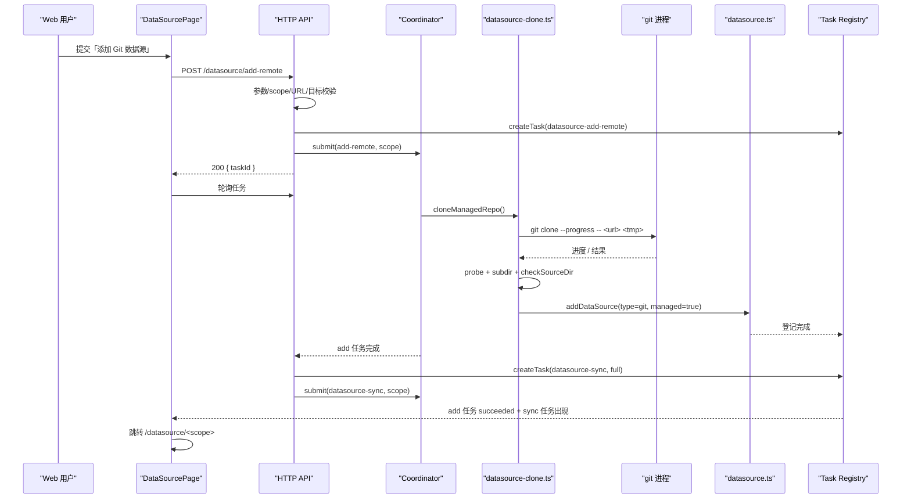

# S-05 Git URL 数据源（托管 clone）— 详细设计

> 父文档：[DESIGN.md](./DESIGN.md)
> 依赖：[S-01](./S01_数据模型与Git识别_DESIGN.md)、[S-02](./S02_Git增量同步引擎_DESIGN.md)、[S-03](./S03_页面同步与限频_DESIGN.md)
> 批次：B（独立交付，不阻塞 A）

---

## 1. 术语

| 术语 | 定义 |
|---|---|
| 托管 clone | 工具从远端克隆并维护的仓库副本，`git.managed=true` |
| clone root | `~/.ki/datasources/<scope>/repo`（临时 clone 先在 `.tmp-repo-*`） |
| add-remote | 一次「clone + 登记」的任务；完成后自动入队首次同步 |
| purge | 删除登记后同时删除托管 clone |
| 环境凭据 | 进程可用的 SSH agent / credential helper；页面不收集 token |

---

## 2. 现状（AS-IS）

| 事项 | 现状 | 证据 |
|---|---|---|
| 登记来源 | 只能是服务器本地目录（`--source`） | `src/lib/datasource.ts:217-302` |
| clone 能力 | 无 | — |
| 托管目录 | 只有 `~/.ki/import-uploads`（上传暂存）与 dataDir | `src/lib/datasource.ts:47` |
| 远端凭据 | 无相关代码 | — |
| 页面添加 | 无入口，页面只读 | `web/src/pages/DataSourcePage.tsx` |
| 移除 | `remove` 只删登记，不清理目录 | `src/lib/datasource.ts:309-325` |

---

## 3. 方案（TO-BE）

### 3.1 文件结构

```text
src/lib/
├── datasource-clone.ts        # [新增] URL 校验 / clone / purge / 托管目录解析
├── datasource-git.ts          # [复用] probeGit / prepareGitSync（managed=true）
├── datasource.ts              # [修改] addDataSource 接受注入的 gitInfo
└── mcp-http-api.ts            # [修改] POST /api/datasource/add-remote
src/datasource.ts              # [修改] add --git-url / remove --purge
web/src/
├── pages/DataSourcePage.tsx   # [修改] 添加表单 + 任务进度
├── api/httpApi.ts             # [修改] addRemoteDataSource()
└── styles/ki.css              # [修改] 表单/进度样式（S-04 同族）
test/
├── datasource-clone-url.test.ts   # [新增] URL 白名单/凭据/分支/子目录
├── datasource-clone.test.ts       # [新增] 本地 bare repo clone/清理（不依赖网络）
└── mcp-http-api.test.ts           # [扩展] add-remote 契约
```

### 3.2 托管目录

```ts
export const DATASOURCE_CLONE_ROOT = path.join(os.homedir(), '.ki', 'datasources');
export function managedRepoDir(scope: string): string;      // <root>/<scope>/repo
export function managedScopeDir(scope: string): string;     // <root>/<scope>
```

- `scope` 必须通过 `resolveScope`（字符集 `[a-zA-Z0-9_-]+`）。
- 目录权限 0700（root / scope / repo 继承）。
- **禁止**位于 `config.dataDir` 内：`checkSourceDir` 会拒绝；在 clone 前显式检查并返回 `CLONE_DIR_INSIDE_DATA_DIR`。
- `DATASOURCE_CLONE_ROOT` 若为符号链接 → fail-loud（避免路径逃逸）。
- 临时目录：`<scope>/.tmp-repo-<uuid>`；clone 成功后 `rename` 为 `repo`；失败则删除临时目录。**不把半成品留在最终路径**。

### 3.2.1 共享托管 clone（2026-10-22 用户反馈追加）

同一 `remoteUrl + 分支` 只保留一份工作副本：新 scope 添加时先按 remote/分支查找已登记的 managed 记录，命中则复用其 `repoRoot`，仅写入新的 `relativeRoot`（子目录），**不重新 clone**。

- `managedCloneDirOf(record)` 由 `repoRoot` 反推 clone 目录，不再要求目录名等于 `record.scope`（复用副本可能属于先登记的 scope）。
- `remove --purge` / `scope delete` 前统计其他 scope 引用数（`countManagedRepoRefs`）：>0 保留并报告 `managedCloneShared`；最后一个引用删除时才清理。
- 新增 clone 级文件锁（以 `repoRoot` 哈希为键）：共享副本的同步、复用校验、删除串行化；scope 锁只保证单 scope 串行，覆盖不了跨 scope 的工作树竞争。
- 同 remote 的并发 add 额外按 `remoteUrl + 分支` 串行化：第一个 clone，后续复用。
- 已有同 remote/分支副本时，子目录在建任务前校验；`INVALID_SUBDIR` 直接 400 并附仓库顶层目录。新仓库仍需 clone 后校验，失败任务通过 `recoveryHint` 给出顶层目录。

### 3.3 URL / 分支 / 子目录校验

```ts
export type GitUrlCheck =
  | { ok: true; url: string }
  | { ok: false; code: 'INVALID_GIT_URL' | 'GIT_URL_CREDENTIALS' | 'GIT_SCHEME_UNSUPPORTED'; error: string };

export function validateGitUrl(raw: string): GitUrlCheck;
export function isSafeRelativeSubdir(raw: string): boolean;
```

**URL 白名单**

| 形式 | 允许 | 说明 |
|---|---|---|
| `https://host/path` | ✅ | 拒绝 `user:pass@` |
| `https://user@host/path`（无密码） | ✅ | 允许，凭据由 credential helper 提供 |
| `ssh://[user@]host/path` | ✅ | 拒绝 password |
| `user@host:path`（scp-like） | ✅ | 拒绝 `user:pass@host:path` |
| `http://` | ❌ | 明文传输；内部需求后续再评估 |
| `git://` | ❌ | 明文、无认证 |
| `file://` | ❌ | 本地目录请走 `--source` |
| `ext::` / `fd::` / 任意 `xxx::` | ❌ | 可执行命令注入 |
| 以 `-` 开头 | ❌ | 参数注入 |
| 长度 > 2048 | ❌ | — |

**分支**：非空时先 `git check-ref-format --branch <branch>`（`execFile`），并拒绝以 `-` 开头、`..`、`@{`、`.lock` 结尾。**只支持远端分支**：`--branch` 传 tag 会得到 detached HEAD，后续 `reset --hard origin/<tag>` 不可用（tag 不在 remote-tracking branch 命名空间），明确不支持。

**子目录**：`isSafeRelativeSubdir`：
- 非绝对路径、无 `..` 段、无反斜杠、无 NUL、无首尾 `/`；
- 不等于 `.git`，也不以上述段开头；
- 长度 ≤ 1024；空字符串 = 仓库根。

### 3.4 clone 流程

```ts
export interface CloneResult {
  scope: string;
  repoRoot: string;
  dir: string;
  branch: string | null;
  headCommit: string | null;
  remoteUrl: string;
}

export async function cloneManagedRepo(input: {
  scope: string;
  url: string;
  branch?: string | null;
  subdir?: string | null;
  config: KiConfig;
  onProgress?: (p: { phase: 'clone'; done: number; total: number }) => void;
  abortSignal?: AbortSignal;
}): Promise<CloneResult>;
```

步骤：

1. 校验 scope / URL / branch / subdir / clone root / 目标不存在。
2. `mkdir -p <root>/<scope>`（0700）；**清理该 scope 下超过 1 小时的 `.tmp-repo-*`**（仅工具创建的模式，路径守卫），再创建 `.tmp-repo-<uuid>`。进程被 kill 留下的临时目录不会阻塞新 add。
3. `git clone --progress [--branch <branch>] -- <url> <tmp>`：
   - `timeout=10min`、`LC_ALL=C`、`GIT_TERMINAL_PROMPT=0`、`GIT_ASKPASS=/bin/true`、`SSH_ASKPASS=/bin/true`、`maxBuffer=32MB`。
   - 用 `execFile` 返回的 `child.stderr.on('data')` **流式**解析 `Receiving objects: 42%` → `onProgress({phase:'clone', done:42, total:100})`；无百分比则只发心跳。不能等回调结束再解析（否则进度只在完成后出现）。
   - `execFile` 的 `signal` 接 `abortSignal`；超时/取消时 kill 子进程并清理临时目录。
4. 失败：删除临时目录（best-effort），按 stderr 映射错误码（见 §6）。
5. 成功：`probeGit(tmp)`；`subdir` 存在且为目录；`checkSourceDir(dir, config, scope)`（要求至少 1 个可导入文件）。
6. `rename(tmp → repo)`；返回 `repoRoot/dir/branch/headCommit/remoteUrl`。
7. 任意一步失败：删除临时目录；**不写登记**。

### 3.5 登记与首次同步

`addDataSource` 增加注入入口（S-01）：

```ts
addDataSource({
  scope, dir, group,
  type: 'git',
  gitInfo: {
    repoRoot, relativeRoot: subdir ?? '',
    // branch 未显式指定时，以 clone 后探测到的当前分支为准（origin/HEAD 的指向）
    branch: probed.branch,
    remoteUrl,
    managed: true,
    remoteBranch: branch ?? probed.branch ?? 'HEAD',
  },
  // conflictMode/vector/chunk 使用默认值或表单值
});
```

**scope 选择来源（2026-10-22 用户修正 Q8=A）**：页面添加表单复用 `ScopePathSelect`（与上传导入一致）——「选择已有 Scope」输入即筛选，或「新建 Scope」输入名称后回车/失焦/点「创建」；名称校验复用 `scopeError`（与 CLI 同规则）。`POST /add-remote` 不再返回 `SCOPE_NOT_FOUND`，scope 不存在时由登记流程（`ensureScopeDir`）自动初始化；仍禁止 `/api/datasource/list` 充当 scope 列表。

**并发串行化（challenger 意见4）**：HTTP handler 的 coordinator 闭包内先用 `withScopeWriteLock(scope, 'datasource-add-remote', ...)` 包住「锁内重新检查存在性 → clone → rename → `addDataSource`（同锁嵌套复用）」；clone 可能几分钟，但该 scope 尚无数据源，阻塞可接受。前置 `DATASOURCE_EXISTS` 只是快速失败，**权威判断在锁内**。`datasource-add-remote` 同时纳入 active 检查，避免两个 add 任务并行。任务创建失败或 clone 失败必须清理临时目录并释放锁。

- 页面/服务端流程：
  1. `POST /api/datasource/add-remote` 创建任务 `datasource-add-remote`（`source='web'`）。
  2. 任务内：clone → `addDataSource`（持 scope 写锁）。
  3. 登记成功后，handler **释放 add 任务的队列槽**，再创建 **`datasource-sync` 任务**并入队首次同步（`mode='full'`，因为首次没有 commit 水位）。
  4. add 任务完成，**result** 返回 `{ scope, dir, syncTaskId }`；sync 任务独立显示「排队中/同步中」。页面优先用 `syncTaskId` 跳转/跟随；若入队失败，add 任务仍成功并带 warning，页面提示手动同步。
- 页面关闭也照常执行（服务端入队）；页面重新进入可从任务台账恢复。
- 首次同步无论如何都是全量（无 `lastCommit`），之后自动进入增量。
- CLI `add --git-url`：同步 clone + 登记 + 打印 `ki datasource sync` 下一步；**不自动入队**（与现有 CLI add 语义一致）。

### 3.6 托管 clone 的同步

- `prepareGitSync({ managed: true, branch: remoteBranch })`：
  1. `git fetch`（失败 → warning，继续）；
  2. `git reset --hard origin/<remoteBranch>`（失败 → warning，继续本地内容）；
  3. **`git clean -fdx`**（challenger 意见5）：清掉未跟踪/ignored 文件，确保副本 = 远端镜像；失败 → `GIT_CLEAN_FAILED`，本次同步失败（不得把脏副本当镜像，否则全量同步会把未跟踪 md 导入 KB）。**仅托管副本执行；本地 Git 源绝不 clean**；
  4. 返回 HEAD。
- 之后与 S-02 的 diff / 导入 / commit 水位完全一致。
- 托管副本由工具维护，**禁止用户手工修改**；文档明确。

### 3.7 移除与 purge

CLI：

```bash
ki datasource remove --scope <s>            # 默认预览
ki datasource remove --scope <s> --yes      # 只删登记
ki datasource remove --scope <s> --yes --purge  # 删登记 + 托管 clone
```

- `--purge` 仅对 `git.managed=true` 有效；普通目录/本地 git → `NOT_MANAGED`。
- 预览展示 `managedCloneDir` 与「将删除该目录」。
- 执行顺序：先删 `datasource.json`，再删 `<root>/<scope>`；删除失败返回 `cloneRemoved=false` + `cloneRemoveError`，登记已删（提示用户手动清理路径）。
- 路径守卫：目标必须是 `<root>/<scope>`，不能是 root 本身；拒绝符号链接；scope 必须匹配字符集。
- **`ki scope delete` 集成（challenger 意见6）**：`executeScopeDelete` 的预览/执行前读取 `datasource.json`；若 `git.managed=true`，把 `<cloneRoot>/<scope>` 纳入删除清单（预览显示路径；`--yes` 后删除）。推荐自动删（派生资源）；若实现成本高，则拒绝删除并提示先执行 `ki datasource remove --purge`。`scope.ts` 通过动态 import `datasource.ts` 避免循环依赖。
- **FTS-only collection 生命周期（A5 实现发现）**：`scope delete` / `scope clear` 还必须清理 `fts-collections/<scope>`（与 dense collection 并列）；否则只做 FTS 的 scope 删除后会留下孤儿目录。实现为 `deleteFtsCollection(scope)`（closeFtsEngine + 路径守卫 + rm），`clear --tags` 用 `ftsDeleteByFilter({tag})` 清对应 tag 的 FTS 文档。
- 页面移除本次不做（Q7 默认）。

---

## 4. 接口设计

### 4.1 `POST /api/datasource/add-remote`

请求：

```json
{
  "scope": "langchain-docs",
  "url": "git@github.com:HACK-WU/learning.git",
  "branch": "master",
  "subdir": "langchain",
  "group": null
}
```

成功（200）：

```json
{
  "ok": true,
  "scope": "langchain-docs",
  "taskId": "7c2e5b1a-3f4d-4e8a-9b6c-1d0f2a3b4c5d",
  "state": "queued"
}
```

> 初始响应只有 add 任务 id；首次同步任务在 clone+登记完成后创建，其 id 通过 add 任务的 **result.syncTaskId** 下发（页面轮询 add 任务详情获取）。

错误（同步前置校验）：

| HTTP | code | 触发 |
|---|---|---|
| 400 | `INVALID_SCOPE` / `INVALID_GIT_URL` / `GIT_URL_CREDENTIALS` / `GIT_SCHEME_UNSUPPORTED` / `INVALID_SUBDIR` / `INVALID_GROUP` | 参数非法 |
| 403 | `SCOPE_FORBIDDEN` | token 无权限 |
| 409 | `DATASOURCE_EXISTS` | 该 scope 已有数据源（先 remove） |
| 409 | `CLONE_TARGET_EXISTS` | 托管目录已存在但无登记 |
| 409 | `SYNC_ALREADY_RUNNING` | 同 scope 有 active 任务 |
| 400 | `CLONE_DIR_INSIDE_DATA_DIR` | clone root 落在 dataDir 内 |

clone 失败（异步任务失败）：

| errorCode | 触发 | 文案（脱敏） |
|---|---|---|
| `GIT_AUTH_FAILED` | 认证失败/无凭据 | 认证失败：请在运行 daemon 的环境中配置 SSH agent 或 credential helper |
| `GIT_REPO_NOT_FOUND` | 仓库不存在/无权限 | 仓库不存在或当前凭据无权访问 |
| `GIT_NETWORK_FAILED` | DNS/连接超时 | 无法连接远端：`<原因>` |
| `GIT_BRANCH_NOT_FOUND` | 分支不存在 | 远端分支不存在 |
| `GIT_CLONE_TIMEOUT` | 超过 10 分钟 | 克隆超时；请检查网络或改用更小的仓库/子目录 |
| `SOURCE_EMPTY` | 克隆后无可导入文件 | 仓库（或子目录）内没有可导入的 Markdown |
| `CLONE_CLEANUP_FAILED` | 清理半成品失败 | 请手动删除 `<path>` |

### 4.2 Web API 客户端

```ts
// web/src/api/httpApi.ts
export interface AddRemoteDataSourceResponse {
  ok: boolean;
  scope: string;
  taskId: string;
  state: 'queued';
}

export async function addRemoteDataSource(input: {
  scope: string;
  url: string;
  branch?: string;
  subdir?: string;
  group?: string | null;
}): Promise<AddRemoteDataSourceResponse> {
  return req<AddRemoteDataSourceResponse>('/api/datasource/add-remote', {
    method: 'POST',
    body: JSON.stringify(input),
  });
}
```

### 4.3 CLI 帮助

```bash
ki datasource add --scope <s> --git-url <url> [--branch <b>] [--subdir <p>] [-g <g>]
ki datasource add --scope <s> --source <dir> [--type directory|git] ...
ki datasource remove --scope <s> [--yes] [--purge]
```

- `--source` 与 `--git-url` 互斥且必选其一。
- `--type` 只对 `--source` 有效；`--git-url` 自动为 git。
- `--branch` / `--subdir` 只对 `--git-url` 有效。

---

## 5. 时序图



---

## 6. 安全与异常

### 6.1 安全清单

| 风险 | 缓解 |
|---|---|
| `ext::sh -c ...` 命令执行 | URL 白名单；任何 `xxx::` 一律拒绝 |
| 参数注入（`--upload-pack` 等） | `execFile` 参数数组 + `--` 分隔 + URL 不得以 `-` 开头 |
| 凭据落盘 | 拒绝 `user:pass@`；`remoteUrl` 存储前脱敏 |
| 凭据泄漏到日志/错误 | stderr 脱敏（去 URL 凭据、限 500 字、只保留尾部） |
| 认证挂起 | `GIT_TERMINAL_PROMPT=0` + `GIT_ASKPASS/SSH_ASKPASS=/bin/true` + 超时 |
| 路径穿越 | scope 字符集校验；托管路径由 scope 派生；拒绝符号链接；purge 守卫 |
| 半成品目录 | 临时目录 clone + rename；失败清理 |
| 磁盘占满 | clone 超时 + 失败清理；导入预算（20k 文件/4GiB/300k chunks）在首同步预检 |
| 私网 SSRF | 用户主动输入 URL，与 CLI 同信任级；不支持页面凭据 |
| 恶意大仓库 | 10 分钟超时 + `maxBuffer`；后续可加大小上限 |

### 6.2 异常处理

| 场景 | 行为 | 对外 |
|---|---|---|
| scope 已有登记 | 拒绝，提示先 remove | `DATASOURCE_EXISTS` |
| 托管目录已存在 | 拒绝，**不自动删除** | `CLONE_TARGET_EXISTS` |
| clone 认证失败 | 清理临时目录；任务失败 | `GIT_AUTH_FAILED` |
| clone 网络失败 | 清理；任务失败 | `GIT_NETWORK_FAILED` |
| 分支不存在 | 清理；任务失败 | `GIT_BRANCH_NOT_FOUND` |
| 子目录不存在 | 清理；任务失败 | `INVALID_SUBDIR` |
| 托管副本 `git clean` 失败 | 本次同步失败；不导入脏副本 | `GIT_CLEAN_FAILED` |
| 仓库无可导入文件 | 清理；任务失败 | `SOURCE_EMPTY` |
| 登记失败 | 清理 clone（best-effort）；任务失败 | `ADD_FAILED` |
| 首次同步入队失败 | add 任务成功；返回 warning，页面可手动同步 | `SYNC_ENQUEUE_FAILED` |
| purge 失败 | 登记已删；报告路径 | `cloneRemoved=false` |
| daemon 无凭据 | 任务失败，提示在 daemon 环境配置 | `GIT_AUTH_FAILED` |
| dataDir 与 clone root 重叠 | 拒绝 | `CLONE_DIR_INSIDE_DATA_DIR` |

---

## 7. 数据模型

```ts
// 托管 clone 的 DataSourceRecord
{
  version: 2,
  scope: 'langchain-docs',
  type: 'git',
  dir: '/root/.ki/datasources/langchain-docs/repo/langchain',
  git: {
    repoRoot: '/root/.ki/datasources/langchain-docs/repo',
    relativeRoot: 'langchain',
    branch: 'master',
    remoteUrl: 'git@github.com:HACK-WU/learning.git',
    managed: true,
    remoteBranch: 'master',
  },
  group: null,
  conflictMode: 'incremental',
  conflictSuffix: '_{n}',
  vector: true,
  chunkSize: null,
  chunkOverlap: null,
  createdAt: 1792560000000,
  updatedAt: 1792560000000,
  lastSync: null, // 首次同步由 datasource-sync 任务写入
}
```

- `dir` 必须是 `repoRoot` 本身或其后代；`relativeRoot` 由 `path.relative` 得出。
- 首次同步 `lastSync.git.commit` 为空 → 全量；成功后记录水位。

---

## 8. 关键决策点

| 决策 | 采用 | 被否决方案 | 否决理由 | 重新评估触发条件 |
|---|---|---|---|---|
| clone 位置 | `~/.ki/datasources/<scope>/repo` | 放进 dataDir | `checkSourceDir` 拒绝；会混入 KB 备份/删除语义 | 用户要求与 KB 同盘管理 |
| URL 范围 | https/ssh/scp-like | 允许 `git://` / `http://` / `file://` | 明文/认证缺失/本地目录应走 `--source` | 内网 HTTP Git 服务需求明确 |
| 私仓凭据 | 环境凭据 | 页面输入 token 存盘 | 密钥存储与泄漏面；首版不做 | 用户明确要求私有仓库 UI |
| clone 与同步 | 两个任务（add-remote → datasource-sync） | 一个任务内 clone+sync | add 任务会长时间占用队列；运行态与限频口径混乱 | 需要单任务原子性时 |
| clone 目标已存在 | 拒绝 | 自动清空重建 | 可能删除用户/前次失败的产物 | 提供显式 `--force` 时 |
| 页面新建 scope | **允许（Q8=A，2026-10-22 用户修正）** | 只选已有 scope（原首版） | 用户要求页面直接新建并支持搜索；名称校验与 CLI 同规则 | 页面写面需要收窄时 |
| 页面移除 | 不做 | 同批做 | Q7 默认；CLI 足够 | 托管 clone 使用频繁时 |
| purge 顺序 | 先删登记，再删目录 | 先删目录 | 删除失败时登记已无，避免“登记指向不存在目录” | 无 |
| clone 目录命名 | `repo` + 子目录 | 每个 scope 直接放源码 | 需要 repoRoot 与 subdir 分离 | 无 |

---

## 9. 影响范围

| 文件/模块 | 变更 |
|---|---|
| `src/lib/datasource-clone.ts` | 新增 clone/URL/purge |
| `src/lib/datasource.ts` | `addDataSource` 接受 `gitInfo`；`removeDataSource` 返回托管目录 |
| `src/lib/mcp-http-api.ts` | 新增 `POST /datasource/add-remote`、任务创建、首次同步入队 |
| `src/datasource.ts` | `add --git-url` / `remove --purge` |
| `src/scope.ts` | `scope delete` 预览/执行时清理托管 clone（动态 import 避免循环依赖） |
| `src/lib/daemon-dispatch.ts` | 不新增：HTTP add-remote 在 coordinator 闭包内直接 clone + 登记；CLI `--git-url` 在 CLI 进程本地执行（与现有 add 一致） |
| `web/src/api/httpApi.ts` / `DataSourcePage.tsx` / `ki.css` | 添加表单、任务进度 |
| `docs/cli.md` / `docs/mcp-http.md` | 新命令/接口/错误码 |
| 安全测试 | URL 注入、凭据、路径穿越、清理 |
| 集成测试 | 本地 bare repo 作为远端（不依赖外网） |

---

## 10. 待定问题

| 问题 | 当前处理 | 需要谁决定 |
|---|---|---|
| 内网 `http://` Git 服务 | 首版拒绝 | 用户 |
| 私有仓库凭据 UI | 首版只支持环境凭据 | 用户 |
| Git LFS / submodule | 不在范围；clone 后按普通文件扫描 | 用户 |
| 单仓库大小上限 | 仅 10 分钟超时 + 导入预算 | 后续实测 |
| 页面移除/替换托管源 | 首版仅 CLI | 用户 |
| clone 进度百分比 | 解析 `Receiving objects`；无百分比则心跳 | 已定 |

---

## 11. 不在范围内

- 私有仓库凭据 UI / token 存储（Q9 默认环境凭据）。
- 页面移除/替换托管 clone（首版仅 CLI）。
- 多分支、多子目录的批量管理 UI。
- Git LFS、submodule 递归、仓库大小上限策略。
- 定时/后台自动更新（所有同步仍需显式触发）。
