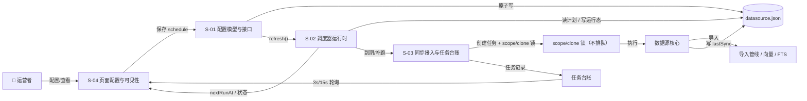
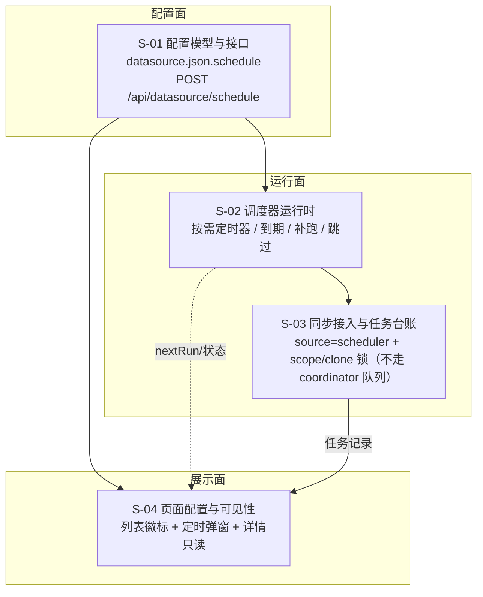

# 数据源定时同步 · 总体设计（REQ-20261029-001）

> 关联需求：[requirement.md](../requirement.md)
> 设计日期：2026-10-29
> 状态：设计中（待评审）

## 1. 需求背景 & 目标

数据源目前只能手动同步（页面 / CLI / 添加 Git 源后的首次同步），系统内无任何调度器。用户要求按计划自动同步：默认关闭、所有源类型可开、间隔自由输入、支持指定日期时间、配置仅在页面、daemon 启动时已过点则补跑一次、连续失败 3 次仅提示且不阻断下周期、每次同步都进任务台账。

**目标**：在 daemon 内提供按需存在的调度器，把「到期」转成既有 `syncDataSource` 链路；页面提供配置与可见性；详情抽屉保持只读。

**不在范围内**：cron 表达式、自动删除待删候选、通知渠道、多实例/多机协调、一 scope 多数据源、CLI 配置命令。

## 2. 关键环节一览图

## 3. 总体方案设计

## 4. 全局风险 & 跨子需求依赖

| 风险 | 影响 | 缓解 |
|---|---|---|
| 多个 HTTP daemon 同时调度 | 重复任务 | S-02 进程级调度锁 |
| 时钟回拨 / DST / 休眠 | 漏跑或重复跑 | 以持久化 `lastSync.at` / `lastAutoFor` 判定；DST 取首次有效时刻 |
| 长间隔超过 `setTimeout` 上限 | 定时器被提前触发 | 分段 arm |
| 页面保存与同步并发 | 丢失 `lastSync` | S-01 保存走 scope 写锁；S-03 运行持锁 |
| `datasource.json` 降级回旧版本 | `schedule` 被丢弃 | 升级先重启 daemon；文档标注 |
| 备份 / 恢复 | 恢复旧快照会连带恢复 `schedule`，可能重新启用已关闭的计划 | restore 成功后 `refresh`；文档标注"恢复会连带恢复定时设置" |
| 成功任务过多 | 任务页噪音 | 任务 TTL 1h；来源标 `scheduler`，可按来源辨认 |
| 任务数 / 列表截断 | 旧任务被挤出 | 既有 TTL / 2000 条上限，不新增存储 |

**非功能假设（默认值，超出需重新评估）**

| 维度 | 假设 |
|---|---|
| 部署 | 单机、单 daemon（或至少单 scheduler）；浏览器与 daemon 同时区 |
| 规模 | 数据源数量 < 100；每次 refresh 读取全部 `datasource.json` 可接受 |
| 频率 | 最小间隔 1 分钟；全局同时最多 1 个自动同步 |
| 耗时 | 单次同步分钟级；任务台账 TTL 1 小时 |
| 时钟 | 依赖系统本地时间；NTP 回拨 / 休眠由重算与 `lastAutoFor` 兜底 |

**共享术语速查**

| 术语 | 定义 | 权威位置 |
|---|---|---|
| 定时计划 `schedule` | 每数据源的定时配置与运行态 | S-01 |
| 槽位 `occurrence` | 一次计划对应的预定时刻（指定时间模式用于去重） | S-01 / S-02 |
| 到期 `due` | `now >= nextRunAt` | S-02 |
| 启动补跑 | daemon 启动时对已过期计划补跑一次 | S-02 |
| 跳过 `skip` | 因已有任务 / 锁占用 / 调度禁用而未执行，不计失败 | S-02 / S-03 |
| 连续失败 | 仅统计调度器触发且 `state=failed` 的连续次数 | S-03 |
| 按需定时器 | 无启用计划时不建 timer | S-02 |

**跨子需求契约**：`DataSourceSchedule` 形状（S-01）→ S-02 只读 + 写运行态；`nextRunAt` 由 S-02 计算、S-01 接口下发；`TaskSource='scheduler'`（S-03）→ S-04 展示。**契约变更必须同时改两侧类型副本与测试**。
