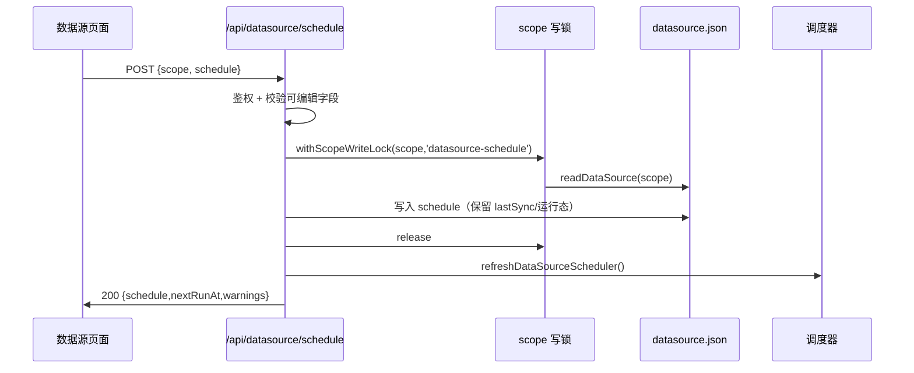

# S-01 配置模型与接口 · 设计

> 父文档：[DESIGN.md](DESIGN.md) ｜ 需求：[../requirement.md](../requirement.md)

## 1. 术语

| 术语 | 定义 |
|---|---|
| `schedule` | 每个数据源一份定时配置 + 运行态，存 `datasource.json` |
| 周期模式 `interval` | 每隔 N 分钟/小时/天执行 |
| 指定时间模式 `at` | 在某个本地日期时间执行；可仅一次或从该时刻起每天重复 |
| 槽位 `occurrence` | 一次计划对应的预定时刻（用于判断某次计划是否已执行） |
| 可编辑字段 | `enabled / mode / intervalValue / intervalUnit / at / repeat` |
| 运行态字段 | `consecutiveFailures / lastAutoAt / lastAutoFor / lastAutoState / lastSkip*`（服务端写） |

## 2. 现状（AS-IS）

| 现状 | 证据 |
|---|---|
| 每源配置落 `datasource.json`，`version: 2` | `src/lib/datasource-types.ts:153-175` |
| 读取时由 `normalizeRecord` 重建对象，**未知字段被丢弃** | `src/lib/datasource.ts:221-253` |
| 写入为 tmp + rename 原子写（0600） | `src/lib/datasource.ts:256-262` |
| 列表/详情由 `GET /api/datasource/list|detail` 下发；`lastSync` 已含 `at/state/git.commit` | `src/lib/mcp-http-api.ts:2038-2190` |
| 无 `schedule` 字段、无定时接口 | 全仓无相关实现 |
| 页面类型副本：`DataSourceListRow` / `DataSourceRecordView` | `web/src/api/httpApi.ts:724-794` |

## 3. 方案（TO-BE）

1. 在 `DataSourceRecord` 增加可选 `schedule`；缺省视为关闭。
2. 新增纯函数模块 `src/lib/datasource-schedule.ts`：`normalizeDataSourceSchedule` / `validateScheduleInput` / `computeNextRun` / `scheduleToLabel`。
3. 新增 `POST /api/datasource/schedule`（页面唯一写入口），读接口在 list/detail 透出 `schedule` + `nextRunAt`。
4. 保存走 `withScopeWriteLock(scope, 'datasource-schedule')` 读改写，避免与同步的 `lastSync` 写互相覆盖。
5. 保存成功后调用 `refreshDataSourceScheduler()`（S-02）。
6. **不新增 CLI 配置命令**；CLI `list --json` 是否只读透出后续另议。

## 4. 数据模型

```ts
// src/lib/datasource-types.ts
export type DataSourceScheduleMode = 'interval' | 'at';
export type DataSourceScheduleUnit = 'minute' | 'hour' | 'day';
export type DataSourceScheduleRepeat = 'once' | 'daily';

export interface DataSourceSchedule {
  enabled: boolean;
  mode: DataSourceScheduleMode;
  /** 周期模式：用户输入值（整数）；关闭时可为 null */
  intervalValue: number | null;
  /** 周期模式单位 */
  intervalUnit: DataSourceScheduleUnit | null;
  /** 指定时间模式：服务器本地时间 'YYYY-MM-DDTHH:mm'（无时区） */
  at: string | null;
  /** 指定时间模式：仅一次 / 从 at 起每天重复 */
  repeat: DataSourceScheduleRepeat | null;

  // ── 运行态（服务端写；客户端请求体不接收）──
  consecutiveFailures: number;
  /** 最近一次自动同步完成时间 */
  lastAutoAt: number | null;
  /** 最近一次已执行的槽位（用于 daily 去重） */
  lastAutoFor: number | null;
  lastAutoState: DataSourceSyncState | null;
  lastSkipReason: string | null;
  lastSkipAt: number | null;
}
```

**缺省值**（文件缺 `schedule` 时）：

```ts
{
  enabled: false,
  mode: 'interval',
  intervalValue: 24,
  intervalUnit: 'hour',
  at: null,
  repeat: 'once',
  consecutiveFailures: 0,
  lastAutoAt: null,
  lastAutoFor: null,
  lastAutoState: null,
  lastSkipReason: null,
  lastSkipAt: null,
}
```

**约束**：
- `interval`：`intervalValue` 为 1–100000 的整数；`intervalUnit ∈ {minute,hour,day}`；折算分钟 ∈ **[1, 525600]**（1 分钟–365 天）。
- `at`：正则 `^\d{4}-\d{2}-\d{2}T\d{2}:\d{2}$` 且为合法本地时间；`repeat ∈ {once,daily}`。
- `daily` 的语义：**从 `at` 指定日期起**，每天该时刻执行；`at` 当天时刻已过 → 启动/保存后立即补跑一次，之后次日同时刻。
- 关闭态：只要 `mode` 合法即可保存，其余字段可为 null；保留用户上次填写的值。
- **仅一次完成态**：无论成功/失败，执行完成即 `enabled=false`，保留 `lastAuto*`（避免"已完成仍显示已开启"）；跳过（未执行）不置 false。
- **运行态写回不修改 `updatedAt`**（`updatedAt` 表示配置更新时间），避免列表看起来"刚改过"。
- **时区**：`at` 按 daemon 本地时区解释；列表展示按浏览器本地时区格式化。默认假设页面与 daemon 同机同时区；远程访问时可能偏差（后续可下发服务器时区）。
- 手工改文件写入非法值时：`normalizeDataSourceSchedule` **降级为 `enabled:false`** 并置 `lastSkipReason='invalid-schedule'`，不静默启用。

## 5. 接口设计

### 5.1 `POST /api/datasource/schedule`

**鉴权**：与 `/api/datasource/sync` 同口径（`scopeAllowed`）。

**请求**

```json
{
  "scope": "ai-docs",
  "schedule": {
    "enabled": true,
    "mode": "interval",
    "intervalValue": 30,
    "intervalUnit": "minute",
    "at": null,
    "repeat": null
  }
}
```

- 只接受可编辑字段；出现运行态字段 → 忽略（不报错，避免前端缓存回传导致误重置）。
- `enabled=false` 时允许其余字段为空。
- **并发保存（待确认）**：建议请求带 `baseUpdatedAt`（弹窗打开时的记录 `updatedAt`）；若与当前记录不一致 → 409 `SCHEDULE_STALE` 并返回当前 schedule。未实现前为"最后写入覆盖"（多标签页可能互相覆盖）。

**成功响应**

```json
{
  "ok": true,
  "scope": "ai-docs",
  "schedulerDisabled": false,
  "nextRunAt": 1793342400000,
  "schedule": {
    "enabled": true,
    "mode": "interval",
    "intervalValue": 30,
    "intervalUnit": "minute",
    "at": null,
    "repeat": null,
    "consecutiveFailures": 0,
    "lastAutoAt": null,
    "lastAutoFor": null,
    "lastAutoState": null,
    "lastSkipReason": null,
    "lastSkipAt": null
  },
  "warnings": []
}
```

**错误**

| HTTP | code | 场景 |
|---|---|---|
| 400 | `SCHEDULE_INVALID_MODE` / `_REPEAT` / `_INTERVAL` / `_INTERVAL_TOO_SMALL` / `_INTERVAL_TOO_LARGE` / `_AT_INVALID` | 校验失败，`details.field` 指明字段 |
| 403 | `SCOPE_FORBIDDEN` | 越权（沿用 `rejectScopeViolation`） |
| 404 | `DATASOURCE_NOT_FOUND` | scope 未登记数据源 |
| 409 | `SCOPE_OPERATION_BUSY` | 该 scope 正在同步，提示"完成后再改定时设置" |
| 409 | `SCHEDULE_STALE` | 可选乐观锁：`baseUpdatedAt` 与当前记录不一致（多标签页并发保存） |
| 500 | `SCHEDULE_WRITE_FAILED` | 原子写失败 |

**警告**（不阻断）：

| code | 场景 |
|---|---|
| `SCHEDULE_AT_IN_PAST` | 仅一次且时间已过：保存后立即补跑一次 |
| `SCHEDULE_DIRECTORY_HIGH_FREQ` | 目录源间隔 < 30 分钟（仍允许） |

### 5.2 读接口新增字段

- `GET /api/datasource/list` 每行增加可选 `schedule`（含 `nextRunAt`），旧 daemon 不下发 → 页面隐藏「定时」入口。
- **`missing` 条目也增加 `schedule` + `nextRunAt`**：目录不可读时页面仍能打开定时弹窗关闭计划（否则用户无法停止持续失败的计划）。**实现注意**：`scanDataSources` 的 `missing` 目前只有 `{scope,reason}`，需扩展为带 `record`，或由 list handler 对 missing scope 重读 `readDataSource(scope)`。
- `GET /api/datasource/detail` 增加 `source.schedule`、`source.nextRunAt`、`schedulerDisabled`。

```ts
export interface DataSourceScheduleView extends DataSourceSchedule {
  /** 服务端按当前时间计算；无下次为 null */
  nextRunAt: number | null;
}
```

### 5.3 类型位置

| 位置 | 变更 |
|---|---|
| `src/lib/datasource-types.ts` | 新增 `DataSourceSchedule` 等类型；`DataSourceRecord` 增 `schedule` |
| `src/lib/datasource.ts` | `normalizeRecord` 解析 `schedule`；`addDataSourceUnlocked` / `addRemoteDataSource` 构造器补默认 `schedule`；导出 `listRegisteredDataSourceRecords`（S-02 用，不做可达性过滤） |
| `src/lib/datasource-schedule.ts` | **[新增]** 纯函数 |
| `src/lib/mcp-http-api.ts` | 新路由 + list/detail 下发 |
| `web/src/api/httpApi.ts` | `DataSourceScheduleView`、list/detail 类型、`saveDataSourceSchedule()` |

## 6. 时序（保存）



## 7. 异常处理

| 场景 | 行为 | 是否对外暴露 |
|---|---|---|
| 请求体非法 JSON | 400 `INVALID_JSON` | 是 |
| `enabled=true` 但间隔为空/0/负数 | 400 + 字段级错误 | 是 |
| `at` 非法日期 | 400 `SCHEDULE_AT_INVALID` | 是 |
| `at` 已过（仅一次） | 保存成功 + warning | 是 |
| 目录源间隔 < 30 分钟 | 保存成功 + warning | 是 |
| 同步进行中保存 | 409 + 可执行提示 | 是 |
| `datasource.json` 损坏 | 400 `CORRUPT` + 修复提示 | 是 |
| 写盘失败 | 500 `SCHEDULE_WRITE_FAILED` | 是 |
| 调度器被环境变量禁用 | 保存成功 + `schedulerDisabled:true` | 是 |

## 8. 影响范围

```
src/
├── lib/
│   ├── datasource-types.ts        [修改] 新增 schedule 类型
│   ├── datasource.ts              [修改] normalizeRecord / 导出记录列表
│   ├── datasource-schedule.ts     [新增] 纯函数（校验/归一/下次时间）
│   └── mcp-http-api.ts            [修改] 路由 + list/detail
web/src/
├── api/httpApi.ts                 [修改] 类型 + saveDataSourceSchedule
└── lib/dataSourceDetailModel.ts   [修改] 定时展示行
test/
└── datasource-schedule.test.ts    [新增] 纯函数单测
```

## 9. 关键决策点

| 决策 | 选择 | 被否决方案 | 理由 / 重新评估触发条件 |
|---|---|---|---|
| 配置存放 | `datasource.json` 每源一份 | `config.yaml` 全局 | 定时是数据源属性，与同步参数同生命周期；**触发**：需要跨 scope 统一策略时 |
| 间隔存储 | `intervalValue + intervalUnit` | 只存折算分钟 | 保留用户输入的"2 天"，回显不变成"2880 分钟"；**触发**：需要统一排序/比较时 |
| 指定时间语义 | `at` + `repeat=once|daily` | 只支持 cron 表达式 | 用户明确"指定日期时间"；cron 过重；**触发**：用户要"每周一/工作日" |
| 运行态字段 | 服务端所有，客户端只读 | 客户端可重置失败计数 | 防止页面缓存/重放误清失败记录；**触发**：需要"手动清零"时加显式动作 |
| 保存并发 | scope 写锁 + 409 | 无锁读改写 | 防止与同步的 `lastSync` 写互相覆盖；**触发**：锁等待带来明显体验问题时可改排队 |
| 时间基准 | 服务器本地时间 | 浏览器时区 | daemon 与页面同机；**触发**：远程访问/多时区部署 |
| 记录版本 | 保持 `version: 2`，`schedule` 为可选字段 | 升到 3 | 现有 `normalizeRecord` 不校验 version，旧读可忽略新字段；**触发**：破坏性 schema 变更 |
| 仅一次完成态 | 完成后 `enabled=false` | 保持 enabled + next=null | 避免"已完成仍显示已开启"的误导；**触发**：用户要求保留开启态 |
| 缺失源可配置 | list 的 `missing` 也带 schedule | 只允许表格行配置 | 源目录不可读时仍能关闭计划；**触发**：页面改为展示缺失源行 |

## 10. 待定问题

| ID | 问题 | 当前处理 |
|---|---|---|
| Q1 | 单位只提供分钟/小时/天；是否需要"周" | 暂不做；一周 = 7 天可表达 |
| Q2 | 指定时间是否需要秒级 | 暂不做，分钟级 |
| Q3 | 间隔上限 365 天是否合适 | 暂定 365 天；超限 400 |

## 11. 验收

1. 保存合法的周期/指定时间计划 → 200，`datasource.json` 落盘，重启 daemon 后仍在。
2. `enabled=true` 且间隔 0/负数/非整数 → 400，文件不变。
3. 关闭定时后 `enabled=false`，其余值保留；再次开启时回显上次值。
4. 同步进行中保存 → 409，提示可执行；同步结束后可保存。
5. 列表/详情在保存后 15s 内反映（依赖页面轮询）；旧 daemon 无 `schedule` 字段时页面不崩溃。
6. 手工把 `schedule` 改成非法值 → 读取降级为 `enabled=false`，不产生自动同步。
