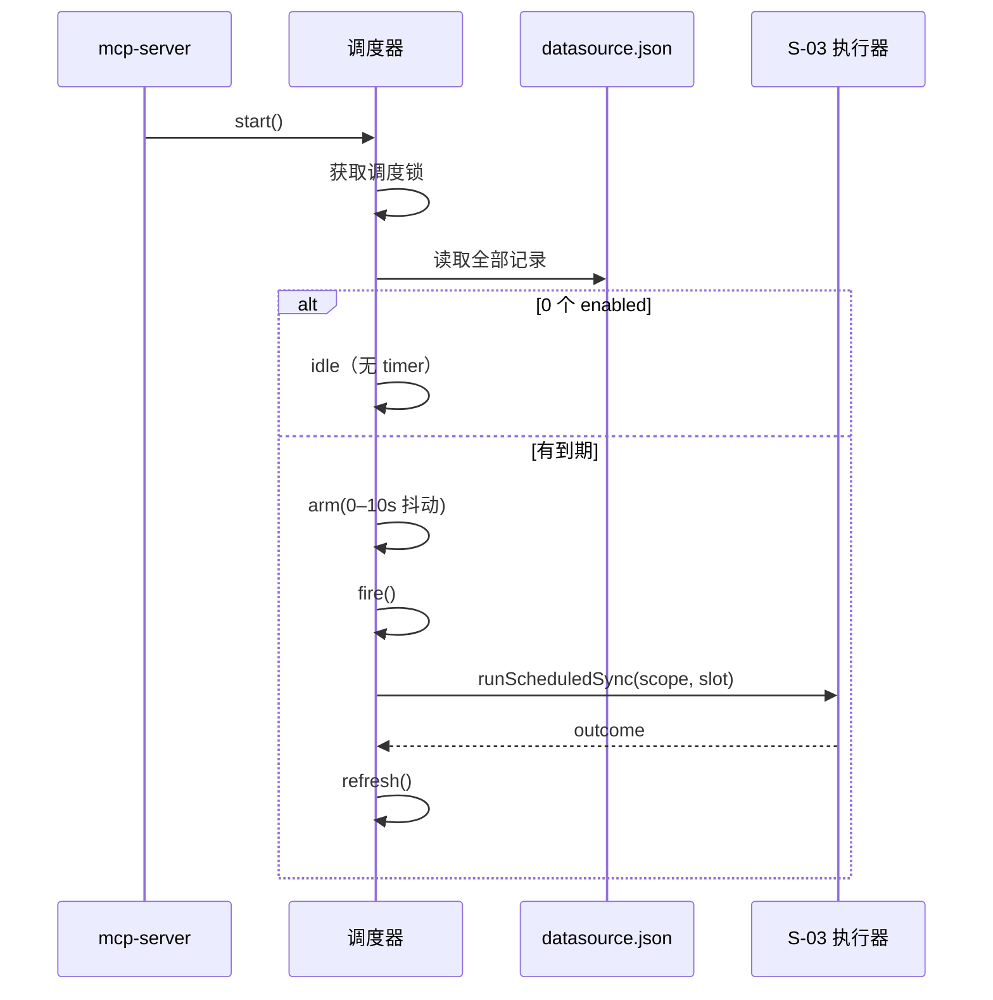
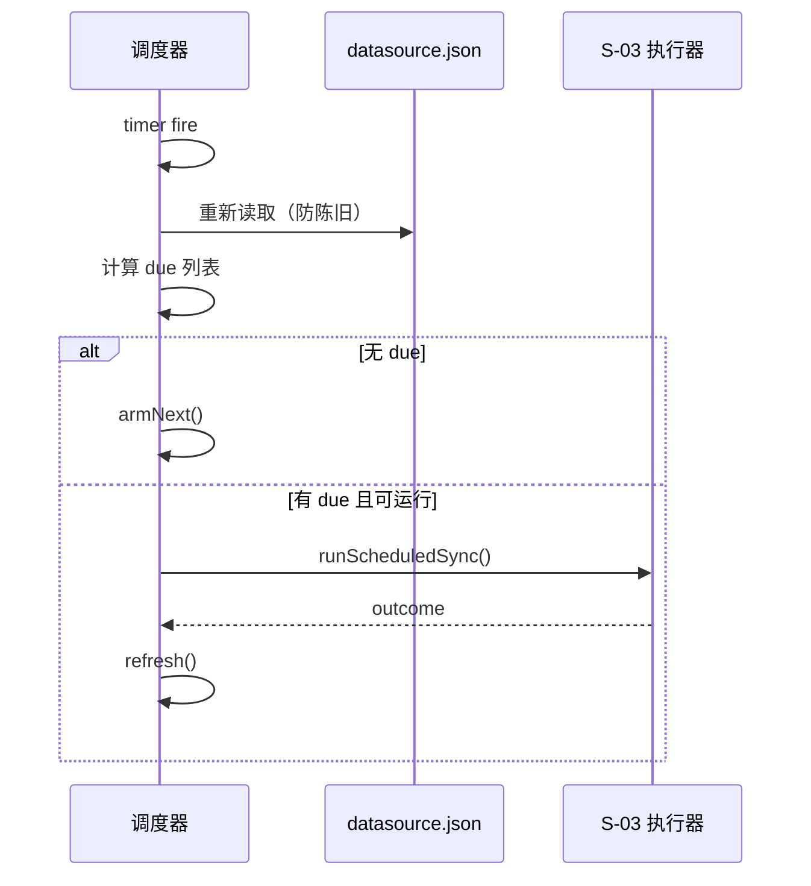

# S-02 调度器运行时 · 设计

> 父文档：[DESIGN.md](DESIGN.md) ｜ 上游：[S01_配置模型与接口_DESIGN.md](S01_配置模型与接口_DESIGN.md)

## 1. 术语

| 术语 | 定义 |
|---|---|
| 调度器 | daemon 进程内的单例，负责计时与触发；**不是**独立进程 |
| 按需定时器 | 无启用计划时不建 `setTimeout`，有 ≥1 个时才 arm 最近到期 |
| 到期 `due` | `now >= nextRunAt` |
| 槽位 `occurrence` | 指定时间模式的一次预定时刻；用于 daily 去重 |
| 启动补跑 | daemon 启动时对已过期计划立即补跑**一次** |
| 跳过 `skip` | 因 active 任务 / scope 锁 / 调度禁用未执行；**不计失败** |
| 抖动 `jitter` | 到期后随机延迟 0–60s，避免多源同时启动 |
## 2. 现状（AS-IS）

| 现状 | 证据 |
|---|---|
| 系统无调度器；`src` 全域无定时调度实现 | 代码检索 |
| 同步单一入口 `syncDataSource()`，内部取 scope 写锁 | `src/lib/datasource.ts:1575-1619` |
| 页面/CLI 同步都经 coordinator（`engine-only`） | `src/lib/operation-coordinator.ts:100-105` |
| 任务台账记录 queued/running/终态 | `src/lib/task-registry.ts:475-498` |
| daemon 仅 HTTP 模式常驻；stdio 是薄桥 | `src/mcp-server.ts:713-715` |
| 读所有登记记录的函数存在但未导出（不做可达性过滤） | `src/lib/datasource.ts:489-508` |

## 3. 方案（TO-BE）

新增 `src/lib/datasource-scheduler.ts`，在 `opts.http` 的 daemon 中启动。

### 3.1 生命周期（按需）

```
daemon 启动
└─ 获取调度锁 <dataDir>/.datasource-scheduler.lock
   ├─ 失败（另一活进程持有）→ 不启动，stderr 日志
   └─ 成功 → 扫描全部 datasource.json
       ├─ 0 个 enabled → idle（无 timer，零轮询）
       └─ ≥1 个 → 计算最近 nextRunAt，arm 一个 setTimeout
配置保存 / 删除数据源 / 同步完成 → refresh() 重新计算
timer 到期 → fire() → 重新读记录（防陈旧）→ 执行或重排
仅一次完成后（S-01 置 enabled=false）→ refresh() 后无 timer
shutdown → abort 当前 run → clearTimer → 释放调度锁
```

### 3.2 下次运行计算（纯函数，S-01 的 `computeNextRun`）

**周期模式**

```
intervalMs = toMs(intervalValue, intervalUnit)
base = max(lastSync?.at ?? 0, schedule.lastAutoAt ?? 0)
base === 0  → next = now + intervalMs       // 首次开启：等满一个周期
否则        → next = base + intervalMs      // 从上次【完成】起算
due = next <= now                           // 停机后过期 → 补跑一次
```

> 从「完成时间」起算而不是「开始时间」：同步可能持续数分钟，避免上一轮未结束就到期。
> 首次开启不等同于"立即跑"；用户拍板的补跑是 daemon 启动时对**已过点**的计划补跑。

**指定时间 · 仅一次**

```
atMs = parseLocal(at)
lastAutoFor === atMs → 无下次（已完成）
否则 → next = atMs；due = atMs <= now
```

**指定时间 · 每天重复**

```
startMs = parseLocal(at)                    // 从该日期起，每天 HH:mm
if (now < startMs) → next = startMs
else
  todaySlot = 今天 HH:mm（不早于 startMs）
  if (now >= todaySlot && (lastAutoFor == null || lastAutoFor < todaySlot))
       → due，occurrence = todaySlot        // 今天已过点且未执行 → 补跑
  else → next = min(todaySlot > now ? todaySlot : 明天 HH:mm)
```

- 停机多天：只补跑**一次**（今天/最近槽位），随后进入下一次。
- DST：`new Date(y,m,d,h,min)` 对不存在的本地时间会归一化到下一有效时刻；重复小时只按 `lastAutoFor` 执行一次。
- 所有比较用 epoch ms；`at` 仅在解析时按**服务器本地时区**解释。

### 3.3 定时器

```ts
const MAX_TIMER_MS = 2_147_000_000; // ~24.8 天，高于 Node setTimeout 上限会立即触发
delay = clamp(nextRunAt - now, 0, MAX_TIMER_MS)
timer = setTimeout(fire, delay + jitterMs).unref()
```

- `unref()`：调度器不阻止进程退出（HTTP server 负责保活）。
- `delay` 被截断到 `MAX_TIMER_MS` 时，到点后重算，不误触发。
- `jitterMs`：未来到期 0–60s；已过期（补跑）0–10s；测试可注入固定值。
- 每次 `fire` 前清空 timer，避免重复。
- `fire` 时若 `runningScope === scope`，该 scope 不进入本轮 due（避免重复 arm 噪声）。

### 3.4 执行与并发

```
fire()
├─ running === true → 重排 SKIP_RETRY_MS（5 分钟）
├─ 读全部记录 → 计算 due 列表（按 nextRunAt 升序）
│   └─ 空 → armNext()
├─ 取最早 due 的 scope
├─ canRunNow(scope)?  ← S-03：任务台账 + coordinator 队列
│   ├─ 否 → 记录 skip，重排 5 分钟
│   └─ 是 → running=true
│       ├─ runScheduledSync(record, occurrence)   ← S-03
│       └─ finally running=false; refresh()
```

- **全局并发 1**：同一时刻最多一个自动同步；其余到期项在本轮结束后由 `refresh()` 重新 arm。
- 不与手动同步排队：检测到 active 直接跳过，避免堆积。
- 每次 run 读取一次 `loadConfig()` 并传入 `runScheduledSync`（与 HTTP 的 `runWithConfigSnapshot` 同口径），避免配置中途变化导致前后半段路径不一致。
- 跳过原因（枚举）：`active-task` / `scope-lock-busy` / `clone-busy` / `task-registry-unavailable` / `not-found` / `disabled` / `invalid-schedule`；写入 `schedule.lastSkip*`（S-03 在能拿到锁时持久化），并暴露到 healthz。

### 3.5 单实例与开关

| 机制 | 规则 |
|---|---|
| 调度锁 | `<dataDir>/.datasource-scheduler.lock`，0600，内容 `{pid,startedAt}`；活 pid 占用则本进程不启动；PID 已死视为陈旧并回收；**无法解析/字段非法 → 视为占用（不抢占）并告警**，人工删除后重启 |
| 启动条件 | 仅 `opts.http`（daemon/前台 HTTP）；stdio 与 CLI 直连不启动 |
| 环境关闭 | `KI_DISABLE_DATASOURCE_SCHEDULER=1` → 不启动；接口仍可保存配置并返回 `schedulerDisabled:true` |
| 停止 | `stopDataSourceScheduler()`：abort 当前 run（`syncDataSource` 支持 `abortSignal` / `onInterrupt`）→ 清 timer → 释放锁；由 `onShutdown` 调用 |

### 3.6 刷新触发点

| 触发 | 调用位置 |
|---|---|
| 保存定时设置 | `src/lib/mcp-http-api.ts` 新 handler 成功后 `refreshDataSourceScheduler()` |
| 页面手动同步完成 | `src/lib/mcp-http-api.ts::runDatasourceSyncTask` 的 `finally` |
| CLI 经 daemon 同步完成 | `src/lib/daemon-rpc.ts` job 的 `taskReporter.finish` 之后 |
| 添加 Git 源首次同步完成 | `src/lib/mcp-http-api.ts` add-remote 任务收尾（同 `runDatasourceSyncTask`） |
| 删除数据源 | `src/datasource.ts`（CLI remove）成功后 |
| 删除 scope | `src/scope.ts`（CLI scope delete）成功后 |
| 恢复快照 | `src/restore.ts` / CLI restore 成功后；**恢复会连带恢复 `datasource.json` 中的 schedule** |
| 调度器自身运行完成 | `refresh()` |
| daemon 启动 | `startDataSourceScheduler()` 内部扫描 |
| SIGHUP 配置刷新 | 不处理（schedule 不在 config.yaml；dataDir 漂移需重启） |

### 3.7 可观测

`getDataSourceSchedulerState()`：

```ts
{
  started: boolean;
  disabled: boolean;            // 环境变量关闭
  enabledSources: number;       // 当前 enabled 计划数
  armed: boolean;               // 是否有 timer
  runningScope: string | null;
  nextScope: string | null;
  nextRunAt: number | null;
  lastSkip: { scope: string; reason: string; at: number } | null;
}
```

挂到 `/healthz` 的 `datasourceScheduler` 字段（`src/lib/mcp-http.ts` 现有 healthz 组装处）。

> `enabledSources` = 当前 `enabled=true` 的计划数；`armed` = 是否有 timer。仅一次计划完成后 `enabled=false`（S-01），两者同时归零。若文件被手工改成 `enabled=true` 但无下次，不 arm 并在 healthz 标记异常。

## 4. 时序

**启动 + 补跑**



**定时器到期**



## 5. 异常处理

| 场景 | 行为 | 对外 |
|---|---|---|
| 调度锁被占用 | 不启动调度，stderr 记录 pid | healthz `started:false` |
| `datasource.json` 损坏 | 跳过该 scope，stderr 告警 | 页面列表已有 `corrupt` |
| `schedule` 非法 | 不启用该计划，记录 `invalid-schedule` | 详情/healthz |
| timer 被 `MAX_TIMER_MS` 截断 | 到点重算 | 无感 |
| 系统休眠后唤醒 | timer 迟到触发 → 重新计算 → 补跑一次 | 日志 |
| 时钟回拨 | 到点重算，未到期则重排 | 无感 |
| 全局并发中又有到期 | 跳过并 5 分钟后重试 | healthz `lastSkip` |
| 进程被 kill | 锁文件残留 → 下次启动按 PID 回收 | 日志 |
| 读记录失败 | 跳过本轮，5 分钟后重试 | healthz |

## 6. 影响范围

```
src/
├── lib/
│   ├── datasource-scheduler.ts    [新增] 调度器单例 + 生命周期 + 定时器 + 锁
│   └── datasource-schedule.ts     [复用] computeNextRun（S-01）
├── mcp-server.ts                  [修改] HTTP 模式 start/stop；`startHttpMcpServer` 就绪后 start，`onShutdown` stop
└── lib/mcp-http.ts                [修改] healthz 增加 datasourceScheduler
test/
├── datasource-schedule.test.ts    [复用] 纯函数
└── datasource-scheduler.test.ts   [新增] 工厂 + 假时钟/假定时器
```

**测试注入**：导出 `createDataSourceScheduler(deps)`，deps 含 `now / setTimer / clearTimer / readRecords / runSync / random / config`；生产用默认 deps。单例 `startDataSourceScheduler()` 包装生产实例。

## 7. 关键决策点

| 决策 | 选择 | 被否决方案 | 理由 / 重新评估触发条件 |
|---|---|---|---|
| 计时模型 | 单一定时器 + 按需 arm | 固定 60s tick | 无计划时零轮询（用户明确要求）；**触发**：需要秒级精度时 |
| 调度位置 | daemon 进程内 | 独立进程 / 系统 cron | 复用任务台账/队列/日志；无 daemon 即不调度可接受；**触发**：需要无人值守的多机调度 |
| 周期基准 | 上次完成后 + 间隔 | 固定节拍（开始时间） | 避免长同步期间反复到期；**触发**：用户要求严格节拍 |
| 首次开启 | 等满一个周期 | 立即跑一次 | 开启动作不应立刻触发重活；补跑只针对"已过点"；**触发**：用户要求开启即同步 |
| 并发 | 全局 1 | 按 scope 并行 | 控制 CPU/embedding 突发；**触发**：源很多且要求尽快追平 |
| 跳过策略 | 直接跳过 + 5 分钟后重试 | 进队列等待 | 避免定时任务堆积；**触发**：用户希望"等当前任务结束后自动跑" |
| 多 daemon | 进程级调度锁 | 依赖 scope 锁 | 避免重复任务；**触发**：需要多实例高可用 |

## 8. 待定 / 风险

| 项 | 说明 |
|---|---|
| 首次开启语义 | 当前等一个周期；如需"开启即跑"改 `computeNextRun` 的 base=now |
| 每日失败重试 | 失败当天也写 `lastAutoFor`，下一日再试；若需当天重试，需为 daily 另定失败策略 |
| 间隔上限 | 365 天；更长用每天模式表达 |
| 任务抖动 | 页面"下次运行"显示理论时刻，实际最多晚 60s |
| 调度锁粒度 | 按 dataDir；同一 dataDir 多 daemon 只允许一个调度 |
| 睡眠期间 | 唤醒后补跑一次，不补多次 |
| 高频 × 多源 | 全局并发 1 + 任务 TTL 1h / 读取上限 2000；1 分钟 × N 源会产生大量 overdue 与任务噪音，页面应提示高频风险，必要时限制最小间隔 |
| 非托管 Git | 既有边界：仅托管 clone 有 clone 锁；两个 scope 指向同一本地 repo 时可能并发 `merge --ff-only` |
| 多标签页并发保存 | 页面无版本校验，后保存覆盖前保存；建议请求带 `baseUpdatedAt` 做乐观锁（Q4，待确认） |

## 9. 验收

1. 没有任何 enabled 计划时，`getDataSourceSchedulerState().armed === false`，进程内无调度 timer。
2. 保存第一个计划 → `armed=true`；关闭最后一个 → `armed=false`。
3. 间隔设为 1 分钟（测试）：到点后 ≤60s 触发一次；任务台账出现 `source=scheduler`。
4. 停止 daemon 超过 2 个周期后启动 → 5 分钟内每源恰好补跑 1 次。
5. 10 个源同时到期 → 同一时刻只有 1 个 running。
6. 连续 3 次 failed → 详情显示失败计数；第 4 个周期仍触发。
7. `KI_DISABLE_DATASOURCE_SCHEDULER=1` → 不建 timer，保存接口返回 `schedulerDisabled:true`。
8. `healthz.datasourceScheduler` 字段随状态变化。
