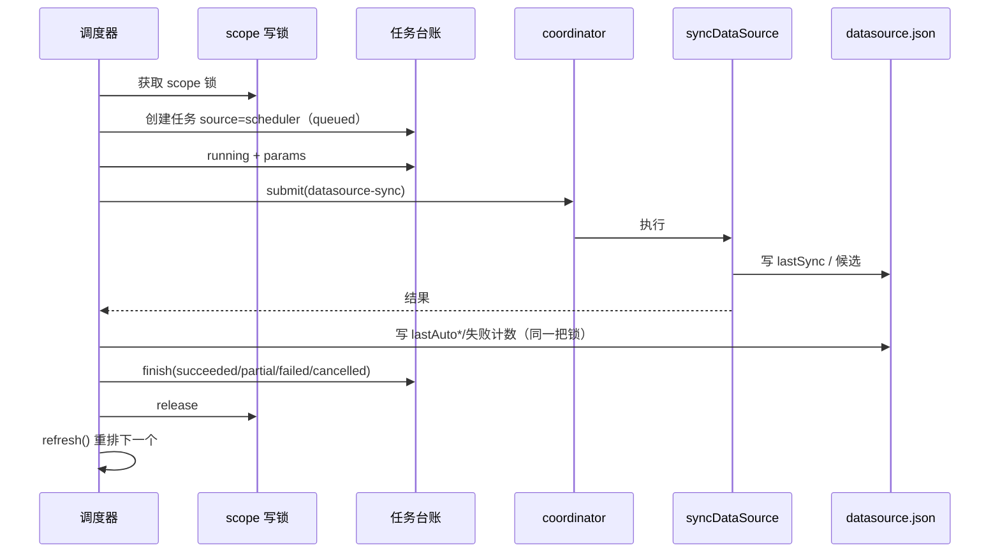
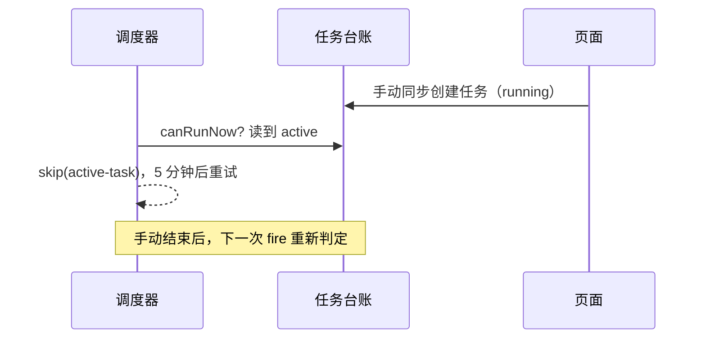

# S-03 同步接入与任务台账 · 设计

> 父文档：[DESIGN.md](DESIGN.md) ｜ 上游：[S02_调度器运行时_DESIGN.md](S02_调度器运行时_DESIGN.md)

## 1. 术语

| 术语 | 定义 |
|---|---|
| 调度触发 | 由调度器（而非页面/CLI）发起的 `datasource-sync` |
| `source=scheduler` | 任务台账中对调度触发的来源标识 |
| 可运行判定 | 同 scope 无 active 的 import / datasource-sync / add-remote 任务 |
| 跳过 | 判定为不可运行或 scope 锁被占用；**不创建任务、不计失败** |
| 连续失败 | 仅调度触发且最终 `state=failed` 的连续次数；ok/partial 清零 |

## 2. 现状（AS-IS）

| 现状 | 证据 |
|---|---|
| 任务来源枚举只有 `cli/daemon/web`，读侧有白名单 | `src/lib/task-registry.ts:6,464` |
| 页面同步：台账 active 检查 → 进程内 gate → 任务 → coordinator | `src/lib/mcp-http-api.ts:2327-2420` |
| `syncDataSource` 内部取 scope 写锁 | `src/lib/datasource.ts:1610` |
| 任务参数/结果快照映射目前是 HTTP 侧私有函数 | `src/lib/mcp-http-api.ts:2200-2284` |
| 同 scope 任务串行由 coordinator 保证 | `src/lib/operation-coordinator.ts:100-113` |
| 顶栏徽章按 `['tasks']` 轮询（空闲 15s） | `web/src/layouts/AppShell.tsx:283-292` |

## 3. 方案（TO-BE）

### 3.1 任务来源扩展

```ts
// src/lib/task-registry.ts
export type TaskSource = 'cli' | 'daemon' | 'web' | 'scheduler';
```

- 读侧白名单 `['cli','daemon','web','scheduler']` 必须同步（否则任务文件被判不可读、从列表消失）。
- 前端 `web/src/api/tasksApi.ts` 的 `TaskSource`、`web/src/lib/taskDetailModel.ts` 的 `SOURCE_LABEL` 增加 `scheduler: '定时'`。
- `ki.css` 增加 `.ki-task-source-badge--scheduler`（沿用现有徽标形状，仅文字/色调区分）。
- **被否决**：复用 `daemon` —— 无法区分"定时触发"与"CLI 经 daemon 触发"。

### 3.2 映射复用

把 HTTP 侧私有的三个函数抽到 `src/lib/datasource-task.ts`，HTTP 与调度器共用：

```ts
export function datasourceSyncMode(record: DataSourceRecord, full: boolean): 'incremental' | 'full';
export function datasourceSyncParams(record: DataSourceRecord, full: boolean): TaskParamSnapshot | undefined;
export function toDatasourceSyncResultSnapshot(result: SyncDataSourceResult): TaskResultSnapshot | undefined;
```

**被否决**：调度器复制一份 —— 两份映射一旦漂移，任务页与数据源页口径不一致。

### 3.3 执行流程

```ts
async function runScheduledSync(input: {
  scope: string;
  slot: number | null;          // 本次计划槽位
  record: DataSourceRecord;
  config: KiConfig;             // S-02 在 run 前读取一次，避免中途配置漂移
  abortSignal?: AbortSignal;    // S-02 stop() 时中止
}): Promise<SchedulerRunOutcome> {
  // 生产实现外层用 runWithConfigSnapshot(input.config, ...) 包裹（与 HTTP 同口径）
  try {
    return await withScopeWriteLock(input.scope, 'datasource-sync', async () => {
      // 1) 锁内重读：配置可能已被删除/关闭
      const read = readDataSource(input.scope);
      if (!read.ok) return { outcome: 'skipped', reason: 'not-found' };
      if (!read.record.schedule?.enabled) return { outcome: 'skipped', reason: 'disabled' };

      // 2) 可运行判定（台账 + coordinator）
      if (!canRunNow(input.scope)) return { outcome: 'skipped', reason: 'active-task' };

      const exec = async (): Promise<SchedulerRunOutcome> => {
        // 3) 先建任务：同步开始那一刻任务页/顶栏可见
        const taskId = crypto.randomUUID();
        let task: TaskReporter;
        try {
          task = createTaskReporter(input.config, {
            id: taskId, source: 'scheduler', operation: 'datasource-sync', scope: input.scope,
          });
        } catch (err) {
          return { outcome: 'skipped', reason: 'task-registry-unavailable' };
        }
        task.update({ state: 'running', startedAt: Date.now(), params: datasourceSyncParams(read.record, false) });

        // 4) 执行（scope 锁 / clone 锁由外层继承，不会自锁）
        let result: SyncDataSourceResult | null = null;
        let thrown: Error | null = null;
        try {
          result = await syncDataSource({
            scope: input.scope,
            taskId,
            config: input.config,
            abortSignal: input.abortSignal,
            onInterrupt: () => task.finish('cancelled', { errorCode: 'SYNC_CANCELLED', error: 'daemon 正在关闭，自动同步已中止' }),
            onProgress: (p) => task.progress(p),
            onPhase: (phase) => task.update({ phase }),
          });
        } catch (err) {
          thrown = err as Error;
        }

        // 5) 收尾：先写运行态（避免崩溃后重复补跑），再 finish 任务
        const outcome = resolveOutcome(result, thrown);
        const postLockSkip = !thrown && result && !result.ok && result.code === 'CLONE_BUSY';
        if (postLockSkip) {
          updateScheduleRuntime(input.scope, { slot: input.slot, outcome: { outcome: 'skipped', reason: 'clone-busy' }, at: Date.now() });
          task.finish('cancelled', { errorCode: 'CLONE_BUSY', error: '共享仓库正在被其他数据源同步，本次跳过' });
          return { outcome: 'skipped', reason: 'clone-busy' };
        }
        updateScheduleRuntime(input.scope, { slot: input.slot, outcome, at: Date.now() });
        finishTask(task, outcome, result, thrown);
        return outcome;
      };

      // 2.1) 托管 clone 预锁：同 scope→clone 的既有锁序，避免与手动同步死锁
      if (read.record.type === 'git' && read.record.git?.managed && read.record.git.repoRoot) {
        try {
          return await withManagedCloneLock(read.record.git.repoRoot, 'datasource-clone-sync', exec);
        } catch (err) {
          if ((err as { code?: string }).code === 'SCOPE_OPERATION_BUSY') {
            return { outcome: 'skipped', reason: 'clone-busy' };
          }
          throw err;
        }
      }
      return exec();
    });
  } catch (err) {
    if ((err as { code?: string }).code === 'SCOPE_OPERATION_BUSY') {
      return { outcome: 'skipped', reason: 'scope-lock-busy' };
    }
    throw err;
  }
}
```

**关键点**：
- **锁序固定为 scope → clone**（与 `syncDataSource` 内部一致）：若先 clone 后 scope，会与"持 scope 等 clone"的手动同步形成死锁。
- **先拿锁、再建任务**：scope 锁被占不会留下失败任务；托管 clone 忙在建任务前就 skip，任务页不会出现假失败。
- **`CLONE_BUSY` 竞态兜底**：预锁后仍可能在 `syncDataSource` 内遇到（极小窗口）→ 任务记 `cancelled`，**不计失败**。
- **任务创建失败**：不执行同步（无法记账），返回 skip；S-02 5 分钟后重试。
- **先写运行态再 finish 任务**：若进程在两者之间崩溃，`lastAutoFor` 已推进，不会在下次启动重复补跑同一槽位；任务记录可能停在 running，由心跳/TTL 兜底。
- **`updateScheduleRuntime`** 只改运行态字段，保留用户配置，且**不修改 `updatedAt`**：
  - `lastAutoAt = now`
  - `lastAutoFor = slot`（**仅在非 cancelled 时写**；cancelled 留给下次补跑）
  - `lastAutoState = state`
  - `consecutiveFailures`：failed → +1；ok/partial → 0；cancelled → 不变
  - **仅一次（`at` + `once`）完成（非跳过）→ `enabled=false`**（S-01）
  - 成功或部分成功时清空 `lastSkipReason/lastSkipAt`
- **任务终态映射**：`ok+ok→succeeded`、`ok+partial→partial`、`ok+cancelled→cancelled`、`ok+failed→failed`、`!ok→failed`、抛异常→failed；`CLONE_BUSY` 特殊映射为 cancelled + skip。
- **手动同步成功清零**：`syncDataSource` 内部的 scope 锁在返回前已释放，**不能**在其后直接写。手动路径需在调用前用 `withScopeWriteLock` 包一层（嵌套复用），在锁内完成同步与 `resetScheduleFailures(scope)`；或把清零并入 `syncDataSource` 成功写回。否则只能接受竞态。
- **配置快照**：run 外层用 `runWithConfigSnapshot(input.config, ...)` 包裹（与 HTTP 路径同口径），`syncDataSource` 透传 `config`，避免长同步期间配置热更新导致前后半段漂移。
- **有意不走 coordinator**：为避免 `submit` 排队，调度器直接用 scope/clone 锁 + 台账预检；代价是 `/healthz.queue` 看不到该次执行、跨 scope 并发不受 coordinator 全局 worker 限制（全局并发 1 仍成立）。后续如需队列指标，再引入非排队 `trySubmit`。

### 3.4 可运行判定

```ts
function canRunNow(scope: string): boolean {
  let tasks;
  try { tasks = listTaskRecords(config); }
  catch { return false; }                    // 台账不可读 → 宁可跳过
  const active = tasks.some((t) => t.scope === scope
    && (t.state === 'queued' || t.state === 'running')
    && ['import', 'datasource-sync', 'datasource-add-remote'].includes(t.operation));
  if (active) return false;
  const queue = getSharedOperationCoordinator().snapshot().queues[scope] ?? 0;
  if (queue > 0) return false;
  return true;
}
```

- 不把被跳过的计划塞进 coordinator 队列（避免堆积）。
- 台账读失败按"不可运行"处理（fail-safe），由 S-02 重试。
- 覆盖范围是**已登记台账的长任务**（import / datasource-sync / datasource-add-remote）；不登记台账的短写若正占用 coordinator，定时任务可能短暂排队（秒级窗口），不影响正确性。
- 托管 clone 另由 `withManagedCloneLock` 在**建任务前**预锁（3.3），忙则 skip。

### 3.5 与手动同步的关系

| 场景 | 行为 |
|---|---|
| 手动同步进行中，定时到点 | 定时看到 active → 跳过；不产生第二个任务 |
| 定时运行中，页面点同步 | 页面预检台账 → 409「已有同步任务」 |
| 定时运行中，CLI `sync` | 抢 scope 锁失败 → `SCOPE_OPERATION_BUSY`（fail-loud） |
| 定时运行中，页面改定时设置 | 保存 409（S-01）；提示"同步完成后再改" |
| 手动同步完成 | 下次到期时间以 `lastSync.at` 重算（S-02 `refresh`）；成功/partial 同时清零连续失败 |
| 托管 clone 忙 | `skip(clone-busy)`；未建任务或任务记 cancelled，**不计失败** |

### 3.6 顶栏"运行中"显示

- **手动触发**：S-04 在 `triggerSync` 成功后立即 `invalidateQueries({queryKey:['tasks']})` → 顶栏立即显示。
- **定时触发**：任务在同步开始前创建；顶栏按现有 15s 空闲轮询出现，最迟约 15s。**已知边界**：如需秒级，需要把空闲轮询降到 5s 或引入事件推送；本期不改全局轮询。
- 任务来源为 `scheduler`，任务页可辨认"定时"。

## 4. 时序

**定时触发**



**定时与手动冲突**



## 5. 异常处理

| 场景 | 行为 | 任务状态 | 失败计数 |
|---|---|---|---|
| 同步返回 `ok:false` | 记录 errorCode/error | failed | +1 |
| 同步抛异常 | 记录 message | failed | +1 |
| partial | 记录结果快照 + warning | partial | 清零 |
| cancelled（进程收尾） | 记录已处理结果 | cancelled | 不变 |
| 任务台账创建失败 | 不同步 | 无任务 | 不变（skip） |
| 托管 clone 忙（预锁） | skip(clone-busy) | 无任务 | 不变 |
| 托管 clone 忙（并发竞态） | 任务记 cancelled + errorCode=CLONE_BUSY | cancelled | 不变 |
| 调度器运行态写失败 | 日志；任务仍 finish | 按结果 | 本次不更新 |
| `datasource.json` 已被删除 | skip(not-found) | 无任务 | 不变 |
| `schedule.enabled=false` | skip(disabled) | 无任务 | 不变 |

> **跳过不建任务**：跳过不是一次同步尝试，不写任务台账、不污染失败徽章；如需"跳过也留痕"，需新增 `skipped` 任务状态（本期不做，列入待确认）。
> **仅一次完成**：非跳过完成后 `enabled=false`（S-01），保留 `lastAuto*`；界面上计划回到关闭态，任务页仍可查该次执行。

## 6. 影响范围

```
src/
├── lib/
│   ├── task-registry.ts        [修改] TaskSource + 读侧白名单
│   ├── datasource-task.ts      [新增] 参数/结果快照映射（HTTP/调度器共用）
│   ├── datasource-scheduler.ts [修改] 调用 runScheduledSync
│   ├── mcp-http-api.ts         [修改] 改用共享映射；手动同步后 refresh() + 成功清零
│   └── daemon-rpc.ts           [修改] CLI 经 daemon 同步收尾 refresh() + 成功清零
web/src/
├── api/tasksApi.ts             [修改] TaskSource 增加 scheduler
├── lib/taskDetailModel.ts      [修改] SOURCE_LABEL 增加 scheduler
└── styles/ki.css               [修改] 来源徽标样式
test/
├── task-registry.test.ts       [修改] 新来源可读
├── datasource-task.test.ts     [新增] 映射契约
└── datasource-scheduler.test.ts[新增] 跳过/失败计数
```

## 7. 关键决策点

| 决策 | 选择 | 被否决方案 | 理由 / 重新评估触发条件 |
|---|---|---|---|
| 任务来源 | 新增 `scheduler` | 复用 `daemon` | 任务页需区分"定时"；读侧白名单成本低；**触发**：无区分需求时可合并 |
| 跳过是否建任务 | 不建任务 | 建一条 failed | 跳过不是同步尝试，不应污染失败徽章；**触发**：需要审计每次跳过时改记 `skipped` 状态 |
| 失败计数范围 | 仅调度触发计数；手动成功/partial 清零 | 所有同步都计数 | 用户关注"自动同步连续失败"；手动失败由页面直接反馈；**触发**：需要统一健康度时 |
| 托管 clone 忙 | 预锁 + skip（竞态记 cancelled），不计失败 | 记为 failed | N5 要求不污染失败状态；**触发**：无 |
| 仅一次完成态 | 非跳过完成后 `enabled=false` | 保持 enabled + next=null | 避免"已完成仍显示已开启"；**触发**：用户要求保留开启态 |
| 锁的范围 | 覆盖运行 + 运行态写回 | 只包 `syncDataSource` | 防止用户保存配置与结果写回互相覆盖；**触发**：锁持有时间过长影响配置保存 |
| 任务创建时机 | 锁内、同步前 | coordinator 回调内 | 确保"开始即显示"且不会因锁被占留下失败任务；**触发**：需要更早可见 |
| 结果映射复用 | 抽公共模块 | HTTP/调度器各一份 | 两端口径必须一致；**触发**：无 |

## 8. 待定 / 风险

- 定时触发的顶栏可见延迟最多 15s（见 3.6）；如需秒级，另议降轮询或事件推送。
- `ki-task-source-badge--scheduler` 的视觉需在实现时按现有 token 取值，不在设计阶段编造色值。
- 任务页历史量随频率增长（TTL 1h + 2000 文件上限），高频计划需关注任务列表噪音。
- **待确认**：跳过（active-task / clone-busy / lock-busy）是否需要在任务页留痕。当前设计不建任务；若需要，需新增 `skipped` 状态并调整顶栏/任务页口径。

## 9. 验收

1. 定时触发后任务立即出现（`source=scheduler`），状态从 queued → running → 终态。
2. 成功、失败、partial 都保留在任务台账；失败计数按 3.3 规则变化。
3. 手动同步进行中到点：不产生第二条任务，`lastSkipReason=active-task`。
4. 定时运行中点页面同步：409；点保存定时：409。
5. 任务台账不可读：不执行同步，不产生任务，S-02 5 分钟后重试。
6. 顶栏在手动同步提交后 1s 内显示运行中（S-04 修复）；定时任务最迟 15s。
