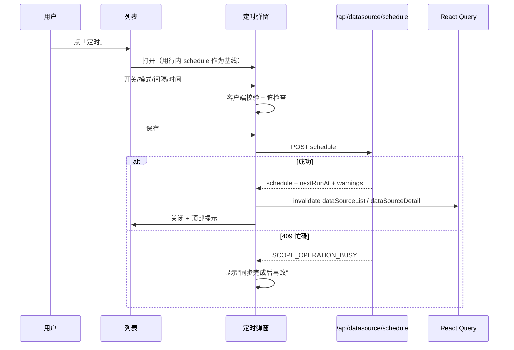

# S-04 页面配置与可见性 · 设计

> 父文档：[DESIGN.md](DESIGN.md) ｜ 上游：[S01](S01_配置模型与接口_DESIGN.md)、[S02](S02_调度器运行时_DESIGN.md)、[S03](S03_同步接入与任务台账_DESIGN.md)

## 1. 术语

| 术语 | 定义 |
|---|---|
| 定时按钮 | 列表操作列的「定时」，打开配置弹窗（**唯一配置入口**） |
| 定时弹窗 | 居中对话框，编辑开关/模式/间隔/指定时间 |
| 第二行 | 「上次同步」列下方显示下次运行/失败信息的辅助行 |
| 只读块 | 详情抽屉中的「定时同步（只读）」展示区，无输入控件 |
| 脏检查 | 表单值与打开时基线比较，决定保存按钮是否可用 |

## 2. 现状（AS-IS）

| 现状 | 证据 |
|---|---|
| 列表 8 列：Scope/类型/源目录/落点/上次同步/状态/持续时间/操作 | `web/src/pages/DataSourcePage.tsx:832-915` |
| 操作列只有「同步」；点击行打开右侧详情抽屉 | 同上；`:947-1180` |
| 详情抽屉含执行结果/同步参数/待删除（**待删除保持现状**） | `web/src/pages/DataSourcePage.tsx:1088-1174` |
| 已有「添加 Git 数据源」居中弹窗可复用样式与焦点逻辑 | `web/src/pages/DataSourcePage.tsx:625-780` |
| 列表每 15s 轮询；详情运行中 3s、否则 15s | `web/src/lib/hooks.ts:165-185` |
| 提交同步后只失效 `dataSourceDetail/dataSourceList/docList`，未失效 `['tasks']` | `web/src/pages/DataSourcePage.tsx:492-496` |
| 顶栏徽章空闲 15s、有活动任务 3s | `web/src/layouts/AppShell.tsx:283-292` |
| 页面提示条/冷却文案易被读成"每 30 分钟自动同步" | `web/src/pages/DataSourcePage.tsx:786,859,1003` |

## 3. 方案（TO-BE）

### 3.1 列表

- 类型列：`Git` / `目录` 徽标后追加 `定时` / `定时⚠` 小徽标；<900px 随类型列隐藏。
- 「上次同步」列第二行（仅启用定时后出现）：
  - 周期：`下次 12:13 · 每 30 分钟`
  - 指定一次：`下次 11-01 09:00 · 仅一次`
  - 每天：`下次 11-01 09:00 · 每天`
  - 已过期待补跑：`即将补跑（11-01 09:00）`（warning 色）
  - 仅一次已完成：`已执行 · 仅一次`（计划自动关闭，徽标消失；详情仍可查）
  - 失败：`下次 12:13 · 连续失败 3 次，仍会尝试`（warning 色）
- 操作列：`[同步] [定时]`；`定时` 阻止行点击冒泡，打开弹窗。
- 旧 daemon 无 `schedule` 字段：隐藏「定时」按钮，页面顶部提示「当前 daemon 不支持定时同步，请升级并重启」。
- **目录不可读的源**（`list.missing`）当前只在告警条出现、不在表格行，无法打开定时入口；见 §8 待确认（建议在告警条补一个「定时」按钮）。

### 3.2 定时弹窗（唯一配置入口）

**周期模式**

```
┌ 定时同步 · ai-docs ────────────────────────────────────── ✕ ┐
│ 上次同步 2026-10-29 11:43:07 · Git @a1b2c3d                 │
│                                                              │
│ 自动同步      [ ● 开 ]                                       │
│                                                              │
│ 模式          (●) 周期            ( ) 指定时间               │
│                                                              │
│ 每隔          [ 30 ]   [ 分钟 ▾ ]                            │
│                                                              │
│ 下次运行      2026-10-29 12:13（约 29 分钟后）               │
│ 上次自动      2026-10-29 11:43 · 成功                        │
│                                                              │
│                                     [ 取消 ]  [ 保存 ]       │
└──────────────────────────────────────────────────────────────┘
```

**指定时间模式**

```
│ 模式          ( ) 周期            (●) 指定时间               │
│                                                              │
│ 时间          [ 2026-11-01 09:00 ]                           │
│ 每天重复      [x] 每天                                       │
│                                                              │
│ 下次运行      2026-11-01 09:00（约 3 天后）                  │
│ ⚠ 仅一次且时间已过：保存后立即补跑一次                        │
```

**关闭态（默认）**

```
│ 自动同步      [ ○ 关 ]                                       │
│ 开启后可设置「周期」或「指定日期时间」；默认关闭。           │
│                                     [ 取消 ]  [ 保存 ]       │
```

**连续失败 3 次**

```
│ 下次运行      12:13                                          │
│ ⚠ 连续失败 3 次 · 下个周期 12:13 仍会尝试                    │
```

**布局与状态规则**

| 项 | 规则 |
|---|---|
| 容器 | 复用 `ki-overlay--front` + `ki-dialog ki-dialog--form`；宽度 `min(520px, 92vw)`，<640px 全宽 |
| 默认值 | 关闭；周期 24 小时；指定时间为空，需用户填写 |
| 单位 | 分钟 / 小时 / 天；不提供预设档位 |
| 指定时间 | `datetime-local`（分钟级）+「每天重复」勾选；按服务器本地时间（弹窗内注明） |
| 下次运行 | 标签写「当前下次运行（保存后重算）」，显示服务端当前值；保存后由接口返回的新值刷新列表/详情 |
| 仅一次完成态 | 开关回到关闭；显示「已完成（仅一次）」+ 上次自动结果；重新选时间可再次保存 |
| daemon 依赖 | 弹窗底部注明「定时同步需要 daemon 常驻；daemon 停止期间不会执行」 |
| 校验 | 间隔空/0/负数/非整数 → 内联错误 + 保存禁用；指定时间为空/非法 → 同 |
| 脏检查 | 未改动 → 保存禁用；取消恢复基线 |
| 关闭 | ✕ / 遮罩 / Esc：有未保存修改时先在 footer 显示「放弃未保存的修改？[继续编辑][放弃]」 |
| 焦点 | 打开聚焦弹窗；关闭后焦点还给对应行的「定时」按钮 |
| 保存 | 成功后关闭 + 失效 `dataSourceList` / `dataSourceDetail(scope)` + 顶部提示「定时设置已保存，下次 12:13」 |
| 服务端禁用调度 | 响应 `schedulerDisabled:true` → 弹窗内黄字提示「服务端已禁用调度，保存后不会自动执行」 |

### 3.3 详情抽屉（只读）

```
│ 执行结果                                                      │
│ ...                                                           │
│ 同步参数                                                      │
│ ...                                                           │
│ 定时同步（只读）                                              │
│ 状态        开启 · 每 30 分钟                                 │
│ 下次运行    2026-10-29 12:13（约 29 分钟后）                  │
│ 上次自动    2026-10-29 11:43 · 成功                           │
│ 连续失败    0 次                                              │
│                                                               │
│ 待删除 2 篇                                                   │
│ ...                                                           │
```

- **无输入框、无开关、无保存按钮**。
- 关闭态显示 `状态 关闭（默认）`；仅一次完成显示 `状态 关闭 · 已完成（仅一次）`。
- 「待删除」操作区保持现状不动。
- 旧 daemon 无 `schedule`：整块不渲染。

### 3.4 文案与冷却

- 页面提示条：`同步可在本页触发；普通目录手动同步有 30 分钟冷却（CLI 可强制）。定时同步在列表「定时」中按源开启，默认关闭。`
- 开启定时的源，冷却提示改为：
  `定时同步已开启，下次 12:13（约 29 分钟后）。普通目录手动同步仍在冷却中，如需立即同步请用 CLI。`
- 「同步」按钮 title 在开启定时后补充「定时同步已开启」。

### 3.5 顶栏任务提示修复

- `triggerSync` 成功后追加：
  ```ts
  queryClient.invalidateQueries({ queryKey: ['tasks'] })
  ```
  → 顶栏从「后台任务」立即变为「N 个任务运行中」（修复用户报的缺陷）。
- 添加 Git 源首次同步任务创建后同样失效 `['tasks']`。
- **定时触发**：任务在开始前创建；顶栏按 15s 空闲轮询出现（已知边界，见 S03 §3.6）。若需秒级，另议降轮询或事件推送。

### 3.6 客户端辅助函数

新增 `web/src/lib/datasourceSchedule.ts`（纯函数，可单测）：

```ts
export function scheduleBadgeLabel(s: DataSourceScheduleView | undefined): '定时' | '定时⚠' | null;
export function scheduleNextLine(s, lastSync, now): { text: string; tone: 'muted'|'warn' } | null;
export function describeSchedule(s): string;              // "每 30 分钟" / "每天 09:00" / "2026-11-01 09:00 · 仅一次"
export function validateScheduleForm(form): { ok: boolean; field?: string; message?: string };
export function toScheduleInput(form): DataSourceScheduleInput;
```

> 不在客户端重复实现 `computeNextRun`；下次时间以服务端返回为准，避免双源漂移。

## 4. 交互时序



## 5. 异常处理

| 场景 | 行为 |
|---|---|
| 400 校验失败 | 按 `details.field` 定位到字段，内联错误；弹窗不关 |
| 403 越权 | 弹窗内提示无权限；不重试 |
| 404 未登记 | 提示"数据源已不存在"，关闭并刷新列表 |
| 409 同步中 | 提示"该知识库正在同步，完成后再改定时设置"；保留表单 |
| 409 `SCHEDULE_STALE` | 提示"配置已在别处修改"；重取 detail 并刷新表单基线（需 S-01 实现乐观锁） |
| 500 写失败 | 提示可重试；保留表单 |
| `schedulerDisabled` | 黄字提示"服务端已禁用调度"；保存仍成功 |
| 旧 daemon | 隐藏「定时」入口 + 页面提示升级 |
| 页面轮询期间配置被改 | 下次打开弹窗用最新行数据作基线 |

## 6. 影响范围

```
web/src/
├── components/
│   └── DatasourceScheduleDialog.tsx   [新增] 弹窗 + 表单 + 脏检查 + 焦点
├── lib/
│   ├── datasourceSchedule.ts          [新增] 纯函数（标签/校验/转换）
│   └── dataSourceDetailModel.ts       [修改] 只读定时行
├── api/httpApi.ts                     [修改] 类型 + saveDataSourceSchedule
├── pages/DataSourcePage.tsx           [修改] 列表徽标/第二行/定时按钮/只读块/文案/顶栏失效
├── lib/taskDetailModel.ts             [修改] SOURCE_LABEL 增加「定时」（S-03）
└── styles/ki.css                      [修改] 徽标/第二行/弹窗表单/错误/窄屏
web/test/
└── datasource-schedule-model.test.mjs [新增] 纯函数单测
```

## 7. 关键决策点

| 决策 | 选择 | 被否决方案 | 理由 / 重新评估触发条件 |
|---|---|---|---|
| 配置入口 | 列表「定时」弹窗 | 详情抽屉内编辑 | 用户明确"详情页不能编辑只有展示"；**触发**：需要批量配置时 |
| 保存方式 | 显式「保存」按钮 | 改完即时生效 | 与"取消/脏检查"配套，避免误改；**触发**：高频调参时 |
| 下次时间 | 服务端计算 | 前端重复实现 | 避免双源漂移；**触发**：需要输入时实时预览 |
| 详情展示 | 只读块 | 可编辑区 | 用户明确；**触发**：无 |
| 待删除区 | 保持现状 | 一并移出 | 用户 2026-10-29 明确；**触发**：无 |
| 定时任务顶栏延迟 | 保持 15s 轮询 | 降 5s / SSE | 不改全局轮询成本；**触发**：用户要求秒级可见 |

## 8. 待定

| 项 | 当前 |
|---|---|
| 单位是否需要"周" | 暂不做（7 天可表达） |
| 指定时间是否秒级 | 暂不做 |
| 弹窗内是否显示"下次运行"实时预览 | 暂不做，保存后以接口返回为准 |
| 定时任务顶栏秒级可见 | 需确认 15s 是否可接受（用户原话"那一刻"）；若不接受，降空闲轮询到 5s 或加事件推送 |
| **目录不可读源的定时入口** | 当前该源不在表格行；建议在告警条补一个「定时」按钮（新增小 UI 元素，需确认后实现），否则无法关闭持续失败的计划 |
| 多标签页并发保存 | 建议加 `baseUpdatedAt` 乐观锁（S-01 已留接口）；否则后保存覆盖前保存 |
| 仅一次完成自动关闭 | 已按此设计；若希望保持"开启"状态请提出 |

## 9. 验收

1. 列表显示 `定时` 徽标与「下次 …」第二行；关闭定时的行不显示第二行。
2. 点「定时」打开弹窗；默认关闭、周期 24 小时；开关打开后可保存。
3. 周期 30 分钟保存 → 列表 15s 内显示 `下次 … · 每 30 分钟`；详情只读块同步更新。
4. 指定时间「仅一次」选择过去时间 → 弹出黄字提示，允许保存；「每天重复」显示明天的下次时间。
5. 间隔 0 / 空 / 非整数 → 内联错误 + 保存禁用；服务端 400 时字段级提示。
6. 同步进行中保存 → 409 提示；同步结束后可保存。
7. 详情抽屉内无输入框/开关/保存按钮；「待删除」区与现状一致。
8. 手动点「同步」后顶栏 1s 内显示「N 个任务运行中」。
9. 旧 daemon：隐藏「定时」入口并提示升级；页面不崩溃。
10. 1440 / 1024 / 600 三档无横向溢出；弹窗键盘可达（Esc、焦点归还）。
