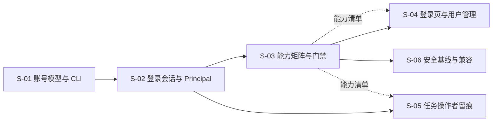

# Web 账号登录与只读权限 · 总体设计（REQ-20261103-001）

> 关联需求：[requirement.md](../requirement.md)
> 设计日期：2026-11-03
> 状态：设计中（待评审）

## 1. 需求背景 & 目标

Web 目前没有账号体系：回环访问免鉴权，非回环只认 Bearer Token（`src/lib/mcp-http-api.ts:529`）。本次给 Web 增加三类账号：管理员、读写账号（editor）、只读账号（viewer）；本机回环自动管理员；账号权限与 MCP Token 独立；后台任务记录操作者。

**目标**：登录/登出/会话、用户管理、能力白名单权限、只读与数据源/删除边界、任务操作者留痕、本机免登录安全边界。

**不在范围内**：scope 级账号授权、SSO/OIDC、多租户、审计日志（v1）、MCP Token 模型改造。

**默认假设**：单机单 daemon、低并发（账号 < 10）、局域网 HTTP；不覆盖多机/HA、TLS 终止与 SSO。会话默认存内存，daemon 重启需重新登录。

## 2. 关键环节一览图



## 3. 总体方案设计

### 3.1 Principal 解析与身份优先级

```
HTTP 请求
├─ 本机回环 + Host 回环 → local-admin（全部能力）
├─ Authorization: Bearer → token（scopes + readOnly）
├─ Cookie 会话 → user（role → capabilities）
└─ 都没有 → 401 → 登录页
```

- Bearer 优先于 Cookie：同一请求同时携带时，按 Token 身份处理。
- 会话每次请求重读用户记录；改密/删除/禁用/角色变更即时生效。
- 本机管理员判定 = 源地址回环 + Host 回环；提供关闭开关。

### 3.2 能力矩阵（S-03 定稿）

| 能力 | admin | editor | viewer |
|---|---|---|---|
| `knowledge.read` | ✅ | ✅ | ✅ |
| `knowledge.write`（含知识删除） | ✅ | ✅ | ❌ |
| `chat.use` | ✅ | ✅ | ✅ |
| `chat.writeTools` | ✅ | ✅ | ❌ |
| `datasource.read` | ✅ | ✅ | ❌（默认） |
| `datasource.write` | ✅ | ❌ | ❌ |
| `datasource.delete` | ✅ | ❌ | ❌ |
| `tasks.read` | ✅ | ✅ | ✅ |
| `tasks.cancel` | ✅ | ❌ | ❌ |
| `tasks.delete` | ✅ | ❌ | ❌ |
| `users.manage` | ✅ | ❌ | ❌ |
| `ops.write`（restore/prune/optimize/scope delete） | ✅ | ❌ | ❌ |

### 3.3 默认拒绝的路由 / 工具注册表

- `/api/*`：`method + path → permission` 注册表；未登记路由默认 403。
- `/mcp`：工具名 → permission；viewer 只保留读工具，editor 保留知识写工具。
- AI 对话工具循环：同一张工具能力表过滤 `toolEntries`。
- 前端：`/api/auth/me` 返回 `permissions`，统一用 `can('...')` 控制显隐/禁用。

### 3.4 任务操作者快照

`TaskRecord.operator`：`{ type, label, userId?, tokenId? }`，创建时由服务端写入，客户端不可指定；重试记录当前操作者。列表新增「操作者」列，详情/`ki log` 同步；旧任务显示 `—`。

## 4. 全局风险 & 跨子需求依赖

| 风险 | 影响 | 处理 |
|---|---|---|
| 反向代理/SSH 隧道使源地址回环 | 远程被误判为本机管理员 | Host 双判定 + 关闭开关 |
| Cookie 引入 CSRF | 写操作被跨站触发 | Origin 白名单 + SameSite=Strict + Content-Type 校验 |
| 路由/工具漏登记 | 新接口被默认拒绝（安全）或误伤读接口 | 覆盖率测试 + 全量回归 |
| 能力标签标错 | 写接口被当读接口放行 | 高风险接口显式负向测试 + 评审 |
| 旧任务无 operator | 任务页显示 `—` | 不做回填，字段可选 |
| 现有 Bearer 客户端 | 鉴权分支改变 | Bearer 优先 + 回归测试 |
| daemon 重启 | 会话失效 | 前端 401 跳登录页；持久化见待定 |

**跨子需求依赖**：S-01 → S-02 → S-03；S-02 → S-05；S-03 → S-04 / S-06。S-05 可与 S-03 并行，但都依赖 S-02 的 principal 类型。
