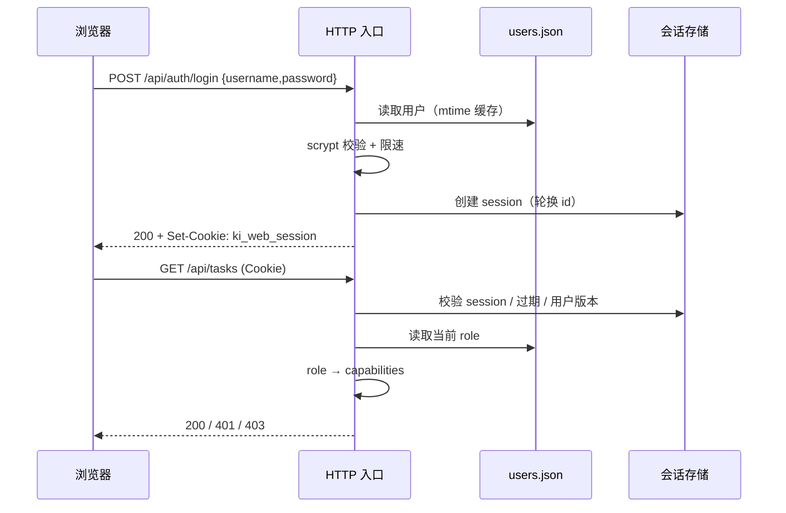

# S-02 登录会话与 Principal

> 父设计：[DESIGN.md](./DESIGN.md)
> 依赖：S-01（账号模型与存储）
> 关联需求：[requirement.md](../requirement.md)

## 1. 术语

| 术语 | 含义 |
|---|---|
| Principal | 一次请求的身份与能力集合；由 `resolvePrincipal()` 统一产出 |
| local-admin | 源地址与 Host 都为回环的本机管理员，免登录 |
| session | 登录后服务端持有的会话记录；Cookie 只存 session id |
| token principal | 既有 MCP Bearer Token 身份（scopes + readOnly） |
| 会话失效 | 用户删除/禁用/改密/角色变更后，旧会话不可继续使用 |

## 2. 现状（AS-IS）

- `/api/*` 鉴权在 `src/lib/mcp-http-api.ts:529-543`：`authEnabled && !isLoopbackAddr(...)` 时校验 Bearer；回环来源免鉴权。
- `/mcp` 鉴权在 `src/lib/mcp-http.ts:740-770`：同样的回环免鉴权 + Bearer。
- `authEnabled = !isLoopbackHost(host)`（`src/lib/mcp-http.ts:1131`）；默认 host `127.0.0.1`（`:61`）。
- 没有 Cookie、会话存储、登录接口；Web 前端 `web/src/api/httpApi.ts:250-255` 不带任何凭据。
- 回环判定在 `src/lib/net-addr.ts:7-35`；反向代理/SSH 隧道会让源地址变成回环（`docs/mcp-http.md:243`）。

## 3. 方案（TO-BE）

### 3.1 Principal 模型

```ts
export type Principal =
  | { kind: 'local-admin'; label: '本机'; capabilities: ReadonlySet<Capability> }
  | { kind: 'session'; sessionId: string; userId: string; username: string;
      role: Role; capabilities: ReadonlySet<Capability> }
  | { kind: 'token'; tokenId?: string; scopes: string[]; readOnly: boolean;
      capabilities: ReadonlySet<Capability> }
  | null;
```

身份优先级（固定顺序，先命中先返回）：

```
1. 源地址回环 + Host 回环 + 无 X-Forwarded-For / X-Real-IP + web.localAdmin=true
   → local-admin（全部能力）
2. Authorization: Bearer <token> 有效
   → token principal（scopes + readOnly；MCP 工具面沿用 readOnly）
3. Cookie ki_web_session 有效（session 存在、未过期、用户仍存在且未禁用）
   → session principal（role → capabilities，每次请求重算）
4. 都没有 → null（/api 返回 401；/api/auth/me 返回 authenticated:false）
```

- **会话校验每次重读 `users.json` 中的用户记录**（不使用 mtime+size 缓存）；禁用/改角色/改密在下一请求立即生效。
- **Bearer 优先于 Cookie**：同一请求同时携带时按 Token 身份处理。
- Token 的能力集合见 S-03 `TOKEN_CAPABILITIES`；**不包含 `users.manage` / `tasks.delete`**，避免既有 Token 因能力白名单获得新的账号管理权限。
- **本机管理员判定收紧**：仅源地址回环不够，Host 头也必须是 `127.0.0.1` / `localhost` / `[::1]`；出现 `X-Forwarded-For` / `X-Real-IP` 一律不判本机。这样 nginx / frp / SSH 隧道不会把远程用户误判为管理员。
- `web.localAdmin=false` 时禁用本机免登录，本机也必须登录。

### 3.2 会话数据模型

```ts
interface SessionRecord {
  id: string;              // 32 字节随机，base64url
  userId: string;
  createdAt: number;
  lastSeenAt: number;
  expiresAt: number;       // 默认 7 天滑动
  passwordUpdatedAt: string; // 与用户记录比对，改密即失效
}
```

- 存储：进程内 `Map<string, SessionRecord>`；daemon 重启即失效（v1 决策，见 D1）。
- 清理：每次创建/校验顺带清理过期项；单用户最多 10 个活跃会话，超出淘汰最旧。
- 滑动续期：距上次访问 > 5 分钟才更新 `lastSeenAt`，避免每请求写内存。

### 3.3 Cookie

| 属性 | 值 |
|---|---|
| 名称 | `ki_web_session` |
| 值 | session id（不包含用户信息、不签名明文） |
| `HttpOnly` | 是 |
| `SameSite` | `Strict` |
| `Path` | `/` |
| `Max-Age` | 7 天（滑动） |
| `Secure` | 仅当请求经 HTTPS 终止（默认不加，局域网 HTTP 可用） |

登录成功后**轮换 session id**（删除旧会话、创建新会话），防会话固定。

### 3.4 API 契约

#### `POST /api/auth/login`

```ts
// request
{ "username": "alice", "password": "********" }
// 200
{
  "ok": true,
  "user": { "id": "a7Kp2mQx", "username": "alice", "role": "editor" },
  "permissions": ["knowledge.read", "knowledge.write", "chat.use", "chat.writeTools", "datasource.read", "tasks.read"]
}
// 401（统一文案，不区分用户不存在/密码错误）
{ "ok": false, "code": "AUTH_INVALID", "error": "用户名或密码不正确" }
// 429
{ "ok": false, "code": "AUTH_RATE_LIMITED", "error": "尝试过于频繁，请稍后再试" }
// 503
{ "ok": false, "code": "USER_STORE_CORRUPT", "error": "账号数据不可读，请在本机运行 ki user list 检查" }
```

#### `GET /api/auth/me`（公开，不返回 401）

```json
{
  "ok": true,
  "authenticated": true,
  "source": "local",
  "localAdminEnabled": true,
  "user": { "id": null, "username": "本机管理员", "role": "admin" },
  "permissions": ["knowledge.read", "knowledge.write", "chat.use", "chat.writeTools",
                  "datasource.read", "datasource.write", "datasource.delete",
                  "tasks.read", "tasks.cancel", "tasks.delete", "users.manage", "ops.write"]
}
```

远程未登录：`{ "ok": true, "authenticated": false, "source": "anonymous", "localAdminEnabled": true, "permissions": [] }`。
登录页据此决定是否渲染，AppShell 据此决定是否跳转。

#### `POST /api/auth/logout`

```json
{ "ok": true }
```

删除当前 session、清 Cookie；幂等。

#### `POST /api/auth/password`（仅 session principal，任意角色含 viewer）

```ts
// request
{ "oldPassword": "********", "newPassword": "********" }
// 200
{ "ok": true }
// 400（本机管理员没有密码）
{ "ok": false, "code": "AUTH_LOCAL_ADMIN", "error": "本机管理员无需修改密码" }
```

校验旧密码；更新哈希与 `passwordUpdatedAt`；**使该用户其他会话失效**，当前会话保留并轮换 id。`local-admin` 没有用户记录，调用返回 400 `AUTH_LOCAL_ADMIN`；前端仅对 `source='session'` 显示「修改密码」。

### 3.5 关键时序



### 3.6 登录限速与耗时

- 内存 `Map<key, { count, resetAt }>`，key = `clientAddr + '\0' + usernameLower`。
- 5 次失败 / 5 分钟；第 6 次返回 429 + `Retry-After: 300`；成功登录清零。
- **统一耗时**：用户不存在时也执行一次 dummy scrypt（固定 N/r/p + 固定 dummy hash），再进入统一失败分支；禁止在 scrypt 前提前返回，避免通过响应时间枚举账号。
- 用户不存在与密码错误走同一条失败路径（同样计数、同样文案），避免枚举。
- **内存上限**：`MAX_RATE_KEYS = 10_000`；单 IP 最多 100 个 key；插入前先清理过期项，满则淘汰最旧。随机用户名不能无限撑大 Map。
- daemon 重启后计数清零（可接受，v1）。
- **已知边界**：按 IP+用户名限速存在定向锁定风险（攻击者故意失败 5 次可让目标 5 分钟无法登录）；v1 接受，后续可加指数退避/验证码。

### 3.7 启动守卫（与 S-06 共用）

`src/mcp-server.ts:174-186` 当前在非回环绑定且无 Token 时拒绝启动。改为：

```
非回环绑定，按凭据状态分支：
  users.json 损坏
    → 拒绝启动 USER_STORE_CORRUPT（提示 ki user list）
  无 Token + 无账号
    → 拒绝启动 MCP_HTTP_TOKEN_REQUIRED（提示 ki mcp token generate 或 ki user create）
  无 Token + 有账号但全部禁用
    → 拒绝启动 MCP_HTTP_ALL_ACCOUNTS_DISABLED（提示 ki user enable <name> 或 ki user create）
  仅 Token
    → 允许启动；stderr 警告「无可用 Web 账号，Web 登录不可用」
  仅启用账号
    → 允许启动；stderr 警告「MCP 远程客户端仍需 Token」
  Token + 启用账号
    → 允许启动，正常提示
```

### 3.8 关键决策

| 决策 | 采用 | 被否决方案 | 否决理由 |
|---|---|---|---|
| 会话存储 | 进程内，重启失效 | 落盘 `web-sessions.json` | 增加会话文件泄露面与清理逻辑；v1 可接受重新登录 |
| 凭据载体 | HttpOnly Cookie | localStorage / JS 可读 Token | XSS 可直接窃取 |
| 本机判定 | 源地址 + Host 双回环 | 仅源地址 | 反向代理/隧道会把远程当本机 |
| Token 优先级 | Bearer 高于 Cookie | Cookie 优先 | 会让浏览器会话意外覆盖 MCP 客户端身份 |
| 登录限速 | 内存计数 | 持久化计数 | v1 单机单进程，重启清零可接受 |

### 3.9 异常处理

| 场景 | 行为 | 是否对外暴露 |
|---|---|---|
| 用户不存在 / 密码错 | 401 `AUTH_INVALID`，统一文案；计入限速 | 是 |
| 账号禁用 | 401 `AUTH_INVALID`（不区分禁用/密码错） | 是 |
| 会话过期 | 401 `AUTH_REQUIRED`；前端跳登录页 | 是 |
| 用户被删除/改密 | 下次请求 401；前端跳登录页 | 是 |
| users.json 损坏 | 登录 503 `USER_STORE_CORRUPT`；其他接口 401 | 是 |
| 反向代理伪造 Host | 不判 local-admin；要求登录 | 是 |
| daemon 重启 | 会话丢失；前端 401 → 登录页 | 是 |

### 3.10 影响范围

| 文件 | 变更 |
|---|---|
| `src/lib/web-session-store.ts` | 新增：会话创建/校验/失效/清理 |
| `src/lib/web-auth.ts` | 新增：`resolvePrincipal()`、Cookie 解析、Host/来源判定 |
| `src/lib/mcp-http-api.ts` | 入口接入 principal；`/api/auth/*` 路由 |
| `src/lib/mcp-http.ts` | `/mcp` 入口接入 principal；静态页放行 |
| `src/mcp-server.ts` | 非回环启动守卫 |
| `web/src/api/authApi.ts` | 新增登录/登出/me/改密 |
| `web/src/lib/authContext.tsx` | 新增 AuthProvider / `can()` |
| `web/src/pages/LoginPage.tsx` | 新增登录页 |

### 3.11 验收标准

- 远程未登录访问 `/api/doc/list` → 401 `AUTH_REQUIRED`；`/api/auth/me` → 200 `authenticated:false`。
- 登录成功设置 `HttpOnly; SameSite=Strict` Cookie；刷新保持登录；登出后旧 Cookie 失效。
- 127.0.0.1/localhost 直连 → `source:'local'`；远程 IP → 401；`Host: evil.com` + 回环源地址 → 不判 local-admin。
- 改密后旧会话 401；删除/禁用用户后旧会话 401；角色变更后下一次请求按新能力执行。
- 连续 5 次失败后 429；不存在用户与密码错响应文案一致，且都执行 scrypt（dummy hash）使耗时可比。
- 随机用户名连续尝试不会使限速 Map 超过上限；过期 key 会被清理。
- 非回环绑定：只有账号、没有 Token 时仍可启动；两者都没有时拒绝启动并给出两条出路。
